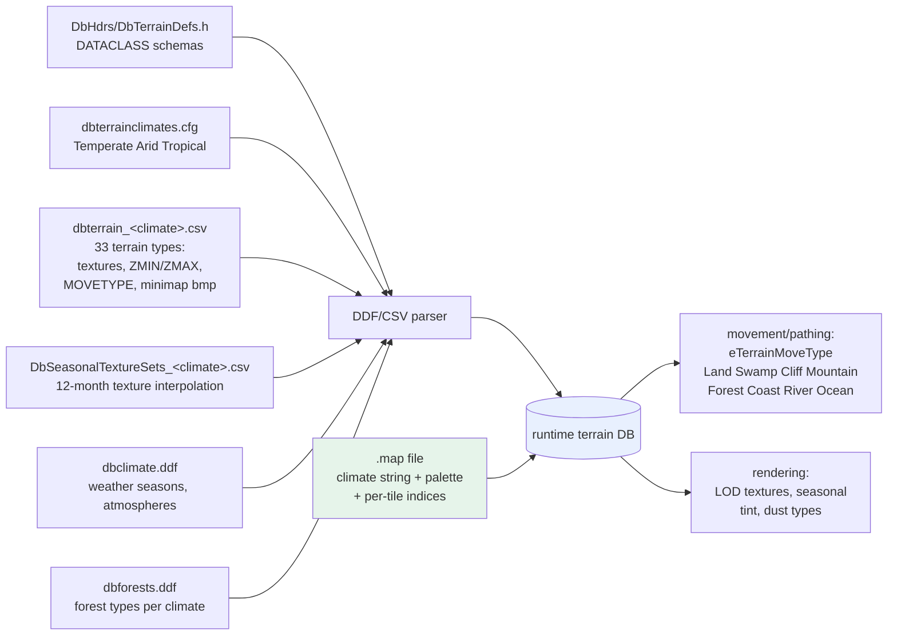

# Empire Earth II — Map Definition & Parsing

How EE2 stores and loads maps: the binary `.map` / `.scn` container, the
text-based terrain/territory/map-generator databases they reference, and how it
all connects. Companion to `EE2_UNIT_VISUAL_PIPELINE.md`. Based on analysis of
`maps/`, `mapx/`, `scenario/`, `zips/db.zip` and the shipped schema headers
(`DbHdrs/DbTerrainDefs.h`, `DbMapGenDefs.h`, `DbScenarioDefs.h`).

---

## 1. File Type Inventory

| Extension | Format | Role | Location | Count |
|---|---|---|---|---|
| `.map` | Binary (`LChunkFile`) | Skirmish/multiplayer map: terrain, territories, world objects, start positions | `maps/` (base, EE2.exe), `mapx/` (expansion, EE2X.exe) | 136 / 66 |
| `.scn` | Binary (`LChunkFile`) | Scenario = map **plus** players, placed units, roads, victory conditions, cinematics, script-lib reference | `scenario/`, `scenario_ee2x/` | ~30 |
| `.ies` | Plain text | Scenario **script source** (Mad Doc rule language: `RULES FOR WORLD`, `OBJECTIVE` blocks); compiled to `scriptlibs/*.dll` | `Scripting Docs/` | 2 examples |
| `.dll` | PE DLL | Compiled scenario scripts, referenced by `.scn` files (`ScriptLibs/American1.dll`) | `scriptlibs/`, `scriptlibs_ee2x/` | ~30 |
| `.ddf` | Text (same DDF lang as units) | Terrain DBs: climate/weather, forests, random-map generator | `db/Terrain/` in `db.zip` | ~15 |
| `.csv` | Comma-separated | Terrain-type tables per climate; seasonal texture sets; cliffs; atmosphere | `db/Terrain/` + loose in `zips/` | ~15 |
| `.cfg` | Text list | `dbterrainclimates.cfg`: the climate registry | `db/Terrain/` | 1 |

---

## 2. The `LChunkFile` Container

`.map` and `.scn` share one binary container:

```text
offset 0x00  "LChunkFile"            10-byte magic
offset 0x0A  4-byte checksum/ID      (differs between maps/ and mapx/ copies)
offset 0x0E  chunk stream:
             [ tag:4cc ][ int32 A ][ int32 version=1 ][ int32 C ][ int32 D ][ payload ... ]
             ... repeated to EOF
```

Chunk tags observed (via byte scan of `maps/!(2)Highland.map` and
`scenario/American1.scn`):

| Tag | Present in | Content (deduced from bytes) |
|---|---|---|
| `Vers` | both | version record (numbers only) |
| `Wrld` | both | world/root chunk; its `A` field = total file size |
| `SPSL` | `.map` | start-position list; count = number of players |
| `SPos` | `.map` | one chunk per player start: map-size int + X/Y float coords |
| `MPVC` | `.map` | map preview / minimap color data |
| `Terr` | both | terrain (see §3) |
| `MpSt` | both | map stats; includes display name string (`Highland`) |
| `Plyr` | both | player setup (names, civs, diplomacy) |
| `TeTr` | both | territory definition (region polygons → the `territory.ddf` rules) |
| `RPwr`,`PlLT`,`PSts`,`AnmM`,`TNmT` | `.map` | resource power / placement / animal / territory-name tables |
| `Unit` | both | placed world objects; payload contains UnitType names (`Boar`, `Gold`...) referencing the unit DB |
| `Reso`(urce) | `.map` | resource nodes (Gold, Iron, Stone, Saltpeter, Uranium, ForagePad) |
| `Road`,`Elbo` | `.scn` | roads and elbow segments |
| `GmSt`,`Clok`,`EvSt` | `.scn` | game settings, clock, event state |
| `VCnd` | `.scn` | victory conditions |
| `Cine` | `.scn` | cinematics |
| `SctI`,`TntM`,`CmSt` | `.scn` | scenario info / trigger map / camera state |
| (script ref) | `.scn` | string `ScriptLibs/American1.dll` → compiled script library |
| `LStL`,`LStP`,`LStT`,`EtyM`,`UtNm`,`GpNm` | `.scn` | leader stats, entity/unit/group name tables |

`maps/` vs `mapx/`: same-named maps differ by a few header bytes (version/
checksum) and small size deltas; `mapx/` is the expansion's re-saved copy;
EE2X.exe reads it, EE2.exe reads `maps/`. The in-game editor's "Save As Map"
writes `.map`; scenario saves write `.scn` (per `Map Making Walkthrough.txt`,
scenarios are not selectable in the multiplayer lobby).

---

## 3. Inside the `Terr` Chunk: Verified Layout

Decoded from `maps/!(2)Highland.map` (`Terr` @ offset 0xB8):

```text
Terr | A=155592 | ver=1 | C=155592 | D=-1 | W=121 | H=121
payload:
  [1] float32 height grid, 121 x 121      (vertex elevations; observed
                                           range -1.0 (water floor) .. 9.484)
  [2] uint16  terrain-type grid, 121 x 121 (index into palette [5];
                                           observed values 0x00..0x14 < 33)
  [3] per-tile aux data (variant/cliff info; RGBA-looking tint bytes
      80 FF 80 80 appear just before [4])
  [4] climate string: int16 length + chars -> "Temperate"
      (must be one of dbterrainclimates.cfg: Temperate / Arid / Tropical)
  [5] terrain-type palette: 33 strings, an EXACT copy of the row names in
      dbterrain_temperate.csv: Grass, Beach, GrassRocky, MountainTop,
      OceanFloor, ..., MidEpochsPath, EndEpochsPath, UnderBuilding_1..3
```

A 120×120-tile map ⇒ 121×121 vertices. `min = -1.0` matches the CSV's
`OceanFloor` row (`ZMIN -9999..-2`); autopaint elevations in the CSV
(`ZMIN/ZMAX` per type) drive the editor's texture auto-painting.

---

## 4. Terrain Definition Chain (text → binary)



Key schema facts from `DbTerrainDefs.h`:

- `eTerrainMoveType`: Land, Swamp, Cliff, Mountain, Forest, Coast, River,
  Ocean: each map tile's palette entry carries one of these; pathing uses the
  mirror enum `eMovementSpeedType` (+Bridge, +Road).
- `DbTerrainDbInfo` = one CSV row: high/medium/low-detail textures, 12 monthly
  dust types, minimap bitmap, autopaint elevations, move type, grass layer.
- `DbTerrainTextureDef`: seasonal texture index, alpha mask, 12 monthly tint
  fractions; the engine interpolates the 12-month texture list evenly across
  the year (hence `Preview Seasons` in the editor).

Territory rules live in `db/Simulation/Misc/territory.ddf`
(`DbTerritoryInfo TheTerritoryInfo`: capture requirements = CityCenter /
Fortress counts, per-house morale & resource bonuses) while each map's actual
territory shapes are baked into its `TeTr` chunk.

---

## 5. Loading Pipeline

```mermaid
flowchart TD
    A[Lobby selects map / scenario loads] --> B[Read .map or .scn]
    B --> C{Validate LChunkFile magic<br/>+ checksum}
    C --> D[Walk chunk stream:<br/>tag, sizes, version]
    D --> E[Vers / Wrld root]
    E --> F[Terr chunk:<br/>height grid + tile types<br/>+ climate + palette]
    F --> G[Resolve climate via dbterrainclimates.cfg]
    G --> H[Map palette names -><br/>dbterrain_&lt;climate&gt;.csv rows<br/>-> textures + move types]
    H --> I[Build render terrain:<br/>seasonal texture sets,<br/>LODs, cliffs, water]
    F --> J[Build sim terrain:<br/>passability grid from<br/>eTerrainMoveType]
    E --> K[TeTr -> territories<br/>(territory.ddf rules)]
    E --> L[Unit/Reso chunks -> instantiate<br/>world objects by UnitType name<br/>(links to unit DB from other doc)]
    E --> M[SPSL/SPos -> player starts]
    B -.scn only.-> N[Plyr players, placed units,<br/>roads, VCnd victory,<br/>load ScriptLibs/*.dll]
    style F fill:#e6f4ea
    style H fill:#e8f0fe
```

Cross-link to the unit pipeline: the `Unit`/`Reso` chunks store **UnitType
names** (e.g. `Gold`, `Boar`, `Wolf`, `Iron`), which are looked up in the same
`.ddf`-built unit database, then `UnitModel` → `.nifcache` + `.kf` as
documented in `EE2_UNIT_VISUAL_PIPELINE.md`.

---

## 6. Random Map Generation

`File → New → Random map` in the editor (and random-map skirmish games) is
driven by text data, not the binary format:

- `db/Terrain/dbmapgen.ddf`: `MapGeography` records (`SmallIslands`,
  `LargeIslands`, `Continents`, `Plains`, ...) with Perlin land/water
  parameters, forced land/water stamps, start-location radii
- `DbMapGenDefs.h`: the schema: `eMapType` (Islands / Continents /
  OneLandMass / Waterless), `eMapBorder`, `DbBitmaskStamp`
- `eWaterLevel` (None/Low/Medium/High) in `DbTerrainDefs.h`: the
  water-level slider

The generator produces the same terrain structures that `.map` files persist,
so a generated map can be saved and reloaded losslessly.

---

## 7. Worked Example: `!(2)Highland.map`

| Step | Evidence in file |
|---|---|
| Container | `LChunkFile` magic @0x00, checksum `74 F9 EE 83` |
| Version | `Vers` chunk @0x0E |
| Root | `Wrld` @0x26, `A` = 347929 = exact file size |
| Starts | `SPSL` @0x3E (player count 2), `SPos` @0x57, @0x78 with X/Y floats |
| Preview | `MPVC` @0x98 |
| Terrain | `Terr` @0xB8: 121×121 grid, heights −1.0…9.484, climate `Temperate`, 33-name palette == `dbterrain_temperate.csv` |
| Stats | `MpSt` @0x25FC8 containing display name `Highland` |
| Territories | `TeTr` @0x26122 |
| Objects | hundreds of `UAbD`/`Unit` records from 0x271F2 on: boars, wolves, resource nodes (`Gold`, `Iron`, `Stone`, `Pete`, `Uran`), trees by species (`daphne`, `birch`, `aspen`, `cedar`...) |
| Animals map | `AnmM` @0x4695B, trailing `TNmT` table @0x54F01 |

Its `mapx/` twin is 137 bytes larger with a different checksum; the
expansion's re-encoded copy of the same map.

---

## 8. Scenario Additions (`.scn`)

A scenario wraps the full map data plus, in `American1.scn` (748,979 B):

- `GmSt` game settings, `Clok` clock, `EvSt` event state
- `Plyr` with fixed civs/diplomacy; per-player `Unit` chunks (HeavyInfantry,
  Palisade, Farms, CityCenter, Leaders like `LeaderRoosevelt`)
- `Road`/`Elbo` road geometry
- `VCnd` victory conditions, `Goal`/objective areas (`Esc apePointArea`,
  `SpanishAreUpsetArea`, ...)
- `Cine` cinematics, camera state `CmSt`
- **Script binding**: string `ScriptLibs/American1.dll`, compiled from
  `.ies` source (see `Scripting Docs/EE2 SCRIPTING.doc`,
  `ScriptExampleTutorial1.ies`: `RULES FOR WORLD` / `SCENARIO` / `OBJECTIVE`
  blocks with name/desc/text refs into `db/Text`)

Campaign `.ddf` files (`db/Campaigns/.../*.ddf`, schema `DbScenarioDefs.h` →
`DbScenarioInfo`) point at these `.scn` files via `mapfilename`, add
briefing/victory/loss text, objectives (`DbScenarioObjectiveDef`: primary /
secondary / lose) and target locations/units/areas/territories.

---

## 9. Quick Reference

- Map container magic: `LChunkFile` + 4-byte checksum; chunks are
  `[4cc][int][ver=1][int][int][payload]`
- Tile grid is `(N+1)×(N+1)` vertices for an `N×N`-tile map (120→121)
- Climates: `Temperate`, `Arid`, `Tropical` (registry: `dbterrainclimates.cfg`)
- Terrain palette in-file always mirrors `dbterrain_<climate>.csv` row names
- Move types drive pathing; textures/seasons drive rendering; both from the
  same CSV row
- Editor flow (official): generate (flat/random) → paint terrain/water/cliffs
  → forests/objects/starts/territories → set season+time of day → **Save As
  Map** (`.map`) or scenario (`.scn`)
