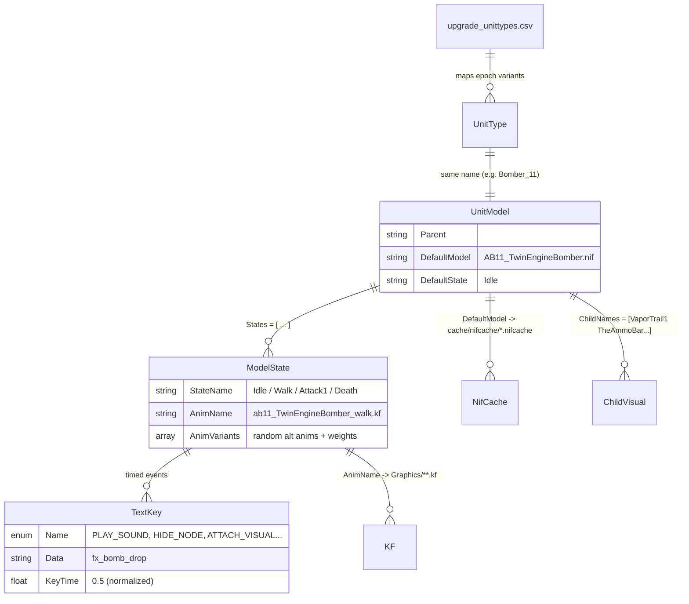
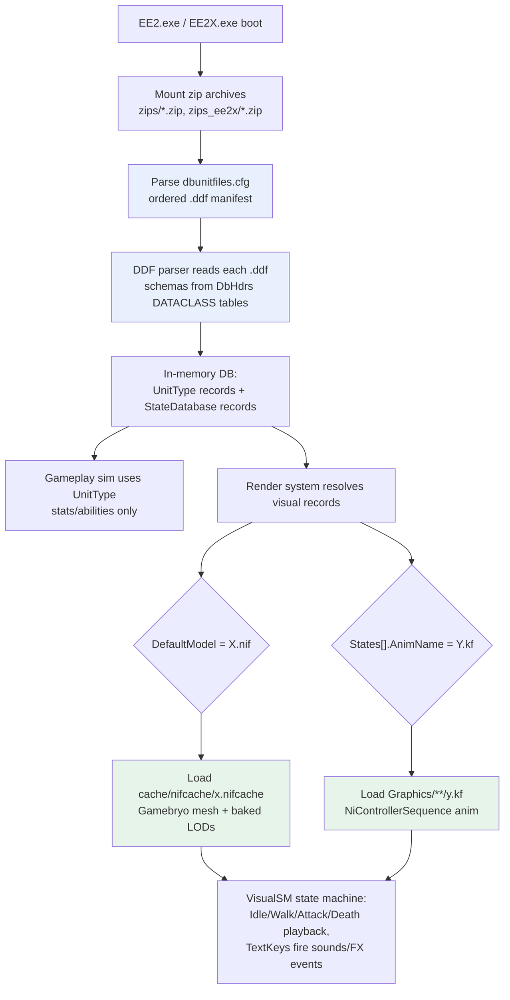

# Empire Earth II — Unit Models, Animations & Definition Files

How EE2's text-based data definitions (`.ddf`) connect unit gameplay records to 3D
models (`.nif` / `.nifcache`) and keyframe animations (`.kf`), and how the engine
loads them. Based on analysis of the base game (`zips/`, `zips_ee2x/`) and the
shipped schema headers (`zips/hdrs.zip` → `DbHdrs/*.h`).

---

## 1. File Type Inventory

| Extension | Format | Role | Location (inside zips) | Count |
|---|---|---|---|---|
| `.ddf` | Plain text, C-like | Data Definition File: unit types, models, FX, sounds, upgrades | `db/Units/`, `db/Visuals/`, ... in `db.zip` / `EE2X_db.zip` | ~375 / ~896 files |
| `.cfg` | Plain text list | Load manifest: which `.ddf` files the engine reads, in order | `db/dbunitfiles.cfg` | 1 |
| `.csv` | Comma-separated | Bulk tables: tech-tree upgrades → visuals, model conversion settings | `db/TechTree/`, `db/Visuals/` | ~40 |
| `.h` | C headers | **Schemas** for every `.ddf` record type (`DATACLASS ... ENDCLASS`) | `DbHdrs/` in `hdrs.zip` | 74 |
| `.nifcache` | Binary (Gamebryo) | Compiled/optimized unit & building meshes with LODs | `cache/nifcache/` in `graphics.zip` | 1638 (+170 EE2X) |
| `.kf` | Binary (Gamebryo) | Keyframe animation sequences | `Graphics/{Animals,Humans,Vehicles,Building}/` in `graphics.zip` | 1371 (+453 EE2X) |

Source `.nif` meshes are **not shipped** — only the compiled `.nifcache` versions.
Every `.nif` reference in a `.ddf` resolves at runtime to
`cache/nifcache/<lowercased name>.nifcache` (case-insensitive match, extension swapped).

---

## 2. What Is a `.ddf`?

A proprietary Mad Doc **Data Definition File**: UTF-8 text with C-like braces,
records, key/value pairs, and arrays. Each line of a record maps to a field
declared in a `DbHdrs/*.h` `DATACLASS` — the headers are the parser's schema.

```text
RecordType RecordName            // e.g. UnitType, UnitModel, ShadowData, UpgradeAbilities
{
    Field        = value         // scalar
    Block { ... }                // nested dataclass (e.g. properties, abilities)
    Items = [ a b c ]            // array
}
```

Example — `db/Units/LightTank.ddf`:

```cpp
UnitType LightTank
{
    parent = LightMounted1              // single-inheritance hierarchy
    properties {
        moveType = Mechanized
        hitpoints = 666
        popCount = 2
    }
    abilities [
        VehicleMove { speed = 1.725; angSpeed = 180; followTerrainSlope = 1 }
        Attack      { range = 7; reloadTime = 2; damage = 31 }
    ]
}
```

Key schema headers (extracted in `/tmp/opencode/ee2/hdrs/DbHdrs/`):

- `DbUnitDefs.h` — `DbUnitTypeProperties` (hitpoints, mass, footprint, popCount...), ability blocks
- `DBVisualDefs.h` — `StateMachineModel`, `StateDatabase`, `ModelState`, `TextKey`, `CompositeModel`
- `DbVisualStateDefs.h` — the state-name database (`Idle`, `Walk`, `Attack1`, `Death`, ...)

---

## 3. The Core Relationship Model

A unit is split into two parallel records that share a name space:

- **`UnitType <Name>`** — gameplay: stats, cost, abilities, sounds.
- **`UnitModel <Name>`** — visuals: a `StateDatabase` mapping animation states
  to a `.nif` mesh plus `.kf` animations.



### Text-key event types (`DBVisualDefs.h → ENUM eKeyType`)

`HIDE_NODE`, `SHOW_NODE`, `PLAY_SOUND`, `START_SOUND`, `STOP_SOUND`,
`START_CONTROLLER`, `STOP_CONTROLLER`, `ATTACH_VISUAL`, `DETACH_VISUAL_BY_NAME`,
`HIDE_VISUAL`, `SHOW_VISUAL` — fired when animation playback crosses `KeyTime`.

---

## 4. Worked Example: the Bomber

**Step 1 — gameplay record.** `db/Units/bomber.ddf` defines `UnitType Bomber`
(parent `Aircraft`, stats, `Attack` ability with `missileName = "Bomb"`).

**Step 2 — epoch → visual binding.** `db/TechTree/upgrade_unittypes.csv` row:

```csv
BomberUpgradeEpoch11,Bomber,"Unit",11,800,tx_utn_bomber11_pname,Bomber_11, ...
                                       (unit) (epoch)            (VISUAL column)
```

**Step 3 — visual record.** Same `bomber.ddf` defines `UnitModel Bomber_11`:

```cpp
UnitModel Bomber_11
{
    Parent        = BaseAircraft                  // inherits scale, UI params
    DefaultModel  = AB11_TwinEngineBomber.nif     // -> ab11_twinenginebomber.nifcache
    ChildNames    = [ VaporTrail1 ... BomberShadow2 TheAmmoBar ]
    States        = [
        { StateName = Idle    AnimName = AB11_TwinEngineBomber_idle.KF
              TextKeys = [{ Name = STOP_SOUND  Data = fx_move_plane_03 KeyTime = 0}] }
        { StateName = Walk    AnimName = AB11_TwinEngineBomber_walk.KF
              TextKeys = [{ Name = START_SOUND Data = fx_move_plane_03 KeyTime = 0}] }
        { StateName = Attack1 AnimName = AB11_TwinEngineBomber_attack.KF
              TextKeys = [{ Name = PLAY_SOUND  Data = fx_bomb_drop    KeyTime = 0.5}] }
        { StateName = TakeOff AnimName = AB11_TwinEngineBomber_takeoff.KF }
        { StateName = Death   AnimName = AB11_TwinEngineBomber_death.KF }
    ]
}
```

**Step 4 — assets on disk.**

```text
zips/graphics.zip
├── cache/nifcache/ab11_twinenginebomber.nifcache   (mesh, from DefaultModel)
└── Graphics/Vehicles/
    ├── ab11_TwinEngineBomber_idle.kf               (from States[].AnimName)
    ├── ab11_TwinEngineBomber_walk.kf
    ├── ab11_TwinEngineBomber_attack.kf
    └── ab11_TwinEngineBomber_death.kf
```

`dbunittypetranslationtable.csv` (`Bomber_11,Bomber`) maps variant names back to
the base unit type for lookup/modding tools.

---

## 5. Runtime Loading Pipeline



Load order: later archives override earlier ones (base `db.zip` → patch
`db_150..160.zip` → expansion `EE2X_db.zip`), which is how the unofficial UP1.6
patch and `zips/Graphics_160/` inject replacement assets.

### Build-time pipeline (why `.nif` → `.nifcache`)

`db/Visuals/db_model_convert.csv` holds the artist-side conversion rules — per
source folder: vertex budget, LOD count, bone LODs, max texture size, scale:

```csv
//NAME,FOLDER,...,MAXVERTS,LODS,BONELODS,TEX_W,TEX_H,SCALE_X,Y,Z
vehicles,"graphics/vehicles/",1,0,1,1,2500,3,2,512,256,1,1,1
humans,"graphics/humans/",1,0,1,1,700,3,2,256,256,1,1,1
```

The converter (Mad Doc internal tool) reads source `.nif`, strips lights,
generates LODs/bone LODs, rescales, and emits the optimized `.nifcache`.

---

## 6. Binary Formats: `.nifcache` and `.kf`

Both are **Gamebryo/NetImmerse "File Format, Version 10.1.0.0"** streams —
little-endian, chunked, with a string table of Ni class names near the top.

### `.nifcache` (mesh)

```text
00000000  "Gamebryo File Format, Version 10.1.0.0\r\n\0\1"
          string table:
            NiNode, NiZBufferProperty, NiVertexColorProperty,
            NiStringExtraData, NiLODNode, NiTriShape, NiTexturingProperty,
            NiSourceTexture, NiMaterialProperty, NiStencilProperty,
            NiTriShapeData, NiRangeLODData
          followed by node tree, geometry, texture bindings
```

- `NiLODNode` + `NiRangeLODData` = baked distance-based LOD switching
- `NiTriShape`/`NiTriShapeData` = triangle meshes; node names (`root`,
  `prop_01`, turrets, rotors) are the animation attachment targets

### `.kf` (animation)

```text
00000000  "Gamebryo File Format, Version 10.1.0.0\r\n\0\1"
          string table:
            NiControllerSequence, NiTextKeyExtraData,
            NiKeyframeController, NiKeyframeData
          sequence name: "idle"
          target node names: "root", "prop_01", ...
```

- `NiControllerSequence` = named clip ("idle", "walk", "attack"...)
- `NiKeyframeController`/`NiKeyframeData` = per-node rotation/translation/scale
  curves, bound **by node name** to the `.nifcache` node tree
- `NiTextKeyExtraData` = embedded named keys; the `.ddf` `TextKeys` array
  supplements these with engine events (`PLAY_SOUND`, `ATTACH_VISUAL`, ...)

Because binding is by node name, any `.kf` whose node names match can drive any
mesh — the shared `AnimVariants` system (with weights) just picks alternates.

---

## 7. Expansion (Art of Supremacy) & Patches

| Layer | Definitions | Assets |
|---|---|---|
| Base game | `zips/db.zip` | `zips/graphics.zip` (1638 meshes, 1371 anims) |
| Expansion | `zips_ee2x/EE2X_db.zip` | `zips_ee2x/EE2X_graphics.zip` (170 meshes, 453 anims) |
| Patch 1.5/1.6 | `zips/db_15x/16x_*.zip` | `zips/Graphics_160(.zip)/`, `Textures_160.zip` |

Same formats and directory layout throughout; later zips shadow earlier files,
so a UP1.6 unit = new `UnitModel` record + new `.nifcache`/`.kf` in the later zip.

---

## 8. Quick Reference — Counted Records (base game)

- `UnitType` records: **438**
- `UnitModel` (StateDatabase) records: **598** (more than unit types — epoch
  variants like `Bomber_11..15`, plus ambients/props)
- Animation states used: `Idle`, `Walk`, `Run`, `Attack1..3`, `Death`,
  `TakeOff`, `Land`, `Work`, `Garrison`, ...

### Extracted analysis copies

```text
/tmp/opencode/ee2/graphics/       base models + animations
/tmp/opencode/ee2/db/             base .ddf / .cfg / .csv definitions
/tmp/opencode/ee2/hdrs/           DbHdrs schema headers
/tmp/opencode/ee2/ee2x_graphics/  expansion assets
/tmp/opencode/ee2/ee2x_db/        expansion definitions
```
