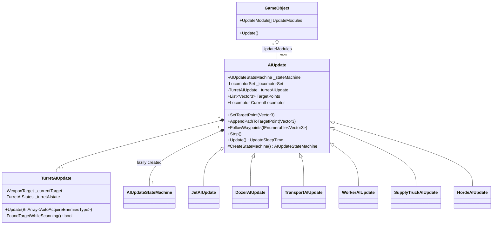
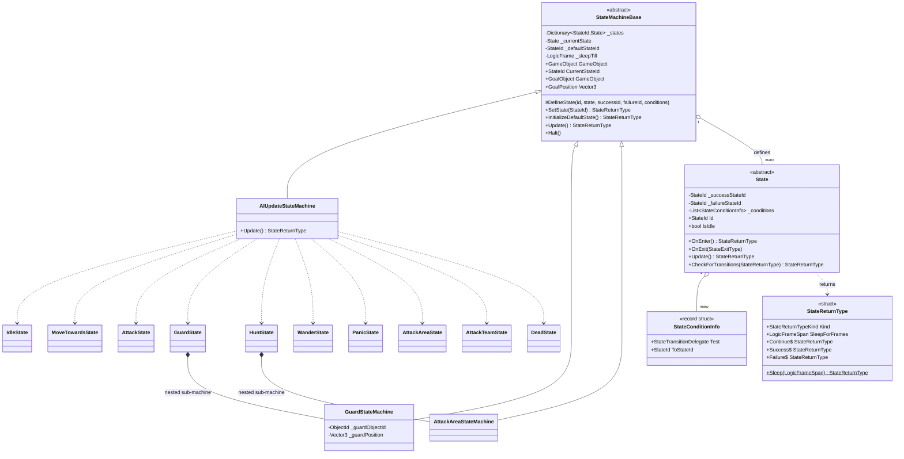
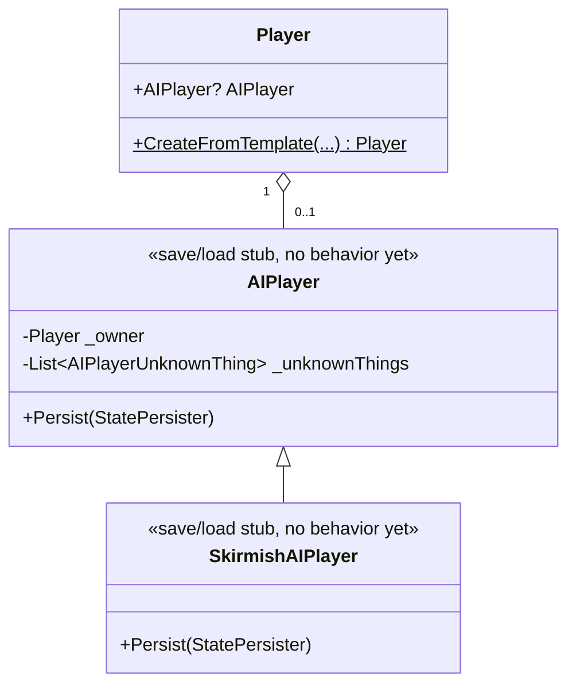
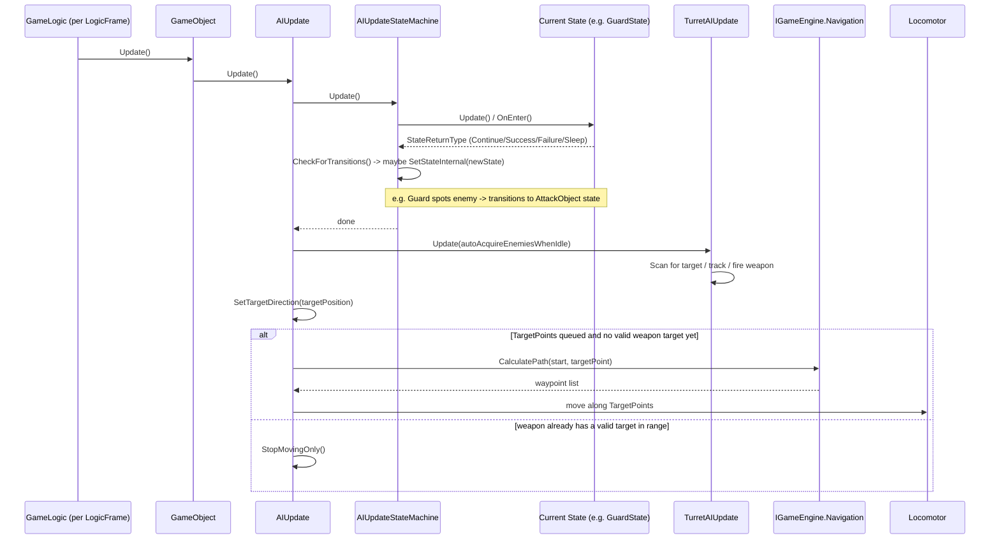
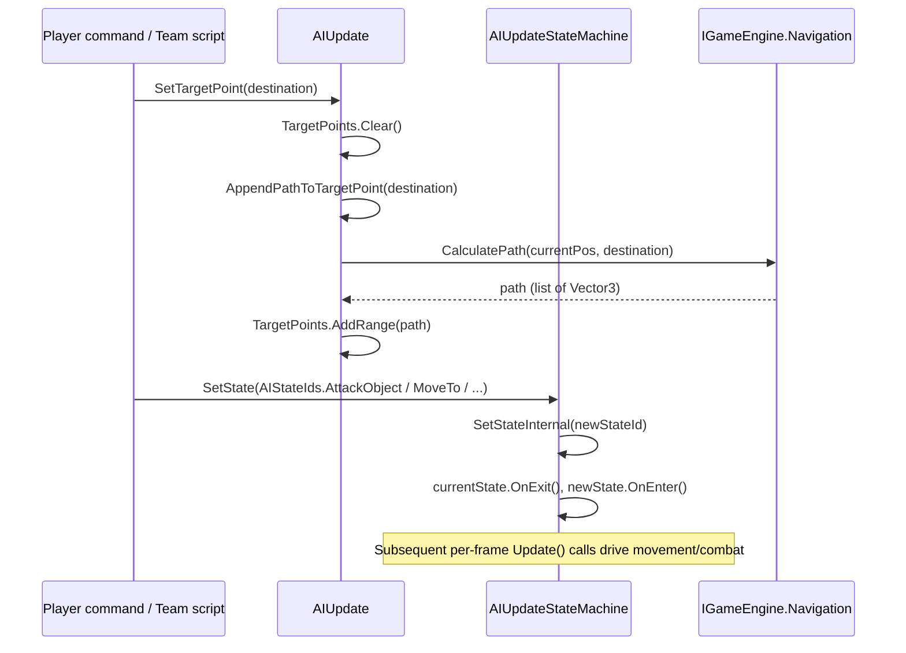
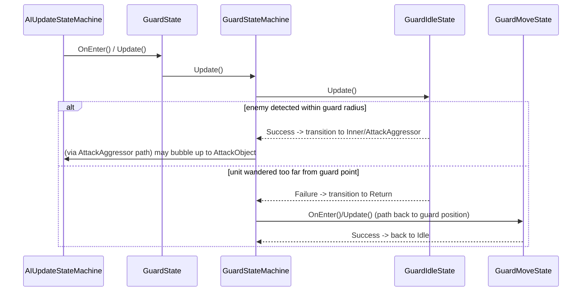

# Enemy AI Architecture

This document explains how "enemy AI" works in OpenSAGE today: which parts of the
original SAGE AI have been ported, which are still stubs, and how the pieces fit
together at runtime. It covers two distinct layers that the original engine calls
"AI":

1. **Per-unit AI** (`AIUpdate` + `AIUpdateStateMachine`): the behavior state
   machine attached to every `GameObject` that can move, fight, guard, wander,
   etc. This is the layer that is substantially ported and functional.
2. **Per-player / skirmish AI** (`AIPlayer` / `SkirmishAIPlayer`): the
   strategic, build-order/attack-wave decision maker for computer-controlled
   players. **This layer is currently a save/load stub only**: the original
   fields are preserved (mostly as `_unknownXxx` placeholders) so replays and
   save files round-trip correctly, but none of the decision-making logic has
   been ported yet. Computer players in OpenSAGE currently rely on map/team
   scripts (`OpenSage.Scripting`) rather than autonomous strategic AI.

Because of this, "enemy AI" in practice today means: individual units/structures
reacting to their surroundings (scanning for enemies, chasing, guarding,
pathfinding) under the direction of either the player, a team script, or their
own default idle behavior.

## 1. Explanation

### 1.1 Per-unit AI (`AIUpdate`)

Every `GameObject` that can act autonomously has an `AIUpdate` module
(`OpenSage.Logic.Object.Update.AIUpdate.AIUpdate`, subclassed for special
movement types like `JetAIUpdate`, `DozerAIUpdate`, `TransportAIUpdate`,
`WorkerAIUpdate`, etc.). `AIUpdate`:

- Owns a lazily-created `AIUpdateStateMachine` (`OpenSage.Logic.AI`) that
  implements the actual behavior (idle, move, attack, guard, hunt, wander,
  panic, dock, follow-waypoints, ...).
- Drives locomotion: it holds a `LocomotorSet`/`Locomotor`, target point queue
  (`TargetPoints`), and asks `IGameEngine.Navigation` to compute paths
  (`CalculatePath`) when a new destination is set.
- Optionally owns a `TurretAIUpdate` for units/structures with turrets, which
  independently scans for and tracks weapon targets (idle scanning, turning,
  attacking, recentering) each logic frame.
- Runs once per logic frame from `GameObject.Update()` via `AIUpdate.Update()`,
  which ticks the state machine, updates the turret, and advances movement
  along `TargetPoints` using the current `Locomotor`.

### 1.2 Generic state machine framework

The AI behavior is expressed with a small, reusable finite-state-machine
framework in `OpenSage.Logic.AI`:

- **`StateMachineBase`**: holds a dictionary of `StateId -> State`, the
  current state, a "goal object/position", and a sleep timer. `Update()` calls
  the current state's `Update()`, and `SetState`/`SetStateInternal` handle
  transitions (`OnExit` on the old state, `OnEnter` on the new one).
- **`State`**: a single behavior. Each state is registered via
  `DefineState(id, state, successStateId, failureStateId, conditions...)`.
  When a state's `Update()`/`OnEnter()` returns `StateReturnType.Success`,
  `Failure`, `Continue`, or `Sleep(n)`, the owning machine looks up the
  matching transition (fixed success/failure target, or one of the
  registered `StateConditionInfo` predicates) and switches state accordingly.
- States can nest **sub state machines**, e.g. `GuardState`, `HuntState`,
  `AttackAreaState`, `AttackTeamState` each wrap their own private
  `StateMachineBase` subclass (`GuardStateMachine`, `AttackAreaStateMachine`,
  ...) to implement multi-step behaviors, similar to hierarchical state
  machines/behavior trees.
- **`AIUpdateStateMachine`** is the top-level machine attached to every
  `AIUpdate`. It registers ~28 top-level states (see `AIStateIds`): `Idle`,
  `MoveTo`, `FollowWaypoints*`, `AttackPosition/Object/Area/Squad`, `Dead`,
  `Dock`, `Guard`, `Hunt`, `Wander`, `Panic`, `RappelInto`, `WanderInPlace`,
  etc. Almost every non-idle state's failure transition leads back to `Idle`.

### 1.3 Per-player / skirmish AI (largely unimplemented)

`Player.AIPlayer` is non-null for any non-human player (`AIPlayer` for a
"generic" computer player, `SkirmishAIPlayer` for a skirmish opponent, see
`Player.cs`). Both classes today only implement `Persist()` for save/load
compatibility; their fields are mostly undocumented placeholders
(`_unknownInt1`, `_unknownFloat`, ...) carried over from reverse engineering
the original binary format. **Neither class currently has an `Update()` method
or any decision-making logic** (build orders, attack waves, resource
management). This is a known gap; see `docs/roadmap/` for where this fits
in the long-term plan.

In place of strategic AI, computer-controlled behavior in OpenSAGE today comes
from:
- **Map/team scripts** (`OpenSage.Scripting`): trigger-based, authored per
  map, can command teams to guard/attack/patrol using the same per-unit AI
  states described above.
- **Default idle behavior**: turret auto-acquire, `Guard`/`Wander` states,
  and reactive states like `PanicState`/`AttackAreaState` that fire from
  `AIUpdate` when a unit takes damage or spots an enemy, independent of any
  higher-level planner.

### 1.4 Pathfinding

`AIUpdate.AppendPathToTargetPoint` calls `IGameEngine.Navigation.CalculatePath`
to get a list of waypoints between the current position and a destination,
which are queued in `TargetPoints` and walked one at a time each frame. The
`Pathfinder` INI-data asset (`OpenSage.Logic.AI.Pathfinder`) currently only
exposes parsed data (e.g. `SlopeLimits`); `ValidMovementTerrain`,
`AddObjectToPathfindMap`, and `RemoveObjectFromPathfindMap` are stubs
(`// TODO(Port): Implement this.`), so fine-grained terrain classification
from the original game is not yet ported; routing currently relies on the
navigation mesh/grid in `IGameEngine.Navigation`.

## 2. Class Diagrams

### 2.1 Per-unit AI module hierarchy

### 2.2 State machine framework

### 2.3 Player-level AI (mostly stubbed)

## 3. Sequence Diagrams

### 3.1 One logic frame: unit AI tick (attack a spotted enemy)

### 3.2 Issuing a move/attack order (player or script driven)

### 3.3 Nested sub-state-machine example: Guard behavior

## 4. Current Implementation Status Summary

| Layer | Status | Notes |
|---|---|---|
| `AIUpdate` / locomotion / target points | Implemented | Movement, waypoint following, weapon-direction updates |
| `AIUpdateStateMachine` + `State` framework | Implemented | ~28 states registered; several sub-states still marked `Unknown*` pending full reverse-engineering |
| `TurretAIUpdate` | Partially implemented | State machine (Idle/Scanning/Turning/Attacking/Recentering) works; `FoundTargetWhileScanning` scan logic is stubbed (`return false`) |
| `Pathfinder` (fine-grained terrain classification) | Stub | `ValidMovementTerrain`, `Add/RemoveObjectFromPathfindMap` are `TODO(Port)`; actual routing goes through `IGameEngine.Navigation` |
| `AIPlayer` / `SkirmishAIPlayer` (strategic AI) | Stub (save/load only) | No build order, attack wave, or economy decision-making has been ported |

See `docs/roadmap/` for tracks that plan to build out full strategic AI on top
of this per-unit foundation.
