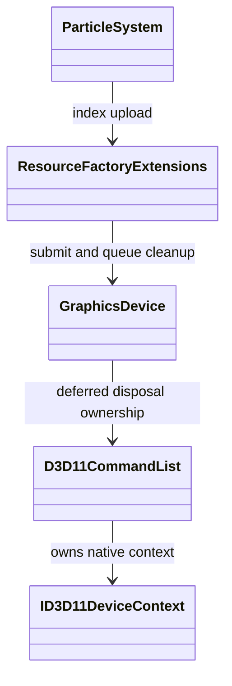
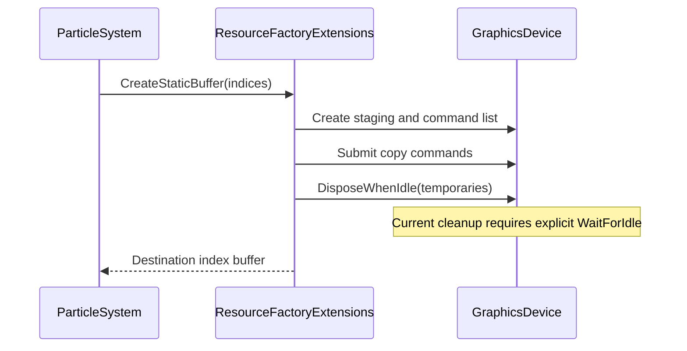

# Task Card `WI-X2-01`: Bound temporary graphics-upload resource lifetimes

> Audience: agent.

| Field | Value |
|---|---|
| Card ID | `WI-X2-01` |
| Roadmap phase | [Track X · X2](../../track-x-fixes-tweaks.md), capacity-probe graphics resource fixes |
| Status | `Ready` |
| Type | `mechanical-refactor` |
| Effort | `S` |
| Prerequisites | none |
| Diagrams | [Architecture diagrams](#architecture-diagrams) |

## Goal

Prevent temporary upload command lists and staging resources from accumulating throughout a rendered battle. Verify native memory behavior independently of the managed heap.

## Context to read (and only this)

- [Capacity-probe evidence](../../implementation/track-x-x2-capacity-probe-fixes.md#capacity-probe-evidence).
- `src/Panopticon.Simulation/Utilities/Extensions/ResourceFactoryExtensions.cs`: static buffer and texture uploads.
- `src/Panopticon.Simulation/Graphics/ParticleSystems/ParticleSystem.cs:150-242`: per-system buffer construction.
- `src/Veldrid/GraphicsDevice.cs`: `WaitForIdle`, `DisposeWhenIdle`, submission, and deferred disposal.
- `src/Veldrid/D3D11/D3D11CommandList.cs`: context ownership, submission completion, and disposal.
- `src/Panopticon.Simulation/Terrain/RadiusCursorDecals.cs:72-118`: existing synchronized upload cleanup.
- `src/Panopticon.Tools.TestHarness/MassBattleCapacityProbeRunner.cs`: rendered probe and screenshot lifecycle.

## Architecture diagrams





## Steps

1. Reproduce repeated particle-system/static-buffer uploads on D3D11 without screenshots or explicit idle waits during measurement. Record temporary-resource counts, managed heap, working set/private bytes, elapsed time, and upload count. Confirm the disposal queue is the retaining owner; do not infer retained native bytes from wrapper counts.
2. Fix the two upload helpers so each successful upload reaches GPU-safe temporary cleanup without relying on scene teardown or an incidental screenshot. Use the existing submit, idle-wait, dispose pattern as the bounded correctness fix. Dispose only temporaries; preserve ownership of the returned destination. Cover exceptions during creation, recording, and submission without freeing resources still in flight.
3. Add regression coverage for repeated buffer and texture uploads, destination contents, and temporary-resource disposal. Follow existing graphics-test infrastructure. Mark platform-dependent D3D11 verification explicitly rather than silently skipping it.
4. Repeat the rendered capacity probe with the same profile, camera, frame budget, and build configuration. Record before/after memory and frame-time measurements. If native growth persists, preserve artifacts and report the residual separately.

## Files likely to change

- `src/Panopticon.Simulation/Utilities/Extensions/ResourceFactoryExtensions.cs`
- Focused upload-lifetime regression tests under `test/Panopticon.Simulation.Tests/`.
- This card's Result section.

## Acceptance criteria

- [ ] Repeated uploads cannot grow the deferred temporary-resource backlog in proportion to total uploads.
- [ ] Uploaded buffer and texture contents remain correct; returned destination resources remain usable.
- [ ] Failure paths release safely owned temporary resources.
- [ ] D3D11 evidence includes native process-memory measurements, not only managed heap size.
- [ ] Capacity-probe results include memory growth and frame-time impact of synchronous cleanup, with residual growth explicitly reported.
- [ ] Standard validation passes (see [guide](../README.md#standard-validation)).

## Validation commands

```sh
dotnet build src
dotnet test src --filter Category!=Interactive
dotnet format src --verify-no-changes
```

Record the exact Windows D3D11 probe command and focused graphics-test command in Result. Screenshots belong after the measured interval because capture calls `WaitForIdle` and can mask the defect.

## Out of scope / guardrails

- No global per-frame GPU idle wait, renderer redesign, general resource pooling, or vendored backend rewrite.
- Do not assume GPU submission has completed before disposing temporaries.
- If synchronized cleanup is prohibitively expensive, report the tradeoff and create a separately scoped asynchronous-upload follow-up instead of expanding this card.
- Preserve profiler artifacts. Determinism-test deviations require the repository's stop-and-report procedure.

## On completion

- Update this card, the [X2 plan](../../implementation/track-x-x2-capacity-probe-fixes.md), checklist, and progress table.
- Reconcile `WI-X2-02` with the post-fix allocation evidence before changing its status.
- Append a result line to repo-root `.exchange`.

## Result

Pending.
