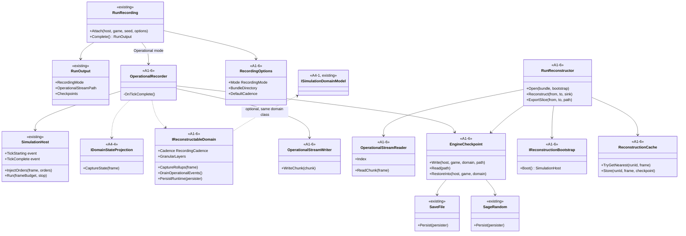
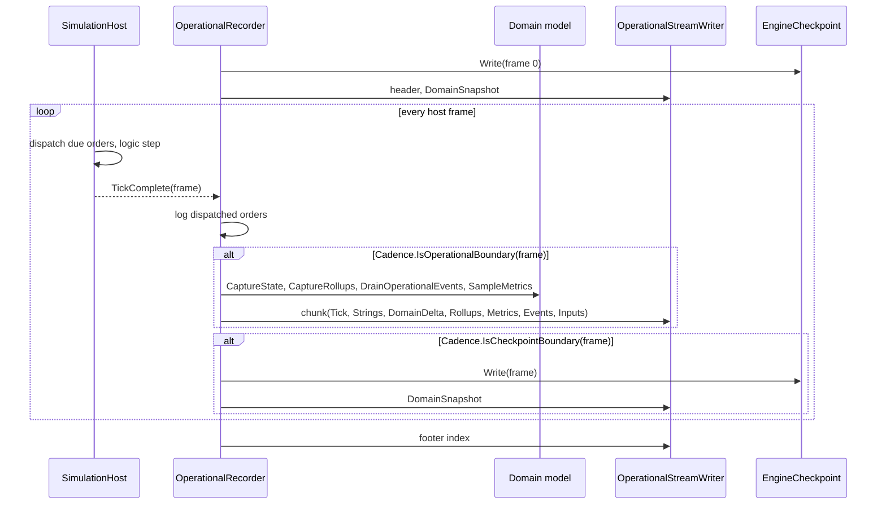
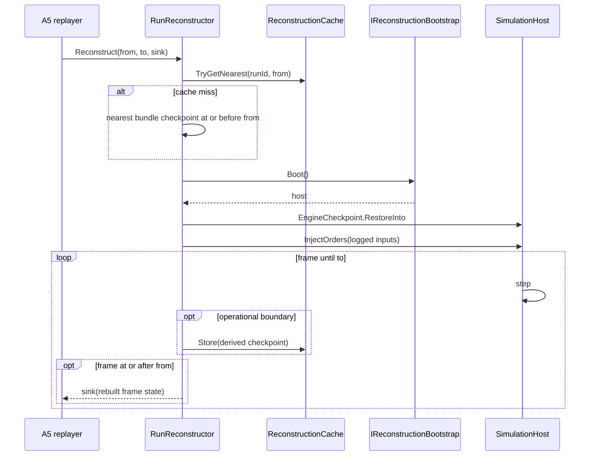

# Deep Dive: A1-6 Operational Recording and Checkpoint Re-simulation

> Expands sub-phase A1-6 of [Track A: Foundations](../track-a-foundations.md); checklist item
> A1-6. Extends the [A1-5 run outputs](a1-headless-host.md#25-result-outputs) and the
> [A4-4 domain state projection](a4-4-domain-state-projection.md). First at-scale consumer:
> [Track W](../track-w-western-front.md) phase W3a.
>
> Audience: human design for the contracts `WI-A1-13..24` and `WI-W3a-31` add. Code references
> are in the agent-context appendix.

Purpose: keep disk use proportional to operational state and a small number of checkpoints, not
to soldiers times frames. Large runs persist operational records and sparse engine checkpoints.
Granular frames are rebuilt on demand by re-simulating from the nearest checkpoint with the logged
inputs. Rebuilt frames are plausible, not authoritative: storage is traded for scrub latency and
for exactness between checkpoints.

---

## 1. Scope

In scope:

- a second recording mode, `Operational`, beside the A1-5 `Full` mode (§4);
- the run bundle: manifest additions, operational stream, engine checkpoints (§5);
- the reconstructor and an in-memory reconstruction cache (§6);
- fidelity rules for rebuilt frames (§3);
- conformance evidence on the RTS and transport-graph domains (§9).

Out of scope:

- determinism of any kind ([determinism Decision](../open-questions.md)); no run identity, no
  state hashes, no same-seed verification;
- region-local reconstruction (whole-world only; a region-local mode would need a recorded log of
  cross-boundary interactions);
- save games for players (checkpoints are recording artifacts, not a user save format);
- schema migration of operational streams (a reader rejects an unknown version).

## 2. Design choices

| Choice | Decision | Reason |
|---|---|---|
| Recording level | Operational records only; no per-frame state on disk | Sedan all-tactical `Full` recording is about 11 to 110 TB per seed (§7). |
| Granular frames | Re-simulated from the nearest checkpoint with logged inputs | Disk use over responsiveness. |
| Rebuilt-frame status | Plausible, not authoritative | Runs are not deterministic; the operational stream is the record of the run. |
| Checkpoint cadence | Frame zero plus every 6 domain campaign hours (default 648,000 frames) | 11 checkpoints for the 60 h Sedan window (§7). |
| Reconstruction scope | Whole world | Needs no boundary-interaction log. |
| Verification | None between checkpoints; restore checks the checkpoint's own domain-state section | Hashes would only report expected drift. |
| Reconstruction cache | In memory, LRU under a byte budget, never on disk | No local disk growth from scrubbing. |
| `Full` mode | Kept, and the default for RTS runs | Small runs and existing golden baselines stay byte-identical. |
| Engine state | `SaveFile.Persist` logic chunks through `StateWriter` | One persistence path for host objects; the A3 seam already separates presentation. |
| Logic random | `GameLogic.Random` becomes `SageRandom` with persisted state | A restored host continues with the recorded generator state; `System.Random` state cannot be saved. |
| Compression | Brotli from `System.IO.Compression` | No new package. |

## 3. Reconstruction fidelity

Execution may vary between runs (parallel commit order, physics, shard timing), so a re-simulation
from a checkpoint can leave the path the original run took.

- Checkpoint frames are exact: restore reproduces the persisted state, and the restore check
  compares the domain-state section with a fresh `CaptureState`.
- Frames after a checkpoint are rebuilt and may drift from the original run; drift can grow with
  distance from the checkpoint.
- The operational stream (metrics, events, operational domain state, roll-ups) is the authoritative
  record. Analysis of outcomes, invariants, and conservation reads the stream, not rebuilt frames.
- Rebuilt frames serve inspection: viewing tactical detail, T2 windows, and slice exports. A5
  labels every reconstructor frame as rebuilt.
- Two reconstructions of the same uncached window may differ. Cached derived checkpoints (§6.3)
  keep repeat views within one session consistent.
- Logged inputs are re-injected at their dispatch frames, so orders match the original run even
  where state drifts.

## 4. Recording modes and cadence

```csharp
public enum RecordingMode { Full, Operational }

public sealed record RecordingCadence(
    Func<uint, bool> IsOperationalBoundary,
    Func<uint, bool> IsCheckpointBoundary);

public sealed record RecordingOptions(
    RecordingMode Mode,
    string BundleDirectory,
    RecordingCadence? DefaultCadence = null,   // 1800 / 648000 frames when null
    bool RecordT1 = true);

public interface IReconstructableDomain
{
    RecordingCadence Cadence { get; }
    IReadOnlySet<string> GranularLayers { get; }
    IReadOnlyList<DomainStateRecord> CaptureRollups(uint frame);
    IReadOnlyList<DomainEvent> DrainOperationalEvents();
    void PersistRuntime(StatePersister persister);
}
```

- `Full` is the A1-5 stack unchanged: per-frame world-state deltas, T0/T1/T2 in `RunOutput`.
- `Operational` samples only at operational boundaries. `WorldStateSampler` stops capturing every
  frame; T2 live capture is off (T2 windows come from reconstruction instead).
- A domain that implements `IReconstructableDomain` supplies its cadence, the layers excluded
  from the operational stream (Western Front: `tactical`), roll-up records that summarize those
  layers, operational events, and runtime state outside its schema (scheduler queues, sequence
  counters). Other domains use `DefaultCadence` and record no roll-ups.
- Default cadence: operational boundary every 1,800 frames (one minute at 30 Hz), checkpoint every
  648,000 frames (six hours at 30 Hz).
- Western Front cadence (`WI-W3a-31`): operational boundary on each 60 s operational tick,
  checkpoint on every sixth 3600 s campaign tick. Compressed mode makes every host frame an
  operational boundary; tactical mode makes every 1800th frame one.
- The checkpoint interval is a run option. A run that needs faster scrubbing records more
  checkpoints and pays the disk cost.

## 5. Run bundle

```text
<bundle>/
  run.json                  RunOutput manifest (A5-07 versioning applies)
  operational.bin           operational stream (§5.2)
  checkpoints/
    000000000.ckpt          frame zero
    000648000.ckpt          first checkpoint boundary in tactical mode (6 h)
    ...
  replay.rep                existing input replay (optional)
```

### 5.1 Manifest additions

`RunOutput` gains nullable properties marked `JsonIgnore(Condition = WhenWritingNull)`, so
`Full` mode JSON is byte-identical:

| Property | Content |
|---|---|
| `recordingMode` | `full` or `operational` |
| `operationalStreamPath` | relative path to `operational.bin` |
| `checkpoints` | frame, relative path, byte size, XxHash3 of the file |

The existing `seed` and `scenarioId` fields identify what the bootstrap boots. The per-file
XxHash3 detects a corrupt or replaced checkpoint, not simulation drift.

In `Operational` mode the T0 samples and T1 trees live in the stream, not in the JSON, and the
manifest is written at start and rewritten at completion, so a crashed run keeps a manifest.

### 5.2 Operational stream

Header: magic `PNOR`, format version, run id, domain id, domain schema version. Then one
length-prefixed, Brotli-compressed chunk per operational boundary, flushed on write. A footer
index lists chunk offsets and frames; a reader rebuilds it by scanning when the footer is
missing.

| Record in a chunk | Content |
|---|---|
| `Tick` | host frame, logic frame, theater time when the domain has one |
| `Strings` | new entries of the append-only string table (keys, kinds, series, definition names) |
| `DomainDelta` | A4-4 upserts and removals for non-granular layers, keys and references as string ids |
| `DomainSnapshot` | full non-granular state; written at checkpoint boundaries only |
| `Rollups` | `CaptureRollups` records, same encoding |
| `Metrics` | T0 series id, key id, value |
| `Events` | `DrainOperationalEvents` entries |
| `Inputs` | orders dispatched since the last boundary: dispatch frame, player, `.rep` order encoding |
| `T1` | optional tolerance-quantized signature tree for cross-run comparison (A5-4) |

Domains without `IDomainStateProjection` record `WorldStateSummary` changes at the boundary in
place of `DomainDelta`, with definition names as string ids and positions as `float`.

### 5.3 Engine checkpoint

Header: magic `PNCK`, format version, frame, theater time, run id. Then length-prefixed,
Brotli-compressed sections:

| Section | Content |
|---|---|
| `engine` | `SaveFile.Persist` logic chunks through `StateWriter`; presentation chunks excluded (list fixed by `WI-A1-13`) |
| `random` | `GameLogic.Random` state |
| `host` | `SimulationHost` frame, map time, pending injected orders |
| `domain-runtime` | `IReconstructableDomain.PersistRuntime` |
| `domain-state` | full A4-4 `DomainStateFrame`, all layers, when the domain has a projection |

The checkpoint is taken in `TickComplete` of a checkpoint-boundary frame, after that frame's
campaign and operational systems ran, so no boundary work is pending. Restore loads the engine
section into a host booted for the same scenario, then the random, host, and runtime sections,
then compares the domain-state section with a fresh `CaptureState` (W6 §3 load check).

## 6. Reconstruction

### 6.1 Flow

`RunReconstructor.Open(bundle, bootstrap)` reads the manifest and loads the stream index.
`Reconstruct(fromFrame, toFrame, sink)`:

1. Pick the latest checkpoint at or before `fromFrame` (cache first, §6.3).
2. Boot a host through `IReconstructionBootstrap` (caller-supplied: game, scenario, domain model)
   and restore the checkpoint.
3. Re-inject logged inputs at their dispatch frames.
4. Step to `toFrame`. From `fromFrame`, hand each frame's `WorldStateSummary` and, when present,
   `DomainStateFrame` to the sink.
5. At operational boundaries, store a derived checkpoint in the cache.

Sinks cover the A5 needs: a frame callback, a T2 window capture armed for chosen regions, and
`ExportSlice(from, to, path)`, which writes a standard A1-5 snapshot/delta artifact for the window
so existing readers work unchanged. Exported slices are marked rebuilt in their manifest.

### 6.2 Restore failure

A checkpoint whose file hash does not match the manifest, or whose domain-state section differs
from the restored host's `CaptureState`, fails with `InvalidDataException` naming the checkpoint
frame. This is a persistence-coverage bug (a field the checkpoint does not save), not drift.

### 6.3 Reconstruction cache

While re-simulating, the reconstructor keeps derived checkpoints at operational boundaries in an
in-memory LRU, keyed by run id and frame, under a byte budget. Nothing is written to disk. Later
scrubs inside a reconstructed window re-simulate at most one operational interval while the
covering entry is cached. A derived checkpoint captures the rebuilt path, so repeat views agree
with the first reconstruction rather than with the original run.

## 7. Size and latency

Sedan reference arm, one seed, 60 h, about 320,000 soldiers. Object sizes are estimates;
`WI-W3a-01` measures them.

| Item | `Full` mode (A1-5) | `Operational` mode |
|---|---|---|
| Per-frame world deltas | about 11 to 110 TB | none |
| World snapshots | about 370 GB | none |
| Operational stream | n/a | about 1 MB per boundary before compression, 3,600 boundaries, about 3.5 GB |
| Checkpoints | none | 11 at about 0.3 to 0.6 GB, about 3.5 to 7 GB |
| Bundle total | about 11 to 110 TB | about 7 to 10 GB |
| In-memory recording state | grows without bound | one chunk and one checkpoint buffer |
| Local disk for scrubbing | none | none (cache is in memory) |
| Scrub to an uncached frame | read | up to 648,000 frames of re-simulation |
| Scrub inside a cached window | read | up to 1,800 frames of re-simulation |

At a measured frame cost `c`, an uncached scrub costs up to `648000 * c` and a cached scrub up to
`1800 * c` (at `c` = 50 ms: 9 hours and 90 seconds). A long scrub can run in the background while
A5 shows operational records from the stream.

## 8. Consequences for other phases

| Phase | Change |
|---|---|
| A5 | The replayer reads the operational stream directly and asks the reconstructor for granular frames, labelled rebuilt; T2 inspection in `Operational` mode arms windows during reconstruction. |
| B3, B6, F4 | No ordering constraints from A1-6. Checkpoints must capture all logic state they own. |
| W3a | `WI-W3a-31` implements `IReconstructableDomain` and a `rollup` record kind on the Western Front domain; reference and comparison arms record in `Operational` mode; evidence uses the operational stream, with rebuilt tactical frames for inspection. |
| W5 | Each shard writes its own checkpoints at shared checkpoint boundaries; whole-world reconstruction restores all shards. |
| W6 | Save/load is the A1-6 checkpoint plus the operational stream. |

## 9. Sub-items and cards

| Item | Cards | Deliverable |
|---|---|---|
| A1-6a | [`WI-A1-13`](../agent/cards/WI-A1-13-audit-checkpoint-coverage.md), [`WI-A1-14`](../agent/cards/WI-A1-14-persistable-logic-random.md) | Checkpoint coverage audit; persisted `SageRandom` logic random. |
| A1-6b | [`WI-A1-15`](../agent/cards/WI-A1-15-engine-checkpoint-format.md), [`WI-A1-16`](../agent/cards/WI-A1-16-restore-host-from-checkpoint.md) | Checkpoint write/read; host restore. |
| A1-6c | [`WI-A1-17`](../agent/cards/WI-A1-17-run-identity.md), [`WI-A1-18`](../agent/cards/WI-A1-18-operational-state-hash.md) | Withdrawn: run identity and state hashes are not part of the design. |
| A1-6d | [`WI-A1-19`](../agent/cards/WI-A1-19-recording-modes-and-cadence.md), [`WI-A1-20`](../agent/cards/WI-A1-20-operational-stream.md) | Recording modes and cadence; operational stream writer and reader. |
| A1-6e | [`WI-A1-21`](../agent/cards/WI-A1-21-operational-run-bundle.md) | Checkpoint scheduling and manifest wiring. |
| A1-6f | [`WI-A1-22`](../agent/cards/WI-A1-22-run-reconstructor.md), [`WI-A1-23`](../agent/cards/WI-A1-23-reconstruction-cache.md) | Reconstructor and sinks; in-memory derived-checkpoint cache. |
| A1-6g | [`WI-A1-24`](../agent/cards/WI-A1-24-reconstruction-conformance.md) | Conformance evidence on RTS and transport-graph runs: exact restore at checkpoints, invariants on rebuilt frames. |

Western Front adapter: [`WI-W3a-31`](../agent/cards/WI-W3a-31-operational-recording-adapter.md).

## 10. Architecture diagrams

Grounded in `SimulationHost`, `RunRecording`, `WorldStateSampler`, `SaveFile`, `StatePersister`,
`IRandom`, and the A4-4 contracts. Types marked `A1-6` are new.







## 11. Related

- Determinism-priority Decision and the operational recording Decision:
  [`../open-questions.md`](../open-questions.md)
- Run outputs this extends: [A1-5](a1-headless-host.md#25-result-outputs)
- Tiered comparison across seeds: [A5 §5](a5-visualization.md#5-run-comparison--divergence-localization)
- Long-run save/load consumer: [W6 §3](w6-long-run-campaign.md#3-persistence-and-replay)

---

## Appendix: current-state hooks

> Agent context: file references for cards `WI-A1-13..24`.

- `src/Panopticon.Simulation/SimulationHost.cs:68-73`: `TickStarting` and `TickComplete`.
- `src/Panopticon.Simulation/SimulationHost.cs:107-117`: `InjectOrders`; late orders dispatch on the
  next step, so the log records dispatch frames.
- `src/Panopticon.Simulation/Recording/RunRecording.cs:15-60`: `WorldStateSampler` captures and diffs
  every logic frame.
- `src/Panopticon.Simulation/Recording/RunRecording.cs:62-125`: `SnapshotDeltaRecorder` keeps every
  snapshot and delta in memory and writes a delta per frame.
- `src/Panopticon.Simulation/Recording/RunRecording.cs:382-398`: `RunRecording.Attach`.
- `src/Panopticon.Simulation/RunOutput.cs:62-110`: `RunOutput` JSON root and options.
- `src/Panopticon.Simulation/Recording/WorldStateSnapshot.cs:25-60`: `WorldObjectState.Persist`
  writes the definition name string per object.
- `src/Panopticon.Simulation/Recording/SignatureTree.cs:66-73`: domain-keyed bucket build.
- `src/Panopticon.Simulation/Data/Sav/SaveFile.cs:53-76`: chunk list, including presentation chunks.
- `src/Panopticon.Simulation/Data/Sav/SaveFile.cs:78-175`: `Persist` reads and writes; reading starts
  a campaign when no game is running, which a headless restore must bypass.
- `src/Panopticon.Simulation/Logic/GameLogic.cs:65-72`: `GameLogic.Random` from `IGame.CreateRandom`.
- `src/Panopticon.Simulation/Logic/GameLogic.cs:387-400`: `GameLogic.Persist`, version 10, objects.
- `src/Panopticon.Simulation/IGame.cs:205`: `CreateRandom` returns `SystemRandom`.
- `src/Panopticon.Mathematics/IRandom.cs:45-72`: `SystemRandom`, no persistable state.
- `src/Panopticon.Mathematics/IRandom.cs:74-175`: `SageRandom`, six `uint` words of state.
- `src/Panopticon.Simulation/StatePersister.cs:292,424`: `StateReader`, `StateWriter`.
- `src/Panopticon.Physics/Bepu/BepuPhysicsWorld.cs:36`: `Simulation.Create` with no thread
  dispatcher.
- `test/Panopticon.Simulation.Tests/Reproducibility/SeededRunTests.cs:19`: existing same-seed test.
- `test/Panopticon.Simulation.Tests/Recording/TieredRecordingTests.cs:18`: A1-5 tier tests.
- `docs/roadmap/implementation/track-a-a2-reproducibility.md`: randomness and ordering audits.
