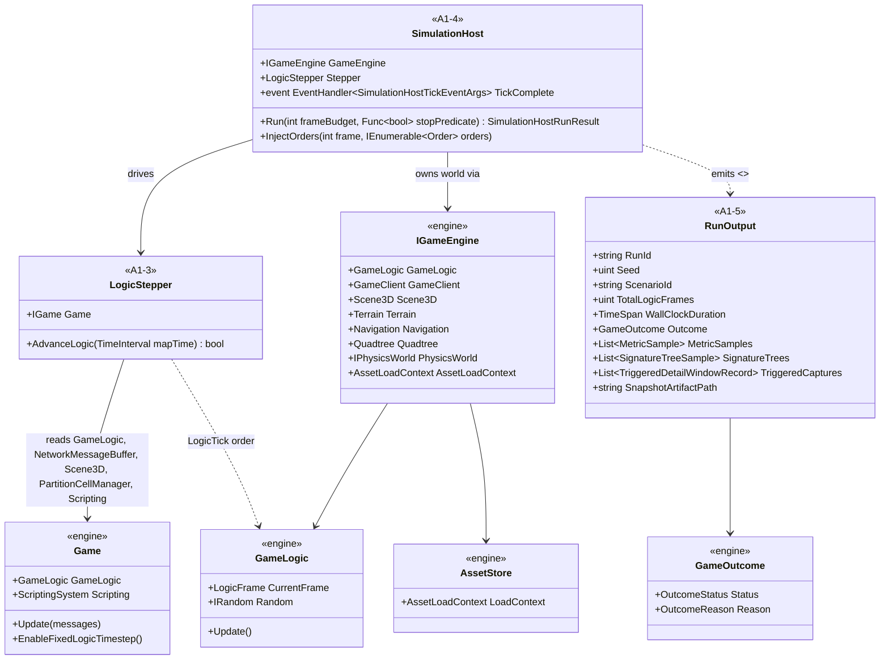
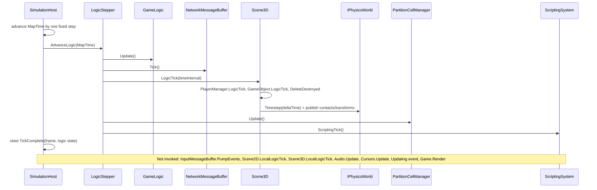
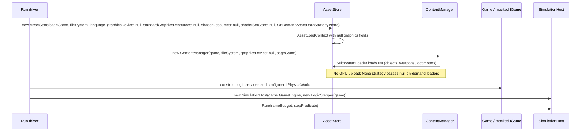

# Deep Dive: Headless Simulation Host

> Expands phase A1 of [Track A: Foundations](../track-a-foundations.md). Part of the
> [Large-Scale RTS Roadmap](../README.md). First-pass design. Refine as phases land.
>
> Audience: human overview of the headless-host design. Code references are in the agent-context appendix at the bottom.
>
> The agent-context section at the bottom ([What already exists appendix](#appendix-what-already-exists-agent-context)) contains code-level details about the current state. Skip it if reading for design intent.

Purpose: run the simulation logic core without a window, GPU, or audio stack so the engine can
support batch runs, CI, faster-than-real-time runs, and later distributed runs.

The design separates logic stepping from presentation and input handling. That separation allows
the host to run as fast as the hardware permits instead of at the wall-clock game rate.

The host is domain-agnostic. It owns a simulation world through the [Simulation Domain Model seam (A4)](../track-a-foundations.md), not an RTS world specifically. Stepping, recording, and analysis are parameterized by the domain, so the same faster-than-real-time host can drive RTS battles, city builders, or transportation and logistics simulations. RTS, the `GameObject` and module engine, is the first domain adapter. Per the [domain-scope Decision](../open-questions.md), a transport or graph domain is the first non-RTS validation target, and non-RTS domains extend the same `GameObject` and module system with a topology and interaction adapter rather than a separate runtime.

---

## 1. Primary blockers

| # | Coupling | Where | Impact |
|---|---|---|---|
| H1 | `Game` constructor unconditionally creates a `GraphicsDevice` and graphics resources (`StandardGraphicsResources`, `ShaderSetStore`, `ShaderResourceManager`) | `Game.cs` ctor (~L481–532) | No GPU → no `Game`. Blocks CI/cloud nodes without a GPU. |
| H2 | `AssetStore` requires a `GraphicsDevice` and graphics load context | `AssetStore` ctor (`Content/AssetStore.cs`), `Game.cs` L534–542 | Asset data (INI/object defs) is entangled with GPU upload of textures/shaders/models. |
| H3 | `Game.Update` interleaves presentation with logic | `Game.cs` `Update`/`LocalLogicTick` (L881–943) | Each tick runs input pumping, Scene2D UI, audio, cursors before the logic tick. A host wants only logic + scripting + network. |
| H4 | No `SimulationHost` abstraction owning the logic step | None | The logic step is embedded in `Game`; batch/distributed drivers must instantiate the full `Game`. |
| H5 | Audio/Graphics `GameSystem`s always constructed and ticked | `Game.cs` L583–585, `LocalLogicTick` audio update | Presentation systems run even when nothing is displayed. |
| H6 | Statistical experiment analysis is missing | see [A2](../track-a-foundations.md) | Headless results need structured metrics, per-run invariants, and aggregate analysis. |

---

## 2. Required infrastructure

### 2.1 A GPU-optional graphics seam
Introduce a null or headless rendering path so logic can run without a real device.

Decision: a null device abstraction. Define an interface over the `GraphicsDevice` parts the
logic and asset-data path touch, with a no-op headless implementation. This is the cleanest
long-term option, decouples logic from `GraphicsDevice`, aligns with
[A3: Simulation/presentation seam](../track-a-foundations.md), and is scoped and validated in
A1-1.

The rejected primary alternative is a headless Veldrid offscreen device. It is a smaller change
but still requires working graphics drivers, so it does not unblock GPU-less CI or cloud nodes.
It may still be useful where a real device is available, such as frame capture.

### 2.2 Data-only asset loading
Split asset data (object, weapon, and locomotor INI, map data) from GPU upload (textures,
shaders, model buffers) so a headless host loads only the logic-side data it needs (H2). The
`OnDemandAssetLoadStrategy.None` path used by `TestGame` is the seed.

### 2.3 Logic-tick extraction
Separate the fixed-rate logic step (`GameLogic.Update`, network tick, `Scene3D.LogicTick`,
`PartitionCellManager.Update`, scripting) from the local or render tick (input, Scene2D, audio,
cursors) so a host can call logic-only (H3). The fixed-rate stepping already lives in
`Game.Update`; extract it into a reusable stepper. F4/F4a object physics stays inside this logic
step: the same per-engine `IPhysicsWorld` steps windowed and headless, with no presentation input.

### 2.4 `SimulationHost`
A lightweight host that owns the logic-side world through the existing `IGameEngine` seam,
parameterized by the [domain model (A4)](../track-a-foundations.md). It advances the world by N
frames or until a stop condition at FTRT speed and exposes hooks for input or order injection
(`InjectOrders`) and result capture. It must run with presentation systems absent or stubbed
(H4/H5) and avoid RTS-specific assumptions so a non-RTS domain can supply its own entity and step
model.

### 2.5 Result outputs
Emit structured run outputs that the analysis layer consumes. Recorded state supports inspection
without requiring input-only re-simulation:
- Recorded state snapshots and deltas: periodic world snapshots and per-frame deltas so any
  frame can be reconstructed for analysis without assuming a re-run reproduces it bit-for-bit.
- Metrics and events stream: domain-defined probes for RTS, city, or transport runs, and the
  primary basis for comparing runs.
- Hierarchical state signature per frame: a tolerance-aware signature tree, from world to
  partition to entity bucket, so divergence screening can be drilled down to a locus rather than
  only flagged globally. The tier design is in [visualization.md §5](a5-visualization.md). An opt-in
- Triggered detail capture: when the signature tree trips a configured threshold, the host writes
  detailed per-entity and per-system deltas for the affected frame and region window into a
  bounded ring buffer. Captured live because a re-run will not reproduce the same divergence, as
  described in [visualization.md §5](a5-visualization.md).
- Replay recording of inputs, including orders, seed, and map, reusing the existing `.rep` path
  (`ReplayConnection`, TestHarness export). This is useful for launching another experiment run,
  not reconstructing an authoritative prior run.
- Optional frame captures via `FrameCaptureService` when a GPU is available.

### 2.6 Result analysis and visualization: see phase A5
Replaying, visualizing, comparing, and localizing divergences between runs, plus authoring the
scenarios that feed the host, belong to [A5: Scenario authoring and visualization](a5-visualization.md).
A1 ends at emitting the run outputs in §2.5. A5 consumes them, makes them inspectable, and is the
validation surface for [B3](../track-b-scale.md) parallelism and
[B6](b6-distributed-simulation.md) sharding. The tiered recording, T0, T1, and T2, emitted here is
specified in [visualization.md §5](a5-visualization.md).

---

## 3. Sub-phases

| Phase | Goal | Status |
|---|---|---|
| A1-1. Headless seam audit & approach | Confirm exactly what the logic/asset-data path needs from `GraphicsDevice`/graphics resources, then scope the null device abstraction (chosen §2.1 approach) and document the target "logic-only" surface. | Done |
| A1-2. Data-only asset loading | Allow `AssetStore`/`ContentManager` to load logic-relevant data without GPU upload (H2), generalizing the `OnDemandAssetLoadStrategy.None` path. | Done |
| A1-3. Logic-tick extraction | Extract the logic step from `Game.Update`/`LocalLogicTick` into a reusable stepper that runs without presentation systems (H3/H5). | Done |
| A1-4. `SimulationHost` | Introduce the domain-agnostic host that owns a simulation world via `IGameEngine` + the [domain model seam (A4)](../track-a-foundations.md), steps N frames / until a condition at FTRT, and supports input injection + result hooks (H4). RTS is the first domain adapter. | Done (domain seam parameterized pending A4) |
| A1-5. Run outputs | Emit recorded state snapshots/deltas, a metrics/events stream, the tiered diagnostic recording ([visualization.md §5](a5-visualization.md): T0 aggregate + T1 hierarchical signature tree + T2 triggered detail), and replay input recordings from a headless run. | Done (T0 metrics/events + terminal outcome; T1 tolerance-quantized spatial-cell signature trees; T2 ring-buffer triggered detail with pre-marked windows; snapshot/delta binary artifact with reconstruction; replay input recording via the existing `.rep` path) |

> Result analysis, visualization, and scenario authoring were previously sketched here as
> A1-6/A1-7; they now live in their own phase, [A5](a5-visualization.md) (A5-1 scenario authoring,
> A5-2 sweeps, A5-3 replayer/visualizer, A5-4 divergence localization).

---

## 4. Sequencing notes

- A1-1 gates the rest; everything depends on the chosen graphics seam.
- A1-2/3/4 are the core host and can land incrementally behind the existing windowless path.
  The TestHarness `RunHeadless` loop is the integration target throughout.
- A1-5 outputs are consumed by [A2 statistical validation](../track-a-foundations.md) and
  [A5 visualization](a5-visualization.md).

## 5. Architecture Diagrams

Grounded in the A1-1 audits
([implementation plan](../implementation/track-a-a1-headless-host.md)). Types marked `<<A1-3>>`,
`<<A1-4>>`, or `<<A1-5>>` are sub-phase deliverables; everything else exists in `src/` today.

The null-device question resolved by the audit: the logic and asset-data path uses so little of
`GraphicsDevice` (see the
[candidate surface](../implementation/track-a-a1-headless-host.md#candidate-null-device-surface))
that A1-2 makes the `AssetStore` graphics parameters optional instead of introducing a null-device
interface. A null device remains the fallback if a later phase needs full map load without a GPU;
its member list is the audit's candidate surface, still open.

One headless tick. The presentation calls from the tick-path audit are explicitly not invoked;
the stepper performs exactly the `logic` rows of the audit, in their existing order.

Headless startup, following the construction order of `Game.cs:510-600` with the graphics
dependencies absent (A1-2):

## 6. Related

- Track A overview: [`../track-a-foundations.md`](../track-a-foundations.md)
- Architecture snapshot: [`../agent/current-state.md`](../agent/current-state.md)
- Scenario authoring & visualization (consumes A1 outputs): [`a5-visualization.md`](a5-visualization.md)
- Determinism-priority Decision: [`../open-questions.md`](../open-questions.md)

---

## Appendix: What already exists (agent context)

> Agent context: this section contains file:line code references for agents
> implementing this phase. Human readers: the design intent above does not
> require reading this section.

A surprising amount of headless plumbing already exists and should be reused:

- Windowless graphics device. `GraphicsDeviceUtility.CreateGraphicsDevice`
  (`src/OpenSage.Game/Graphics/GraphicsDeviceUtility.cs`) accepts a `null` window and creates a
  swapchain-less D3D11/Vulkan/Metal device. `new Game(installation, backend, config, window:
  null)` already works.
- A headless run loop. `OpenSage.Tools.TestHarness` (`Program.cs`, `RunHeadless`)
  constructs a windowless `Game`, loads a replay, and ticks `game.Update(empty)` + `game.Render()`
  in a loop with a frame cap.
- Frame capture for inspection. `FrameCaptureService`
  (`src/OpenSage.Game/Graphics/FrameCaptureService.cs`) renders to a texture and writes PNGs
  with machine-parseable `[CAPTURE]` stdout lines for headless test runs.
- Replay action monitoring. `ReplayActionMonitor` (ReplaySketch) surfaces dispatched/
  completed in-game actions with player + frame, used by the TestHarness for logging and
  deferred-order injection.
- A logic-only mock. `MockedGameTest.TestGame` (`src/OpenSage.Game.Tests/MockedGameTest.cs`)
  implements `IGame` with `GraphicsDevice = null` and an `AssetStore` built with
  `OnDemandAssetLoadStrategy.None`, proving parts of the logic layer can exist without GPU
  resources.
- A non-rendering data tool. `OpenSage.Tools.Sav2Json` constructs a `Game` purely to load/
  persist save state.
- An engine seam. `IGameEngine` and `GameEngine` (`src/OpenSage.Game/GameEngine.cs`) already
  abstract the logic-side services (`AssetLoadContext`, `GameLogic`, `Terrain`, `Navigation`,
  `Quadtree`, `Scene3D`, `IPhysicsWorld`) behind an interface, which is a natural foundation for a
  host.

Today, headless means no window but still requires a real GPU and still runs the full
`Game.Update` → `Render` path. True GPU-less, logic-only simulation is not yet possible.

---