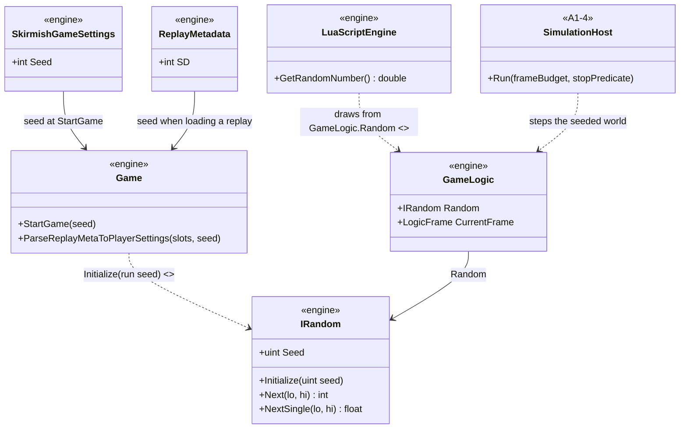
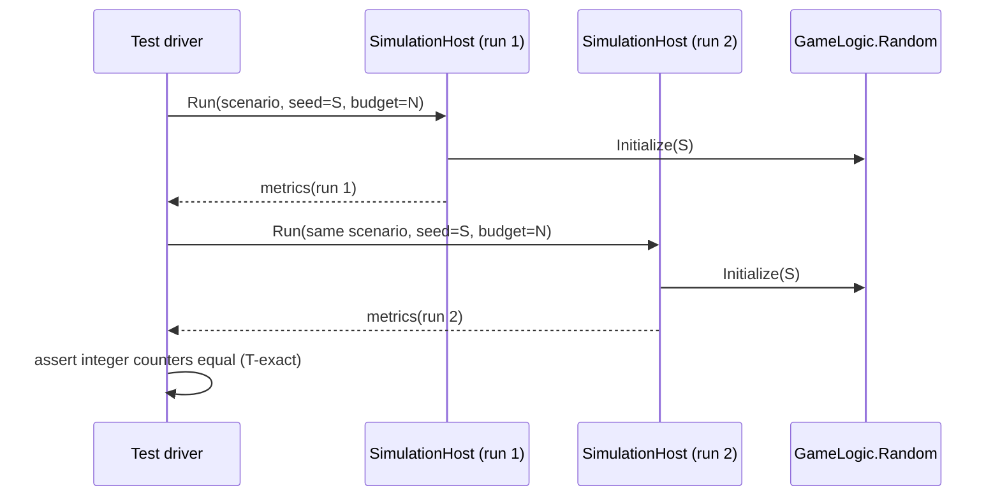

# Deep Dive: Reproducibility & Statistical Stability

> Expands phase A2 of [Track A: Foundations](../track-a-foundations.md). Part of the
> [Large-Scale RTS Roadmap](../README.md). First-pass design, grounded in the
> [A2 audits](../implementation/track-a-a2-reproducibility.md). Refine as phases land.
>
> Audience: human overview of the reproducibility design. Code references are in the
> implementation plan linked above.

Purpose: make two runs of the same scenario with the same seed comparable, so the headless host
(A1), experiment framework (A4), and sharded runs (B6) can be measured, diffed, and debugged. Per
the [relaxed-determinism Decision](../open-questions.md), the target is reproducibility for
comparison, not bit-exactness.

---

## 1. Current state

- A seeded source exists: `GameLogic.Random` (`IRandom`, `src/OpenSage.Game/Logic/GameLogic.cs`),
  and the logic path already draws from it at every module site (see the
  [audit](../implementation/track-a-a2-reproducibility.md#randomness-source-audit)).
- The run seed does not reach it. `Game.StartGame` uses the seed only for replay metadata;
  `GameLogic.Random` stays at its constructed default (`SystemRandom`, seed 0). A run is therefore
  not controllable: two runs with different seeds are identical, and one seed cannot reproduce a
  specific stream.
- Two simulation-affecting sites bypass the seeded source: `LuaScriptEngine.GetRandomNumber`
  (constructs a `Random` per call) and `Game.ParseReplayMetaToPlayerSettings` (random faction
  re-roll when loading a replay whose slots say random). Both are flagged in the audit.
- Remaining nondeterminism on the tick path is the wall-clock `DeltaTimer` driving `MapTime`
  (by design; fixed-delta and host-fixed stepping are the deterministic paths), plus tool-side
  dispatch RNG in the P0 harness.

## 2. Design

### 2.1 Seeded stream determined by the run seed

The run seed (`SkirmishGameSettings.Seed`, replay metadata `SD`, or an explicit parameter from a
harness) becomes the single root of the simulation's random stream:

- `Game.StartGame` initializes `GameLogic.Random` with the run seed once the world is created.
- `GameClient.Random` (presentation-only consumers today) is initialized from the same seed; it is
  not part of the comparable stream.
- Every simulation-affecting site draws from `GameLogic.Random`; the two uncontrolled sites are
  converted (`WI-A2-03`). Presentation-only sources (particle emission, audio variation, Apt UI)
  stay uncontrolled on purpose.
- Draw order and draw count at converted sites must not change; an extra or reordered draw is a
  defect even when the distribution is unchanged.

### 2.2 Tolerance model

Comparability tiers, from strictest to loosest:

| Tier | Comparison | Rule |
|---|---|---|
| T-exact | Same build, same platform, same seed, fixed-timestep stepping | Integer counters (money, unit counts, logic frame counts, action durations) must be equal. |
| T-tolerance | Same build, cross-platform, or wall-clock stepping | Integer counters compared within a percentage tolerance; per-metric tolerance floors are set by the verification harness (`WI-A2-04`), not hardcoded at call sites. |
| T-statistical | Different seeds or sharded vs single (B6) | Aggregate metrics compared statistically; no per-frame equality. |

`WI-A2-03`'s same-seed test uses T-exact. The opt-in strict-hash mode (whole-state hash per frame,
debugging only) belongs to `WI-A2-04` and is scoped by the
[A2 strict-hash scope Decision](../open-questions.md).

### 2.3 Concurrent-write conflict rules

No concurrent writer is reachable from the tick path today, so no rule is needed yet. B3
(parallel update) and B6 (sharding) introduce concurrent writers; the conflict-resolution rules
are designed in those phases, with the invariant that conservation quantities (money, unit count)
never duplicate or lose value across a write handoff.

## 3. Sub-phases

| Phase | Goal | Status |
|---|---|---|
| A2-a. Audit | Randomness and non-random nondeterminism audits (the tables in the implementation plan). | Done |
| A2-b. Seeded source | Thread the run seed into `GameLogic.Random`; convert the uncontrolled simulation-affecting sites (`WI-A2-03`). | Done |
| A2-c. Verification harness | Tolerance/stability harness plus opt-in strict-hash mode (`WI-A2-04`). | Not started |

## 4. Sequencing notes

- A2-b must land before A1-5 run outputs record a seed: a recorded seed that does not determine
  the run is misleading.
- A2-c consumes the tiered recording emitted by A1-5 and the tolerance model above.
- B3/B6 depend on A2 for comparable baselines; the conflict rules land with them, not before.

## 5. Architecture Diagrams

Grounded in the audits. Types marked `<<A2-b>>` are seeded-source deliverables; everything else
exists today.

Same-seed run comparison, T-exact tier:

## 6. Related

- Track A overview: [`../track-a-foundations.md`](../track-a-foundations.md)
- Audits: [`../implementation/track-a-a2-reproducibility.md`](../implementation/track-a-a2-reproducibility.md)
- Headless host that consumes the seed: [`a1-headless-host.md`](a1-headless-host.md)
- Relaxed-determinism and strict-hash scope Decisions: [`../open-questions.md`](../open-questions.md)
