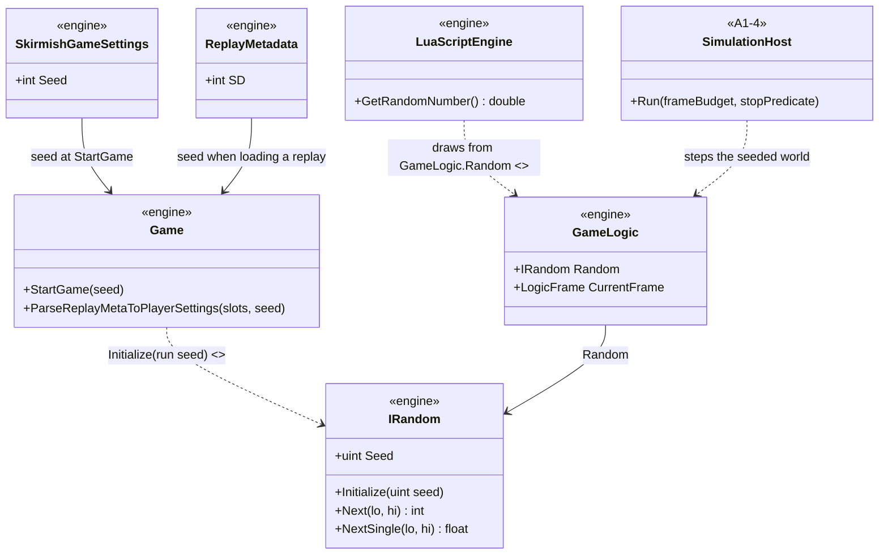
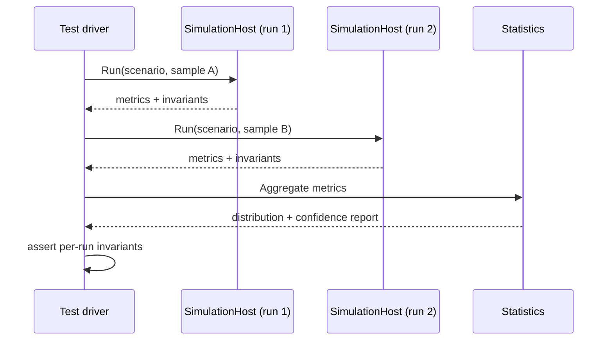

# Deep Dive: Statistical Validation

> Expands phase A2 of [Track A: Foundations](../track-a-foundations.md). Part of the
> [Large-Scale RTS Roadmap](../README.md). First-pass design, grounded in the
> [A2 audits](../implementation/track-a-a2-reproducibility.md). Refine as phases land.
>
> Audience: human overview of the statistical-validation design. Code references are in the
> implementation plan linked above.

Purpose: measure experiment outcomes across samples and validate per-run correctness invariants.
Determinism and same-seed agreement are not requirements ([determinism
Decision](../open-questions.md)). Seed controls remain available as experiment inputs.

---

## 1. Current state

- `GameLogic.Random` is initialized from the run seed, and simulation-affecting random sites use
  it. The completed [audit](../implementation/track-a-a2-reproducibility.md#randomness-source-audit)
  records the implementation.
- The headless host emits metrics, events, invariants, snapshots, and tiered diagnostic data.
- The multi-run statistics harness (`StatisticalRunHarness`) reports per-run invariant results
  plus aggregate distributions and confidence intervals (A2-c).
- Wall-clock timing, parallel scheduling, physics, and distributed execution may produce different
  results between runs. A2 does not constrain those sources.

## 2. Design

### 2.1 Experiment controls

The run seed (`SkirmishGameSettings.Seed`, replay metadata `SD`, or an explicit harness parameter)
is recorded with the result. It is useful for selecting an input stream and investigating a run,
but does not promise that another execution will reproduce the same state or metrics.

### 2.2 Validation model

The A2 harness:

- runs a configured sample count;
- checks correctness invariants independently in every run;
- reports mean, variance, confidence intervals, and outliers for selected metrics;
- compares aggregate distributions when an experiment has a reference implementation;
- never fails because two executions with the same seed differ.

State signatures and snapshots remain diagnostic artifacts for inspecting the run that produced
them. They are not parity gates.

### 2.3 Concurrent-write correctness

B3 and B6 own their conflict-resolution and authority rules. Those rules prevent invalid outcomes
such as duplicate ownership or lost resources; they do not prescribe execution order or require
cross-run identity.

## 3. Sub-phases

| Phase | Goal | Status |
|---|---|---|
| A2-a. Experiment controls audit | Randomness and execution-variation audits (the tables in the implementation plan). | Done |
| A2-b. Seed control | Thread the run seed into `GameLogic.Random`; convert the uncontrolled simulation-affecting sites (`WI-A2-03`). | Done |
| A2-c. Statistical harness | Multi-sample metrics and per-run invariant harness (`WI-A2-04`). | Done |

## 4. Sequencing notes

- A1-5 records the selected seed as run metadata.
- A1-6 replaces the `SystemRandom` behind `GameLogic.Random` with a persisted `SageRandom`
  seeded by the A2-b run seed.
- A2-c consumes A1-5 metrics and invariants.
- B3 and B6 define conflict rules in their own phases. A2 can measure their output distributions
  but does not gate their implementation.

## 5. Architecture Diagrams

Grounded in the audits. Types marked `<<A2-b>>` are completed seed-control work; everything else
exists today.

Multi-sample experiment:

## 6. Related

- Track A overview: [`../track-a-foundations.md`](../track-a-foundations.md)
- Audits: [`../implementation/track-a-a2-reproducibility.md`](../implementation/track-a-a2-reproducibility.md)
- Headless host that consumes the seed: [`a1-headless-host.md`](a1-headless-host.md)
- Determinism-priority Decision: [`../open-questions.md`](../open-questions.md)
