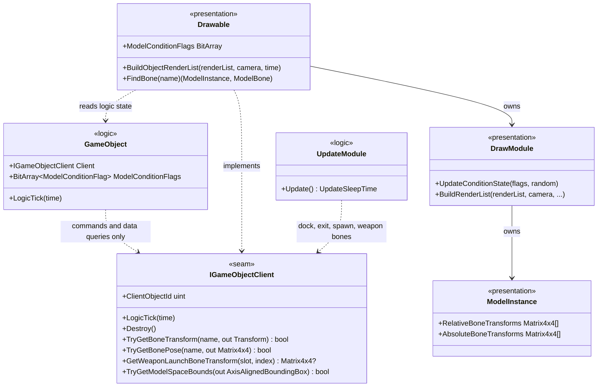
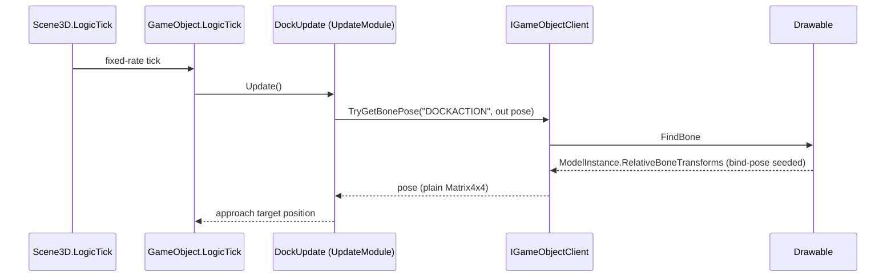
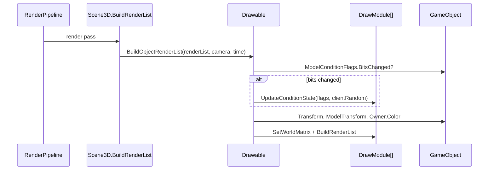

# Deep Dive: Simulation/Presentation Seam

> Part of [Track A: Foundations](../track-a-foundations.md). Defines the A3 boundary, the seam
> interface that implements it, and the enforcement that keeps it.
>
> Audience: human overview of the design; agent context for the enforcement test's canonical
> namespace and type lists.

## 1. Current state

- `GameObject` (`Panopticon.Logic.Object`) holds a public `Drawable` field
  (`src/Panopticon.Simulation/Logic/Object/GameObject.cs:490`) and constructs it through `GameClient`
  (`:528`). Every logic module reaches presentation directly through it.
- Logic reads presentation state in 15 clusters (the
  [read audit](../implementation/track-a-a3-sim-presentation-seam.md)): construction state through
  `Drawable.ModelConditionFlags`, bone poses through `Drawable.FindBone` and
  `ModelInstance` transform arrays, debris model selection through a `W3dDebrisDraw` cast.
- Presentation-by-role code lives under `Panopticon.Logic` namespaces: the `Draw/` and
  `ClientUpdate/` module trees, `OrderGenerators/`, `SelectionSystem`, and `GhostObject`.
- Update topology: `Scene3D.LogicTick` (`Scene3D.cs:364`) runs the fixed-rate simulation.
  `Scene3D.LocalLogicTick` (`:380`) runs the per-frame client-side pass (camera, input, client
  updates via `GameObject.LocalLogicTick`, particles, tracers). Rendering is a separate pass
  (`Scene3D.BuildRenderList`).
- Headless runs (A1) already execute the logic tick without a GPU; bone transform arrays are
  seeded to the bind pose at `ModelInstance` construction (`ModelInstance.cs:96-107`) so
  logic-side bone queries are valid without rendering.

## 2. Boundary definition

State classes:

| Class | Definition | Examples |
|---|---|---|
| Logic state | Owned by `Panopticon.Logic` types; determines simulation outcome | `GameObject.Transform`, `ObjectStatus`, `ModelConditionFlags`, health, team |
| Presentation state | Exists only because a renderer/audio client maintains it | `ModelInstance` animation output, draw-module condition-state selection, `Camera` matrices, drawable visibility, cursor, audio playback |
| Shared asset data | Loaded content readable by both sides | `Model`, `ModelBone` bind pose, `*ModuleData` INI data, audio event assets, `AxisAlignedBoundingBox` mesh bounds |

Permitted directions:

| Direction | Ruling |
|---|---|
| Logic reads logic | Permitted |
| Logic commands presentation | Permitted through `IGameObjectClient` and one-way effect services (`AudioSystem.PlayAudioEvent`, particle/tracer/projectile-stream creation, FXList execution) |
| Logic reads presentation state | Forbidden. This is the A3 defect class |
| Presentation reads logic | Permitted (`Drawable` reads `GameObject.ModelConditionFlags`, transforms, owner color) |
| Presentation writes logic | Forbidden; damage-tier condition flags moved to `GameObject` for this reason |

Bone queries are classified by data, not by owner: `TryGetBoneTransform` returns the bind pose
(asset data) and `TryGetBonePose` returns the current root-relative pose (asset-derived, seeded to
bind pose, refreshed by animation). Both return plain math types, so logic never sees a
presentation type; presentation decides which model instance serves the query.

## 3. Seam design

`IGameObjectClient` (`src/Panopticon.Simulation/Logic/Object/IGameObjectClient.cs`, namespace
`Panopticon.Logic.Object`) is the logic-facing surface of an object's client side. `Drawable`
(`Panopticon.Client`) implements it. Members:

| Member | Kind | Replaces |
|---|---|---|
| `ClientObjectId` | get/set uint | `GameObject.Persist` reading `Drawable.ID` |
| `LogicTick(TimeInterval)` | command | `GameObject.LocalLogicTick` calling `Drawable.LogicTick` |
| `Destroy`, `TriggerSelection`, `SetAnimationDuration`, `SetSupplyBoxesRemaining`, `SetTerrainDecal`, `ShowSubObject`, `HideSubObject`, `StopSway`, `SetDebrisModel`, `ShadowsEnabled` | commands | direct `GameObject.Drawable` calls in `GameLogic`, `Player`, HackInternet states, `HordeUpdate`, `ArmorUpgrade`, `ToppleUpdate`, `SupplyWarehouseDockUpdate`, `BuildingBehavior`, `SubObjectsUpgrade`, `ObjectCreationList` |
| `TryGetBoneTransform`, `TryGetBonePose`, `GetWeaponLaunchBoneTransform`, `GetWeaponFireFXBoneTransform`, `TryGetModelSpaceBounds` | data queries | `Drawable.FindBone` + transform-array reads in dock, exit, spawn, parking, welding, weapon-launch, fire-FX, and projectile-pivot code |
| `DrawInspector` | debug command | the draw-module loop in `GameObject`'s inspector |

Supporting changes:

- `GameObject.ModelConditionFlags` is a logic-owned `BitArray<ModelConditionFlag>`.
  `Drawable.ModelConditionFlags` forwards to it (or to a private fallback for drawables without a
  game object). The sav stream is unchanged: `Drawable.Persist` still reads and writes the same
  bits through the forwarding property.
- `GameObject.BuildRenderList` moves to `Drawable.BuildObjectRenderList`; it reads logic state
  (transform, owner color, placement flags, sold condition) and is called from the render pass.
- `GameClient.CreateClientObject`/`DestroyClientObject` are the `IGameObjectClient`-typed
  lifecycle entry points logic uses; `CreateDrawable`/`DestroyDrawable` remain for
  presentation callers.
- Presentation code that needs the concrete drawable uses `gameObject.Client is Drawable d`.

## 4. Enforcement

`Panopticon.Simulation.Tests/Logic/LogicPresentationBoundaryTests.cs` reflects over the
`Panopticon.Simulation` assembly.

Logic types: every type whose namespace starts with `Panopticon.Logic`, except the
presentation-by-role subtrees and types named in the
[audit](../implementation/track-a-a3-sim-presentation-seam.md#presentation-by-role-under-panopticonlogic):
types deriving from `DrawModule`, `ClientUpdateModule`, `DrawModuleData`, or
`ClientUpdateModuleData` (the draw/client-update module families, data classes included, along
with their nested types); the `Panopticon.Logic.OrderGenerators` namespace;
`Panopticon.Logic.OrderGeneratorSystem`, `Panopticon.Logic.SelectionSystem`,
`Panopticon.Logic.SelectionMessageHandler`, `Panopticon.Logic.GhostObject`,
`Panopticon.Logic.GhostObjectManager`; and `Panopticon.Logic.Object.W3dModelDrawConditionState`
(declared alongside the draw module it serves; holds the active condition state's model
instance). The draw and client-update trees share the `Panopticon.Logic.Object` namespace, so the
exclusion is by base-type assignability rather than by namespace.

Presentation types: `Panopticon.Client.Drawable`; `DrawModule` and anything deriving from it;
`ClientUpdateModule` and anything deriving from it; `Panopticon.Graphics.Cameras.Camera`;
`Panopticon.Graphics.ModelInstance`; `Panopticon.Graphics.Rendering.RenderList`;
`Panopticon.Gui.DrawingContext2D`; `Veldrid.GraphicsDevice`; every type in namespace
`Panopticon.Rendering` or its descendants.

The test collects every type referenced by each logic type's fields, properties, methods,
parameters, return types, events, base types, and interfaces (generic arguments expanded), and
fails on any presentation-type reference. An allowlist maps `(logic type, presentation type)` to
a one-line justification and is asserted exact: a new violation fails, and a fixed violation left
in the allowlist also fails. The allowlist is empty as of this phase.

Out of structural scope, by design: `Panopticon.Scripting` (the shared Lua engine hosts SAGE
client scripting, the `CurDrawable*` functions), `Scene3D` and `IGameEngine` (composition layer,
root namespace), and the one-way effect services.

## 5. Sub-phases

| Sub-phase | Scope | Status |
|---|---|---|
| A3-1 | Read audit (`WI-A3-01`) | Done |
| A3-2 | Boundary definition and this deep dive | Done |
| A3-3 | Enforcement test (`WI-A3-02`) | Done |
| A3-4 | Remove all read violations; allowlist reaches zero | Done |

## 6. Sequencing notes

- B5 (rendering at scale) consumes this seam: instancing and LOD live entirely on the
  presentation side and read logic state.
- C1 (model import) feeds the same runtime `Model`/`ModelInstance` types; bone queries stay
  asset-backed so a new importer changes nothing for logic.
- B6 (distributed sim) thin shards hold `GameObject` graphs without `Drawable` instances;
  `GameObject.Client` is null there and construction state still works because the condition
  flags are logic-owned.
- Named follow-ups (not gating A3): relocate the presentation-by-role subtrees out of
  `Panopticon.Logic`; split drawable scripting out of the shared Lua engine.

## 7. Milestone demonstration

The A3 milestone (a full logic tick executes with zero reads of render/audio-only state) is
demonstrated by three artifacts: the enforcement test (no presentation type is reachable from
logic code), the A1 headless host tests (logic ticks run to match end with data-only assets), and
the P7 regression suite (gameplay outcomes unchanged after the flag move and bone-query rerouting).

## 8. Architecture Diagrams

Grounded in the post-change types. `<<seam>>` marks the new interface.

Logic tick with a bone query (zero presentation state read; the pose is asset-derived and
bind-pose seeded):

Presentation refresh reading logic state (permitted direction):

## 9. Related

- Track A overview: [`../track-a-foundations.md`](../track-a-foundations.md)
- Read audit and classifications: [`../implementation/track-a-a3-sim-presentation-seam.md`](../implementation/track-a-a3-sim-presentation-seam.md)
- Seam registry: [`../seams.md`](../seams.md)
- Headless host: [`a1-headless-host.md`](a1-headless-host.md)
