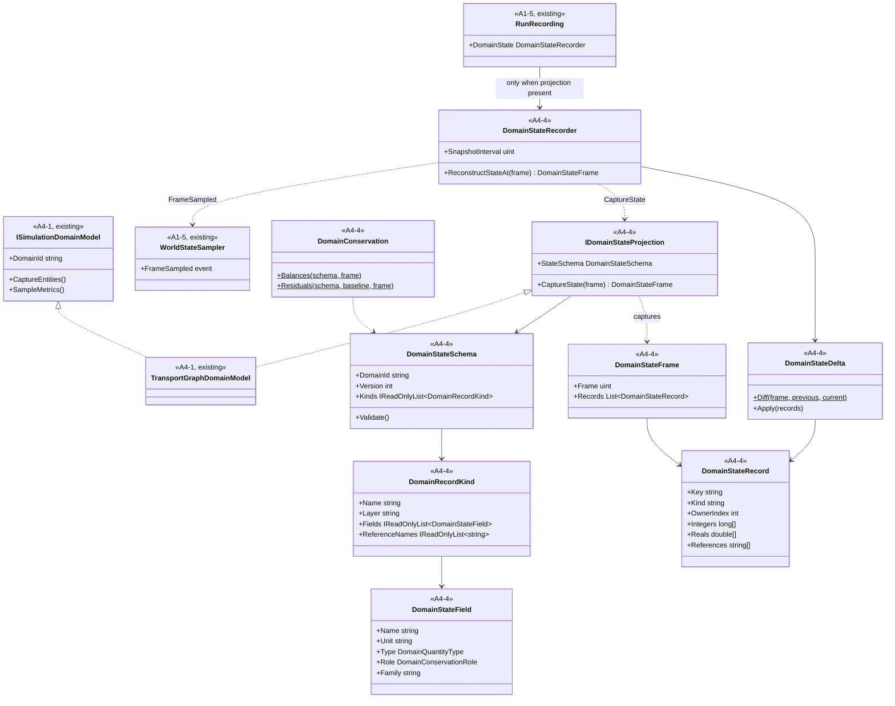
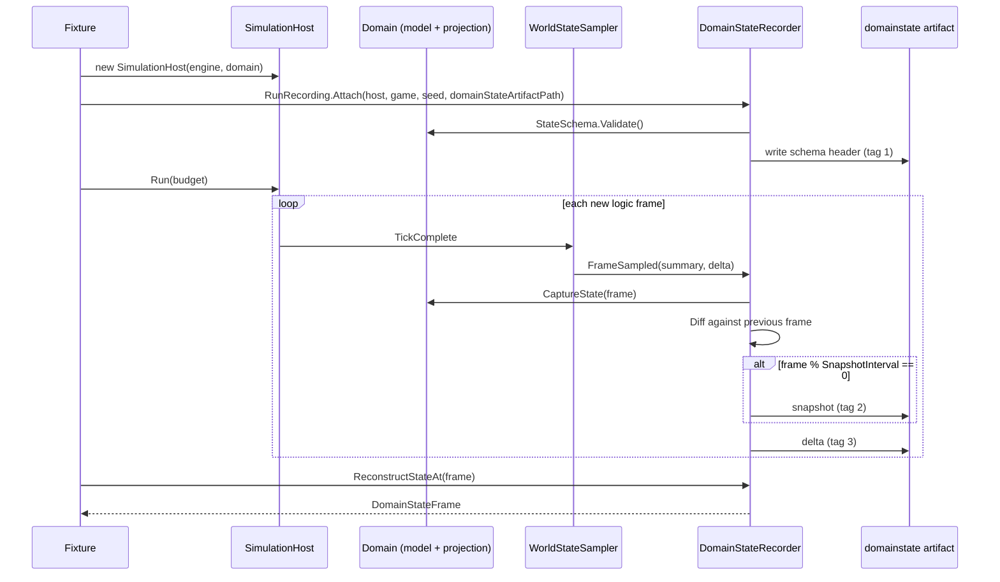

# Deep Dive: A4-4 Domain State Projection

> Expands phase A4 of [Track A: Foundations](../track-a-foundations.md); checklist item A4-4.
> Extends the [A4-1 Simulation Domain Model seam](a4-simulation-domain-model.md). First consumer:
> [Track W](../track-w-western-front.md) phase W0.
>
> Audience: human design for the contracts `WI-A4-42..45` add. Code references are in the
> agent-context appendix.

Purpose: let a domain record reconstructable, multi-valued, versioned state without changing the
RTS recording path. `DomainEntitySummary` carries two scalar slots, which cannot reconstruct
formation strength, logistics stocks, command state, and fidelity layer. Sampled metric series are
analysis output, not state. This phase adds an optional projection beside the existing summary.

---

## 1. Scope

In scope:

- a declared, versioned state schema: record kinds, fields, units, owning layer, conservation role;
- keyed state records with integer and real field vectors plus stable-key references;
- frame capture, delta diff/apply, snapshot/delta artifact, and reconstruction;
- a generic conservation check driven only by the schema;
- wiring into `RunRecording` and `RunOutput` when the injected domain implements the projection.

Out of scope:

- T1 signature trees over state records (entity summaries keep feeding T1);
- save/load of domain state (a domain persists its own state through `StatePersister` when it
  needs save games);
- schema migration between versions (a reader rejects an unknown version).

## 2. Design choices

| Choice | Decision | Reason |
|---|---|---|
| Attachment | Optional interface `IDomainStateProjection`, implemented by the domain model class | RTS and existing adapters stay untouched; the host and recorder detect the projection by type test. |
| Artifact | Separate `*.domainstate.bin` beside the world-state artifact | `WorldObjectState` and its artifact stay byte-identical for RTS. |
| Value storage | Per record: `long[] Integers`, `double[] Reals`, `string[] References` in schema field order | Compact, typed, and stable-order; no per-value field names on disk. |
| Conservation | Field role `Holding`, `Sink`, `Source`, or `None`, grouped by `Family` and record owner | A checker can prove `sum(Holding) + sum(Sink) - sum(Source)` is constant without domain code. |
| Conserved type | Non-`None` roles require `Integer` | Exact integer conservation (see the [Western Front decision gates](../open-questions.md)). |
| Record order | Ordinal by `Key` | Stable diffs and reconstruction regardless of domain iteration order. |
| Version | `DomainStateSchema.Version` persisted in the artifact header | Readers reject unknown versions instead of guessing. |

## 3. Contracts

Namespace `Panopticon.Simulation`, files under `src/Panopticon.Simulation/Simulation/State/`.

```csharp
public enum DomainQuantityType { Integer, Real }

public enum DomainConservationRole { None, Holding, Sink, Source }

public sealed record DomainStateField(
    string Name,
    string Unit,
    DomainQuantityType Type,
    DomainConservationRole Role,
    string? Family);

public sealed record DomainRecordKind(
    string Name,
    string Layer,
    IReadOnlyList<DomainStateField> Fields,
    IReadOnlyList<string> ReferenceNames);

public sealed record DomainStateSchema(
    string DomainId,
    int Version,
    IReadOnlyList<DomainRecordKind> Kinds)
{
    public void Validate();
}

public sealed class DomainStateRecord : IPersistableObject
{
    public string Key { get; set; }
    public string Kind { get; set; }
    public int OwnerIndex { get; set; }
    public long[] Integers { get; set; }
    public double[] Reals { get; set; }
    public string[] References { get; set; }
}

public sealed class DomainStateFrame : IPersistableObject
{
    public uint Frame { get; set; }
    public List<DomainStateRecord> Records { get; }
}

public sealed class DomainStateDelta : IPersistableObject
{
    public uint Frame { get; set; }
    public List<DomainStateRecord> Upserted { get; }
    public List<string> Removed { get; }

    public static DomainStateDelta Diff(uint frame, DomainStateFrame previous, DomainStateFrame current);
    public void Apply(SortedDictionary<string, DomainStateRecord> records);
}

public interface IDomainStateProjection
{
    DomainStateSchema StateSchema { get; }

    DomainStateFrame CaptureState(uint frame);
}
```

`Validate` rejects: duplicate kind or field names, an empty `Unit` or `Layer`, a non-`None` role on
a `Real` field, a non-`None` role without `Family`, and a `None` role with a `Family`. `Unit` uses
short SI-style or count labels (`persons`, `rounds`, `guns`, `s`, `ratio`, `index`).

`Integers` holds the kind's `Integer` fields in declaration order; `Reals` holds its `Real` fields
in declaration order. `References` holds stable keys named by `ReferenceNames` (for example a
parent formation key or region key). A record whose vector lengths disagree with its kind is
invalid; the recorder throws on capture.

## 4. Conservation check

```csharp
public sealed record DomainConservationBalance(string Family, int OwnerIndex, long Balance);

public static class DomainConservation
{
    public static IReadOnlyList<DomainConservationBalance> Balances(
        DomainStateSchema schema,
        DomainStateFrame frame);

    public static IReadOnlyList<DomainConservationBalance> Residuals(
        DomainStateSchema schema,
        DomainStateFrame baseline,
        DomainStateFrame frame);
}
```

`Balance` is `sum(Holding) + sum(Sink) - sum(Source)` over every record with that owner and every
field of that family. `Residuals` returns only non-zero `frame - baseline` differences, so an
empty list proves exact conservation. Sources model declared external inputs (production, new
arrivals); sinks model declared exits (casualties, consumption). Anything else that changes a
balance is a defect.

## 5. Recording

`DomainStateRecorder` subscribes to `WorldStateSampler.FrameSampled`, so it samples exactly the
frames the other tiers sample (paused steps that do not advance the logic frame are skipped).

- Every sampled frame: `CaptureState(frame)`, diff against the previous frame, keep the delta.
- Every `SnapshotInterval` frames: keep the full frame as a snapshot.
- Optional artifact: record tag `1` schema header (domain id, version, kinds), tag `2` snapshot,
  tag `3` delta, written live and flushed per record, matching `WorldStateArtifactWriter`.
- `ReconstructStateAt(frame)`: latest snapshot at or before the frame plus later deltas.
- `DomainStateArtifact.Load(path, game)` returns schema, snapshots, and deltas; an unknown record
  tag or schema version throws `InvalidDataException`.

`RunRecording.Attach` creates the recorder only when `host.DomainModel is IDomainStateProjection`.
It takes an optional `domainStateArtifactPath`. `RunOutput` gains nullable additive properties:
`DomainStateSchemaVersion`, `DomainStateArtifactPath`, and `DomainStateSnapshotFrames`, marked
`JsonIgnore(Condition = WhenWritingNull)` so RTS run-output JSON is unchanged.

## 6. Reference implementation

`TransportGraphDomainModel` implements the projection as the generality proof (`WI-A4-45`):

| Kind | Layer | Fields | References |
|---|---|---|---|
| `node` | `graph` | `occupancy` (`vehicles`, Integer, Holding, family `vehicle`) | none |
| `edge` | `graph` | `throughput` (`crossings`, Integer, None) | `from`, `to` |
| `vehicle` | `graph` | `edge_progress` (`ratio`, Real, None) | `edge` |

Every vehicle is counted at exactly one node, so `vehicle` residuals stay empty for the whole run.

## 7. Sub-items and cards

| Item | Card | Deliverable |
|---|---|---|
| A4-4a | [`WI-A4-42`](../agent/cards/WI-A4-42-domain-state-contracts.md) | Contracts and schema validation. |
| A4-4b | [`WI-A4-43`](../agent/cards/WI-A4-43-domain-state-frames.md) | Persistence, diff/apply, reconstruction, conservation check. |
| A4-4c | [`WI-A4-44`](../agent/cards/WI-A4-44-domain-state-recorder.md) | Recorder, artifact, `RunRecording`/`RunOutput` wiring. |
| A4-4d | [`WI-A4-45`](../agent/cards/WI-A4-45-transport-state-projection.md) | Transport-graph projection and conservation test. |

## 8. Architecture diagrams

Grounded in `ISimulationDomainModel`, `WorldStateSampler`, `RunRecording`, and
`WorldStateArtifactWriter` as of this design. Types marked A4-4 are new.





## Appendix: Current-state hooks (agent context)

- `src/Panopticon.Simulation/Simulation/ISimulationDomainModel.cs:15-63`: seam the projection sits beside.
- `src/Panopticon.Simulation/Simulation/Types/DomainEntitySummary.cs`: the two-scalar summary this
  phase does not change.
- `src/Panopticon.Simulation/Recording/RunRecording.cs:15-62`: `WorldStateSampler` and its
  paused-frame skip.
- `src/Panopticon.Simulation/Recording/RunRecording.cs:70-125`: `SnapshotDeltaRecorder`, the pattern
  `DomainStateRecorder` replicates.
- `src/Panopticon.Simulation/Recording/RunRecording.cs:382-448`: `RunRecording.Attach` and
  `Complete`, the wiring points.
- `src/Panopticon.Simulation/Recording/WorldStateSnapshot.cs:330-468`: artifact writer, loader, and
  reconstruction to mirror.
- `src/Panopticon.Simulation/RunOutput.cs:62-100`: additive run-output fields.
- `src/Panopticon.Simulation/Simulation/Transport/TransportGraphDomainModel.cs:140-215`: reference
  adapter captures reused by `WI-A4-45`.
