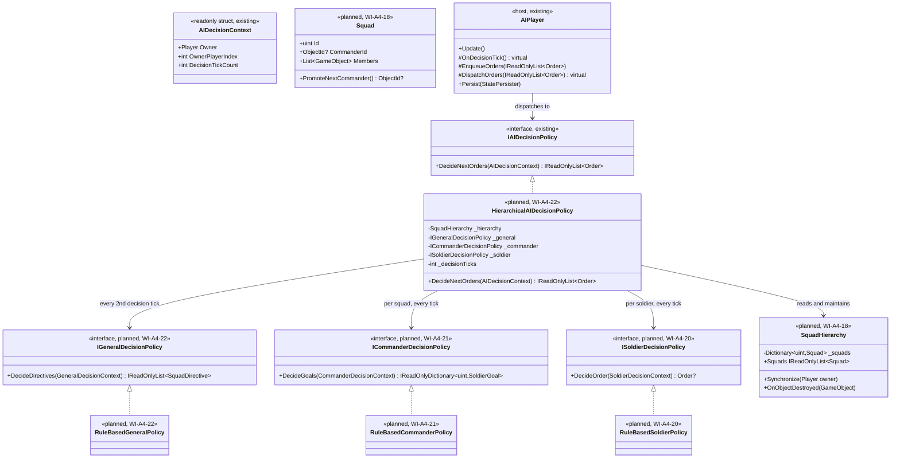
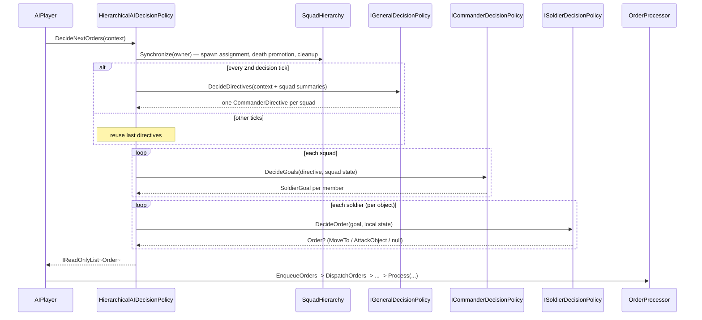

# Deep Dive: Decentralized Hierarchical AI (Unit-Level ANNs)

> Expands phase A4 of [Track A: Foundations](../track-a-foundations.md). Part of the
> [Large-Scale Simulation Roadmap](../README.md).
>
> Audience: human overview of the decentralized-AI design. Code references are in the
> agent-context appendix at the bottom.

Purpose: generalize the A4 AI decision policy seam from one centralized policy per player into a
decentralized, rank-structured population of small artificial neural networks (ANNs), one per
unit, that command each other in a hierarchy. This document designs the architecture only. It
does not implement a training harness or a first network; §7 covers the follow-on work it
unblocks.

---

## 1. Rationale

[pluggable-ai.md](a4-pluggable-ai.md) formalizes `IAIDecisionPolicy`: one policy instance per
player, called once per decision tick, that reads the whole game state it needs and returns every
order for that player. That shape is intentionally flat: it is the smallest seam that lets a
rule-based state machine and a neural network sit behind the same interface.

A flat, single-network policy does not scale the same way the rest of the roadmap does. One
network that must encode the state of, and decide the action for, every unit a player owns grows
with unit count, working against the roadmap's scale aims ([Track B](../track-b-scale.md)) and
against evolvability: a single large network is harder to train than many small ones. The
alternative explored here is decentralized: authority is distributed across a rank hierarchy of
small networks, each with a narrow, local input and output space that does not grow with total
unit count.

The hierarchy has three ranks:

- General: the player. One instance per player, unchanged in position from
  [pluggable-ai.md](a4-pluggable-ai.md), issuing directives to commanders rather than concrete
  orders to every unit.
- Commander: a unit promoted to lead a squad. Reads the general's directive plus the state of
  its own squad and issues goals to the soldiers under it.
- Soldier: an individual leaf unit. Reads its own local perception plus the goal its commander
  gave it and emits the actual engine order.

Each rank's network varies in complexity with the size of its input, output, and decision space:
a soldier's network is small and cheap, run once per unit per decision tick at whatever scale
[Track B](../track-b-scale.md) reaches; a commander's network is larger, run once per squad; the
general's network is the largest and rarest, run once per player. This mirrors the existing
per-unit AI split described in [`docs/system-investigations/enemy-ai.md`](../../system-investigations/enemy-ai.md): per-unit behavior
(`AIUpdate`/`AIUpdateStateMachine`) is already the layer that scales with unit count, while
strategic decisions are already the layer that runs once per player. This design slots a new,
learned middle rank (commander) between them and replaces the leaf and root layers' decision logic
with pluggable per-rank policies, without changing which rank actuates.

---

## 2. Design

### 2.1 Command hierarchy and rank assignment

A hierarchy needs a rule for who becomes a commander and who reports to whom. The reference rule:
squads form from the existing team/group selection the engine already has (`Team`, multi-unit box
selection), and the highest-value unit in a squad by an existing property (unit rank, cost, or a
new explicit `IsCommandCapable` flag on the object definition) becomes that squad's commander. If
a commander dies, the next-highest-value soldier in its squad is promoted, so the hierarchy
repairs itself without extra bookkeeping. A soldier with no live commander reports directly to the
general, so units always have exactly one order source above them, even mid-battle.

This reference rule is deliberately simple. Alternative rank-assignment rules, such as a
dedicated commander unit type with no combat capability of its own, or fixed squads defined at
scenario-authoring time, remain future variations behind the same seam (§6).

### 2.2 Order flow

Each tick, information flows down and orders flow down; nothing but engine `Order`s crosses the
simulation boundary, matching the actuation constraint [pluggable-ai.md](a4-pluggable-ai.md)
already established and [skirmish-ai.md's actuation decision](p2-p5-skirmish-ai.md#13-how-the-ai-issues-actions-decision-orders-via-orderprocessor):

1. General tick (coarsest cadence): reads player-level state (economy, force composition, enemy
   intelligence) and emits one directive per commander, or per squad with no live commander. A
   directive is data, not an order: a target region, a posture (attack, defend, regroup), and an
   optional target reference.
2. Commander tick (finer cadence): reads its received directive plus its squad's local state
   (member health, position, ammunition, nearby threats) and emits one goal per soldier in its
   squad. A goal is also data: a destination, a target, and a stance.
3. Soldier tick (finest cadence, matches today's per-object `AIUpdate` cadence): reads its
   received goal plus its own local perception (nearby enemies, terrain, line of sight, matching
   what `AIUpdateStateMachine`'s states already read) and emits the concrete engine `Order`
   (`MoveTo`, `AttackObject`, `ForceAttack…`) via `OrderProcessor`, exactly as today's rule-based
   AI and the flat NN policy from [pluggable-ai.md](a4-pluggable-ai.md) do.

No rank mutates game state directly, and no rank other than the soldier rank touches
`OrderProcessor`. This keeps every rank replay- and record-compatible.

### 2.3 Relationship to per-unit AI (`AIUpdate`)

The soldier rank's network does not replace `AIUpdate`'s locomotion, target-point queue, or
turret-tracking. It replaces only the decision `AIUpdateStateMachine` currently makes inside a
state such as `GuardState` or `HuntState`: given a goal and local perception, which state to be
in and which target or destination to pick. `AIUpdate`'s existing movement and weapon-actuation
path is unchanged; a soldier's network is a pluggable alternative to
`AIUpdateStateMachine`'s transition logic, not a replacement for the whole per-unit module. This
keeps the soldier rank's blast radius small: a soldier network that misbehaves still moves and
fires through the same tested locomotion and targeting code, it just picks worse goals.

### 2.4 Complexity scaling

Network size scales with each rank's role, not with a fixed global size:

- Soldier: a small feed-forward network. Input is the unit's own local perception (nearby enemy
  and ally positions/health within sensor range, its own health and ammunition, its received
  goal). Output is a small discrete or low-dimensional continuous action (move toward a point,
  attack a target, hold position, retreat). Sized to run for every live unit every soldier-tick
  at Track B's scale targets.
- Commander: a larger network. Input aggregates its squad's state (member count, average
  health, nearby threat density) plus the general's directive. Output is one goal per squad
  member, so its output space scales with squad size, not total unit count, keeping it bounded by
  a configured maximum squad size.
- General: the largest network, matching the flat policy's scope in
  [pluggable-ai.md §3](a4-pluggable-ai.md#3-what-this-unblocks-a-neural-network-policy). Input is
  player-level state (economy, force composition by squad, enemy intelligence). Output is one
  directive per commander (or per uncommanded squad), so its output space scales with squad
  count, not unit count.

The exact per-rank network shape (layer sizes, feature encoding) is implementation detail decided
when a first network is built (§7), not part of this seam.

---

## 3. Interface shape (design, not implementation)

Three narrow interfaces, one per rank, each following the same shape as
[`IAIDecisionPolicy`](a4-pluggable-ai.md#2-interface-shape-design-not-implementation): read a
context, decide, return data:

```csharp
// Illustrative, not implemented by this doc.

public interface IGeneralDecisionPolicy
{
    // Called at the general's decision cadence. Reads player-level state; returns one
    // directive per commander, or per uncommanded squad.
    IReadOnlyDictionary<SquadId, CommanderDirective> DecideDirectives(GeneralDecisionContext context);
}

public interface ICommanderDecisionPolicy
{
    // Called at the commander's decision cadence. Reads the received directive plus local
    // squad state; returns one goal per soldier in the squad.
    IReadOnlyDictionary<ObjectId, SoldierGoal> DecideGoals(CommanderDecisionContext context);
}

public interface ISoldierDecisionPolicy
{
    // Called at the soldier's decision cadence (matches today's AIUpdate cadence). Reads the
    // received goal plus local perception; returns the order to enqueue. Must not mutate game
    // state directly, same constraint as every rank above it and as the flat policy in
    // pluggable-ai.md.
    Order DecideOrder(SoldierDecisionContext context);
}
```

`IGeneralDecisionPolicy` is a second, hierarchical implementation family behind the same
top-level seam `IAIDecisionPolicy` already occupies: a `HierarchicalAIDecisionPolicy` adapter
implements `IAIDecisionPolicy` by running the general network and forwarding its directives down
through the commander and soldier ranks, so `AIPlayer` still dispatches through one seam
regardless of whether the flat or hierarchical family is selected. `AIPlayer`'s host role, tick
cadence, and persistence (`AIPlayer.Persist`) are unchanged from
[pluggable-ai.md §2](a4-pluggable-ai.md#2-interface-shape-design-not-implementation); this design
adds ranks below the existing seam rather than beside it.

### 3.1 Selection

Selection composes with the flat-policy selection already described in
[pluggable-ai.md §2.1](a4-pluggable-ai.md#21-selection): the existing policy-identifier config
value grows one more option, `hierarchical`, which additionally needs a commander-assignment rule
(§2.1) and per-rank network identifiers once trained networks exist. No caller of `AIPlayer` needs
to know which family, flat or hierarchical, is running.

---

## 4. Integration surface

- Host: unchanged from [pluggable-ai.md §5](a4-pluggable-ai.md#5-integration-surface):
  `AIPlayer.OnDecisionTick()` dispatches through `IAIDecisionPolicy`.
- New adapter: `HierarchicalAIDecisionPolicy` implements `IAIDecisionPolicy` and internally runs
  the general, commander, and soldier ranks each at their own cadence, converting the leaf rank's
  output into the `IReadOnlyList<Order>` the host expects.
- New rank-assignment data: a commander/squad grouping derived from the existing `Team`/selection
  model (§2.1), read by the general and commander ranks and updated on unit death (promotion) and
  unit spawn (assignment to a squad).
- Per-unit decision hook: a pluggable point inside `AIUpdateStateMachine`'s existing states
  (`GuardState`, `HuntState`, `AttackAreaState`, and similar) where the soldier rank's network can
  substitute for the state's built-in target/goal selection, without touching `AIUpdate`'s
  locomotion or turret-actuation code (§2.3).
- Actuation: unchanged. Only the soldier rank emits `Order`s, via `OrderProcessor`, matching the
  actuation decision in [skirmish-ai.md §1.3](p2-p5-skirmish-ai.md#13-how-the-ai-issues-actions-decision-orders-via-orderprocessor)
  and [pluggable-ai.md](a4-pluggable-ai.md).
- Persistence: general and commander state (which squad a unit belongs to, who its commander is)
  extends `AIPlayer.Persist`/`SkirmishAIPlayer.Persist`'s existing save/load path rather than
  introducing a new one.

---

## 5. Sub-phases

| Phase | Goal | Status |
|---|---|---|
| A4-3a. Rank and command-hierarchy model | Add the squad/commander data model: derive squads from the existing team/selection model, assign a commander per squad, promote on commander death. No network yet; commander/soldier goals are still decided by today's rule-based logic. | Done (WI-A4-18/19) |
| A4-3b. Soldier-level decision policy seam | Extract `ISoldierDecisionPolicy` from the relevant `AIUpdateStateMachine` states (§2.3), with the existing state-machine transition logic as the reference implementation. | Done (WI-A4-20; adapter-owned per-object invocation per the §6 leaf-execution decision) |
| A4-3c. Commander-level decision policy | Add `ICommanderDecisionPolicy`, with a rule-based reference implementation (aggregate squad state, forward the general's directive as each soldier's goal). | Done (WI-A4-21) |
| A4-3d. General-level directive interface | Add `IGeneralDecisionPolicy` and the `HierarchicalAIDecisionPolicy` adapter, with a rule-based reference implementation equivalent to today's flat `SkirmishAIPlayer` behavior split across ranks. | Done (WI-A4-22/23; military facet, economy/production stay the flat policy's surface) |
| A4-3e. First per-rank neural networks | Design and implement a first `ISoldierDecisionPolicy`, `ICommanderDecisionPolicy`, and `IGeneralDecisionPolicy` network per §2.4's complexity scaling. | Not started |
| A4-3f. Hierarchical evolutionary training harness | Extend the flat-policy training harness ([pluggable-ai.md §4](a4-pluggable-ai.md#4-what-this-unblocks-evolutionary-training-via-seeded-weight-populations)) to co-evolve three rank populations. | Not started |

---

## 6. Resolved design questions and open work

- Commander assignment. Decision: derive squads from the existing team/selection model and
  promote the highest-value surviving squad member on commander death (§2.1), rather than a
  dedicated non-combat commander unit type. Revisit if playtesting shows commander death causes
  disruptive command gaps.
- Soldier/`AIUpdate` boundary. Decision: the soldier rank's policy replaces only
  `AIUpdateStateMachine`'s decision logic, not `AIUpdate`'s locomotion or turret actuation (§2.3),
  to keep the blast radius of a misbehaving network small and reuse tested movement/targeting
  code.
- Squad source (WI-A4-17). Decision: squads derive from simulation-owned
  `GameObject.Team` where a map or script assigned one; units with no team are auto-grouped
  by the hierarchy into squads of at most `MaxSquadSize` (8), filling in ascending object-id
  order so grouping is stable across runs. Presentation-owned selection state is never read.
- Commander ranking (WI-A4-17). Decision: the commander is the squad member with the highest
  `ObjectDefinition.BuildCost`; ties break to the lower object id. Promotion applies the same
  rule over surviving members.
- Per-rank cadence (WI-A4-17). Decision: every rank runs inside the existing
  `AIPlayer.OnDecisionTick` dispatch (no new tick site). The general runs every second
  decision tick (120 frames); commanders and soldiers run every decision tick (60 frames).
  Between commander ticks a soldier keeps its last goal, so every soldier always has one.
- Leaf execution and actuation (WI-A4-17). Decision: leaf decisions execute inside the
  top-level adapter, which iterates the player's units per-object and calls each soldier's
  policy; every rank's output flows back as `Order`s through the single existing actuation
  path (`AIPlayer.EnqueueOrders` -> `DispatchOrders` -> `OrderProcessor`). No rank mutates
  game state directly and `AIUpdateStateMachine` is untouched.
- Hierarchy persistence (WI-A4-17). Decision: squad membership and commander identity
  persist as a version-gated block appended to `SkirmishAIPlayer.Persist` (version 2+).
  Version-1 saves load unchanged and rebuild squads on demand; object identities persist as
  ids and resolve lazily against live objects, never during load.
- Per-rank network shape and feature encoding: open, deferred to A4-3e (§5). Each rank's exact
  layer sizes and state encoding are implementation detail, not part of the seam (§2.4).
- Co-evolution scheme for three interacting rank populations (fix two ranks and evolve the
  third, alternating; or evolve all three jointly): open, deferred to A4-3f (§5). This is a
  harder training problem than the flat policy's single-population evolution
  ([pluggable-ai.md §4](a4-pluggable-ai.md#4-what-this-unblocks-evolutionary-training-via-seeded-weight-populations))
  because rank fitness is interdependent.
- Fitness signal below the match level: open. The flat policy scores fitness from
  [`GameOutcome`](p3-victory-defeat.md) alone; a hierarchical population may need per-rank shaped
  fitness (for example, a commander's squad survival rate) in addition to match outcome, to give
  useful training signal to ranks that do not directly win or lose a match. Deferred to A4-3f.

---

## 7. Follow-on work (not in this doc)

This doc formalizes the hierarchy and per-rank seams only. Follow-up work, each large enough for
its own task-card set, is enumerated as sub-phases A4-3a through A4-3f (§5). It depends on
[pluggable-ai.md](a4-pluggable-ai.md)'s flat-policy seam landing first, since the general rank's
adapter composes with the existing `IAIDecisionPolicy` selection point rather than replacing it.

---

## 8. Related

- Flat single-policy seam this design generalizes:
  [pluggable-ai.md](a4-pluggable-ai.md) (A4).
- Reference per-unit AI this design's soldier rank extends:
  [`docs/system-investigations/enemy-ai.md`](../../system-investigations/enemy-ai.md).
- Reference strategic AI this design's general rank replaces the flat form of:
  [skirmish-ai.md](p2-p5-skirmish-ai.md) (P2).
- Fitness signal: [victory-defeat.md](p3-victory-defeat.md) (`GameOutcome`, P3).
- Seam registry entry: [`../seams.md`](../seams.md) (Experiment seams (A4) table).
- Statistical evaluation: [Track A A2](../track-a-foundations.md).

---

## 9. Architecture diagrams

Grounded in the current code plus the explicitly named planned types (`SquadHierarchy`,
`CommanderDirective`, `SoldierGoal`, the three rank policy interfaces, their rule-based
reference implementations, and `HierarchicalAIDecisionPolicy`). Everything else is the
type/member as it stands today.



Order flow for one decision tick (single actuation path; soldiers keep their last goal
between commander ticks):



---

## Appendix: Current code (agent context)

> Agent context: file:line references for agents implementing this phase. Human readers: the
> design intent above does not require reading this section.

- No hierarchy or per-rank policy code exists yet; this phase is design-only.
- Reference points this design builds on, already documented elsewhere:
  - `AIPlayer.OnDecisionTick()` / `AIPlayer.Update()` host and cadence
    (`src/OpenSage.Game/Logic/AI/AIPlayer.cs`), unchanged, see
    [pluggable-ai.md appendix](a4-pluggable-ai.md#appendix-current-code-agent-context).
  - `AIUpdateStateMachine` and its states (`GuardState`, `HuntState`, `AttackAreaState`, and
    others), the soldier rank's decision-substitution point, see
    `src/OpenSage.Game/Logic/AI/AIUpdateStateMachine.cs` and
    [`docs/system-investigations/enemy-ai.md` §1.2](../../system-investigations/enemy-ai.md).
  - Existing team/multi-select grouping the squad model reuses: `Team`
    (`src/OpenSage.Game/Logic/Team.cs`) and the box-selection path in
    `src/OpenSage.Game/Logic/SelectionSystem.cs`.
  - Actuation path every rank's leaf output must still go through: `OrderProcessor.Process(...)`
    (`src/OpenSage.Game/Logic/Orders/OrderProcessor.cs`).
