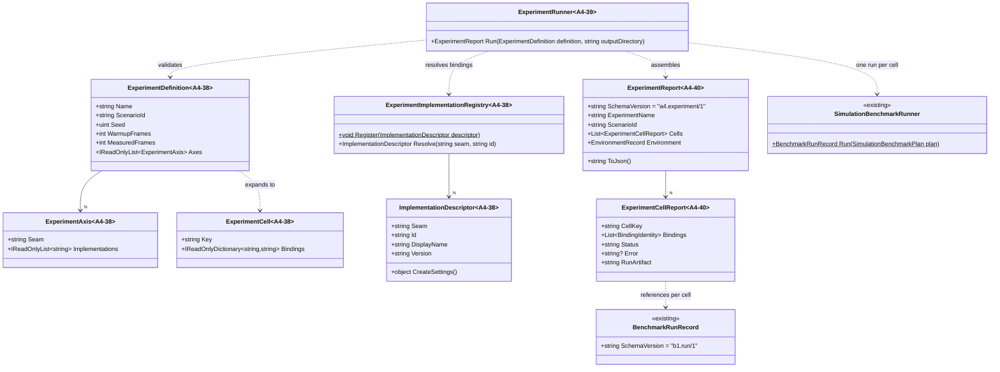
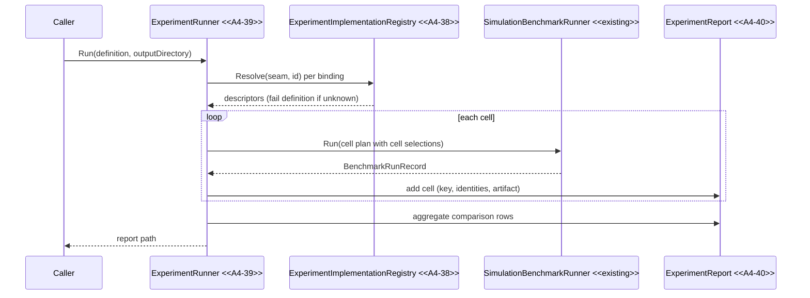

# Deep Dive: A4 Experiment Harness

> Part of [Track A · A4](../track-a-foundations.md). Defines the harness that selects seam
> implementations, runs them against [B1](b1-benchmarking.md) benchmarks, and reports
> comparable results to [A5](a5-visualization.md).

## Scope

The harness is the orchestration layer of the pluggable-experiments aim: one experiment
configuration names a B1 scenario plus one implementation per swept seam, the harness expands
the cells, runs each through the B1 runner, and emits one report that A5 can load without
knowing any concrete implementation. It does not benchmark anything itself and does not
redesign B1; B1 owns measurement mechanics, A4 owns selection and orchestration.

## Decisions applied

- The harness lives in `src/Panopticon.Benchmarks.Simulation` under `Experiments/`, reusing
  B1's runner, record types, statistics, and environment capture. No new assembly.
- Selection is data: an experiment is a typed definition with typed bindings, not a scenario
  subclass per combination. Registry identity is stable strings plus versions.
- The report envelope extends the B1 record shape: B1 `BenchmarkRunRecord` per cell, embedded
  in an experiment report with cell keys, binding identities, and artifact references.
- Failures are cell-scoped: a failing cell is recorded with its error and the remaining cells
  still run and report.

## Experiment configuration

An experiment definition contains:

- Name and B1 scenario reference: the `scenarioId` string registered in
  `SimulationBenchmarkScenario.Create`.
- Sample settings: seed, warmup frames, measured frames, with B1 defaults.
- Axes: one entry per swept seam, naming the seam key and the implementation ids to compare.
- Optional per-implementation typed settings carried by the registry descriptors, such as a
  neural-policy genome.

Expansion is the cartesian product of axes, one cell per combination, each cell a stable
`seam=implementation` binding map. Cells are keyed by the binding map rendered in axis order,
so the same definition always yields the same cell keys. This mirrors
`ScenarioMatrix.Expand()` from ReplaySketch but stays inside the benchmark project and keys on
implementation identity rather than authoring values.

## Registry keys and typed bindings

Each seam implementation registers under a stable key pair:

- Seam key: the seam name from the [seam registry](../seams.md), e.g. `ai-policy`,
  `model-import`.
- Implementation id: stable within the seam, e.g. `rule-based`, `neural`,
  `w3d`, `gltf`.
- Descriptor: display name, version string, and a typed factory that produces the runtime
  selection value for that seam (e.g. an `AIDecisionPolicyPayload` or an importer pair).

Definitions validate against the registry before any run: unknown seam, unknown implementation
id, or a settings object the descriptor rejects fails the definition with an explicit error,
not a runtime crash inside a benchmark.

## Execution model

Per cell: resolve bindings through the registry, construct the B1 plan, apply the cell's
selections through the seam's existing selection surface (never a caller-side branch on
implementation type), then run `SimulationBenchmarkRunner.Run`. Warmup, measurement,
recording, statistics, and environment capture are B1's and are not duplicated. The first
consumer of a runtime selection is the AI-policy experiment: bindings become
`PlayerSetting.AIPolicy` payloads resolved by `AIDecisionPolicyFactory`, proven end to end by
`HeadlessNeuralMatchEvaluator`.

## Output artifacts

One experiment produces one directory:

```text
<output>/experiments/<experiment>/<timestamp>/
    experiment.json          the report (authority)
    cells/<cellKey>/run.json the per-cell B1 record
    cells/<cellKey>/run.csv  derived CSV
```

Artifact references inside the report are relative to the report file, so moving or archiving
the directory keeps references resolving. The report is the authority; CSVs are derived.

## Result envelope

The experiment report carries:

- `schemaVersion`: `a4.experiment/1`.
- Experiment name, definition digest, and B1 scenario id.
- One entry per cell: cell key, binding identities (seam, implementation id, version), run
  status, error text when failed, and the per-cell B1 record reference.
- Aggregate comparison rows for shared metrics, computed from the per-cell B1 statistics
  (`BenchmarkStatistics` medians and bootstrap CIs, `IntervalsDiffer` for verdicts).
- One `EnvironmentRecord` captured per experiment; per-cell environments stay in the cell's
  B1 record.

Compatibility checks: readers reject a `schemaVersion` they do not support with a clear
message; binding identities that a reader does not know still render (they are strings), they
just do not resolve to an implementation.

This fills the `ExperimentMatrix`/`ExperimentRun` envelope placeholders in
[a5-visualization §8](a5-visualization.md#8-architecture-diagrams): the matrix is the expanded
definition, the run is the cell's B1 record, and the comparison keys are the cell keys.

## Failure semantics

- Definition-invalid (unknown key, bad settings): fail before any run, no artifacts.
- Cell failure (exception inside a run): recorded on the cell with the error message; the
  report marks it failed; other cells run and report.
- Report-invalid (unknown schema version on load): rejected with an explicit error naming the
  expected and found versions.

## Ownership

- Implementation project: `src/Panopticon.Benchmarks.Simulation` (`Experiments/` directory).
- CLI: the benchmark CLI gains `--experiment <path>` in WI-A4-41; the API surface
  (`ExperimentRunner.Run`) is primary and is what tests drive.
- A5 consumes `experiment.json` and per-cell `run.json`; it needs no implementation knowledge.

## Sub-phases and cards

| Card | Output |
|---|---|
| [`WI-A4-37`](../agent/cards/WI-A4-37-design-experiment-harness.md) | This deep dive |
| [`WI-A4-38`](../agent/cards/WI-A4-38-experiment-variant-registry.md) | Typed experiment definition and implementation registry |
| [`WI-A4-39`](../agent/cards/WI-A4-39-run-b1-experiments.md) | Per-cell B1 execution |
| [`WI-A4-40`](../agent/cards/WI-A4-40-write-experiment-comparison-report.md) | Report envelope and writers |
| [`WI-A4-41`](../agent/cards/WI-A4-41-compare-two-seam-implementations.md) | Two-implementation comparison milestone and CLI |

## Architecture diagrams

Grounded in the current code (`src/Panopticon.Benchmarks.Simulation/SimulationBenchmarkRunner.cs`,
`SimulationBenchmarkPlan.cs`, `BenchmarkRunRecord.cs`, `BenchmarkStatistics.cs`,
`EnvironmentRecord.cs`, `src/Panopticon.Simulation/Logic/AI/AIDecisionPolicyFactory.cs`).
Types marked `<<A4-38>>`..`<<A4-41>>` are the sub-phase deliverables.



Sequence: one experiment through the harness (WI-A4-38..40):



## Appendix: grounded hook references

- `src/Panopticon.Benchmarks.Simulation/SimulationBenchmarkRunner.cs`: per-run orchestration
  the harness reuses per cell.
- `src/Panopticon.Benchmarks.Simulation/SimulationBenchmarkPlan.cs`: plan construction the
  harness performs per cell.
- `src/Panopticon.Benchmarks.Simulation/BenchmarkRunRecord.cs`: per-cell record and
  `b1.run/1` schema.
- `src/Panopticon.Benchmarks.Simulation/BenchmarkStatistics.cs`: medians, bootstrap CIs,
  interval comparison for aggregate rows.
- `src/Panopticon.Benchmarks.Simulation/EnvironmentRecord.cs`: hardware context capture.
- `src/Panopticon.Simulation/Logic/AI/AIDecisionPolicyFactory.cs`: sole selection surface for
  the AI-policy seam.
- `src/Panopticon.Tools.ReplaySketch.Core/Model/ScenarioMatrix.cs`: cartesian-expansion
  precedent.
- `src/Panopticon.Tools.ReplaySketch.Core/Services/StatisticalRunHarness.cs`: aggregation-only
  statistics precedent.
