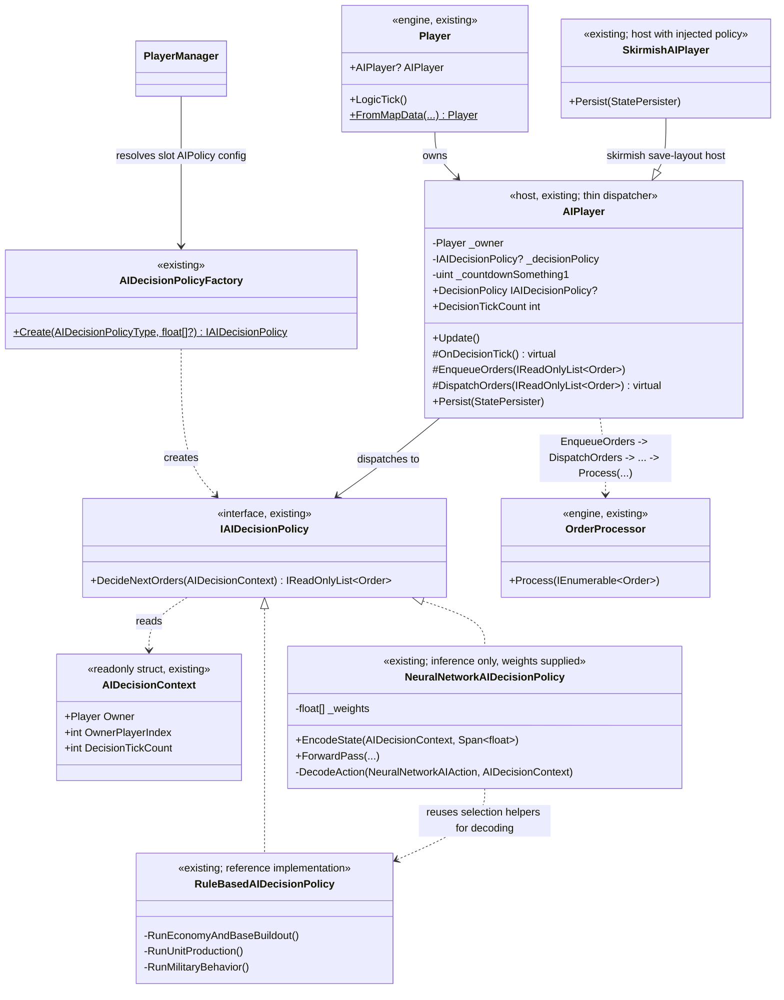
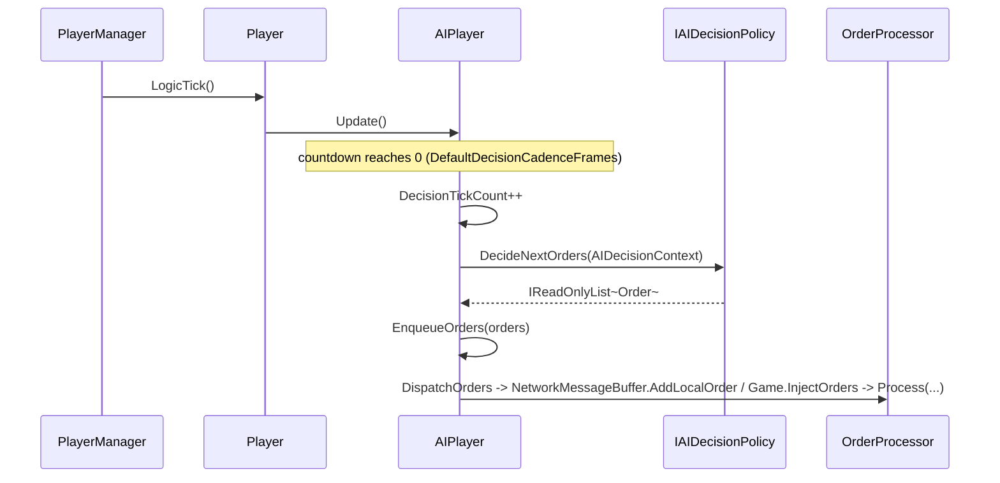
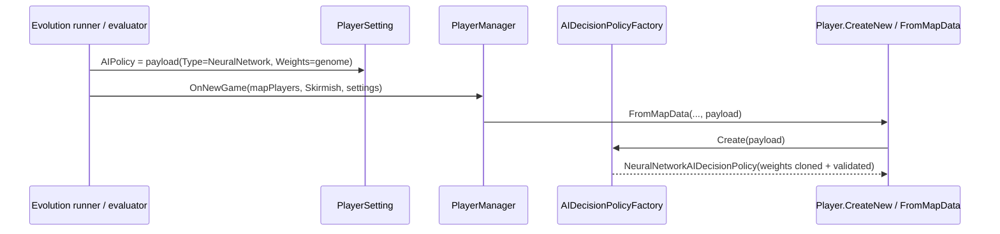
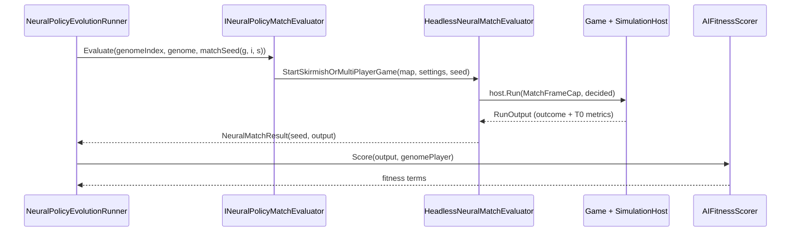
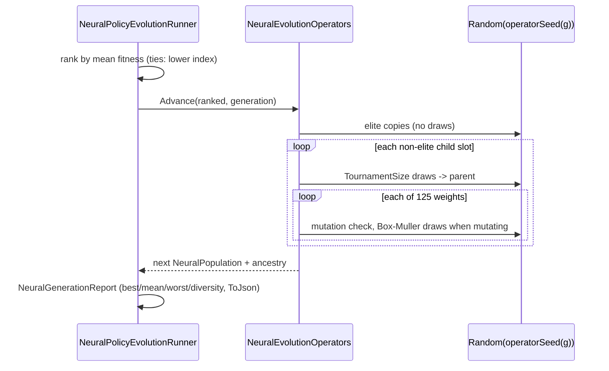

# Deep Dive: Pluggable AI Decision Policy

> Expands phase A4 of [Track A: Foundations](../track-a-foundations.md). Part of the
> [Large-Scale Simulation Roadmap](../README.md).
>
> Audience: human overview of the pluggable-AI design. Code references are in the
> agent-context appendix at the bottom.

Purpose: make a player's strategic decision-making its own A4 experiment seam. The design keeps
rule-based skirmish AI from [P2](../track-p-playable-baseline.md) as one swappable implementation
rather than the only one.

This document designs the seam only. It does not implement a neural-network policy or a training
harness; §6 covers the follow-on work it unblocks.

---

## 1. Rationale

[skirmish-ai.md §5](p2-p5-skirmish-ai.md#5-resolved-design-questions-and-open-work) already records the
key decision: a pluggable AI policy is an A4 experiment seam, not a P2 requirement. P2 lands one
concrete policy, `SkirmishAIPlayer`, described in [skirmish-ai.md §1.1](p2-p5-skirmish-ai.md#11-add-a-strategic-decision-loop-to-the-skirmish-ai). That is the shape an
[A4](../track-a-foundations.md) seam needs: a stable interface with one reference
implementation, sized so a very different implementation such as a neural net can sit behind the
same interface and be selected or compared without caller changes.

The variation axis is narrow: how a player's per-tick strategic decisions are made. It is not
per-object AI (`AIUpdate`/`DozerAIUpdate`/`SupplyAIUpdate`, etc.), and it is not the actuation
path. Every implementation still emits `Order`s through `OrderProcessor`, per the P2 actuation
decision in [skirmish-ai.md §1.3](p2-p5-skirmish-ai.md#13-how-the-ai-issues-actions-decision-orders-via-orderprocessor), so the recorded/replayed order stream stays intact.

---

## 2. Interface shape (design, not implementation)

The seam sits where `AIPlayer.OnDecisionTick()` sits today: a coarse-cadence callback, driven
from `AIPlayer.Update()`, that reads game state and enqueues `Order`s. Today it is a
`protected virtual` hook overridden by `SkirmishAIPlayer`; this seam turns it into an injectable
strategy so a policy is a pluggable collaborator instead of a base-class override:

```csharp
// Illustrative; not implemented by this doc.
public interface IAIDecisionPolicy
{
    // Called at the AI's decision cadence (AIPlayer.DefaultDecisionCadenceFrames).
    // Reads whatever state it needs from the context; returns orders to enqueue.
    // Must not mutate game state directly; same actuation-via-orders constraint as P2 (§2.3
    // of skirmish-ai.md) so every policy stays replay/record-compatible.
    IReadOnlyList<Order> DecideNextOrders(AIDecisionContext context);
}

// Read-only view of the state a policy is allowed to consume. Wraps Player/GameLogic/AssetStore
// access the reference implementation already uses (Owner.BankAccount, Owner.OwnedObjects,
// Owner.Enemies, AssetStore.AIData, ...) behind one seam so implementations aren't coupled to
// engine internals more broadly than necessary, and so a future non-engine (e.g. batched
// training) context can supply a lighter-weight fake.
public readonly struct AIDecisionContext
{
    public Player Owner { get; }
    public int OwnerPlayerIndex { get; }
    public int DecisionTickCount { get; }
    // ... read accessors mirroring what SkirmishAIPlayer already reads (§1.1 of skirmish-ai.md).
}
```

`AIPlayer` becomes a thin host: it owns the tick cadence and dispatches to an
`IAIDecisionPolicy` instead of relying on subclass overrides. `SkirmishAIPlayer`'s existing state
machine from [skirmish-ai.md §1.1](p2-p5-skirmish-ai.md#11-add-a-strategic-decision-loop-to-the-skirmish-ai) becomes the reference implementation, either as a
`RuleBasedAIDecisionPolicy` or via a refactored `SkirmishAIPlayer` that holds one, proving the
seam is real per the A4 definition ([seams.md](../seams.md#what-is-a-seam)).

### 2.1 Selection

Policy selection is config-driven, matching other A4 seams. A `PlayerAIType`-adjacent setting in
the skirmish slot config, which already drives `AIPlayer` vs `SkirmishAIPlayer` selection in
`Player.CreateNew`, grows a policy identifier. A small factory maps that identifier to an
`IAIDecisionPolicy`, and no caller of `AIPlayer` needs to know which policy is running.

### 2.2 Rationale for this shape

- It matches the existing actuation boundary exactly: orders via `OrderProcessor`. The seam is
  additive over P2's actuation decision, not a re-litigation of it.
- It keeps the interface narrow: one method and one read-only context. A neural-network
  implementation then needs only a private state encoding and order-decoding step, not engine
  knowledge about build lists, prerequisites, or unit kind flags.
- It keeps cadence, persistence (`AIPlayer.Persist`), and dispatch (`EnqueueOrder(s)`) in the
  host (`AIPlayer`) instead of duplicating them per policy.

---

## 3. What this unblocks: a neural-network policy

A neural-network implementation of `IAIDecisionPolicy` is the motivating case. The concrete
v1 design (exact feature vector, 9-8-5 network shape, five-action decoding, genome layout,
randomness policy) lives in [neural-network-ai-policy.md](neural-network-ai-policy.md) and
is implemented inference-only as `NeuralNetworkAIDecisionPolicy`; that document is the
stable genome contract for the training harness.

## 4. What this unblocks: evolutionary training via seeded weight populations

The user's training goal: generate multiple seed weight vectors and evolve them through repeated
simulation runs, maps directly onto the [A4 experiment harness](../track-a-foundations.md), which
already selects a seam implementation, runs it, and reports results. [A5](a5-visualization.md)
visualizes those results. Applied here:

1. Population: a set of weight vectors (genomes), one `IAIDecisionPolicy` instance per genome.
2. Fitness: a full headless match per genome (via the [P0 harness](p0-playable-baseline-harness.md)
   and [A1 headless host](a1-headless-host.md)), scored from the already-first-class
   [`GameOutcome`](p3-victory-defeat.md) (win/loss/score) plus auxiliary metrics (economy growth,
   territory held, survival time) as a shaped fitness signal.
3. Selection/variation: standard evolutionary-strategy moves (truncation/tournament selection,
   Gaussian mutation, optional crossover) produce the next generation's weight vectors.
4. Repeat: generations run as an A4 experiment sweep (matching the parameter-matrix mechanism
   [A5](a5-visualization.md) already drives for scenario authoring), with per-generation results
   (best/mean/worst fitness, diversity) reported to the visualizer so evolution progress across
   seeds is inspectable, not just the final result.

This doc does not design the training harness in detail; the concrete design lives in
[implementation/track-a-a4-ai-policy-evolution.md](../implementation/track-a-a4-ai-policy-evolution.md)
(WI-A4-11: policy payload, seeded population/variation operators, match evaluation matrix,
shaped fitness over `GameOutcome` plus T0 metrics, per-generation report). The seam is
shaped so the harness drops in cleanly: running N genomes across M seeded matches and collecting
fitness requires no change to `AIPlayer`, `OrderProcessor`, or `GameOutcome`. It only requires a
way to construct an `IAIDecisionPolicy` from a weight vector and assign it to a player slot, which
§2.1's factory provides.

---

## 5. Integration surface

- Host: `AIPlayer.OnDecisionTick()` becomes a dispatch to an injected `IAIDecisionPolicy`
  instead of a `protected virtual` override point.
- Reference implementation: `SkirmishAIPlayer`'s existing economy/build-out/production/military
  state machine (skirmish-ai.md §1.1), refactored behind the interface, no behavior change.
- Selection: a policy-identifier config value (alongside the existing skirmish/`PlayerAIType`
  slot configuration in `Player.CreateNew`) resolved by a small factory.
- Actuation: unchanged, every policy still emits `Order`s via `OrderProcessor` (skirmish-ai.md
  §2.3); this seam does not touch that decision.
- Persistence: unchanged in shape, `AIPlayer.Persist`/`SkirmishAIPlayer.Persist` keep owning
  save/load; a stateful policy (e.g. a NN's activations, if ever persisted) would extend that
  same path, not a new one.

---

## 6. Follow-on work (not in this doc)

This doc formalized the seam; the first three follow-ups have since landed (the seam
extraction and selection factory as `WI-A4-01`/`WI-A4-02`, the v1 neural-network policy as
`WI-A4-03`/`WI-A4-04`), and the flat-policy evolutionary training harness is designed and
implemented as `WI-A4-11` through `WI-A4-16` (design:
[implementation/track-a-a4-ai-policy-evolution.md](../implementation/track-a-a4-ai-policy-evolution.md)).
Remaining work:

- Per-generation reporting surfaced in [A5](a5-visualization.md) (charts over the generation
  reports the harness already emits).
- Hierarchical co-evolution (`WI-A4-17`..): the decentralized rank generalization of this seam.

---

## 7. Related
- Seam registry entry: [`../seams.md`](../seams.md) (Experiment seams (A4) table).
- Reference implementation this seam is carved from: [`p2-p5-skirmish-ai.md`](p2-p5-skirmish-ai.md) (P2).
- Fitness signal: [`p3-victory-defeat.md`](p3-victory-defeat.md) (`GameOutcome`, P3).
- Training-run execution surface: [`a1-headless-host.md`](a1-headless-host.md) (A1),
  [`p0-playable-baseline-harness.md`](p0-playable-baseline-harness.md) (P0).
- Sweep/reporting mechanism the training harness would reuse: [`a5-visualization.md`](a5-visualization.md) (A5).
- Statistical evaluation: [Track A A2](../track-a-foundations.md).

---

## 8. Architecture diagrams

Grounded in the current code (`src/OpenSage.Game/Logic/AI/AIPlayer.cs`,
`src/OpenSage.Game/Logic/AI/SkirmishAIPlayer.cs`, `src/OpenSage.Game/Logic/AI/AIDecisionPolicyFactory.cs`,
`src/OpenSage.Game/Logic/Player.cs`, `src/OpenSage.Game/Logic/Orders/OrderProcessor.cs`).



Sequence: the dispatch path since `WI-A4-01`:



Before the seam, `Pol` did not exist: `AIPlayer.OnDecisionTick()` was a bare `protected
virtual` hook and `SkirmishAIPlayer` overrode it directly, calling
`RunEconomyAndBaseBuildout()` / `RunUnitProduction()` / `RunMilitaryBehavior()` inline.
`WI-A4-01` extracted those into `RuleBasedAIDecisionPolicy`; `WI-A4-02` added the enum +
factory selection; `WI-A4-04` added `NeuralNetworkAIDecisionPolicy` per
[neural-network-ai-policy.md](neural-network-ai-policy.md).

Evolution diagrams (WI-A4-11..16; design:
[implementation/track-a-a4-ai-policy-evolution.md](../implementation/track-a-a4-ai-policy-evolution.md)).

Payload construction (WI-A4-12): how a genome reaches the policy.



Match evaluation (WI-A4-14/16): one genome-slot-seed cell.



Generation advancement (WI-A4-13/15): ranking to the next population.



---

## Appendix: Current code (agent context)

> Agent context: file:line references for agents implementing this phase. Human readers: the
> design intent above does not require reading this section.

- `AIPlayer.OnDecisionTick()` dispatches its injected `IAIDecisionPolicy` on a
  `DefaultDecisionCadenceFrames` cadence (`src/OpenSage.Game/Logic/AI/AIPlayer.cs`).
- `RuleBasedAIDecisionPolicy` contains the reference economy, production, and military state
  machine extracted from `SkirmishAIPlayer`. `SkirmishAIPlayer` remains the save-layout host.
- Actuation: `AIPlayer.EnqueueOrder(s)` → `DispatchOrders(...)` →
  `NetworkMessageBuffer.AddLocalOrder` (networked) or `Game.InjectOrders` (local), both ultimately
  processed by `OrderProcessor.Process(...)` (`Logic/Orders/OrderProcessor.cs`). The actuation
  path every future policy must keep using.
- Selection: `PlayerSetting.AIPolicy` (an `AIDecisionPolicyPayload`, WI-A4-12: null = rule
  based, neural carries its weight vector) flows through
  `PlayerManager.BuildAIDecisionPolicies(...)` to `AIDecisionPolicyFactory`, then into
  `Player.FromMapData(...)`.
- Fitness data source: `GameOutcome` is queryable by headless runs. The training harness (§4)
  combines it with existing T0 run metrics.
