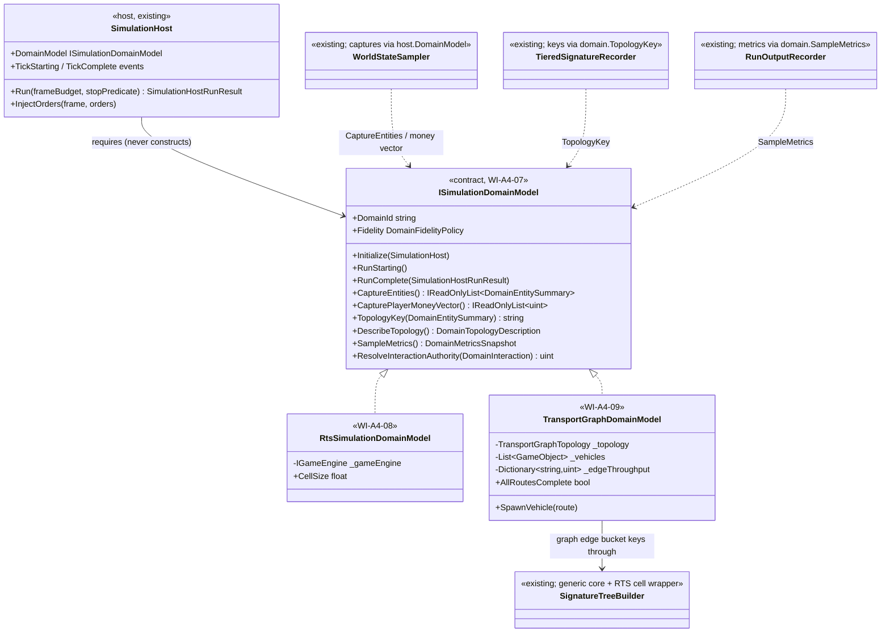
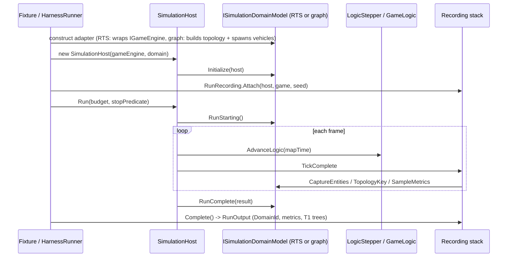

# Deep Dive: A4-1 Simulation Domain Model Seam

> Expands phase A4 of [Track A: Foundations](../track-a-foundations.md); checklist item A4-1.
> Audit: [implementation/track-a-a4-simulation-domain-model.md](../implementation/track-a-a4-simulation-domain-model.md).
>
> Audience: the contract set `WI-A4-07` adds and the adapters `WI-A4-08`/`WI-A4-09` implement.

Purpose: make "what the simulation is" a pluggable seam. The host (stepping, orders, events),
the recording tiers, and later scale work (B3 storage, B4 routing, B6 partitioning, B7
fidelity) consume domain-agnostic contracts; RTS becomes the first adapter and a minimal
transport/graph domain the second, proving the seam is topology-general rather than
RTS-shaped. Per the domain-scope Decision, non-RTS domains extend the shared
`GameObject`/module runtime: a domain is modules plus a topology/interaction adapter, not a
second engine.

---

## 1. What the seam owns (from the audit)

The audit found exactly five RTS-coupled surfaces; everything else in host and recorder is
already generic:

1. `SimulationHost`'s constructor parameter is the RTS-shaped `IGameEngine`.
2. `WorldStateSummary.Capture` projects entities and player money from `IGame`.
3. `RunOutputRecorder` reads per-player money and object counts from `PlayerManager`.
4. `SignatureTreeBuilder` buckets entities into origin-anchored spatial cells.
5. No fidelity hook exists anywhere (identity only).

The seam replaces these with one injected collaborator.

## 2. Contracts

Namespace `OpenSage.Simulation`, files under `src/OpenSage.Game/Simulation/`.

### 2.1 Entity summary

```csharp
public readonly record struct DomainEntitySummary(
    uint EntityId,
    string KindName,
    int OwnerIndex,
    Vector3 Position,
    float ScalarA,
    float ScalarB);
```

One comparable entity observation. `EntityId` is the stable entity key (RTS: object id
index). `KindName` is the definition/kind label (RTS: `ObjectDefinition.Name`). `ScalarA` and
`ScalarB` are the two domain-quantity slots the recording tolerances quantize (RTS: health,
max health; transport: edge progress, zero). Two slots, not a vector, keeps the persisted
`WorldObjectState` artifact format unchanged.

### 2.2 The domain model

```csharp
public interface ISimulationDomainModel
{
    string DomainId { get; }

    DomainFidelityPolicy Fidelity { get; }

    // Lifecycle, invoked by SimulationHost (see 2.5).
    void Initialize(SimulationHost host);
    void RunStarting();
    void RunComplete(in SimulationHostRunResult result);

    // Entity enumeration and projections.
    IReadOnlyList<DomainEntitySummary> CaptureEntities();
    IReadOnlyList<uint> CapturePlayerMoneyVector();

    // Topology: stable bucket keys for T1, adjacency for visualization/B6.
    string TopologyKey(in DomainEntitySummary entity);
    DomainTopologyDescription DescribeTopology();

    // Metrics: named series sampled by the recorder.
    DomainMetricsSnapshot SampleMetrics();

    // Interaction-resolution authority (B6 consumes; see 2.4).
    uint ResolveInteractionAuthority(in DomainInteraction interaction);
}
```

`CapturePlayerMoneyVector` exists because the persisted snapshot artifact carries a per
player money vector; non-player domains return an empty list.

### 2.3 Metrics and topology

```csharp
public sealed record DomainPlayerMetrics(string Player, uint Money, int OwnedObjects);

public sealed record DomainMetricValue(string Series, string Key, double Value);

public sealed class DomainMetricsSnapshot
{
    public List<DomainPlayerMetrics> Players { get; } = new();
    public List<DomainMetricValue> Series { get; } = new();
}

public sealed record DomainTopologyDescription(
    IReadOnlyList<string> NodeKeys,
    IReadOnlyList<(string From, string To)> Adjacencies);
```

`Players` feeds the existing T0 per-player section unchanged (RTS adapter supplies it);
`Series` rows land in a new additive `RunOutput.DomainMetricSamples` list of
`(Frame, Series, Key, Value)` records. `DescribeTopology` returns keys plus adjacency pairs:
the graph adapter lists its nodes and edges; the RTS adapter returns an empty description
(RTS visualization is position-driven; a cell-grid description can be added when a consumer
needs it).

### 2.4 Interaction authority

```csharp
public readonly record struct DomainInteraction(
    uint InitiatorId,
    uint CounterpartId,
    string TopologyKey);
```

`ResolveInteractionAuthority` returns the entity id of the authority that resolves the
interaction. RTS rule: the initiator. Transport/graph rule: the owner side of the topology
key, realized as the tail node's controller entity (the stationary `GameObject` placed at
each node; edges belong to their tail node). Single-process runs are sequential, so the rule
changes nothing today; B6 maps the returned id to the owning shard so cross-boundary
interactions resolve exactly once, on the documented side. The rule is part of the domain
contract precisely so sharding does not re-derive it.

### 2.5 Fidelity hooks

```csharp
public enum DomainFidelityLevel { Identity, Aggregated }

public sealed record DomainFidelityPolicy(DomainFidelityLevel Level);
```

v1: every adapter returns `Identity`. `Aggregated` and richer policies arrive with
[B7](b7-variable-fidelity.md); the hook exists now so adapters grow a policy instead of a
new seam later.

### 2.6 Lifecycle and host wiring

`SimulationHost` takes a required `ISimulationDomainModel`; it never constructs a concrete
adapter (locked by a source check in `WI-A4-10`). Documented callback order, per `Run` call:

1. host constructor: `Initialize(host)` (subscribe to host events here).
2. `Run` entry: `RunStarting()`.
3. zero or more steps: due orders dispatch, logic advance, host `TickStarting` /
   `TickComplete` events.
4. `Run` exit (budget exhausted or stop predicate): `RunComplete(result)`.

Recording routes through the same instance: `WorldStateSampler` captures summaries via
`host.DomainModel`; `TieredSignatureRecorder` builds trees with `domain.TopologyKey`;
`RunOutputRecorder` samples `domain.SampleMetrics()`. `RunOutput` records the `DomainId`.

## 3. RTS adapter

`RtsSimulationDomainModel` wraps `IGameEngine` and reproduces today's behavior exactly:

| Contract member | RTS mapping |
|---|---|
| `DomainId` | `"rts"` |
| `CaptureEntities` | `GameLogic.Objects` in id order, mapping position/health/max health |
| `CapturePlayerMoneyVector` | `PlayerManager.Players` money, in order |
| `TopologyKey` | `cell:{floor(x/cellSize)},{floor(y/cellSize)}`, cell size 100 (today's default) |
| `SampleMetrics` | `Players`: display name, money, owned-object count (today's T0 rows) |
| `DescribeTopology` | empty |
| `ResolveInteractionAuthority` | initiator id |
| lifecycle | no-ops |

Signature compatibility: the generic entity signature hashes kind name, owner index + 2,
quantized position (position epsilon), then the two scalars (health epsilon), in the same
order and with the same mixing as today's `SignatureTreeBuilder.EntitySignature`; bucket
hashing, ordering, and root construction are unchanged code. The RTS path therefore produces
byte-identical trees, summaries, and JSON run outputs.

## 4. Transport/graph validation domain

Deliberately minimal (the non-RTS completeness Decision): a partition-stress harness, not a
game.

- Topology: directed graph, 6 nodes / 7 edges, one edge designated the partition cut. Stable
  keys `node:{i}` and `edge:{from}->{to}`, owned by `TransportGraphTopology`.
- Entities on the shared runtime: a stationary node-controller `GameObject` per node
  (owner = node owner) and vehicle `GameObject`s with a `TransportVehicleUpdate` module that
  advances the vehicle along its route edge by edge at a fixed speed and reports arrivals to
  the domain.
- Edge-coupled interaction: completing an edge crossing registers with the domain, which
  resolves authority at the tail node controller (documented owner rule), then updates edge
  throughput and node occupancy exactly once per crossing.
- Metrics (`Series`): `edge-throughput` keyed by `edge:{from}->{to}`, `node-occupancy` keyed
  by `node:{i}`. `Players` and money vector stay empty.
- Recording: `TopologyKey` returns the vehicle's current `edge:*` (controllers: `node:*`), so
  stable graph keys appear in T1; entity scalars carry edge progress (vehicles) and occupancy
  (controllers).
- Termination: fixed routes; the run stops when every vehicle has arrived (adapter-exposed
  completion flag used by the fixture's stop predicate).

Out of scope: routing product, passengers, economy, signals, editors, AI, Track-P-grade
scenarios.

## 5. What this unblocks

- B6 partitioning consumes `TopologyKey`/adjacency and `ResolveInteractionAuthority` instead
  of assuming a spatial grid and initiator authority.
- B3 storage and B7 fidelity extend adapters behind stable contracts instead of new seams.
- A5 visualization reads `DomainId`, topology descriptions, and domain metric series to
  render non-RTS runs without domain-specific consumer code.

## 6. Deferred decisions

- Whether `DescribeTopology` for RTS should expose occupied-cell adjacency is deferred until
  a consumer (A5 or B6) needs it; recorded in [open-questions.md](../open-questions.md).
- A domain-fidelity policy richer than a level enum is B7's design space; the hook only fixes
  the attachment point.

## 7. Related

- Audit with owner/classification table: [implementation plan](../implementation/track-a-a4-simulation-domain-model.md)
- Host being parameterized: [a1-headless-host.md](a1-headless-host.md)
- Authority/topology consumers: [b6-distributed-simulation.md](b6-distributed-simulation.md)
- Seam registry entry: [seams.md](../seams.md) (Simulation Domain Model)

## 8. Architecture diagrams

Grounded in the code as of `WI-A4-07`/`WI-A4-08`/`WI-A4-09`; types under `OpenSage.Simulation`
are the contracts those cards add.



Sequence: an RTS headless run (identical caller shape serves the graph domain; only the
injected adapter and stop predicate differ):


