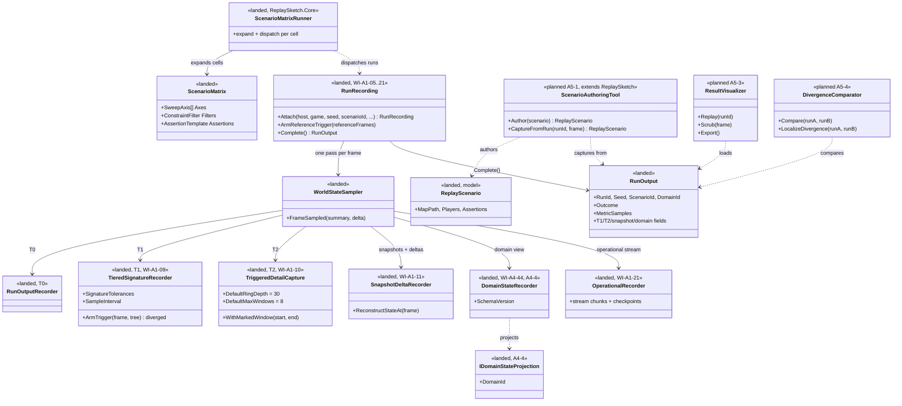
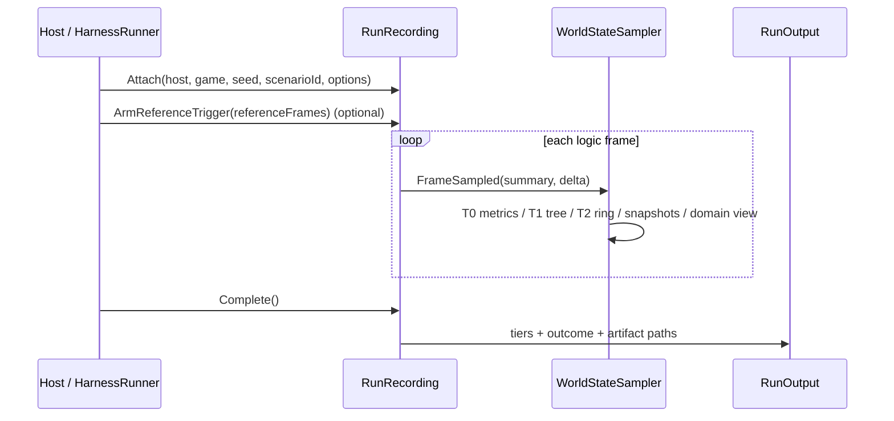
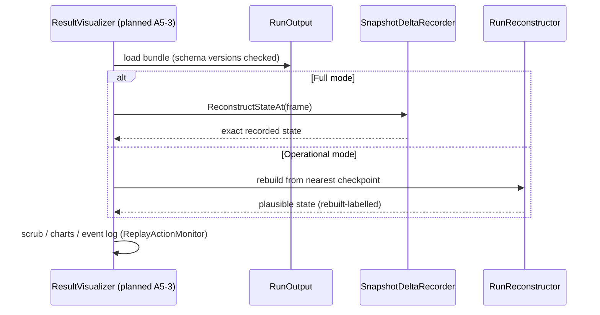
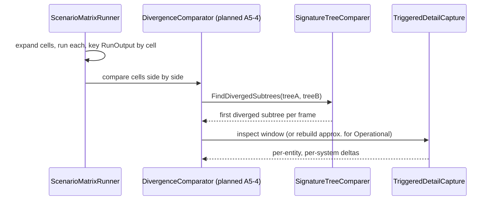

# Deep Dive: Scenario Authoring & Visualization

> Expands phase A5 of [Track A: Foundations](../track-a-foundations.md). Part of the
> [Large-Scale RTS Roadmap](../README.md).
>
> Audience: human overview of the authoring and visualization design.

Purpose: provide the authoring and analysis surface for the experiment framework. The design covers
scenario authoring, sweep execution, replay, and result comparison for the host's recorded runs.

Both ends are domain-parameterized via the [Simulation Domain Model seam (A4)](../track-a-foundations.md). The same authoring and visualization machinery serves RTS battles, city builders, and transportation/logistics simulations, with the domain supplying entity kinds, topology, and metrics. RTS is the reference domain.

---

## 1. Rationale

A scaling or optimization framework is only useful if experiments are easy to define and results
are inspectable. Today both are missing:

- Setup is purely programmatic: `SimulationHost` input injection (A1-4), harness config
  (A4), benchmark scenario builders (B1), and map authoring in WorldBuilder (B4a). There is no
  way to lay out initial conditions, parameterize a sweep, or save/version a scenario as a
  first-class artifact.
- Results are opaque without the replayer/visualizer (previously sketched as A1-6/A1-7, now
  owned here).
- Neither scales yet. ReplaySketch authoring is hand-entry over a fixed vocabulary, and the
  replay/visualization path assumes small runs. To author and inspect sim-scale scenarios,
  the entire point of the framework, the tooling itself must scale to the same entity/command
  magnitudes as the engine (see A5-5). Scenario tooling is on the scaling critical path, not
  beside it.

Pulling both into one layer keeps one domain-parameterized rendering and UX stack for previewing
scenarios and replaying runs.

---

## 2. What already exists (reuse, don't reinvent)

> ReplaySketch is the primary tool. Scenario and end-to-end testing flows through
> `Panopticon.Tools.ReplaySketch`. It is the entry point lower-effort/automated agents use, and the
> result replayer/visualizer below (A5-3) is built by extending it rather than starting a new
> tool. [Track P, phase P0](../track-p-playable-baseline.md) finalizes ReplaySketch into a general
> harness for authoring and validating any arbitrary command/order set (generalizing beyond its
> current fixed `ActionType` vocabulary, plus an assertion layer); A5-3 builds on that harness, and
> the playable-baseline check (P7) runs through it.

| Capability | Current code | Reuse for |
|---|---|---|
| Replay parsing + action monitoring | `Panopticon.Tools.ReplaySketch.`, `ReplayActionMonitor` | Loading runs, event logs, jump-to-frame. |
| Headless frame capture | `FrameCaptureService` (`[CAPTURE]` stdout, PNG export) | Exportable visual artifacts for CI. |
| Headless run loop | `Panopticon.Tools.TestHarness` `RunHeadless` | Driving preview/replay re-simulation. |
| Map authoring | `Panopticon.Tools.WorldBuilder.` | Terrain/topology authoring substrate for scenario setup. |
| Windowed 3-D rendering | engine renderer / TestHarness windowed path | Optional full 3-D playback. |

---

## 3. Scenario setup & authoring

### 3.1 What a scenario is
A scenario is a versioned, declarative artifact containing the inputs needed to launch a run:

- Domain selection: which [domain model (A4)](../track-a-foundations.md) (RTS / city /
  transport / …) and its configuration.
- World / topology: the map (spatial grid, via [B4a](b4a-larger-maps.md)), graph/network, or
  zone layout the domain partitions over.
- Initial entity population: placements/seeds: explicit unit/building placement (RTS),
  zoning + initial buildings (city), the network + initial vehicles/demand (transport). Supports
  procedural seeding (e.g. "N units per side in formation") for large stress scenarios.
- Parameters: domain + experiment knobs (counts, economy rates, AI profiles, fidelity
  policy, partition scheme, pathfinder choice, i.e. the [A4 seam](../track-a-foundations.md)
  selections under test).
- Seed: an optional RNG input recorded with the run.
- Input/order timeline: scripted orders/events injected over time via the host's
  `InjectOrders` hook (A1-4).
- Stop conditions & probes: end criteria (frame cap, victory, steady-state) and which
  [domain metrics](a1-headless-host.md) to record.

### 3.2 Authoring surfaces
- Declarative scenario file (primary). A human- and agent-writable definition that the harness
  and host consume directly. It is the source of truth, diffable, and version-controllable.
  Agent-authored scenarios, and the [`.exchange`](../../../.github/copilot-instructions.md)
  hand-off, are first-class.
- Visual setup (secondary, GPU-light). A domain-parameterized editor reusing the §4 rendering so
  authors can place or paint entities, edit parameters, and scrub a preview. For spatial domains
  this extends WorldBuilder; graph and zone domains render the network or district view. Visual
  edits serialize back to the declarative file.
- Capture-from-run. Derive a new scenario from any frame of a previous run's recorded state,
  because a recorded snapshot is a valid initial population. This is a deliberately lossy
  projection, not a branch: the derived scenario records source run id and frame, and keeps only
  what that frame's recorded state contains (snapshotted state, placements, parameters). Frames
  rebuilt from `Operational` checkpoints carry that mode's approximation; no intermediate
  per-entity history is carried into the new scenario.

### 3.3 Parameter sweeps / experiment matrix
Optimization experiments are rarely single-run. A5 lets a scenario declare sweep axes such as
unit count, partition scheme, and fidelity. The [A4 harness](../track-a-foundations.md) expands
the matrix, dispatches one host run per cell, and collects results keyed by cell for side-by-side
comparison in §4 and §5. Cells can also be sharded via [B6](b6-distributed-simulation.md).

### 3.4 Pre-run validation & preview
Before a long FTRT run, sanity-check the scenario: schema and seed validity, entity placement,
topology connectivity, probe wiring, and a short preview that renders frame 0 and steps a few
frames. Catch authoring mistakes in seconds, not after an hour-long batch.

---

## 4. Results replay & visualization

A tool to replay recorded runs and analyze or visualize their results, so headless and FTRT
batch runs are inspectable rather than opaque.

- Load a run from its recorded artifacts: the recorded state snapshots/deltas and the
  metrics/events/signature stream from [A1-5 run outputs](a1-headless-host.md) (and/or the `.rep`
  inputs for re-running).
- State reconstruction: `Full`-mode runs reconstruct any frame from recorded snapshots/deltas.
  `Operational`-mode runs read operational records directly and obtain granular frames from the
  [A1-6 reconstructor](a1-6-operational-recording.md#6-reconstruction), which re-simulates from
  the nearest checkpoint. Rebuilt frames are labelled as such: they are plausible and may drift
  from the original run, whose authoritative record is the operational stream
  ([A1-6 §3](a1-6-operational-recording.md#3-reconstruction-fidelity)).
- Timeline scrubbing: step/seek to any logic frame; play/pause/fast-forward.
- Visualizations, domain-parameterized as the domain model supplies the view:
  - A spatial 2-D overview/heatmap of entity positions/movement for grid domains (RTS), a
    network/graph view for transport domains (links, vehicles, congestion), or a zone
    choropleth for city builders (population/utility/traffic by district); all GPU-light and
    suitable for CI artifacts.
  - Optional full 3-D playback when a GPU is present (reuse the engine renderer / TestHarness
    windowed path).
  - Time-series charts of the domain's metrics (RTS unit/building counts, economy, casualties;
    city population/traffic; transport throughput/delay).
  - Event log with jump-to-frame (built on `ReplayActionMonitor`).
  - Fidelity overlay: colour entities by their [B7](b7-variable-fidelity.md) fidelity level.
- Headless/exportable mode: render the 2-D overview and charts to image/HTML artifacts
  without a window, for CI and remote inspection (extends `FrameCaptureService`'s
  agent-inspection workflow).

Run artifacts and versions: the run manifest is the `RunOutput` JSON (run id, seed, scenario id,
domain id, outcome, metric samples, and the tier fields below); each side artifact carries its
own schema version (snapshot/delta world-state artifact, domain-state artifact
`DomainStateSchemaVersion`, operational stream bundle). Loaders reject a run whose artifact
schema version they do not understand with an explicit error rather than best-effort parsing.
Paths recorded inside a run bundle are relative to the bundle root, so bundles can be moved and
archived. Frame-zero reconstruction needs no special case: `Full` mode reconstructs any recorded
frame, frame 0 included.

---

## 5. Run comparison & divergence localization

Comparing runs by frame, partition, entity, and system helps investigate an experiment without
making cross-run agreement a correctness gate. Exact diagnostic detail must be captured in the
original run because another execution may follow a different path; A1-6 rebuilt frames give
approximate detail for `Operational` runs.

### 5.1 Tiered recording (emitted by [A1-5](a1-headless-host.md), consumed here)
The recording is tiered so always-on cost stays proportional to the scale this roadmap targets:

| Tier | What it records | Cost | Purpose |
|---|---|---|---|
| T0: Aggregate | Per-frame metrics + invariants (counts, conservation checks). | Always on, tiny. | Detect that a run drifted / broke an invariant. |
| T1: Hierarchical signature | A signature tree per frame following the domain topology (world → partition → entity-bucket: spatial cells for grids, graph nodes/edges for networks, districts for city builders), quantized to tolerance. | Always on, small (one hash per node). | Localize drift by drilling down the tree to the first subtree that exceeds tolerance. |
| T2: Triggered detail | Per-entity, per-system state deltas for a bounded frame+region window, into a ring buffer. | On-demand, large; only around a tripped threshold or a user-marked window. | Pinpoint the exact entity/system and inspect the values that diverged. |

Landed as ([A1-5](a1-headless-host.md), wired by `Recording.RunRecording.Attach`): T0 is
`RunOutputRecorder` (per-frame metric samples), T1 is `TieredSignatureRecorder` (signature tree
per sampled frame, per-quantity `SignatureTolerances`, sampled on `SampleInterval`), T2 is
`TriggeredDetailCapture` (ring depth default 30, at most 8 windows, marked windows supported).
Frame state feeding the tiers is produced by one `WorldStateSampler` pass per logic frame, and
`RunRecording.Complete` assembles the tiers into the `RunOutput` manifest.

### 5.2 Design points
- Hierarchical, addressable signatures (T1). A single global hash only answers "diverged
  yes/no at frame N." A tree keyed by partition and entity-bucket lets the comparator descend to
  the smallest node that diverged, turning O(world) inspection into O(log) drill-down.
- Live triggering (T2). T2 is armed
  before a run and fires when a T1 subtree (or a T0 invariant) breaches tolerance, snapshotting
  recent detailed deltas from a ring buffer. A user can also pre-mark a frame/region window.
  For `Operational`-mode runs, an approximate window can be rebuilt after the fact from the
  nearest checkpoint.
- Tolerance-aware comparison. "Divergence" is first place drift exceeds a configured
  tolerance, reported per subtree, not first non-identical bit. Tolerances are per-quantity
  (e.g. position ε, health ε) and surfaced in the comparator.
- Stable bucketing across runs. For optional diagnostic comparison, partition/entity buckets must
  be addressed by stable keys drawn from the domain topology (spatial cell, graph node/edge,
  or district id + stable entity id), not by iteration order or memory layout, so the same bucket
  lines up across runs that parallelized or partitioned differently.
- Budgeted overhead. T1 granularity (bucket size) and T2 ring-buffer depth are configurable so
  recording cost is bounded; at extreme scale T1 can coarsen and T2 can be armed only for suspect
  regions.

This keeps artifacts granular enough to identify divergence without paying full per-entity,
per-frame recording cost for every run.

Design-point status: the addressable tree, tolerance-aware comparison, and budgeted granularity
are landed (`SignatureTree` + `SignatureTreeComparer.FindDivergedSubtrees`, per-quantity
tolerances, configurable T1 sample interval and T2 ring depth); stable bucket keys are landed
when the domain implements `ISimulationDomainModel` (otherwise a legacy spatial grid keys the
tree); live triggering is landed for reference-comparison arming (`RunRecording.ArmReferenceTrigger`
trips T2 on the first diverged subtree); T0-invariant arming and the comparator UI are the
A5-4 scope.

---

## 6. Sub-phases

| Phase | Goal | Status |
|---|---|---|
| A5-1. Scenario authoring & setup | Define the declarative scenario artifact (§3.1) and the host/harness path that consumes it; procedural seeding for large stress scenarios; capture-from-run; pre-run validation + short preview (§3.4). Domain-parameterized. Large-scenario seeding scales under A5-5. | Not started |
| A5-2. Experiment matrix / parameter sweeps | Let a scenario declare sweep axes; expand the matrix through the [A4 harness](../track-a-foundations.md), dispatch one run per cell, and key results for comparison (§3.3). | Not started |
| A5-3. Results replayer / visualizer | Build the analysis tool of §4 on top of ReplaySketch: load runs, scrub the timeline, domain-parameterized visualizations, metric charts, event log, fidelity overlay, headless export. Scales to large/long runs under A5-5. (Supersedes the former A1-6.) | Not started |
| A5-4. Divergence localization | Implement the §5 drill-down: compare two runs' T1 signature trees to localize the first subtree exceeding tolerance, arm/inspect T2 detail, with stable cross-run bucketing and per-quantity tolerances. Validation surface for B3/B6. (Supersedes the former A1-7.) | Not started |
| A5-5. Authoring & visualization at scale | Make ReplaySketch's authoring, replay, and visualization handle the same magnitudes as the sim they configure: programmatic/procedural generation of large command sets and initial conditions (not hand-entry); streaming + LOD + culling in the replay viewport (reuse [B5](../track-b-scale.md) instancing and [B7](b7-variable-fidelity.md) fidelity for visualization); bounded-memory loading of long/large recordings; and authoring/replay throughput tracked by [B1](../track-b-scale.md) benchmarks. Keeps scenario tooling off the critical path as entity/command counts grow. Mirrors WorldBuilder's [B4a-7](b4a-larger-maps.md) large-population authoring. | Not started |
| A5-6. WorldBuilder baseline | Establish WorldBuilder as a functional baseline scenario-authoring tool, before B4a scales it. Audit the tool's current functional state: what can be authored, saved, loaded, and played at normal map sizes; where the basic author → save → load → play round-trip works and where it fails. Document functional gaps for B4a to address. Unlike A5-1 through A5-5, this sub-phase does not depend on A1 or A4. It is WorldBuilder tooling, not the headless sim pipeline, so it can start in Stage 1 alongside B4a, and [B4a](b4a-larger-maps.md) depends on it completing. | Done: [audit + baseline](../implementation/track-a-a5-6-worldbuilder-baseline.md) (WI-A5-01), repairs WI-A5-27/28/34/35, round-trip + engine play leg proven (WI-A5-02) |

---

## 7. Sequencing notes

- A5-1/3 can begin as soon as the [A1 host](a1-headless-host.md) and [A1-5 run outputs](a1-headless-host.md)
  exist: A5-1 needs the host's input/injection + initial-state path; A5-3 needs the recorded
  outputs.
- A5-2 (sweeps) depends on the [A4 harness](../track-a-foundations.md) (it expands and
  dispatches the matrix) and pairs naturally with [B1 benchmarks](../track-b-scale.md).
- A5-4 (divergence localization) depends on A1-5's tiered recording (T1/T2) and the A5-3
  comparator; it is what lets [B3](../track-b-scale.md) (parallelism) and
  [B6](b6-distributed-simulation.md) (sharding) be debugged by pinpointing where a run drifts.
- A5-5 pairs with B4a-7 (large-population authoring) so the scenario author and replay tools
  scale together.
- A5-6 (WorldBuilder baseline) is an early-start sub-phase. It only requires P7, can run in
  parallel with Stage 0/1 work, and is a prerequisite for B4a. B4a must not be the first time we
  discover basic WorldBuilder functionality is broken.
- A5-1 through A5-5 share one domain-parameterized rendering stack between setup preview and
  results replay.

## 8. Architecture Diagrams

Grounded in landed code (recording: `Panopticon.Recording` in `Panopticon.Simulation`; matrix and
replay scenario: `Panopticon.Tools.ReplaySketch.Core` model; runners: TestHarness /
ReplaySketch.Core). Types marked `planned` are the A5 additions; everything else exists.

Run and record (landed path; A5-1 wraps it with the declarative scenario artifact):

Load and seek (Full vs Operational):

Matrix comparison and divergence detail:

## 9. Related

- Headless/FTRT host (produces the runs/recordings A5 consumes): [`a1-headless-host.md`](a1-headless-host.md)
- Experiment framework seams & harness (sweeps, domain model): [`../track-a-foundations.md`](../track-a-foundations.md)
- Distributed sim (validated via §5 localization): [`b6-distributed-simulation.md`](b6-distributed-simulation.md)
- Variable fidelity (fidelity overlay): [`b7-variable-fidelity.md`](b7-variable-fidelity.md)
- Larger maps (spatial authoring substrate): [`b4a-larger-maps.md`](b4a-larger-maps.md)
- Determinism-priority Decision: [`../open-questions.md`](../open-questions.md)
