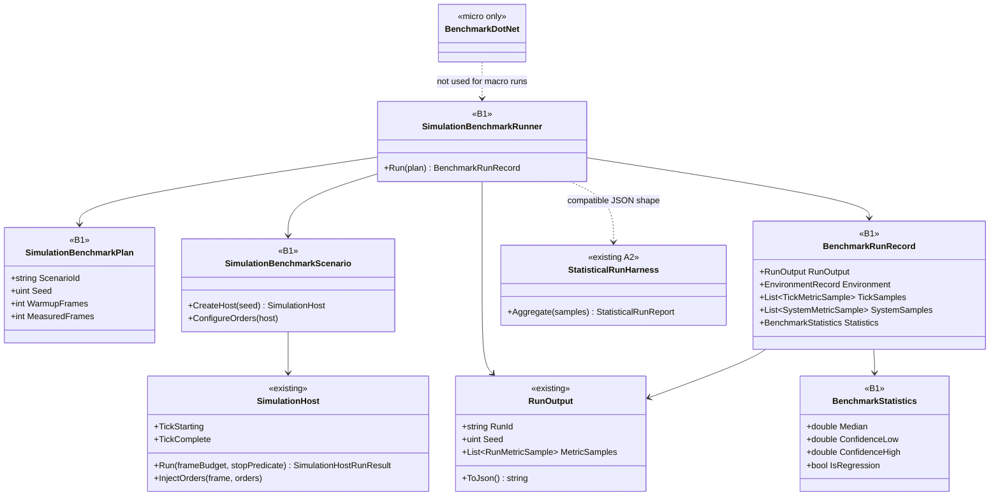
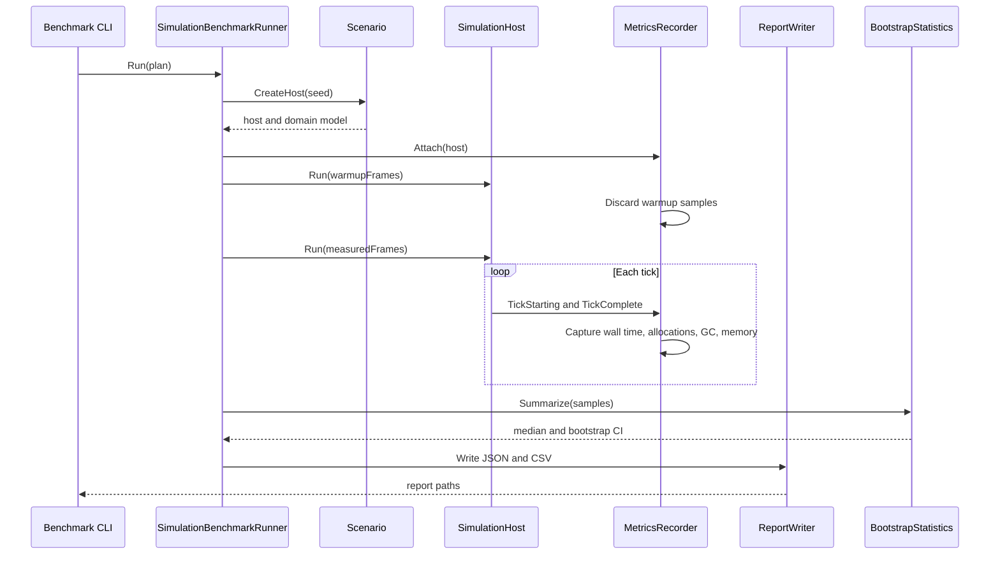

# Deep Dive: B1 Benchmarking

> Expands phase B1 of [Track B: Scale](../track-b-scale.md). Part of the
> [Large-Scale RTS Roadmap](../README.md).
>
> Audience: human + agent design for repeatable macro benchmarking and regression reporting.

Purpose: make scale work measurable before it is optimized. B1 measures cost and memory for
seeded offline runs. It does not gate simulation detail or choose aggregate fidelity. Western Front
uses the reports to compare all-tactical cost, aggregate approximation cost, and B4b import cost.

## Scope

B1 owns a custom macro benchmark harness over `SimulationHost`. It records per-tick wall time,
per-system time, allocation deltas, GC counts, peak process memory, run metadata, environment
metadata, and statistical summaries. BenchmarkDotNet remains limited to micro benchmarks, such as
the existing `Panopticon.Benchmarks.DataStructures` project.

Out of scope:

- changing gameplay or fidelity to meet a performance target;
- treating same-seed state equality as a correctness requirement;
- replacing A2 correctness invariants or A5 visualization;
- optimizing the hot paths found by the harness.

## Decisions applied

- Macro harness: custom runner over headless `SimulationHost`.
- Micro harness: BenchmarkDotNet only for isolated data-structure or algorithm micro benchmarks.
- Metrics: per-tick wall time, per-system time, allocations, GC counts, peak memory.
- Output: JSON run records compatible with A2 distribution reports, plus CSV summaries.
- Statistics: median with bootstrap 95 percent confidence interval.
- Regression rule: a metric regresses when the baseline and candidate confidence intervals do not overlap.
- Reference scenarios: seeded workloads, including the 10k-unit scale anchor in
  [open-questions.md](../open-questions.md), plus consumer measurements for Western Front and B4b.
- Stance: detail-first offline runs. B1 measures cost and memory; it does not reduce detail.

## Current hooks

| Hook | Status | Reference |
|---|---|---|
| Headless run loop | Exists. `SimulationHost.Run` steps fixed logic frames with no render or wall-clock sleep. | `src/Panopticon.Simulation/SimulationHost.cs:160-189` |
| Per-tick callback | Exists. `TickStarting` and `TickComplete` expose frame and map time; `OrdersDispatched` exposes due-order batches. | `src/Panopticon.Simulation/SimulationHost.cs:68-79` |
| Order injection | Exists. Scheduled orders use the normal `IGame.InjectOrders` path. | `src/Panopticon.Simulation/SimulationHost.cs:142-153,201-219` |
| A1 run record | Exists. `RunOutput` serializes identity, seed, duration, outcome, metrics, T1, T2, and snapshot artifact references. | `src/Panopticon.Simulation/RunOutput.cs:63-132` |
| T0 recorder | Exists. `RunOutputRecorder` samples metrics on `TickComplete` and completes wall-clock timing. | `src/Panopticon.Simulation/RunOutput.cs:237-342` |
| A2 report format | Exists. `StatisticalRunReport.ToJson` emits run count, invariant failures, metrics, and confidence intervals. | `src/Panopticon.Tools.ReplaySketch.Core/Services/StatisticalRunHarness.cs:57-76` |
| Existing micro benchmarks | Exists. BenchmarkDotNet runs bit-array, quadtree, and pathfinding micro suites. | `src/Panopticon.Benchmarks.DataStructures/Program.cs:11-18` |
| Micro benchmark package | Exists. BenchmarkDotNet is referenced by `Panopticon.Benchmarks.DataStructures`. | `src/Panopticon.Benchmarks.DataStructures/Panopticon.Benchmarks.DataStructures.csproj:9` |

## Measurement model

A benchmark run has three nested levels:

1. Run: one scenario, seed, configuration, and environment.
2. Tick sample: one logic frame or a configured sampling interval.
3. System sample: one measured subsystem span inside a tick.

The JSON record extends the A1/A2 run-output shape rather than inventing an incompatible report.
The CSV summary is derived from JSON and is not authoritative.

Required run fields:

| Field | Meaning |
|---|---|
| `schemaVersion` | B1 report schema version. |
| `runId` | Unique run id. |
| `scenarioId` | Stable scenario id. |
| `seed` | Input seed. |
| `commit` | Git commit when available. |
| `environment` | OS, runtime, CPU, memory, GPU when present, process architecture, relevant env vars. |
| `config` | Frame budget, warmup frames, sample interval, scenario parameters. |
| `tickSamples` | Per-frame or sampled tick timing, allocation, GC, and memory rows. |
| `systemSamples` | Optional per-system spans grouped by frame and system name. |
| `outcome` | Terminal outcome copied from `RunOutput` where present. |
| `statistics` | Median, bootstrap CI, sample count, regression result. |

Tick sample fields:

| Field | Meaning |
|---|---|
| `frame` | Logic frame of the sample. |
| `wallMs` | Wall time of the tick in milliseconds. |
| `allocBytes` | Managed allocation delta for the tick. |
| `gc0` / `gc1` / `gc2` | Generation collection counts, cumulative. |
| `heapBytes` | Sampled managed heap size. |
| `workingSetBytes` | Sampled process working set. |
| `objects` | Live object count when available. |

System sample fields:

| Field | Meaning |
|---|---|
| `frame` | Logic frame of the span. |
| `system` | Subsystem name, such as `logic` or `partition`. |
| `spanMs` | Wall time of the span in milliseconds. |

Environment record fields:

| Field | Meaning |
|---|---|
| `os` / `runtime` / `gcMode` / `arch` | OS description, .NET version, GC flavor, process architecture. |
| `cpu` / `logicalProcessors` / `frequency` | CPU model, logical processor count, available frequency fields. |
| `totalPhysicalBytes` / `peakWorkingSetBytes` | Total physical memory and peak process working set. |
| `gpu` / `vramBytes` | GPU adapter and VRAM when a graphics path is active. |
| `installId` | Resolved game installation id. |
| `env` | Selected environment variables that affect install and rendering. |

Statistic record fields:

| Field | Meaning |
|---|---|
| `metric` | Metric name, such as `tick.wallMs`. |
| `samples` | Number of samples summarized. |
| `median` / `ciLow` / `ciHigh` | Median and bootstrap 95 percent confidence interval. |
| `baselineRunId` / `isRegression` | Baseline comparison result when a baseline is supplied. |

The JSON record is the authority: CSV summaries derive one row per statistic with run,
scenario, seed, and environment columns. Type names fixed by this audit for B1-2 through B1-5:
`SimulationBenchmarkRunner`, `SimulationBenchmarkPlan`, `SimulationBenchmarkScenario`,
`BenchmarkRunRecord`, `TickMetricSample`, `SystemMetricSample`, `EnvironmentRecord`,
`BenchmarkStatistics`, `BenchmarkReportWriter`, `BootstrapStatistics`.

## Statistics

B1 keeps A2's per-run invariant stance, but uses a stronger performance summary:

- discard configured warmup frames before summarizing;
- compute the median for each metric and scenario cell;
- compute a bootstrap 95 percent confidence interval over run medians;
- mark a regression when baseline and candidate intervals do not overlap;
- keep all samples in JSON so alternate analyses can be reproduced.

A2's existing Student-t mean CI remains valid for correctness and outcome distributions. B1 adds
median bootstrap summaries because tick-time and allocation distributions are usually skewed.

## Reference scenarios

| Scenario | Purpose | Consumer |
|---|---|---|
| `b1.empty-host` | Host overhead and recorder overhead. | B1 |
| `b1.1k-move` | Movement and partition baseline. | B2, B4 |
| `b1.10k-scale-anchor` | Near-term scale anchor from the scale-anchor Decision. | B2, B3, B4, B5 |
| `b1.mixed-combat` | Combat, orders, deaths, and object churn. | B2, B3, F4a |
| `b1.path-query` | Pathfinding pressure on large maps. | B4 |
| `b1.worldbuilder-edit` | Normal and large map edit latency, undo memory, and save time. | B4a |
| `b1.b4b-import` | Geospatial import time, peak memory, and chunk generation time. | B4b |
| `b1.western-front` | All-tactical and aggregate Western Front experiment cost. | Track W |

The 10k-unit scenario is an anchor, not a ceiling. It stays in the suite even if later phases exceed it.

## Environment capture

Every run records:

- OS description and kernel;
- .NET runtime version, GC mode, process architecture;
- CPU model, logical processor count, and available frequency fields;
- total physical memory and peak process working set;
- GPU adapter name and VRAM when a graphics path is active;
- selected game installation id and asset hash summary;
- relevant environment variables that affect game install and rendering.

## Sub-phases and cards

| Phase | Goal | Cards | Status |
|---|---|---|---|
| B1-1. Benchmark audit and report contract | Ground hooks, scenario list, schema, and validation fixtures. | [`WI-B1-01`](../agent/cards/WI-B1-01-benchmark-audit-contract.md) | Done |
| B1-2. Macro harness skeleton | Add the simulation benchmark runner around `SimulationHost`. | [`WI-B1-02`](../agent/cards/WI-B1-02-macro-harness-skeleton.md) | Done |
| B1-3. Tick and system metrics | Capture per-tick wall time, allocations, GC, peak memory, and per-system spans. | [`WI-B1-03`](../agent/cards/WI-B1-03-tick-system-metrics.md) | Done |
| B1-4. Report writers | Write compatible JSON records and derived CSV summaries. | [`WI-B1-04`](../agent/cards/WI-B1-04-report-writers.md) | Done |
| B1-5. Statistics and regression | Add median bootstrap CI and CI-overlap regression comparison. | [`WI-B1-05`](../agent/cards/WI-B1-05-statistics-regression.md) | Not started |
| B1-6. Reference scenario suite | Add seeded empty, movement, combat, path, and 10k-unit anchor scenarios. | [`WI-B1-06`](../agent/cards/WI-B1-06-reference-scenarios.md) | Not started |
| B1-7. Consumer measurements | Add B4a, B4b, and Western Front measurement adapters after their producer seams exist. | [`WI-B1-07`](../agent/cards/WI-B1-07-consumer-measurements.md) | Not started |

## Architecture Diagrams

### Macro benchmark types

### One measured run

## Appendix: grounded hook references

- `src/Panopticon.Simulation/SimulationHost.cs:47-79`: host class, tick hooks, and frame counters.
- `src/Panopticon.Simulation/SimulationHost.cs:142-153`: `InjectOrders` scheduling entry point.
- `src/Panopticon.Simulation/SimulationHost.cs:160-189`: tight fixed-frame run loop.
- `src/Panopticon.Simulation/SimulationHost.cs:201-219`: due-order dispatch through the game order path.
- `src/Panopticon.Simulation/RunOutput.cs:63-132`: A1/A2-compatible run record fields and JSON options.
- `src/Panopticon.Simulation/RunOutput.cs:237-342`: `RunOutputRecorder` tick sampling and completion (interval const at `:242`, `Complete` at `:310`).
- `src/Panopticon.Tools.ReplaySketch.Core/Services/StatisticalRunHarness.cs:57-76`: A2 distribution JSON shape.
- `src/Panopticon.Tools.ReplaySketch.Core/Services/StatisticalRunHarness.cs:123-230`: aggregation plus existing mean, variance, and Student-t CI implementation.
- `src/Panopticon.Benchmarks.DataStructures/Program.cs:11-18`: existing BenchmarkDotNet micro benchmark runner.
- `src/Panopticon.Benchmarks.DataStructures/Panopticon.Benchmarks.DataStructures.csproj:9`: BenchmarkDotNet package reference.
