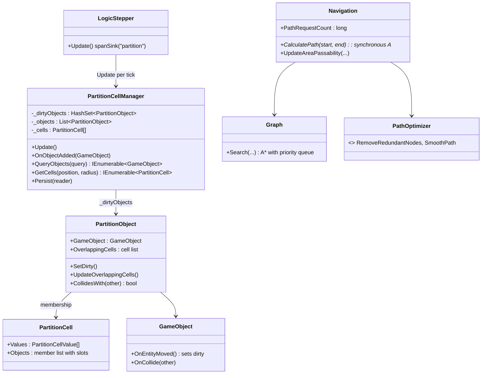
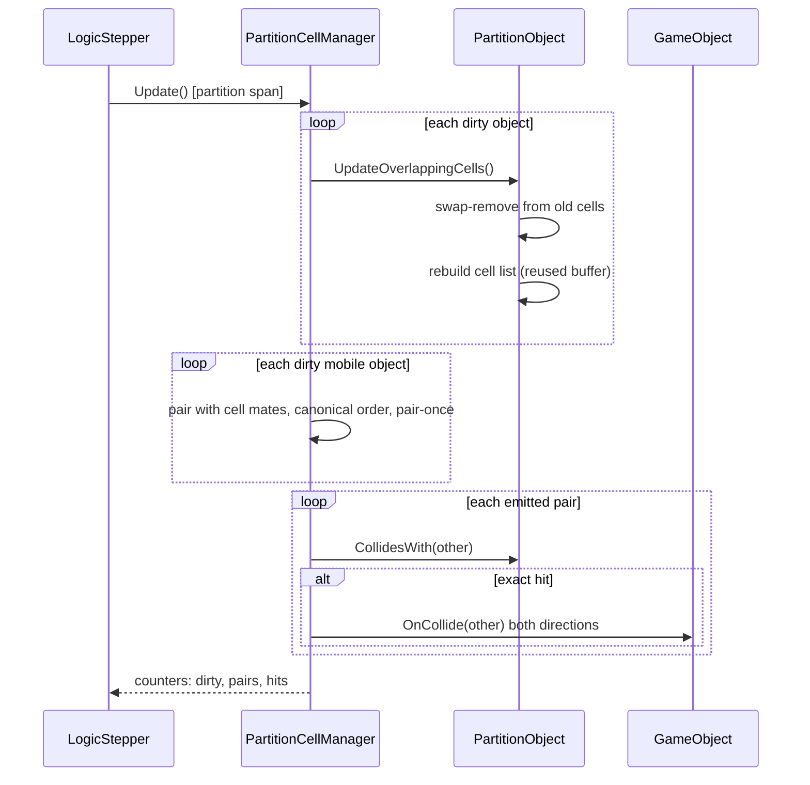
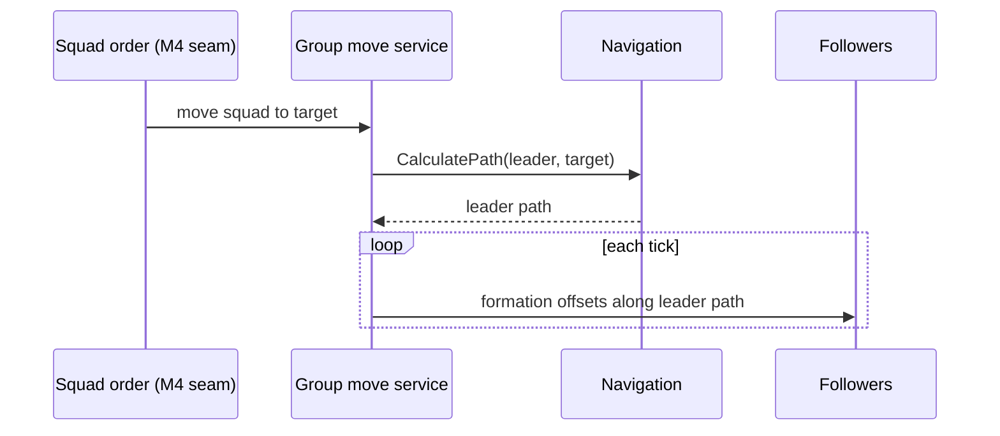

# B4: Spatial and Pathfinding Scaling

> Part of the [roadmap](../README.md) and [Track B](../track-b-scale.md).
> Audience: human.

B4 makes the spatial subsystems hold measured budgets at mass-battle scale:
partition collision maintenance and pathfinding. The [M1 capacity
probe](../implementation/track-m-m1-capacity-probe.md) measured the current engine at 2000 units on
`deepdivide`: the partition system span is the first failing constraint (86-99 percent of
every tick through contact, 666 ms median overall), allocation churn reaches 190 MB/tick, and
path requests are near zero (front-loaded approach moves). B4 therefore spends most of its
budget on the partition hot path, adds group movement and asynchronous path requests for M4,
and gates any hierarchical pathfinding on measurement.

B4a (larger maps) and B4b (geospatial generation) are separate phases and stay out of scope.

## Measured baseline

Numbers from the M1 full-scale run (2000 units, 9000 frames, seed 1):

| Quantity | Median | Notes |
|---|---|---|
| `tick.wallMs` | 1041 ms | 33.3 ms budget for 30 fps |
| `system.partition.spanMs` | 666 ms | tracks tick cost near 1:1 at contact |
| `system.gameLogic.spanMs` | 18.9 ms | includes pathfinding cost |
| `tick.allocBytes` | 97.8 MB | grows to 190 MB/tick at contact |
| `path.requestsPerTick` | 0 | load front-loaded into the approach |

## Partition hot path

`PartitionCellManager.Update()` runs once per tick inside the `partition` B1 span
(`LogicStepper`). Three phases, all currently allocation-heavy:

1. Dirty objects rebuild membership. `GameObject.OnEntityMoved` calls
   `PartitionObject.SetDirty()` on every move, so at contact nearly every unit is dirty every
   tick. `UpdateOverlappingCells()` removes the object from old cells via `List.Remove` (a
   linear scan over cell occupants), clears the `HashSet<PartitionCell>` of overlapping
   cells, and rebuilds it from the `GetCells()` iterator, which allocates.
2. Broadphase collects candidate pairs into a fresh `List<(PartitionObject,
   PartitionObject)>` every tick (an existing TODO). Each dirty, mobile object pairs with
   every object in every overlapping cell. The same pair is added once per shared cell, and a
   pair of two dirty objects is added twice, once from each side.
3. Exact checks run `CollidesWith` per candidate pair and fire `GameObject.OnCollide` both
   ways. Duplicate candidates mean duplicate exact checks and duplicate `OnCollide` calls.

The cost driver is density: candidates grow with dirty objects times cell occupancy, so
concentrated armies pay superlinearly.

### Changes

- Reuse the candidate pair buffer across ticks; clear, do not reallocate.
- Keep cell membership as an indexed structure so removal is swap-remove in O(1) instead of
  `List.Remove`. `PartitionObject.OverlappingCells` and `PartitionCell.Objects` are not
  persisted (`Persist` stores cell values and shroud reveals only), so membership storage can
  change without touching the save format.
- Emit each pair at most once per tick: iterate dirty objects against cell mates with a
  canonical order (for example by partition object sequence) and skip pairs already emitted.
- Replace the per-object `HashSet<PartitionCell>` and the `GetCells()` iterator with a small
  reusable list and a non-allocating enumeration in the update path.
- Record per-tick counters: dirty object count, emitted candidate pairs, exact hits. They
   extend the B1 record the same way `path.requestsPerTick` does.

Pair-once delivery changes `OnCollide` call counts relative to today's duplicates. Handlers
are expected to be idempotent per tick; if a golden or seeded determinism baseline fails, the
run is treated as a suspected deviation: preserve artifacts, report, and wait for the
operator.

### Budget

Partition span at or under 10 ms median at M1 full-scale contact. That leaves the 33.3 ms
tick budget room for the measured 19 ms gameLogic plus scene3d and headroom. Verification
re-runs the M1 probe unchanged (same profile, seed, and frame budget) and compares medians.

## Group movement

M4 issues orders at army scale. Per-unit path requests do not scale, so group movement moves
the request to the squad:

- A squad move resolves one leader path through `Navigation.CalculatePath`.
- Followers receive formation offsets around the leader's path each tick.
- Path requests then scale with squads, not units.

The service is a seam M4 and A4-3 consume; it does not change per-unit orders. The M1 probe
run with squads replaces N approach requests with squad-count requests, observable through
`PathRequestCount`.

## Asynchronous path requests

`Navigation.CalculatePath` is synchronous. The B4 element adds a queued request API: a
worker computes paths off the logic thread and completions land within a bounded number of
frames. Completion application stays on the logic thread in fixed order (single consumer,
deterministic drain), so seeded runs stay byte-identical.

## Hierarchical pathfinding, gated

The phase one-liner names hierarchical or flow-field paths. M1 measured near-zero path load,
and group movement lowers request counts further, so the hierarchy is built only if the
measured latency budget is exceeded at the scale anchor: M1-scale probe with squads issuing
concurrent requests. The gate decision, with numbers, lands in the implementation report
either way.

## Architecture diagrams

Existing types with the planned seams named. Grounded in
`src/Panopticon.Simulation/Logic/PartitionCellManager.cs`,
`src/Panopticon.Simulation/Logic/GameObject.cs`,
`src/Panopticon.Simulation/Navigation/Navigation.cs`, and
`src/Panopticon.Simulation/Logic/LogicStepper.cs`.

Planned additions: the reusable candidate pair buffer and per-tick counters live inside
`PartitionCellManager.Update`; membership slots live on `PartitionCell.Objects` plus a per
object back-index; the group movement service and the asynchronous request queue wrap
`Navigation` without changing `CalculatePath` itself.

Group movement sequence:

## Scale dependencies

| Requirement | Evidence |
|---|---|
| Partition span within budget at contact | M1 probe re-run, medians compared |
| Pair delivery contract | pair-once per tick, duplicate `OnCollide` removed |
| Determinism | seeded runs and golden baselines green, deviations escalated |
| Path requests scale with squads | `PathRequestCount` in squad probe |
| Async completions bounded and ordered | frame-bounded queue, seeded equality |
