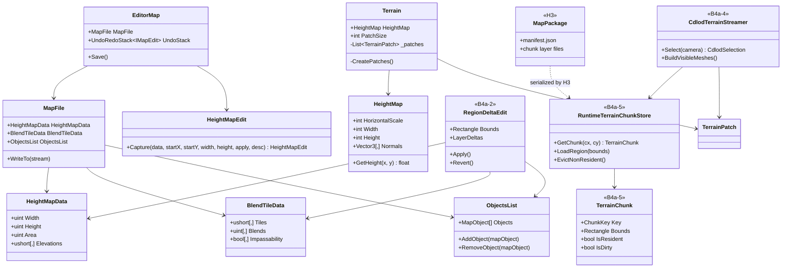
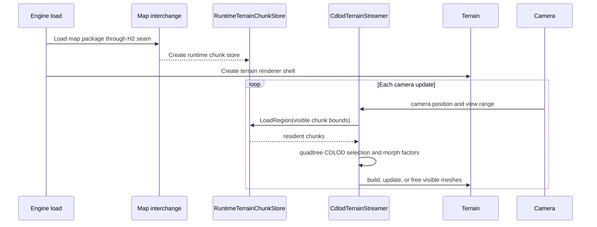
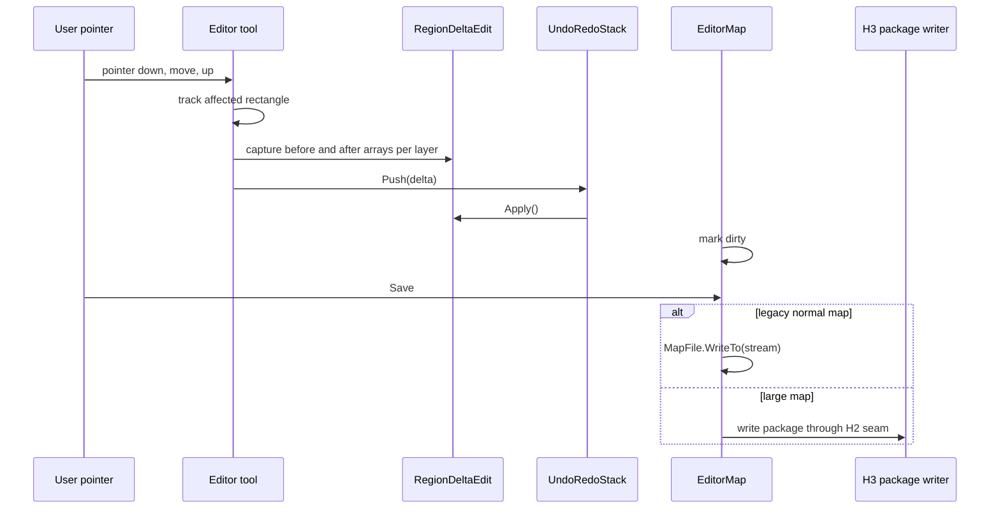

# Deep Dive: Larger Maps (via WorldBuilder)

> Expands phase B4a of [Track B: Scale](../track-b-scale.md). Part of the
> [Large-Scale RTS Roadmap](../README.md).
>
> Audience: human overview of the larger-maps design.

Purpose: scale WorldBuilder and map loading toward very large maps and large populations. The
design treats terrain streaming, chunk residency, scalable edit/undo, and large-object authoring as
core requirements.

B4a assumes that WorldBuilder's basic author, save, load, and play round-trip works at normal map
sizes. That baseline is tracked by A5-6 in [implementation-checklist.md](../implementation-checklist.md).
The only current A5-6 card found is [`WI-A5-06`](../agent/cards/WI-A5-06-ground-a5-architecture.md),
which is `Ready` and grounds A5 architecture, not the full WorldBuilder baseline acceptance item.
B4a implementation cards therefore call out the A5-6 checklist item where it affects execution.

## Decisions

- No size cap. Design for arbitrarily large maps. Map size is bounded by disk and authored data, not
  by a hard format or RAM ceiling.
- Original-engine `.map` write compatibility is not required for large maps. Reading legacy maps remains
  useful, but large-map authoring targets the H2/H3 path.
- B4a-2 undo uses region deltas: a rectangle plus before and after arrays for each edited layer.
- B4a-4 terrain LOD uses CDLOD: quadtree selection with continuous morph between levels.
- B4a-5 owns the runtime chunk store: chunk residency, paging, dirty tracking, and runtime access.
  H3 owns on-disk chunk encoding.
- The proposed runtime chunk layout matches B4b §5.1a: 128 lattice intervals per chunk, 129 lattice
  points, one-sample apron on every side, and raw little-endian `float32` height payloads in game units.

## How maps are sized today

- `HeightMapData` stores `Width`, `Height`, `Area`, and a resident `ushort[,] Elevations`
  array. It verifies `Width * Height == Area` while parsing and creates resident arrays for new maps
  (`src/Panopticon.Simulation/Data/Map/HeightMapData.cs:18-43,49-78`).
- `BlendTileData` stores texture, blend, passability, buildability, visibility, and related per-cell
  arrays sized from `HeightMapData` (`src/Panopticon.Simulation/Data/Map/BlendTileData.cs:11-50,82-170`).
- `HeightMap` exposes ten world units per sample and builds a resident normal array from the whole
  grid (`src/Panopticon.Simulation/Terrain/HeightMap.cs:9-31,166-185`).
- `Terrain` uses `PatchSize = 17` and creates all patches up front in `CreatePatches`
  (`src/Panopticon.Simulation/Terrain/Terrain.cs:31-36,263-322`).
- `Terrain.CreateTileDataTexture` builds one whole-map tile-data texture from `BlendTileData`
  (`src/Panopticon.Simulation/Terrain/Terrain.cs:326-376`).
- `PartitionCellManager.OnNewGame` allocates its full cell array from the map boundary
  (`src/Panopticon.Simulation/Logic/PartitionCellManager.cs:30-65`).
- `Navigation` creates a whole-map graph from the passability array
  (`src/Panopticon.Simulation/Navigation/Navigation.cs:14-31`).
- `EditorMap` wraps a resident `MapFile` and saves through `MapFile.WriteTo`
  (`src/Panopticon.Tools.WorldBuilder.Core/EditorMap.cs:9-25,51-69`).
- `HeightMapEdit` already records a rectangular before and after patch
  (`src/Panopticon.Tools.WorldBuilder.Core/HeightMapEdit.cs:8-26,33-64`).
- `HeightBrushTool` still clones the whole `Elevations` array at pointer down and pointer up before
  slicing the affected patch (`src/Panopticon.Tools.WorldBuilder.Core/HeightBrushTool.cs:14-17,42-48,87-124`).
- `ObjectsList` uses flat arrays and copies the whole array on add/remove
  (`src/Panopticon.Simulation/Data/Map/ObjectsList.cs:8-23`).

## Constraints to lift

| # | Constraint | Where | Why it blocks large maps |
|---|---|---|---|
| C1 | Whole heightmap and per-cell arrays resident in memory | `HeightMapData`, `BlendTileData` | Memory grows with total area. |
| C2 | All terrain patches and tile-data texture built up front | `Terrain` | Build time, GPU memory, and draw cost grow with total area. |
| C3 | Brush strokes clone the full elevation grid | `HeightBrushTool` | Edit latency and memory scale with map area, not brush area. |
| C4 | Undo model needs layer-general region deltas | WorldBuilder edit model | Height already has a patch edit; blend, passability, and object edits need the same contract. |
| C5 | Spatial and navigation structures size eagerly to full grid | `PartitionCellManager`, `Navigation` | Allocation and per-tick cost grow with map area. |
| C6 | Legacy `.map` is the only save path in WorldBuilder | `EditorMap.Save`, `MapFile.WriteTo` | Chunked storage needs H2/H3 package output. |

## Chunk contract (proposed)

B4a adopts the B4b §5.1a layout as the proposed B4a-5 runtime chunk contract.

| Property | Value |
|---|---|
| Lattice spacing | 10 game units |
| Chunk extent | 128 sample intervals per axis |
| Lattice points per chunk | 129 per axis; edge points duplicated in neighbours and equal |
| Apron | one read-only sample on each side for normals |
| Stored chunk sample count | 131 x 131 with apron |
| Height payload | little-endian `float32` game units |
| Chunk key | `(cx, cy)` from southwest origin; +X east, +Y north |
| Runtime owner | B4a-5 chunk store |
| On-disk owner | H3 package encoding |

A 128-interval chunk aligns with eight current terrain patches in each axis because `Terrain.PatchSize`
is 17 vertices, or 16 intervals. One chunk therefore holds an 8 x 8 patch grid at full detail before
CDLOD coarsening.

Approximate resident payload per chunk:

| Layer | Estimate |
|---|---|
| Height apron | 131 x 131 x 4 bytes, about 67 KiB |
| Material or tile indices | 129 x 129 x 1 to 2 bytes, about 16 to 33 KiB per layer |
| Passability and buildability masks | 129 x 129 bits each, about 2 KiB per mask |
| Current tile-data texture equivalent | 128 x 128 x 16 bytes, about 256 KiB before compression or packing changes |

For the settled Somme extent in the Western Front decisions, about 78 x 52 chunks produce about
4,056 chunks. Height aprons alone are about 266 MiB if fully resident. The whole Western Front is a
later capacity problem and must page by region rather than relying on full residency.

## Sub-phases

| Phase | Goal | Status |
|---|---|---|
| B4a-1. Baseline and limits audit | Measure normal and large map load time, memory, edit latency, render cost, save time, and the first failing constraint. | Not started |
| B4a-2. Region-delta editing in WorldBuilder | Replace full-grid clones with rectangle plus before and after arrays per edited layer. Height, blend/material, passability/buildability, and object edits use one region-delta pattern. | Not started |
| B4a-3. New Map wizard for large maps | Add large-map presets, 16-bit elevation defaults, and memory guidance without a hard cap. | Not started |
| B4a-4. Terrain streaming and CDLOD | Select terrain by quadtree, page visible chunks, build render meshes on demand, and morph continuously between LOD levels. | Not started |
| B4a-5. Runtime chunk store | Provide chunk residency, paging, dirty tracking, and region access over B4b's 128-interval chunk layout. H3 serializes the chunks. | Not started |
| B4a-6. Round-trip and play validation | Validate large maps through WorldBuilder save, reload, engine load, and play. | Not started |
| B4a-7. Large-population scenario authoring | Scale object placement, selection, multi-object edit/undo, and editor rendering for large populations. | Not started |

## Cards

| Card | Title | Status | Prerequisites |
|---|---|---|---|
| [`WI-B4a-01`](../agent/cards/WI-B4a-01-chunk-contract.md) | Ground the B4a-5 chunk contract | Ready | none |
| [`WI-B4a-02`](../agent/cards/WI-B4a-02-baseline-limits-audit.md) | Audit WorldBuilder large-map limits | Ready | A5-6 checklist item |
| [`WI-B4a-03`](../agent/cards/WI-B4a-03-region-delta-contract.md) | Add the region-delta edit contract | Ready | A5-6 checklist item |
| [`WI-B4a-04`](../agent/cards/WI-B4a-04-height-brush-region-delta.md) | Remove full-grid height brush clones | Draft | `WI-B4a-03` |
| [`WI-B4a-05`](../agent/cards/WI-B4a-05-layer-region-deltas.md) | Apply region deltas to map layers | Draft | `WI-B4a-03` |
| [`WI-B4a-06`](../agent/cards/WI-B4a-06-large-map-wizard.md) | Add large-map wizard presets | Ready | A5-6 checklist item |
| [`WI-B4a-07`](../agent/cards/WI-B4a-07-cdlod-streaming-design.md) | Design CDLOD and streaming seams | Draft | `WI-B4a-01` |
| [`WI-B4a-08`](../agent/cards/WI-B4a-08-cdlod-selection.md) | Implement CDLOD quadtree selection | Draft | `WI-B4a-07` |
| [`WI-B4a-09`](../agent/cards/WI-B4a-09-visible-patch-streaming.md) | Stream visible terrain patches | Draft | `WI-B4a-07` |
| [`WI-B4a-10`](../agent/cards/WI-B4a-10-runtime-chunk-store.md) | Implement runtime chunk store | Draft | `WI-B4a-01`, `WI-H3-01`, `WI-H3-02` |
| [`WI-B4a-11`](../agent/cards/WI-B4a-11-large-map-roundtrip.md) | Validate large-map round-trip and play | Draft | `WI-B4a-10`, H6 |

## Sequencing notes

- B4a-1 is an investigation card and can run before code changes.
- B4a-2 and B4a-3 are WorldBuilder-local and can proceed before H3 package encoding.
- B4a-4 and B4a-5 depend on the chunk contract from `WI-B4a-01`.
- B4a-5 must coordinate with H3. B4a owns runtime residency and dirty state; H3 owns bytes on disk.
- B4a-7 can begin after B4a-2 establishes region-object edit patterns and B5 provides rendering scale hooks.

## Architecture Diagrams

### Current types and B4a additions

### Large map runtime flow

### WorldBuilder region edit and save

## Related

- Track B overview: [`../track-b-scale.md`](../track-b-scale.md)
- B4b chunk layout: [`b4b-geospatial-map-generation.md#51a-chunk-layout`](b4b-geospatial-map-generation.md#51a-chunk-layout)
- Track H storage formats: [`../track-h-storage-formats.md`](../track-h-storage-formats.md)
- Architecture snapshot: [`../agent/current-state.md`](../agent/current-state.md)
