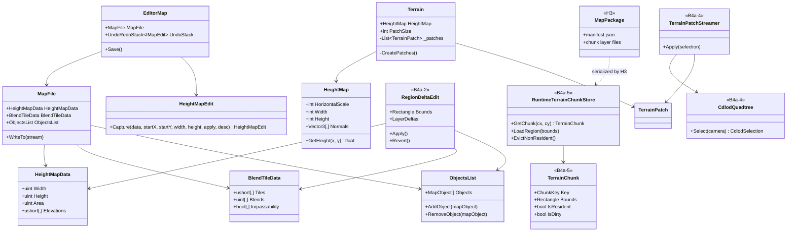
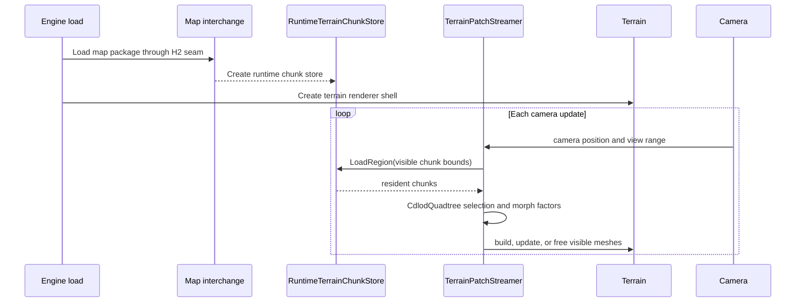
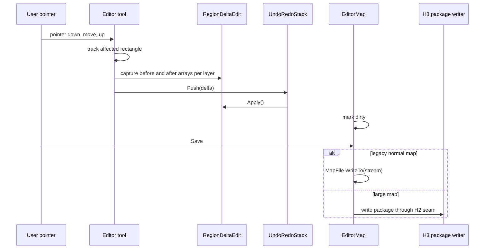

# Deep Dive: Larger Maps (via WorldBuilder)

> Expands phase B4a of [Track B: Scale](../track-b-scale.md). Part of the
> [Large-Scale RTS Roadmap](../README.md).
>
> Audience: human overview of the larger-maps design.

Purpose: scale WorldBuilder and map loading toward very large maps and large populations. The
design treats terrain streaming, chunk residency, scalable edit/undo, and large-object authoring as
core requirements.

B4a assumes that WorldBuilder's basic author, save, load, and play round-trip works at normal map
sizes. That baseline is tracked by A5-6 in [implementation-checklist.md](../implementation-checklist.md).
The only current A5-6 card found is [`WI-A5-06`](https://projects.reid-corp.com/work_packages/302),
which is `Ready` and grounds A5 architecture, not the full WorldBuilder baseline acceptance item.
B4a implementation cards therefore call out the A5-6 checklist item where it affects execution.

## Decisions

- No size cap. Design for arbitrarily large maps. Map size is bounded by disk and authored data, not
  by a hard format or RAM ceiling.
- Original-engine `.map` write compatibility is not required for large maps. Reading legacy maps remains
  useful, but large-map authoring targets the H2/H3 path.
- B4a-2 undo uses region deltas: a rectangle plus before and after arrays for each edited layer.
- B4a-4 terrain LOD uses CDLOD: quadtree selection with a continuous `MorphFactor` per node. The first
  integration uses CPU edge stitching at weight 1 plus banded CPU morph for interior vertices, per the
  [WI-B4a-07 design](#cdlod-streaming-design-wi-b4a-07).
- B4a-5 owns the runtime chunk store: chunk residency, paging, dirty tracking, and runtime access.
  H3 owns on-disk chunk encoding.
- The proposed runtime chunk layout matches B4b §5.1a: 128 lattice intervals per chunk, 129 lattice
  points, one-sample apron on every side, and raw little-endian `float32` height payloads in game units.

## How maps are sized today

- `HeightMapData` stores `Width`, `Height`, `BorderWidth`, `Area`, and a resident `ushort[,] Elevations`
  (`src/Panopticon.Simulation/Data/Map/HeightMapData.cs:19-30`). `Parse` allocates the full array and
  rejects `Width * Height != Area` (`HeightMapData.cs:137-146`). `Create` wraps a caller-supplied array
  (`HeightMapData.cs:35-46`). `MapFile.CreateEmpty` allocates new maps at `playable + 2 * border + 1`
  per axis (`src/Panopticon.Simulation/Data/Map/MapFile.cs:342-345,356`).
- `BlendTileData` stores tile, blend, passability, buildability, visibility, and related per-cell arrays
  (`src/Panopticon.Simulation/Data/Map/BlendTileData.cs:18-53`). `Parse` sizes them from `HeightMapData`
  (`BlendTileData.cs:184-195`). `CreateUniform` allocates each array at `width x height`
  (`BlendTileData.cs:88-110`).
- `HeightMap.HorizontalScale` is 10 world units per sample (`src/Panopticon.Simulation/Terrain/HeightMap.cs:12`).
  `GetHeight(int, int)` indexes the whole `Elevations` array (`HeightMap.cs:32`). `Width` and `Height` are
  the data dimensions minus one (`HeightMap.cs:176-177`). The constructor allocates
  `Normals = new Vector3[Width, Height]` and fills every entry through `RefreshNormals`
  (`HeightMap.cs:168-192`).
- `Terrain.PatchSize` is 17 vertices, or 16 intervals (`src/Panopticon.Simulation/Terrain/Terrain.cs:62,354`).
  `CreatePatches` builds every patch for the map (`Terrain.cs:352-396`). It runs from the constructor
  (`Terrain.cs:163`) and from the full rebuild `OnHeightMapChanged()` (`Terrain.cs:336-350`). The bounded
  `OnHeightMapChanged(bounds)` (`Terrain.cs:313-334`) rebuilds only intersecting patches.
- `Terrain.CreateTileDataTexture` allocates `uint[Width * Height * 4]` for the whole map and uploads one
  texture (`Terrain.cs:398-452`, allocation at `403`).
- `TerrainPatch` reads `heightMap.GetPosition` and `heightMap.Normals[x, y]` over its own bounds
  (`src/Panopticon.Simulation/Terrain/TerrainPatch.cs:72-86`, reads at `77` and `82`). It is a
  patch-local consumer of the whole-grid arrays.
- `PartitionCellManager.OnNewGame` takes the terrain boundary from `Borders[0]`
  (`src/Panopticon.Simulation/Logic/PartitionCellManager.cs:92-101`) and allocates `_cells` for the full
  boundary (`PartitionCellManager.cs:103`).
- `Navigation` has two constructors, one from `BlendTileData.Impassability` and one from a `bool[,]` feed.
  Both build a whole-map `Graph` (`src/Panopticon.Simulation/Navigation/Navigation.cs:29-45,52-68`, graph
  construction at `33` and `56`).
- `EditorMap.Save` (`src/Panopticon.Tools.WorldBuilder.Core/EditorMap.cs:99-124`) calls `MapFile.WriteTo`
  at line 115 for legacy maps and `MapPackageConverter.SavePackage` at line 108 for packages.
- `HeightMapEdit` records a rectangular before and after patch
  (`src/Panopticon.Tools.WorldBuilder.Core/HeightMapEdit.cs:8-27,33-64`). `Apply` and `Revert` copy the
  patch back (`HeightMapEdit.cs:66-93`).
- `HeightBrushTool` clones the whole `Elevations` array at pointer down
  (`src/Panopticon.Tools.WorldBuilder.Core/HeightBrushTool.cs:43`) and again at pointer up
  (`HeightBrushTool.cs:87`), then slices the affected rectangle (`HeightBrushTool.cs:94-111`).
- `ObjectsList` stores a flat `Objects` array (`src/Panopticon.Simulation/Data/Map/ObjectsList.cs:12`).
  `AddObject` copies the whole array (`ObjectsList.cs:17-20`), and `RemoveObject` rebuilds it
  (`ObjectsList.cs:26`).

## Constraints to lift

| # | Constraint | Where | Why it blocks large maps |
|---|---|---|---|
| C1 | Whole heightmap and per-cell arrays resident in memory | `HeightMapData`, `BlendTileData` | Memory grows with total area. |
| C2 | All terrain patches and tile-data texture built up front | `Terrain` | Build time, GPU memory, and draw cost grow with total area. |
| C3 | Brush strokes clone the full elevation grid | `HeightBrushTool` | Edit latency and memory scale with map area, not brush area. |
| C4 | Undo model needs layer-general region deltas | WorldBuilder edit model | Height already has a patch edit; blend, passability, and object edits need the same contract. |
| C5 | Spatial and navigation structures size eagerly to full grid | `PartitionCellManager`, `Navigation` | Allocation and per-tick cost grow with map area. |
| C6 | Legacy `.map` is the only save path in WorldBuilder | `EditorMap.Save`, `MapFile.WriteTo` | Chunked storage needs H2/H3 package output. |

## Baseline audit (WI-B4a-02)

Run context: Intel Core Ultra 7 265K, 20 cores, 125 GiB RAM, Linux. .NET SDK 10.0.109, runtime 10.0.9.
Measured 2026-11-11 on commit `99f382642`, Release build.

Probe method: a temporary xUnit fact, deleted after measurement and not committed, runs one playable size
per `dotnet test` process. Each run calls `NewMapFactory.Create`, times one `HeightBrushTool` Mound stroke
at the map centre (radius 10, strength 1, delta 100), calls `UndoStack.Undo`, then saves and reloads through
the legacy and package paths. Phases use `Stopwatch` and `GC.GetAllocatedBytesForCurrentThread` deltas.
Stop rules: 300 s process timeout, any phase above 60 s, an error, or no result file. Raw JSON and logs are
kept outside the repository.

Lattice is playable + 13 per axis (`MapFile.CreateEmpty`, `MapFile.cs:342-343`). Times are one sample per size.

| Playable | Lattice | createMs | heightMapCtorMs | brushStrokeMs | undoMs | saveLegacyMs | loadLegacyMs | savePackageMs | loadPackageMs |
|---|---|---|---|---|---|---|---|---|---|
| 128 | 141 | 15.5 | 1.2 | 1.5 | 0.16 | 14.3 | 15.7 | 73.2 | 15.7 |
| 256 | 269 | 14.7 | 3.9 | 1.5 | 0.14 | 16.4 | 22.5 | 74.6 | 30.9 |
| 512 | 525 | 26.0 | 14.3 | 1.8 | 0.15 | 29.5 | 21.0 | 95.8 | 58.6 |
| 1024 | 1037 | 36.8 | 24.5 | 3.0 | 0.13 | 132.5 | 50.7 | 219.8 | 104.7 |
| 2048 | 2061 | 142.0 | 94.2 | 8.0 | 0.14 | 508.1 | 193.0 | 560.3 | 356.8 |
| 4096 | 4109 | 469.4 | 375.5 | 21.3 | 0.14 | 2024.4 | 663.9 | 1975.7 | 1432.3 |

| Playable | Working set MiB | createMiB | heightMapCtorMiB | brushMiB | legacy file MiB | package MiB | Render patches | Tile texture MiB |
|---|---|---|---|---|---|---|---|---|
| 128 | 97.4 | 0.80 | 0.22 | 0.08 | 0.18 | 0.24 | 81 | 0.30 |
| 256 | 98.2 | 2.90 | 0.82 | 0.28 | 0.63 | 0.86 | 289 | 1.10 |
| 512 | 100.4 | 11.04 | 3.14 | 1.06 | 2.40 | 3.26 | 1,089 | 4.19 |
| 1024 | 111.0 | 43.07 | 12.28 | 4.11 | 9.36 | 12.67 | 4,225 | 16.38 |
| 2048 | 153.3 | 170.10 | 48.56 | 16.21 | 36.97 | 50.00 | 16,641 | 64.75 |
| 4096 | 323.0 | 676.19 | 193.13 | 64.41 | 146.93 | 198.67 | 66,049 | 257.50 |

Working set is the test host process `WorkingSet64` after create. Render patches and tile texture are
arithmetic, not GPU measurements. Patches use `ceil((lattice - 2) / 16)` per axis because `CreatePatches`
subtracts one from `HeightMap.Width` (`Terrain.cs:356-357`, `HeightMap.cs:176`). The texture uses
`(lattice - 1)^2 x 16` bytes (`Terrain.cs:403`).

Growth from 2048 to 4096 (area x3.97): createMs x3.31, heightMapCtorMs x3.99, brushStrokeMs x2.65,
saveLegacyMs x3.98, loadLegacyMs x3.44, savePackageMs x3.53, loadPackageMs x4.01. Allocation series grow
x3.97 to x3.98. At 4096, create allocates 42.0 bytes per lattice sample, the `HeightMap` constructor
12.0 (`Normals`, `HeightMap.cs:179`), a stroke 4.0 (two full `ushort` clones), the legacy file 9.1, and the
package 12.3.

### First failure

All six sizes completed with no error, no timeout, no phase above 60 s, and no process death. No size
failure was observed, so no size or memory limit is claimed. The first failing constraint is C3, on the edit
path, because undo does not restore the stroke at any size. The centre sample reads 10 before the stroke,
110 after it, and 110 after `Undo` at every size from 128 to 4096. The legacy and package reloads also hold
110, so the saved files contain the unrestored value.

Cause: `OnPointerDown` applies the stroke in place (`HeightBrushTool.cs:49`). `OnPointerUp` then calls
`HeightMapEdit.Capture` (`HeightBrushTool.cs:115-122`). Its before-snapshot is read after the grid has been
mutated (`HeightMapEdit.cs:38-48`), and its apply action is a no-op (`HeightBrushTool.cs:118-121`). `Revert`
therefore restores post-stroke values (`HeightMapEdit.cs:71-74`, `UndoRedoStack.cs:32`). The patchBefore and
patchAfter arrays built at `HeightBrushTool.cs:102-111` are never read. The full-grid clones at
`HeightBrushTool.cs:43` and `:87` make the stroke cost scale with map area: 64.41 MiB at 4096 for a
radius-10 stroke. No source test in the tree undoes a `HeightBrushTool` stroke.

| Constraint | Status at 4096 | Evidence |
|---|---|---|
| C1 | Measured growth, no failure | createMiB 676.19, heightMapCtorMiB 193.13 |
| C2 | Not measured, arithmetic only | 66,049 patches and 257.50 MiB tile texture, built in the `Terrain` constructor (`Terrain.cs:163`, `352-396`, `398-452`) |
| C3 | Fails: undo does not restore; cost scales with area | Two full clones per stroke (`HeightBrushTool.cs:43`, `:87`); the undo error at `:115-122` |
| C4 | Open: the existing patch edit is defeated by capture order | `HeightMapEdit.cs:38-48`; the region-delta contract is WI-B4a-03 |
| C5 | Not measured by the probe | `PartitionCellManager` and `Navigation` are not constructed |
| C6 | Stale wording, package path exists | Package save and reload round-trip (`EditorMap.cs:106-111`, `148-153`); new maps default to legacy (`EditorMap.cs:44-50`); the package write result is discarded (`EditorMap.cs:108`) |

### Resident renderer and chunk store

Resident renderer: `Terrain` builds every patch and one whole-map tile texture in its constructor (C2).
The editor's 3D preview loads only maps inside the game file system (`GameViewportRenderer.cs:276-287`), so
a new map outside the installation has no preview at any size. The probe does not construct `Terrain`.

Chunk store: this stack contains `RuntimeTerrainChunkStore` (`src/Panopticon.Simulation/Terrain/RuntimeTerrainChunkStore.cs:14`),
which bounds resident chunks and never evicts dirty data. `LargeMapRoundTripTests` covers the bounded read
path (`test/Panopticon.Simulation.Tests/Terrain/LargeMapRoundTripTests.cs:42`). The probe does not exercise
the store, so its paging limits are not measured here. The statement under Chunk contract (proposed) that no
store exists is stale for this stack.

### A5-6 status

The A5-6 checkbox is checked (`implementation-checklist.md:728`). The normal-size leg holds: at 128 and 256
the author, save, and reload legs complete. `WorldBuilderRoundTripTests.SavedNewMap_StartsInEngine`
(32 x 32 map, `CNC_GENERALS_PATH` set) passed: 1 passed, 0 failed, 0 skipped. The checked clause that undo/redo
is proven by test does not hold for height strokes, because undo does not restore the centre at any size. This
audit documents that gap for the functional-gap clause at `implementation-checklist.md:732-733`. The checkbox
is not changed here. The fix belongs to WI-B4a-04 with the region-delta contract from WI-B4a-03.

### Limitations

- One run per size on a shared host. Timings are single wall-clock samples, not CI-grade.
- Release build. Working set is the whole test host process, not an editor process.
- One stroke at the map centre, radius 10. Undo runs before the saves, so the saved files hold the post-stroke state.
- Not measured: `Terrain` construction, GPU memory, render cost, C5 structures, chunk-store paging, and engine load of any map larger than 32 x 32.
- Growth beyond 4096 is not measured. No OOM or process death was observed.

## Region-delta edit contract (WI-B4a-03)

Normative rules for WorldBuilder undo entries. Rules R1 to R13 are referenced by the compliance table.
Behaviour that holds today is pinned by [`RegionDeltaContractTests.cs`](../../../test/Panopticon.Tools.WorldBuilder.Core.Tests/RegionDeltaContractTests.cs).

### Shape

- `R1` One edit is one rectangle (`startX`, `startY`, `width`, `height`, in lattice cells) plus, per edited layer, a `before` and an `after` array with the rectangle's extents. One edit may carry several layers over the same rectangle. `HeightMapEdit` holds this pair (`src/Panopticon.Tools.WorldBuilder.Core/HeightMapEdit.cs:13-14`). `BlendTileEdit` holds it for the Tiles layer (`BlendTileEdit.cs:13-14`).
- `R2` Layer element types, from `BlendTileData` (`src/Panopticon.Simulation/Data/Map/BlendTileData.cs:18-53`) and `HeightMapData.Elevations` (`src/Panopticon.Simulation/Data/Map/HeightMapData.cs:30`):

  | Layer | Element type | Source |
  |---|---|---|
  | Height | `ushort` | `HeightMapData.cs:30` |
  | Tiles | `ushort` | `BlendTileData.cs:18` |
  | Blends, ThreeWayBlends, CliffTextures | `uint` | `BlendTileData.cs:19-21` |
  | Impassability, ImpassabilityToPlayers, PassageWidths, Taintability, ExtraPassability, Visibility, ImpassabilityToAirUnits, Buildability, TiberiumGrowability | `bool` | `BlendTileData.cs:23-50` |
  | Flammability | `TileFlammability` (enum, `int` underlying type) | `BlendTileData.cs:38`, `:447` |
  | DynamicShrubberyDensity | `byte` | `BlendTileData.cs:53` |

- `R3` Each layer's representation is chosen by the implementing work package, which states the choice. Let `R` be the rectangle and `T` the set of cells the stroke wrote or read. A dense form stores every cell of `R`. A sparse form stores ordered `(cell index, before, after)` entries for exactly `T`. Storage cost is O(|R|) for dense and O(|T|) for sparse, never O(grid). A sparse form that stores any cell outside `T` is non-compliant. The rectangle of a single Mound or Dig stamp is `(2r + 3)` square (`HeightBrushTool.cs:95-100`). No sparse form exists in the tree.
- `R4` Object edits are not region deltas. `ObjectPlacementEdit` holds an `ObjectsList` and a `MapObject` reference, not a rectangle (`src/Panopticon.Tools.WorldBuilder.Core/ObjectPlacementEdit.cs:8-12`). R1 to R3 and R6 to R7 do not apply to it. R8 and R13 do.
- `R5` A stroke allocates no array sized to the full grid, so its cost scales with rectangle area. At the WI-B4a-03 audit, `HeightBrushTool` violated this with two full-grid clones (audit-era `HeightBrushTool.cs:43`, `:87`); resolved by WI-B4a-04 (WP354).

### Capture order

- `R6` Before values are read before the first mutation of each cell, and after values are read after the stroke's last mutation. `HeightMapEdit.Capture` reads before at `HeightMapEdit.cs:38-48`, runs the action at `:50`, and reads after at `:52-61`. A stroke whose rectangle grows while dragging stores each cell's before value on first touch, before writing it, in a stroke-local buffer.
- `R7` Capture from a grid already mutated in place is prohibited. At the WI-B4a-03 audit, `HeightBrushTool` wrote the live grid on pointer down and move (audit-era `HeightBrushTool.cs:49`, `:67`), then captured with a no-op action (`:115-122`), so before equaled after and Undo did nothing; resolved by WI-B4a-04 (WP354). The G7 probe measured a centre sample of 110 after Undo, against 10 before the stroke ([Baseline audit](#baseline-audit-wi-b4a-02)).

### Single application owner

- `R8` `UndoRedoStack.Push` is the only caller that applies a new edit (`src/Panopticon.Tools.WorldBuilder.Core/UndoRedoStack.cs:16-22`). Tools do not call `Apply`, and do not mutate the grid outside the `applyAction` passed to `Capture`, which runs once between the two reads. At the WI-B4a-03 audit, `MeshMoldTool` called `edit.Apply()` before `Push` (audit-era `MeshMoldTool.cs:96-97`), so the after arrays were written twice. The writes were idempotent, so the grid was correct, but the rule was broken; resolved by WI-B4a-05 (WP355).

### Apply and Revert

- `R9` `Apply` writes the after arrays and `Revert` writes the before arrays (`HeightMapEdit.cs:66-74`, `BlendTileEdit.cs:46-48`). Both go through `CopyPatch`, which writes only cells inside the grid (`HeightMapEdit.cs:76-93`, bounds test at `:87`; `BlendTileEdit.cs:50-67`, bounds test at `:61`).
- `R10` Cells outside the grid are never written. `Capture` records an out-of-bounds sample as 0 (`HeightMapEdit.cs:46`, `:59`; `BlendTileEdit.cs:40`). That 0 is a capture-side artifact, and Apply and Revert must not write it back.
- `R11` Undo and redo are exact and repeatable. `Undo` calls `Revert` (`UndoRedoStack.cs:24-35`) and `Redo` calls `Apply` (`:37-48`), so repeated cycles return the same arrays. Pinned by `RegionDeltaContractTests` and by `UndoRedoEditApplicationTests` (`BlendEditPushAppliesOnce_AndReverts`, `HeightEditPushKeepsCapturedAfterState_AndCycles`).

### Rectangle boundaries

- `R12` A stroke's rectangle is the bounding box of its stamp centres (`HeightBrushTool.cs:175-182`), expanded by `RadiusCells + 1` on each side and clipped to the grid (`HeightBrushTool.cs:95-100`). The extra cell covers smoothing, because `ComputeSmoothed` reads the 3x3 neighbourhood of each written cell (`HeightBrushTool.cs:191-203`). The rectangle must cover every cell the stroke wrote or read.

### Coalescing

- `R13` One pointer stroke (down, moves, up) produces exactly one undo entry covering the whole stroke rectangle. Moves update the pending edit or stroke-local buffer and never push to the undo stack. `HeightBrushTool` pushes once at pointer up (`HeightBrushTool.cs:101`). At the WI-B4a-03 audit, paint tools pushed per call, per tile, or per move: `PaintLargeTileTool` pushed `TileSize * TileSize` entries per call (audit-era `PaintLargeTileTool.cs:61-81`), `PaintSingleTileTool` pushed on every pointer event (audit-era `PaintSingleTileTool.cs:24`, `:35`, `:54-55`), and `SpillPaintTool` pushed per visited tile (audit-era `SpillPaintTool.cs:86-87`); resolved by WI-B4a-05 (WP355). `MeshMoldTool` pushed per stamp at the audit (`MeshMoldTool.cs:30`, `:41`, `:96`); resolved by WP1016. Object tools push once per click (`PlaceObjectTool.cs:38`, `DeleteTool.cs:40`, `WaypointTool.cs:37`) and comply.

### Viewport seam

Tools take `ViewportPointerEvent` (`src/Panopticon.Tools.WorldBuilder.Core/ViewportEvents.cs:8`) and `EditorMap` and use no UI types, so the contract runs headless. The only viewport coupling is the terrain reload flag, set on pointer up (`GameViewportRenderer.cs:186-189`). That flag is outside this contract.

### Compliance

| Component | Rules violated | Work package |
|---|---|---|
| `HeightMapEdit`, `BlendTileEdit`, `BlendLayerEdit` | none | n/a |
| `HeightBrushTool` | none | WI-B4a-04 (WP354) |
| `MeshMoldTool` | none | R8 resolved by WI-B4a-05 (WP355); R13 resolved by WP1016 |
| `PaintLargeTileTool`, `PaintSingleTileTool`, `SpillPaintTool` | none | WI-B4a-05 (WP355) |
| Object edits and object tools | none | n/a |
| Blend layers Tiles (paint tools), Blends, Impassability, Buildability (`BlendLayerEdit`) | none | WI-B4a-05 (WP355) |
| `BlendTileData` arrays other than Tiles, Blends, Impassability, and Buildability | no edit type exists | Unassigned |

WI-B4a-04 (`HeightBrushTool`): each stroke keeps a stroke-local before buffer for its rectangle, filled on first touch from cells that are not yet written, and pushes one `HeightMapEdit.FromPatches` edit at pointer up. The rectangle covers stamp centres whose reach meets the grid, expanded by `RadiusCells + 1` and clipped. A stroke that writes no in-bounds cell pushes nothing. A radius-10 stroke allocated 2,264 bytes at both playable 128 and playable 4096. Tests: `HeightBrushRegionDeltaTests` (Mound, Dig, and Smooth undo and redo; one entry per multi-move stroke; map edge; off-map; sub-cell offset; allocation).

WI-B4a-05 (`PaintSingleTileTool`, `PaintLargeTileTool`, `SpillPaintTool`, `MeshMoldTool`, `BlendLayerEdit`): the representation is dense (R3) for every tool and for `BlendLayerEdit`. Each paint stroke records each touched cell's pre-stroke tile on first touch and paints the live grid as it goes. At pointer up (end of the fill for `SpillPaintTool`), `BlendTileEdit.FromTouchedCells` builds one `BlendTileEdit.FromPatches` edit over the bounding rectangle of the touched cells. Nothing is pushed when no cell changed value. The visited set of `SpillPaintTool` is capped at 10,000 cells, but its bounding rectangle is not, so a snake-shaped fill can span the grid. `BlendLayerEdit` captures one dense rectangle of Tiles, Blends, Impassability, or Buildability. No UI tool edits Blends, Impassability, or Buildability, and the other `BlendTileData` arrays have no edit type. `MeshMoldTool` no longer calls `Apply` before `Push` (R8); its per-stamp push is replaced by one push per stroke at pointer up (R13, WP1016). Tests: `LayerRegionDeltaTests` (`BlendLayerEdit_PushUndoRedoAreExactOverRectangle`, `PaintSingleTileStroke_PaintsTouchedCells_PushesOneEntry_AndRedoReapplies`, `PaintSingleTileStroke_PaintingExistingIndex_PushesNoEdit`, `PaintSingleTileStroke_OffGrid_ChangesNothingAndPushesNoEdit`, `PaintLargeTileStroke_OneEntryCoversItsCells_AndUndoRestores`, `PaintLargeTileDrag_OverlappingPositions_PushesOneEntry_AndUndoRestoresPreStroke`, `SpillPaintFill_OnUniformGrid_PushesOneEntry_AndUndoRestoresFill`, `MeshMoldStamp_MovesCentreOnceTowardTarget_AndUndoRestoresGrid`), `MeshMoldRegionDeltaTests` (WP1016).

## Chunk contract (proposed)

B4a adopts the B4b §5.1a layout as the proposed B4a-5 runtime chunk contract. The rationale is in
[§5.1a](r-real-world-terrain.md#51a-chunk-layout). No `RuntimeTerrainChunkStore` exists in the tree; the
name in the diagrams is the proposed B4a-5 type. The layout is already encoded in the interchange model
`MapInterchange` (`src/Panopticon.Simulation/Content/Importing/Maps/MapInterchange.cs:10`) through the
constants in `MapChunkGeometry` (`src/Panopticon.Simulation/Content/Importing/Maps/MapChunkGeometry.cs:8-18`).

| Property | Value |
|---|---|
| Lattice spacing | 10 game units |
| Chunk extent | 128 sample intervals per axis |
| Lattice points per chunk | 129 per axis; edge points duplicated in neighbours and equal |
| Apron | one read-only sample on each side for normals |
| Stored chunk sample count | 131 x 131 with apron |
| Height payload | little-endian `float32` game units (`MapPackageChunkCodec.cs:22`) |
| Chunk key | `(cx, cy)` from southwest origin; +X east, +Y north |
| Runtime owner | B4a-5 chunk store |
| On-disk owner | H3 package encoding: writer `MapPackageDirectoryWriter.Write` (`src/Panopticon.Simulation/Content/Importing/MapSources/Package/MapPackageDirectoryWriter.cs:33`), codec `MapPackageChunkCodec` (`MapPackageChunkCodec.cs:15`), reader `MapPackageChunkFileReader` (`MapPackageChunkFileReader.cs:16`) |

### Lattice and patch mapping

| Quantity | Value | Source |
|---|---|---|
| Chunk extent | 128 intervals x 10 units = 1280 game units per axis | `MapChunkGeometry.cs:10`, `HeightMap.cs:12` |
| Core points | 129 per axis: 128 intervals plus the shared end point | `MapChunkGeometry.cs:8` |
| Stored points | 131 per axis: 129 core plus one apron per side | `MapChunkGeometry.cs:14` |
| Chunk origin | whole-map lattice index `(128 cx, 128 cy)` | `MapInterchangeValidator.cs:21` |
| Shared edge | lattice column `128 (cx + 1)` is core column 128 of chunk `cx` and core column 0 of chunk `cx + 1` | `MapInterchangeValidator.cs:21-23` |
| East apron | lattice column `128 (cx + 1) + 1`, core column 1 of chunk `cx + 1` | `MapInterchangeValidator.cs:33-34` |
| Render patch | 17 vertices with stride 16, so adjacent patches share one edge | `Terrain.cs:62,354,377-381` |
| Patches per chunk | `128 / 16 = 8` per axis; `8 x 8 = 64` at full detail | arithmetic |
| Patch `(px, py)` | core-local vertices `16 px` through `16 px + 16` inclusive | arithmetic on `Terrain.cs:374-381` |

Chunk world origin: `(128 cx - BorderWidth) x 10` per axis, from `GetPosition` (`HeightMap.cs:126-129`).

The current patch count formula does not fit a 129-point chunk. `CreatePatches` derives its extent from
`HeightMap.Width - 1` (`Terrain.cs:356-368`), and `HeightMap.Width` is the data width minus one
(`HeightMap.cs:176`). For a 129-point grid, that yields a last patch of 16 vertices (`Terrain.cs:380`).
Chunk-local patch bounds must use the 129-point core extent.

### Border and apron interactions

- `BorderWidth` is map-edge padding inside the lattice. New maps size `Width` and `Height` to include both
  borders (`MapFile.cs:342-343`). World-to-lattice conversions add it (`HeightMap.cs:88`, `104-105`,
  `148-149`, `164`) and lattice-to-world conversions subtract it (`HeightMap.cs:127-128`). Chunk keys index
  the padded lattice, so chunk origins in world units subtract `BorderWidth`.
- The apron is a one-sample copy of the neighbour's core sample. It is not `BorderWidth`. A chunk on the
  map edge has no neighbour on that side. Its apron follows the adapter clamp policy
  (`src/Panopticon.Simulation/Content/Importing/MapSources/LegacyMapReader.cs:165-166`), and the validator
  does not check map-edge aprons (`MapInterchangeValidator.cs:36-37`).
- Normals at core edges read the apron. `CalculateNormal` reads quads `m = x - 1..x` and
  `n = y - 1..y` (`HeightMap.cs:240-242`), and `CalculateQuadNormal` reads `x + 1` and `y + 1`
  (`HeightMap.cs:215-218`). With the apron, a chunk-local normal matches the whole-grid normal everywhere
  except the final global lattice column and row, where the whole-grid path substitutes `UnitZ`
  (`HeightMap.cs:248`) or stores no normal (`HeightMap.cs:176-177`).
- Shared edge points must be equal in both chunks because both chunks' normals and apron samples read
  them (`MapInterchangeValidator.cs:33-37`).

### Memory estimates

These are estimates from element sizes, not measurements. Bytes are per chunk.

| Layer | Basis | Bytes | KiB |
|---|---|---|---|
| Heights | 131 x 131 x 4, float32, with apron | 68,644 | 67.04 |
| Normals | 129 x 129 x 12, `Vector3`, held in `HeightMap.Normals` today (`HeightMap.cs:168`) | 199,692 | 195.01 |
| Material index, in memory | 129 x 129 x 2, `ushort` (`BlendTileData.cs:18`) | 33,282 | 32.50 |
| Material index, palette bytes | 129 x 129 x 1, uint8 | 16,641 | 16.25 |
| Impassability mask, in memory | 129 x 129 x 1, `bool` (`BlendTileData.cs:23`) | 16,641 | 16.25 |
| Buildability mask, in memory | 129 x 129 x 1, `bool` (`BlendTileData.cs:47`) | 16,641 | 16.25 |
| Two masks, bit-packed | 129 x 129 / 8 per mask, about 2,080 bytes each | 4,160 | 4.06 |
| Subtotal, in memory | heights, normals, material `ushort`, two `bool` masks | 334,900 | 327.05 |
| Current tile-data texture, state basis | 128 x 128 x 16, `R32_G32_B32_A32_UInt` (`Terrain.cs:451`) | 262,144 | 256.00 |
| Current tile-data texture, 129 basis | 129 x 129 x 16 | 266,256 | 260.02 |

The bit-packed row is a packing scenario. The H3 codec writes masks as raw uint8 flag bytes today
(`MapPackageChunkCodec.cs:83-87`), so the in-memory `bool` and on-disk byte figures apply to the
current encoding. The subtotal omits the other `BlendTileData` arrays, so the resident total is higher.

Somme extent: about 78 x 52 chunks, carried from the settled extent above, gives 4,056 chunks.

| Layer | Total bytes | MiB |
|---|---|---|
| Heights | 278,420,064 | 265.52 |
| Normals | 809,950,752 | 772.43 |
| Material index, in memory | 134,991,792 | 128.74 |
| Impassability mask, in memory | 67,495,896 | 64.37 |
| Buildability mask, in memory | 67,495,896 | 64.37 |
| Combined in-memory subtotal | 1,358,354,400 | 1,295.43 |
| Current tile-data texture, state basis | 1,063,256,064 | 1,014.00 |
| Current resident `Elevations`, `ushort`, 9,985 x 6,657 lattice without border | 132,940,290 | 126.78 |
| Full-detail render patches, 64 per chunk | 259,584 patches | n/a |

Stored heights hold 4,056 x 17,161 = 69,605,016 samples. The unique lattice for the same extent is
9,985 x 6,657 = 66,470,145 points, so apron and shared-edge duplication add about 4.7 percent. The whole
Western Front is a later capacity problem and must page by region rather than relying on full residency.

## CDLOD streaming design (WI-B4a-07)

Design for B4a-4. WI-B4a-08 implements pure selection, and WI-B4a-09 implements patch residency inside `Terrain`. The names under [Planned types](#planned-types-binding-for-wi-b4a-08-and-wi-b4a-09) bind both.

### Units

| Unit | Size | Role | Source |
|---|---|---|---|
| Renderer patch | 16 intervals, 17 by 17 samples | One vertex buffer and one draw | `Terrain.PatchSize` (`Terrain.cs:62`), `CreatePatches` (`Terrain.cs:352-396`) |
| Chunk read unit | 128 intervals, 129 core samples plus apron | One store read and one residency entry | [Chunk contract](#chunk-contract-proposed) |

One chunk covers 8 by 8 level-0 patches. Selection and GPU residency count patches. Store reads, dirty state, and eviction count chunks.

### Geometry contract

- Node `(X, Y, Level)` covers `16 * 2^Level` intervals per axis from origin lattice index `(16 * 2^Level * X, 16 * 2^Level * Y)`. Level 0 is one renderer patch.
- Every node has 17 by 17 vertices. Vertex `(i, k)` samples lattice index `min(origin + (i, k) * 2^Level, last)`, where `last` is `HeightMap.Width - 1` or `HeightMap.Height - 1` (`Terrain.cs:356-381`). A clipped node repeats its last sample, giving zero-area triangles, so all nodes share the index buffer cached by width and height (`TerrainPatch.cs:38-41`, `TerrainPatchIndexBufferCache.cs:16`).
- Position uses the `HeightMap.GetPosition` mapping (`HeightMap.cs:126-129`), with height from `ITerrainLatticeSampler`. UV stays the sample's own lattice coordinate (`TerrainPatch.cs:83`), so tile-data lookups do not change with level or morph.
- Normal uses full-resolution heights and the quad set of `HeightMap.CalculateNormal` (`HeightMap.cs:235-264`), so a sample's normal is the same at every level. It reads one sample past the node on each side, supplied by the chunk apron or by the map-edge rule (`HeightMap.cs:248`, [Border and apron interactions](#border-and-apron-interactions)).
- Edge stitching: on an edge whose neighbour is one level coarser, the fine node's edge vertices take the neighbour's rendered positions. Even edge vertex `2j` takes rendered coarse vertex `j`. Odd edge vertex `2j + 1` takes the midpoint of rendered coarse vertices `j` and `j + 1`, interpolated by lattice coordinate at a clipped end. "Rendered" includes the neighbour's own morph. When the neighbour is unmorphed, even vertices equal their own samples because both levels sample the same heights.
- Stitch weight on these edges is 1 regardless of the node morph factor. The fine edge then lies exactly on the coarse edge polyline, which is the no-crack guarantee that the geometry tests assert. A partial weight would leave a gap of `(1 - morph)` times the odd-vertex offset. `MorphFactor` applies to interior vertices only.
- Morph: `MorphFactor` in [0, 1] is 0 at the node's own geometry and 1 at parent spacing. An interior vertex odd in x moves to the midpoint of its even x neighbours, likewise for y, and a vertex odd in both becomes the mean of its four even corners. The displacement is scaled by `MorphFactor`. Stitched edge vertices are excluded. Selection output carries the continuous value; `TerrainPatchStreamer` quantizes it into rebuild bands in WI-B4a-09, which also defines the band count.
- Restricted quadtree: adjacent selected nodes differ by at most one level.

### Selection (WI-B4a-08)

- Inputs: camera position, `BoundingFrustum` (`Camera.cs:64`), pixel error threshold, optional previous selection, and node capacity.
- `ICdlodErrorProvider` returns a node's minimum and maximum height over its footprint, read on demand for each visited node. Screen error is that height range scaled by distance, a conservative bound. Selection never warms the whole map and never scans the resident store at full resolution.
- A resident `HeightMap` may serve as the provider for tests and small maps. Its whole-grid cost is listed under [Residual costs](#residual-whole-grid-costs-wi-b4a-09-does-not-solve).
- Split when screen error exceeds the split threshold. Merge when error falls below the merge threshold. The split threshold is strictly greater than the merge threshold. With no previous selection, both equal the pixel threshold. With a previous selection, a previously selected leaf splits only above the split threshold, and a node whose descendants were selected stays split unless its error is below the merge threshold.
- Splits are transactions. Splitting one node into four children adds three nodes, and any balancing split required by the one-level rule belongs to the same transaction. A transaction that would exceed capacity is rejected whole. Candidates are visited by descending screen error, ties broken by `(Level, Y, X)`.
- Coverage: the selection is always a cut of the quadtree. A visible node leaves the selection only by splitting into children or merging into its parent, so capacity stops refinement without any visible region losing coverage. Culled nodes are absent.
- Output is sorted by `(Level, Y, X)`. Each entry carries `MorphFactor` and `CdlodEdges` flags for neighbours one level coarser. A capacity below the root node count is rejected at construction.

Implementation (WI-B4a-08): `CdlodQuadtree` in `src/Panopticon.Simulation/Terrain/Cdlod/` follows this section. Greedy splitting runs first, then the one-level rule is restored by splitting the coarser node when capacity allows, otherwise collapsing the finer node into its parent. A camera inside a node's world box gives infinite screen error, so the camera path refines to leaves within capacity. Tests: `test/Panopticon.Simulation.Tests/Terrain/CdlodSelectionTests.cs`.

### Planned types (binding for WI-B4a-08 and WI-B4a-09)

| Type | Shape | Notes |
|---|---|---|
| `ICdlodErrorProvider` | `GetHeightRange(CdlodNode node)` returns min and max height | On demand, per node |
| `CdlodNode` | `int X`, `int Y`, `int Level`, `Rectangle ClippedExtent` | Identity is `(X, Y, Level)`; extent in lattice samples |
| `CdlodSelection` | Ordered entries of `CdlodNode`, `MorphFactor`, `CdlodEdges` | Sorted output of selection |
| `CdlodEdges` | Flags: north, east, south, west | Set when the neighbour across that edge is one level coarser |
| `CdlodQuadtree` | Pure selection; no references to `Terrain`, `TerrainPatch`, graphics, or materials | WI-B4a-08 |
| `ITerrainLatticeSampler` | `float GetHeight(int latticeX, int latticeY)` | Resident adapter over `HeightMap.GetHeight(int, int)` (`HeightMap.cs:32`); chunk adapter over `RuntimeTerrainChunkStore.GetHeight` (`RuntimeTerrainChunkStore.cs:130`) |
| `TerrainPatchStreamer` | GPU residency inside `Terrain`, keyed by `(CdlodNode, morph band, edge flags)` | WI-B4a-09 |

### Residency and capacity (WI-B4a-09)

- CPU: the chunk adapter reads one node at a time through `GetChunk` (`RuntimeTerrainChunkStore.cs:55`). It does not call `LoadRegion` over visible bounds, which throws when the region exceeds `MaxResidentChunks` (`RuntimeTerrainChunkStore.cs:79-85`).
- GPU vertex memory: 289 vertices of 32 bytes (`TerrainShaderResources.cs:85-87`), so 9,248 bytes per resident node (arithmetic). Capacity N bounds vertex buffers to `N * 9,248` bytes; 4,096 nodes is 36.1 MiB. The full-detail set at 4096 playable is 66,049 patches, or 582.5 MiB of vertex buffers (arithmetic). Capacity bounds GPU vertex memory; map size does not.
- Release: a patch leaves GPU residency in the update that drops its node from the selection.
- Rebuild: a node rebuilds when its key `(level, morph band, edge flags)` changes, or when a coarser neighbour's morph band changes the rendered positions on a stitched edge. One band change therefore rebuilds at most eight finer neighbours, two per edge.
- Edits: editor height edits reach the streamer through the bounded `OnHeightMapChanged(bounds)` path (`Terrain.cs:313-334`). WI-B4a-09 extends that path to mark intersecting store chunks dirty (`RuntimeTerrainChunkStore.cs:177-191`, `:363`), rebuild nodes whose clipped extent intersects the bounds at every resident level, and invalidate cached height ranges for their ancestors. Dirty chunks are never evicted (`RuntimeTerrainChunkStore.cs:203-218`, `:242`).

### Implementation (WI-B4a-09)

Patch residency is implemented in `Terrain` through `TerrainPatchStreamer`. Streaming activates when the level-0 patch count exceeds 1,024 (`StreamingPatchThreshold`). Smaller maps keep the resident `CreatePatches` path. In streaming mode, `Terrain` owns a `CdlodQuadtree` with node capacity 4,096 and error threshold 2 pixels, a `CachedHeightRangeProvider`, and the previous selection for hysteresis. Each frame, `Terrain.Update` receives the camera from `Scene3D`, shifts it by the border width into the quadtree's lattice frame, selects nodes, and passes the selection to the streamer, which creates or releases patches only where residency changes. Patch geometry comes from `TerrainPatchGeometry.Build`, sampling the resident `HeightMap` as its `ITerrainLatticeSampler`. The chunk store and `PackageChunkSource` adapters are not used by the streamer. A height edit forgets and rebuilds only resident nodes whose clipped extent intersects the edited lattice bounds, expanded by one cell, and invalidates cached height ranges over the same area. A full `OnHeightMapChanged()` clears the streamer and range cache. `Terrain.Intersect` tests resident patches, which in streaming mode are the current selection, so a pick on a node outside the selection misses. Public counters: `StreamingEnabled`, `StreamedPatchCount`, `StreamedVertexBytes`.

Patch residency does not bound whole-world memory. The tile-data texture, resident `HeightMap` elevations and normals, the `Navigation` graph, and `PartitionCellManager` stay whole-grid, as listed below. No H3 format widening is part of this work.

### Residual whole-grid costs (WI-B4a-09 does not solve)

WI-B4a-09 streams patches only. The following stay whole-grid:

| Cost | 4096 playable | Western Front extent | Source |
|---|---|---|---|
| Tile-data texture | 257.50 MiB | 1,014.00 MiB | `Terrain.cs:398-452`, allocation `:403`; [Memory estimates](#memory-estimates) |
| `HeightMap.Normals`, 12 bytes per sample | 193.13 MiB | 772.43 MiB | `HeightMap.cs:168-192` |
| Resident `Elevations`, 2 bytes per sample | 32.20 MiB (arithmetic) | 126.78 MiB | `HeightMapData.cs:30`, `Game.cs:829`, `:850`, `:865` |
| `Navigation` graph and `PartitionCellManager` cells | not measured (C5) | not measured | `Scene3D.cs:322-324`, `Navigation.cs:33,56` |

Further whole-grid couplings: `Scene3D` builds `Terrain` and `Navigation` from the whole `HeightMap` (`Scene3D.cs:319`, `:322-324`), the decal renderer receives the whole `HeightMap` (`Terrain.cs:161`), and `Terrain.Intersect` scans resident patches only (`Terrain.cs:726-733`), so WI-B4a-09 must route picks through the selection.

B4a closeout cannot claim whole-world memory boundedness from patch streaming alone. Tile-data texture, normals, and resident logic heights need region-bounded forms, which are outside WI-B4a-09. No H3 format expansion is part of WI-B4a-09.

### Editor preview seam (group 14)

`LoadMapCore` admits a map only when `ContentManager.GetMapEntry` resolves it (`GameViewportRenderer.cs:276`) and refuses it otherwise (`:284-286`). Minimal seam: also admit a directory package that `Game.IsDirectoryPackage` accepts (`Game.cs:906-916`), then call `StartSinglePlayerGame(mapPath)` unchanged. The runtime branch already loads such a package with no entry (`Game.cs:816`, `:837-841`). Legacy `.map` files outside the installation stay refused until saved as a package, or until a composite file system (`src/Panopticon.IO/CompositeFileSystem.cs:3`) layered over the installation is exposed through the user data file system that `GetMapEntry` checks first (`ContentManager.cs:173-179`). Neither route builds `Scene3D` ad hoc, which the comment at `GameViewportRenderer.cs:272-275` prohibits. The editor's package write result is discarded (`EditorMap.cs:108`), so the seam checks it before reporting a load.

## Sub-phases

| Phase | Goal | Status |
|---|---|---|
| B4a-1. Baseline and limits audit | Measure normal and large map load time, memory, edit latency, render cost, save time, and the first failing constraint. | Measured to 4096 playable; see [Baseline audit](#baseline-audit-wi-b4a-02) |
| B4a-2. Region-delta editing in WorldBuilder | Replace full-grid clones with rectangle plus before and after arrays per edited layer. Height, blend/material, passability/buildability, and object edits use one region-delta pattern. | Height brush strokes (WI-B4a-04) and tile paint strokes (WI-B4a-05) use region deltas; mesh mold strokes use region deltas (WP1016); `BlendLayerEdit` covers Blends, Impassability, and Buildability with no UI tool; other `BlendTileData` arrays not started; contract in [Region-delta edit contract](#region-delta-edit-contract-wi-b4a-03) |
| B4a-3. New Map wizard for large maps | Add large-map presets, 16-bit elevation defaults, and memory guidance without a hard cap. | Presets, 16-bit default for large presets, and resident memory estimate in place ([WI-B4a-06](#wizard-presets-wi-b4a-06)); package round-trip of 16-bit elevation not covered |
| B4a-4. Terrain streaming and CDLOD | Select terrain by quadtree, page visible chunks, build render meshes on demand, and morph continuously between LOD levels. | Pure selection in [WI-B4a-08](#selection-wi-b4a-08) implemented. Patch residency wired into `Terrain` in [WI-B4a-09](#implementation-wi-b4a-09); whole-grid costs remain, so whole-world memory is not bounded |
| B4a-5. Runtime chunk store | Provide chunk residency, paging, dirty tracking, and region access over B4b's 128-interval chunk layout. H3 serializes the chunks. | Runtime chunk store implemented by stack groups 1 and 5: chunk contract grounded in `WP351` (`WI-B4a-01`), chunk store serving that contract in `WP360` (`WI-B4a-10`); H3 owns the disk format; review pending merge |
| B4a-6. Round-trip and play validation | Validate large maps through WorldBuilder save, reload, engine load, and play. | Round-trip and play validated by group 6 (`WP361`) and the B1-backed exit proof of group 18 (`WP1013`); review pending merge |
| B4a-7. Large-population scenario authoring | Scale object placement, selection, multi-object edit/undo, and editor rendering for large populations. | Large-population authoring implemented by groups 15, 16, and 17 (`WP1008` bulk placement, `WP1009` region edits, `WP1012` instanced editor viewport); review pending merge |

## Cards

| Card | Title | Status | Prerequisites |
|---|---|---|---|
| [`WI-B4a-01`](https://projects.reid-corp.com/work_packages/351) | Ground the B4a-5 chunk contract | Ready | none |
| [`WI-B4a-02`](https://projects.reid-corp.com/work_packages/352) | Audit WorldBuilder large-map limits | Ready | A5-6 checklist item |
| [`WI-B4a-03`](https://projects.reid-corp.com/work_packages/353) | Add the region-delta edit contract | Ready | A5-6 checklist item |
| [`WI-B4a-04`](https://projects.reid-corp.com/work_packages/354) | Remove full-grid height brush clones | Draft | `WI-B4a-03` |
| [`WI-B4a-05`](https://projects.reid-corp.com/work_packages/355) | Apply region deltas to map layers | Draft | `WI-B4a-03` |
| [`WI-B4a-06`](https://projects.reid-corp.com/work_packages/356) | Add large-map wizard presets | Ready | A5-6 checklist item |
| [`WI-B4a-07`](https://projects.reid-corp.com/work_packages/357) | Design CDLOD and streaming seams | Draft | `WI-B4a-01` |
| [`WI-B4a-08`](https://projects.reid-corp.com/work_packages/358) | Implement CDLOD quadtree selection | Draft | `WI-B4a-07` |
| [`WI-B4a-09`](https://projects.reid-corp.com/work_packages/359) | Stream visible terrain patches | Draft | `WI-B4a-07` |
| [`WI-B4a-10`](https://projects.reid-corp.com/work_packages/360) | Implement runtime chunk store | Draft | `WI-B4a-01`, `WI-H3-01`, `WI-H3-02` |
| [`WI-B4a-11`](https://projects.reid-corp.com/work_packages/361) | Validate large-map round-trip and play | Draft | `WI-B4a-10`, H6 |

### Wizard presets (WI-B4a-06)

The new-map wizard offers Standard (200 x 200), Large (512 x 512), Very Large (1024 x 1024), and Huge (2048 x 2048). Large presets default to 16-bit elevation. Presets only fill the fields; custom sizes stay accepted. `NewMapFactory.TryValidate` rejects a size only when its lattice (playable + 2 x border + 1 per axis) exceeds `int.MaxValue` samples per axis or in total. The wizard's memory line is an estimate of 29 bytes per lattice sample, based on the arrays a new map allocates, not a measurement. 16-bit elevation is verified on the legacy `.map` save path; package round-trip of elevations above 255 is not covered.

## Sequencing notes

- B4a-1 is an investigation card and can run before code changes.
- B4a-2 and B4a-3 are WorldBuilder-local and can proceed before H3 package encoding.
- B4a-4 and B4a-5 depend on the chunk contract from `WI-B4a-01`.
- B4a-5 must coordinate with H3. B4a owns runtime residency and dirty state; H3 owns bytes on disk.
- B4a-7 can begin after B4a-2 establishes region-object edit patterns and B5 provides rendering scale hooks.

## Architecture Diagrams

### Current types and B4a additions

### Large map runtime flow

### WorldBuilder region edit and save

## Related

- Track B overview: [`../track-b-scale.md`](../track-b-scale.md)
- B4b chunk layout: [`r-real-world-terrain.md#51a-chunk-layout`](r-real-world-terrain.md#51a-chunk-layout)
- Track H storage formats: [`../track-h-storage-formats.md`](../track-h-storage-formats.md)
- Architecture snapshot: [`../agent/current-state.md`](../agent/current-state.md)
