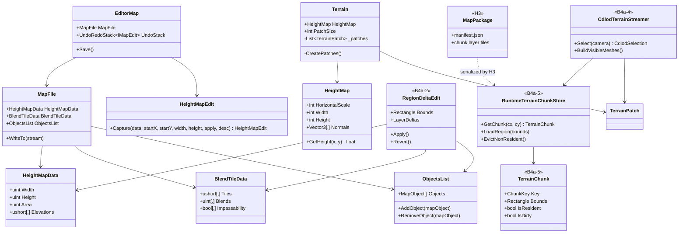
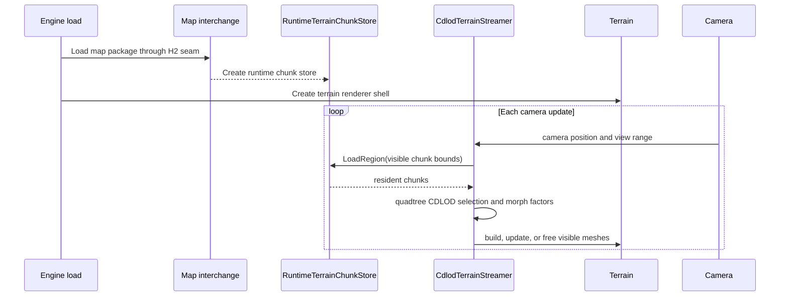
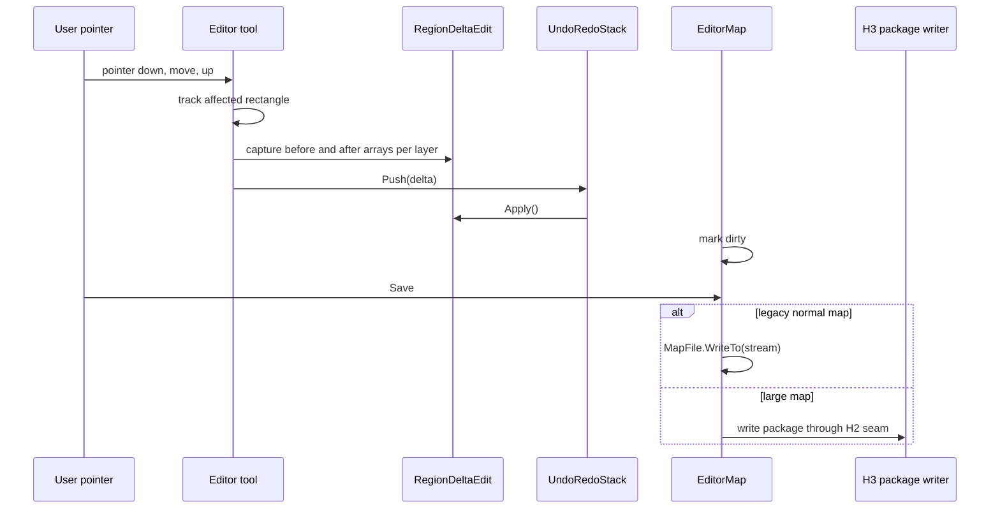

# Deep Dive: Larger Maps (via WorldBuilder)

> Expands phase B4a of [Track B: Scale](../track-b-scale.md). Part of the
> [Large-Scale RTS Roadmap](../README.md).
>
> Audience: human overview of the larger-maps design.

Purpose: scale WorldBuilder and map loading toward very large maps and large populations. The
design treats terrain streaming, chunk residency, scalable edit/undo, and large-object authoring as
core requirements.

B4a assumes that WorldBuilder's basic author, save, load, and play round-trip works at normal map
sizes. That baseline is tracked by A5-6 in [implementation-checklist.md](../implementation-checklist.md).
The only current A5-6 card found is [`WI-A5-06`](https://projects.reid-corp.com/work_packages/302),
which is `Ready` and grounds A5 architecture, not the full WorldBuilder baseline acceptance item.
B4a implementation cards therefore call out the A5-6 checklist item where it affects execution.

## Decisions

- No size cap. Design for arbitrarily large maps. Map size is bounded by disk and authored data, not
  by a hard format or RAM ceiling.
- Original-engine `.map` write compatibility is not required for large maps. Reading legacy maps remains
  useful, but large-map authoring targets the H2/H3 path.
- B4a-2 undo uses region deltas: a rectangle plus before and after arrays for each edited layer.
- B4a-4 terrain LOD uses CDLOD: quadtree selection with continuous morph between levels.
- B4a-5 owns the runtime chunk store: chunk residency, paging, dirty tracking, and runtime access.
  H3 owns on-disk chunk encoding.
- The proposed runtime chunk layout matches B4b §5.1a: 128 lattice intervals per chunk, 129 lattice
  points, one-sample apron on every side, and raw little-endian `float32` height payloads in game units.

## How maps are sized today

- `HeightMapData` stores `Width`, `Height`, `BorderWidth`, `Area`, and a resident `ushort[,] Elevations`
  (`src/Panopticon.Simulation/Data/Map/HeightMapData.cs:19-30`). `Parse` allocates the full array and
  rejects `Width * Height != Area` (`HeightMapData.cs:137-146`). `Create` wraps a caller-supplied array
  (`HeightMapData.cs:35-46`). `MapFile.CreateEmpty` allocates new maps at `playable + 2 * border + 1`
  per axis (`src/Panopticon.Simulation/Data/Map/MapFile.cs:342-345,356`).
- `BlendTileData` stores tile, blend, passability, buildability, visibility, and related per-cell arrays
  (`src/Panopticon.Simulation/Data/Map/BlendTileData.cs:18-53`). `Parse` sizes them from `HeightMapData`
  (`BlendTileData.cs:184-195`). `CreateUniform` allocates each array at `width x height`
  (`BlendTileData.cs:88-110`).
- `HeightMap.HorizontalScale` is 10 world units per sample (`src/Panopticon.Simulation/Terrain/HeightMap.cs:12`).
  `GetHeight(int, int)` indexes the whole `Elevations` array (`HeightMap.cs:32`). `Width` and `Height` are
  the data dimensions minus one (`HeightMap.cs:176-177`). The constructor allocates
  `Normals = new Vector3[Width, Height]` and fills every entry through `RefreshNormals`
  (`HeightMap.cs:168-192`).
- `Terrain.PatchSize` is 17 vertices, or 16 intervals (`src/Panopticon.Simulation/Terrain/Terrain.cs:62,354`).
  `CreatePatches` builds every patch for the map (`Terrain.cs:352-396`). It runs from the constructor
  (`Terrain.cs:163`) and from the full rebuild `OnHeightMapChanged()` (`Terrain.cs:336-350`). The bounded
  `OnHeightMapChanged(bounds)` (`Terrain.cs:313-334`) rebuilds only intersecting patches.
- `Terrain.CreateTileDataTexture` allocates `uint[Width * Height * 4]` for the whole map and uploads one
  texture (`Terrain.cs:398-452`, allocation at `403`).
- `TerrainPatch` reads `heightMap.GetPosition` and `heightMap.Normals[x, y]` over its own bounds
  (`src/Panopticon.Simulation/Terrain/TerrainPatch.cs:72-86`, reads at `77` and `82`). It is a
  patch-local consumer of the whole-grid arrays.
- `PartitionCellManager.OnNewGame` takes the terrain boundary from `Borders[0]`
  (`src/Panopticon.Simulation/Logic/PartitionCellManager.cs:92-101`) and allocates `_cells` for the full
  boundary (`PartitionCellManager.cs:103`).
- `Navigation` has two constructors, one from `BlendTileData.Impassability` and one from a `bool[,]` feed.
  Both build a whole-map `Graph` (`src/Panopticon.Simulation/Navigation/Navigation.cs:29-45,52-68`, graph
  construction at `33` and `56`).
- `EditorMap.Save` (`src/Panopticon.Tools.WorldBuilder.Core/EditorMap.cs:99-124`) calls `MapFile.WriteTo`
  at line 115 for legacy maps and `MapPackageConverter.SavePackage` at line 108 for packages.
- `HeightMapEdit` records a rectangular before and after patch
  (`src/Panopticon.Tools.WorldBuilder.Core/HeightMapEdit.cs:8-27,33-64`). `Apply` and `Revert` copy the
  patch back (`HeightMapEdit.cs:66-93`).
- `HeightBrushTool` clones the whole `Elevations` array at pointer down
  (`src/Panopticon.Tools.WorldBuilder.Core/HeightBrushTool.cs:43`) and again at pointer up
  (`HeightBrushTool.cs:87`), then slices the affected rectangle (`HeightBrushTool.cs:94-111`).
- `ObjectsList` stores a flat `Objects` array (`src/Panopticon.Simulation/Data/Map/ObjectsList.cs:12`).
  `AddObject` copies the whole array (`ObjectsList.cs:17-20`), and `RemoveObject` rebuilds it
  (`ObjectsList.cs:26`).

## Constraints to lift

| # | Constraint | Where | Why it blocks large maps |
|---|---|---|---|
| C1 | Whole heightmap and per-cell arrays resident in memory | `HeightMapData`, `BlendTileData` | Memory grows with total area. |
| C2 | All terrain patches and tile-data texture built up front | `Terrain` | Build time, GPU memory, and draw cost grow with total area. |
| C3 | Brush strokes clone the full elevation grid | `HeightBrushTool` | Edit latency and memory scale with map area, not brush area. |
| C4 | Undo model needs layer-general region deltas | WorldBuilder edit model | Height already has a patch edit; blend, passability, and object edits need the same contract. |
| C5 | Spatial and navigation structures size eagerly to full grid | `PartitionCellManager`, `Navigation` | Allocation and per-tick cost grow with map area. |
| C6 | Legacy `.map` is the only save path in WorldBuilder | `EditorMap.Save`, `MapFile.WriteTo` | Chunked storage needs H2/H3 package output. |

## Chunk contract (proposed)

B4a adopts the B4b §5.1a layout as the proposed B4a-5 runtime chunk contract. The rationale is in
[§5.1a](r-real-world-terrain.md#51a-chunk-layout). No `RuntimeTerrainChunkStore` exists in the tree; the
name in the diagrams is the proposed B4a-5 type. The layout is already encoded in the interchange model
`MapInterchange` (`src/Panopticon.Simulation/Content/Importing/Maps/MapInterchange.cs:10`) through the
constants in `MapChunkGeometry` (`src/Panopticon.Simulation/Content/Importing/Maps/MapChunkGeometry.cs:8-18`).

| Property | Value |
|---|---|
| Lattice spacing | 10 game units |
| Chunk extent | 128 sample intervals per axis |
| Lattice points per chunk | 129 per axis; edge points duplicated in neighbours and equal |
| Apron | one read-only sample on each side for normals |
| Stored chunk sample count | 131 x 131 with apron |
| Height payload | little-endian `float32` game units (`MapPackageChunkCodec.cs:22`) |
| Chunk key | `(cx, cy)` from southwest origin; +X east, +Y north |
| Runtime owner | B4a-5 chunk store |
| On-disk owner | H3 package encoding: writer `MapPackageDirectoryWriter.Write` (`src/Panopticon.Simulation/Content/Importing/MapSources/Package/MapPackageDirectoryWriter.cs:33`), codec `MapPackageChunkCodec` (`MapPackageChunkCodec.cs:15`), reader `MapPackageChunkFileReader` (`MapPackageChunkFileReader.cs:16`) |

### Lattice and patch mapping

| Quantity | Value | Source |
|---|---|---|
| Chunk extent | 128 intervals x 10 units = 1280 game units per axis | `MapChunkGeometry.cs:10`, `HeightMap.cs:12` |
| Core points | 129 per axis: 128 intervals plus the shared end point | `MapChunkGeometry.cs:8` |
| Stored points | 131 per axis: 129 core plus one apron per side | `MapChunkGeometry.cs:14` |
| Chunk origin | whole-map lattice index `(128 cx, 128 cy)` | `MapInterchangeValidator.cs:21` |
| Shared edge | lattice column `128 (cx + 1)` is core column 128 of chunk `cx` and core column 0 of chunk `cx + 1` | `MapInterchangeValidator.cs:21-23` |
| East apron | lattice column `128 (cx + 1) + 1`, core column 1 of chunk `cx + 1` | `MapInterchangeValidator.cs:33-34` |
| Render patch | 17 vertices with stride 16, so adjacent patches share one edge | `Terrain.cs:62,354,377-381` |
| Patches per chunk | `128 / 16 = 8` per axis; `8 x 8 = 64` at full detail | arithmetic |
| Patch `(px, py)` | core-local vertices `16 px` through `16 px + 16` inclusive | arithmetic on `Terrain.cs:374-381` |

Chunk world origin: `(128 cx - BorderWidth) x 10` per axis, from `GetPosition` (`HeightMap.cs:126-129`).

The current patch count formula does not fit a 129-point chunk. `CreatePatches` derives its extent from
`HeightMap.Width - 1` (`Terrain.cs:356-368`), and `HeightMap.Width` is the data width minus one
(`HeightMap.cs:176`). For a 129-point grid, that yields a last patch of 16 vertices (`Terrain.cs:380`).
Chunk-local patch bounds must use the 129-point core extent.

### Border and apron interactions

- `BorderWidth` is map-edge padding inside the lattice. New maps size `Width` and `Height` to include both
  borders (`MapFile.cs:342-343`). World-to-lattice conversions add it (`HeightMap.cs:88`, `104-105`,
  `148-149`, `164`) and lattice-to-world conversions subtract it (`HeightMap.cs:127-128`). Chunk keys index
  the padded lattice, so chunk origins in world units subtract `BorderWidth`.
- The apron is a one-sample copy of the neighbour's core sample. It is not `BorderWidth`. A chunk on the
  map edge has no neighbour on that side. Its apron follows the adapter clamp policy
  (`src/Panopticon.Simulation/Content/Importing/MapSources/LegacyMapReader.cs:165-166`), and the validator
  does not check map-edge aprons (`MapInterchangeValidator.cs:36-37`).
- Normals at core edges read the apron. `CalculateNormal` reads quads `m = x - 1..x` and
  `n = y - 1..y` (`HeightMap.cs:240-242`), and `CalculateQuadNormal` reads `x + 1` and `y + 1`
  (`HeightMap.cs:215-218`). With the apron, a chunk-local normal matches the whole-grid normal everywhere
  except the final global lattice column and row, where the whole-grid path substitutes `UnitZ`
  (`HeightMap.cs:248`) or stores no normal (`HeightMap.cs:176-177`).
- Shared edge points must be equal in both chunks because both chunks' normals and apron samples read
  them (`MapInterchangeValidator.cs:33-37`).

### Memory estimates

These are estimates from element sizes, not measurements. Bytes are per chunk.

| Layer | Basis | Bytes | KiB |
|---|---|---|---|
| Heights | 131 x 131 x 4, float32, with apron | 68,644 | 67.04 |
| Normals | 129 x 129 x 12, `Vector3`, held in `HeightMap.Normals` today (`HeightMap.cs:168`) | 199,692 | 195.01 |
| Material index, in memory | 129 x 129 x 2, `ushort` (`BlendTileData.cs:18`) | 33,282 | 32.50 |
| Material index, palette bytes | 129 x 129 x 1, uint8 | 16,641 | 16.25 |
| Impassability mask, in memory | 129 x 129 x 1, `bool` (`BlendTileData.cs:23`) | 16,641 | 16.25 |
| Buildability mask, in memory | 129 x 129 x 1, `bool` (`BlendTileData.cs:47`) | 16,641 | 16.25 |
| Two masks, bit-packed | 129 x 129 / 8 per mask, about 2,080 bytes each | 4,160 | 4.06 |
| Subtotal, in memory | heights, normals, material `ushort`, two `bool` masks | 334,900 | 327.05 |
| Current tile-data texture, state basis | 128 x 128 x 16, `R32_G32_B32_A32_UInt` (`Terrain.cs:451`) | 262,144 | 256.00 |
| Current tile-data texture, 129 basis | 129 x 129 x 16 | 266,256 | 260.02 |

The bit-packed row is a packing scenario. The H3 codec writes masks as raw uint8 flag bytes today
(`MapPackageChunkCodec.cs:83-87`), so the in-memory `bool` and on-disk byte figures apply to the
current encoding. The subtotal omits the other `BlendTileData` arrays, so the resident total is higher.

Somme extent: about 78 x 52 chunks, carried from the settled extent above, gives 4,056 chunks.

| Layer | Total bytes | MiB |
|---|---|---|
| Heights | 278,420,064 | 265.52 |
| Normals | 809,950,752 | 772.43 |
| Material index, in memory | 134,991,792 | 128.74 |
| Impassability mask, in memory | 67,495,896 | 64.37 |
| Buildability mask, in memory | 67,495,896 | 64.37 |
| Combined in-memory subtotal | 1,358,354,400 | 1,295.43 |
| Current tile-data texture, state basis | 1,063,256,064 | 1,014.00 |
| Current resident `Elevations`, `ushort`, 9,985 x 6,657 lattice without border | 132,940,290 | 126.78 |
| Full-detail render patches, 64 per chunk | 259,584 patches | n/a |

Stored heights hold 4,056 x 17,161 = 69,605,016 samples. The unique lattice for the same extent is
9,985 x 6,657 = 66,470,145 points, so apron and shared-edge duplication add about 4.7 percent. The whole
Western Front is a later capacity problem and must page by region rather than relying on full residency.

## Sub-phases

| Phase | Goal | Status |
|---|---|---|
| B4a-1. Baseline and limits audit | Measure normal and large map load time, memory, edit latency, render cost, save time, and the first failing constraint. | Not started |
| B4a-2. Region-delta editing in WorldBuilder | Replace full-grid clones with rectangle plus before and after arrays per edited layer. Height, blend/material, passability/buildability, and object edits use one region-delta pattern. | Not started |
| B4a-3. New Map wizard for large maps | Add large-map presets, 16-bit elevation defaults, and memory guidance without a hard cap. | Not started |
| B4a-4. Terrain streaming and CDLOD | Select terrain by quadtree, page visible chunks, build render meshes on demand, and morph continuously between LOD levels. | Not started |
| B4a-5. Runtime chunk store | Provide chunk residency, paging, dirty tracking, and region access over B4b's 128-interval chunk layout. H3 serializes the chunks. | Not started |
| B4a-6. Round-trip and play validation | Validate large maps through WorldBuilder save, reload, engine load, and play. | Not started |
| B4a-7. Large-population scenario authoring | Scale object placement, selection, multi-object edit/undo, and editor rendering for large populations. | Not started |

## Cards

| Card | Title | Status | Prerequisites |
|---|---|---|---|
| [`WI-B4a-01`](https://projects.reid-corp.com/work_packages/351) | Ground the B4a-5 chunk contract | Ready | none |
| [`WI-B4a-02`](https://projects.reid-corp.com/work_packages/352) | Audit WorldBuilder large-map limits | Ready | A5-6 checklist item |
| [`WI-B4a-03`](https://projects.reid-corp.com/work_packages/353) | Add the region-delta edit contract | Ready | A5-6 checklist item |
| [`WI-B4a-04`](https://projects.reid-corp.com/work_packages/354) | Remove full-grid height brush clones | Draft | `WI-B4a-03` |
| [`WI-B4a-05`](https://projects.reid-corp.com/work_packages/355) | Apply region deltas to map layers | Draft | `WI-B4a-03` |
| [`WI-B4a-06`](https://projects.reid-corp.com/work_packages/356) | Add large-map wizard presets | Ready | A5-6 checklist item |
| [`WI-B4a-07`](https://projects.reid-corp.com/work_packages/357) | Design CDLOD and streaming seams | Draft | `WI-B4a-01` |
| [`WI-B4a-08`](https://projects.reid-corp.com/work_packages/358) | Implement CDLOD quadtree selection | Draft | `WI-B4a-07` |
| [`WI-B4a-09`](https://projects.reid-corp.com/work_packages/359) | Stream visible terrain patches | Draft | `WI-B4a-07` |
| [`WI-B4a-10`](https://projects.reid-corp.com/work_packages/360) | Implement runtime chunk store | Draft | `WI-B4a-01`, `WI-H3-01`, `WI-H3-02` |
| [`WI-B4a-11`](https://projects.reid-corp.com/work_packages/361) | Validate large-map round-trip and play | Draft | `WI-B4a-10`, H6 |

## Sequencing notes

- B4a-1 is an investigation card and can run before code changes.
- B4a-2 and B4a-3 are WorldBuilder-local and can proceed before H3 package encoding.
- B4a-4 and B4a-5 depend on the chunk contract from `WI-B4a-01`.
- B4a-5 must coordinate with H3. B4a owns runtime residency and dirty state; H3 owns bytes on disk.
- B4a-7 can begin after B4a-2 establishes region-object edit patterns and B5 provides rendering scale hooks.

## Architecture Diagrams

### Current types and B4a additions

### Large map runtime flow

### WorldBuilder region edit and save

## Related

- Track B overview: [`../track-b-scale.md`](../track-b-scale.md)
- B4b chunk layout: [`r-real-world-terrain.md#51a-chunk-layout`](r-real-world-terrain.md#51a-chunk-layout)
- Track H storage formats: [`../track-h-storage-formats.md`](../track-h-storage-formats.md)
- Architecture snapshot: [`../agent/current-state.md`](../agent/current-state.md)
