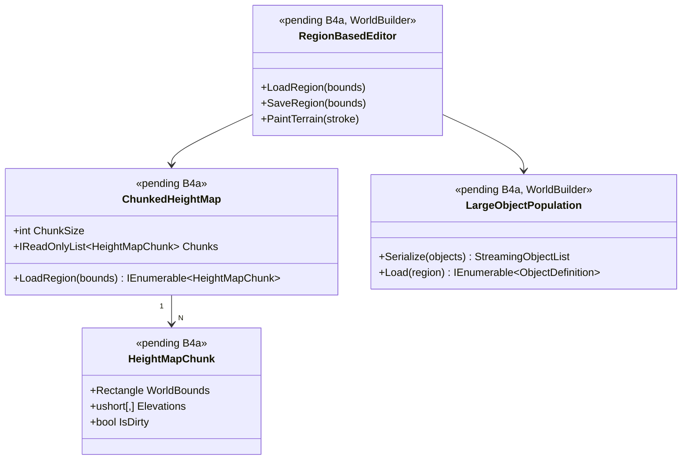

# Deep Dive: Larger Maps (via WorldBuilder)

> Expands phase B4a of [Track B: Scale](../track-b-scale.md). Part of the
> [Large-Scale RTS Roadmap](../README.md).
>
> Audience: human overview of the larger-maps design.

Purpose: scale WorldBuilder and map loading toward very large maps and large populations. The
design treats terrain streaming and large-object authoring as the core requirements.

> B4a assumes that WorldBuilder's basic author → save → load → play round-trip already
> works at normal map sizes. That baseline is established in [A5-6](a5-visualization.md), an
> early Track A sub-phase. B4a scales beyond those limits; it is not the first audit of basic
> WorldBuilder functionality.

> WorldBuilder is scenario-authoring tooling and must scale with the sim. It handles terrain and a
> scenario's initial object population: units, structures, and props. A sim-scale experiment needs a
> sim-scale authoring path that can place and edit thousands to millions of objects, not just a large
> heightmap. Terrain scaling (B4a-1…6) and large-population scenario authoring (B4a-7) are the two
> halves of that. B4a-7 is the WorldBuilder counterpart to ReplaySketch's
> [A5-5](a5-visualization.md) authoring-at-scale work.

## Decisions

- No size cap. Design for arbitrarily large maps. The goal is to scale map size over time to
  experiment with scaling techniques, so size must be bounded by disk, not RAM or the file format.
  Streaming/chunking (B4a-5) is therefore a core requirement, and every per-cell-resident
  assumption (C1, C5) must eventually go.
- Original-engine `.map` compatibility is not required. OpenSAGE may extend or replace the `.map`
  format for large maps from the start, consistent with the roadmap principle that scale and
  extensibility outrank fidelity. Reading existing original maps remains valuable, but writing must
  not be constrained by the original format's limits. This removes the compatibility half of C6 as a
  blocker.

## How maps are sized today

- Terrain is a heightmap grid. `HeightMapData`
  (`src/OpenSage.Game/Data/Map/HeightMapData.cs`) stores `Width`/`Height` (tiles) and a full
  `ushort[,] Elevations` array, plus `Area = Width  Height`. Generals maps store elevations as
  `uint8`; BFME and later as `uint16` (`ElevationsAre16Bit`, version ≥ 5).
- Companion per-tile data scales with area too. Blend/texture tiles (`BlendTileData`), passability,
  and similar data are all per-cell.
- Rendering splits terrain into fixed 17×17-vertex patches. `Terrain`
  (`src/OpenSage.Game/Terrain/Terrain.cs`, `PatchSize = 17`) builds a `List<TerrainPatch>` covering
  the whole map up front. There is no streaming or terrain LOD.
- Spatial systems scale with cell count. `PartitionCellManager`, the `Quadtree`
  (`src/OpenSage.Game/DataStructures/`), and the navigation graph
  (`src/OpenSage.Game/Navigation/`) are all sized from map dimensions.
- WorldBuilder authoring assumes the full grid is resident and cheap to copy. The New Map wizard
  (`NewMapWizardPage.xaml.cs`) only enforces minimums (width/height ≥ 10, border ≥ 2); there is no
  upper bound. Height-edit tooling clones the entire elevation array per stroke
  (`HeightBrushTool._strokeBefore = Elevations.Clone()`), so each edit is O(map area).

## Constraints to lift

| # | Constraint | Where | Why it blocks large maps |
|---|---|---|---|
| C1 | Whole heightmap + per-cell arrays resident in memory | `HeightMapData`, `BlendTileData` | Memory grows with map area; very large maps exhaust RAM. |
| C2 | All terrain patches built and kept up front; no LOD/streaming | `Terrain.cs` | Build time, GPU memory, and draw/cull cost grow with area. |
| C3 | Per-stroke full-array clone in the editor | `HeightBrushTool.cs` and other tools | Editing latency grows with map area, not brush size. |
| C4 | Undo/redo snapshots are full-grid | WorldBuilder edit/undo model | Memory + latency per edit scale with area. |
| C5 | Spatial/path/partition sized to full grid eagerly | `PartitionCellManager`, `Quadtree`, `Navigation` | Allocation and per-tick cost grow with area (ties into B2/B4). |
| C6 | No explicit, validated max size; `.map` format itself has size/precision limits | `NewMapWizardPage.xaml.cs`, `MapFile`, `HeightMapData` | Without an extended/replacement format, very large maps cannot be represented. The compatibility half is already resolved by the Decisions section. |

## Sub-phases

| Phase | Goal | Status |
|---|---|---|
| B4a-1. Baseline & limits audit | Measure where large maps break today: load time, memory, edit latency, render cost. Document the practical ceiling and which constraint (C1–C6) fails first to prioritize streaming/chunking work, not to pick a max size. See Decisions. | Not started |
| B4a-2. Region-based editing in WorldBuilder | Replace full-array clone/undo with dirty-region edits: tools capture only the affected rectangle, the brush already tracks stroke bounds in `HeightBrushTool` min/max X/Y, and undo/redo stores region deltas. Edit latency becomes proportional to brush size rather than map size. | Not started |
| B4a-3. New Map wizard for large maps | Surface large-size presets and validation in the New Map wizard: no hard cap, memory/perf guidance for the resident-grid path, and 16-bit elevation by default for large maps. | Not started |
| B4a-4. Terrain streaming & LOD | Build terrain patches on demand around the camera, free distant patches, and add terrain LOD so render cost scales sub-linearly with map area (ties into B5). | Not started |
| B4a-5. Chunked terrain storage & extended map format | Core requirement. Tile the heightmap/blend data into chunks so the whole grid need not be resident, and extend or replace the `.map` format to store chunked, arbitrarily large terrain. This resolves C1/C5/C6 and feeds B6 spatial sharding. | Not started |
| B4a-6. Round-trip & play validation | Validate large maps author → save → reload in WorldBuilder → play in the engine; confirm partition/pathfinding/rendering behave at increasing sizes. | Not started |
| B4a-7. Large-population scenario authoring | Scale WorldBuilder beyond terrain to placing and editing large object populations: bulk/procedural placement of units and structures, region-based multi-object edit/undo that extends B4a-2's dirty-region model from cells to objects, scalable selection/iteration, and instanced editor rendering that reuses [B5](../track-b-scale.md). This is the authoring counterpart to the engine-side [A5 scenario setup](a5-visualization.md) and ReplaySketch's [A5-5](a5-visualization.md). | Not started |

## Sequencing notes

- B4a-1 is a prerequisite for the rest. Optimize against measured limits, not guesses.
- B4a-2/3 are WorldBuilder-local and low-risk. They make large-map authoring usable before the
  engine-side streaming work lands.
- B4a-4/5 are engine-side and overlap with B2, B4, and B5. Coordinate so terrain chunking and the
  partition/quadtree work share a chunk/region concept.
- B4a-5 is required by the no-cap decision and is the natural bridge to B6 distributed simulation
  through spatial sharding. Coordinate the chunk/region concept with B6-1.
- B4a-7 reuses B4a-2's dirty-region edit/undo model, lifted from cells to objects, and B5's
  instanced rendering. It pairs with the engine-side [A5-5](a5-visualization.md) so the author and replay
  tools scale together. It can proceed in parallel with terrain streaming once B4a-2 exists.

## Architecture Diagrams

Diagrams for this phase will be elaborated once B4a moves to active implementation. The
placeholder below captures the key types larger-map support introduces.

## Related

- Track B overview: [`../track-b-scale.md`](../track-b-scale.md)
- Decision on the size ceiling & compatibility: [`../open-questions.md`](../open-questions.md)
- Architecture snapshot: [`../agent/current-state.md`](../agent/current-state.md)
