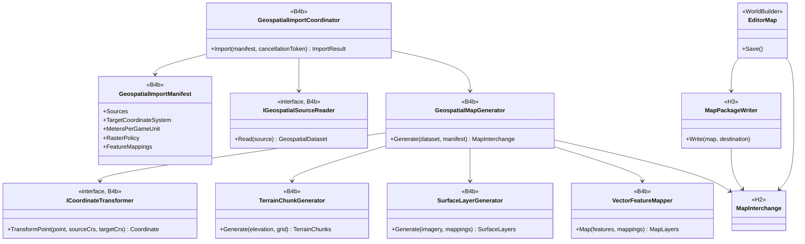
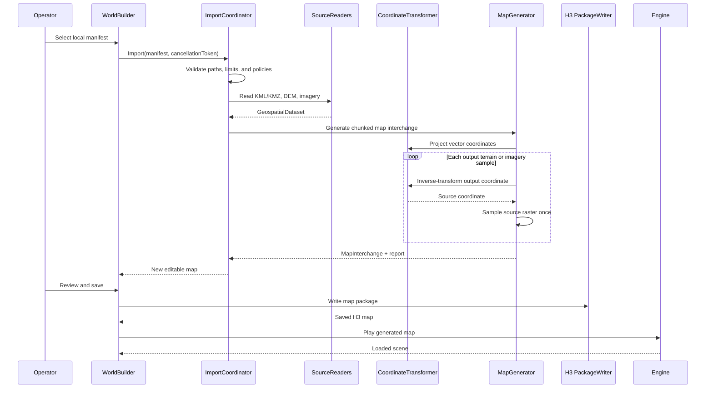
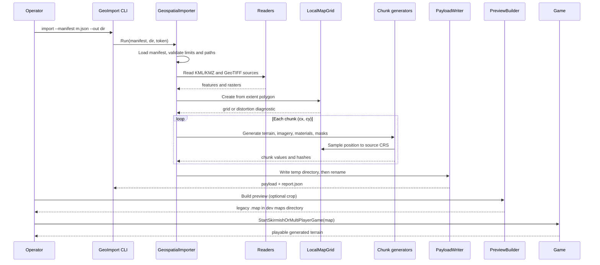

# Deep Dive: Geospatial Map Generation

> Expands phases R1 to R5 of [Track R: Real-World Terrain](../track-r-real-world-terrain.md)
> (formerly Track B phase B4b; sub-phase labels and card IDs keep the B4b prefix). Part of the
> [Large-Scale RTS Roadmap](../README.md).
>
> Audience: human design for offline generation of Panopticon maps from operator-supplied
> geospatial data. Code references are in the agent-context appendix.

Purpose: generate an editable, playable Panopticon map from a bounded real-world area selected in
Google Earth or prepared through Google Earth Engine. The importer converts local KML/KMZ from
Google Earth and georeferenced raster exports from operator-authorized Earth Engine datasets or
other authorized sources into the B4a/H3 map representation. Google basemap imagery and terrain
are not input sources. The pipeline does not couple the engine to a network service or treat
geographic coordinates as game-space coordinates.

---

## 1. Scope and completion boundary

B4b owns an offline source-to-map pipeline:

1. Read a local import manifest and its referenced files.
2. Parse KML/KMZ vector data and georeferenced elevation/imagery rasters.
3. Reproject every source into one local planar coordinate system.
4. Generate chunked terrain, imagery, and configured vector-derived map layers.
5. Write the H3 map package through the H2 map interchange boundary.
6. Open, edit, save, reload, and play the generated map through WorldBuilder.

The first completed pipeline supports:

- one KML or KMZ document containing an extent and named point, line, or polygon features;
- one georeferenced DEM raster;
- one optional georeferenced imagery raster;
- one optional classification raster;
- one WGS84 Transverse Mercator target: a UTM zone or a custom central meridian;
- deterministic nearest-neighbour, bilinear, and area-weighted resampling;
- a visual imagery layer and explicit vector-to-map mapping rules;
- a machine-readable import report and source manifest.

The milestone is not visual resemblance alone. Source control points must map to the generated
terrain and named landmarks within declared horizontal and vertical tolerances. The generated map
must then survive a WorldBuilder save/reload and run in the engine.

Out of scope:

- authenticating to Google or another provider;
- downloading map tiles, resolving remote KML links, or scraping a service;
- automatically inferring object definitions from arbitrary feature names;
- globe-scale coordinates or rendering Earth curvature;
- reconstructing buildings from imagery;
- merging a changed source dataset into arbitrary hand edits;
- legacy `.map` export for operators (deferred until H5 migration tooling; the dev preview in
  §6.1 is not an operator export).

## 2. Source and provenance boundary

The [geospatial-import Decision](../open-questions.md) fixes an offline boundary. The operator
supplies every input file and is responsible for the right to use it. B4b records provenance but
does not implement license adjudication.

The manifest records:

- source file paths and content hashes;
- source label and optional attribution text;
- source and target coordinate reference systems;
- horizontal and vertical units;
- vertical datum or an explicit `unknown` value;
- selected extent and local origin;
- meters per game unit and vertical exaggeration;
- terrain lattice spacing, chunk size, and border;
- resampling and no-data policies;
- horizontal and vertical validation tolerances;
- imagery and vector mapping rules.

Paths resolve relative to the manifest. Absolute paths may be used interactively but are rewritten
as relative paths when all inputs share a project root. A saved map retains hashes and descriptive
metadata, not copies of source files unless the operator explicitly embeds generated assets.

KMZ is treated as an archive, not a remote-document container. Archive-local resources are
allowed. Path traversal, absolute archive paths, `NetworkLink`, and remote `href` values fail
before extraction.

## 3. Input and normalized interchange

Format-specific readers produce CPU-only values before map generation:

```text
GeospatialImportManifest
  Sources[]
  ExtentPolicy
  TargetCoordinateSystem
  LocalOrigin
  MetersPerGameUnit
  VerticalPolicy
  RasterPolicy
  FeatureMappings[]

GeospatialDataset
  Extent
  ElevationRaster
  Optional ImageryRaster
  VectorLayers[]
  Provenance

GeospatialRaster<T>
  Width, Height
  AffineTransform
  CoordinateSystem
  NoData
  Samples

GeospatialFeature
  SourceId
  Geometry
  Attributes
  CoordinateSystem
```

These types do not reference `MapFile`, renderer resources, Google SDK types, or a selected
GeoTIFF/projection library. Readers and coordinate transforms sit behind narrow interfaces so a
dependency can be replaced without changing the generation pipeline.

KML support is deliberately bounded:

- `Point`, `LineString`, `Polygon`, and `MultiGeometry`;
- folder and placemark names;
- extended string/number attributes;
- longitude, latitude, and optional altitude coordinates;
- `clampToGround` and absolute altitude interpreted through explicit policy.

Styles may supply a mapping key but do not define engine materials directly. Tours, models,
overlays with remote resources, network links, and dynamic updates are unsupported.

The initial raster contract is GeoTIFF with an affine transform, declared CRS, bands, and no-data
metadata. Google Earth supplies KML/KMZ vectors; raster inputs come from operator-authorized
datasets exported through Earth Engine or another geospatial tool. Google Earth basemap imagery
and terrain are explicitly unsupported.

Dependencies (see the B4b dependency Decision in [open-questions.md](../open-questions.md)):

| Concern | Choice |
|---|---|
| TIFF decoding | `BitMiracle.LibTiff.NET` (managed, BSD-style license) with in-house GeoTIFF key parsing |
| Projection | in-house WGS84 Transverse Mercator (Krüger series, order 6); no projection package |
| PNG encoding | existing `SixLabors.ImageSharp` |
| KML/KMZ | `System.Xml` and `System.IO.Compression` |

Both stay behind `IGeospatialRasterReader` and `ICoordinateTransformer`, so either can be
replaced without changing the generation pipeline. All code lives in the CPU-only
`Panopticon.Geospatial` project, which references no engine assembly.

## 4. Coordinate and elevation contract

KML coordinates are WGS84 longitude/latitude. They are never copied directly into game X/Y.
Raster coordinates come from their embedded CRS and affine transform.

Import uses this sequence:

1. Transform the selected KML polygon into the manifest's projected CRS.
2. Build the smallest axis-aligned target-CRS rectangle containing that polygon. Anchor the local
   lattice at its southwest corner and round its width and height upward to whole chunks.
   Retain the polygon as the playable-area mask; exterior samples are impassable and unbuildable.
3. Use that southwest corner as the standalone payload's origin. Other origin policies are deferred.
4. Subtract the origin to obtain local meters.
5. Divide by `metersPerGameUnit` to obtain Panopticon horizontal world units.
6. For each output sample, inverse-transform its target-CRS location into each source raster and
   sample that raster exactly once.

`ICoordinateTransformer` transforms coordinates only; it never creates an intermediate warped
raster. This single inverse-warp rule avoids two rounds of interpolation.

Geographic `Vector2d` coordinates use X longitude and Y latitude. An extent source must contain
exactly one polygon unless `extentFeatureId` selects a polygon explicitly. Ambiguous extents fail.

Projected easting maps to game +X and projected northing maps to game +Y. Raster row order comes
from the affine transform: a north-up raster with negative row scale is flipped while sampling so
it is not mirrored in game space.

The initial terrain lattice remains the engine's ten game units per sample. Therefore:

```text
outputSpacingMeters = 10 * metersPerGameUnit
```

The values are not independent controls. A later B4a/H3 variable-lattice contract may replace the
constant, but it must preserve the same declared relation.

The transform is retained as map metadata:

```text
GeospatialMapTransform
  SourceCoordinateSystems[]
  ProjectedCoordinateSystem
  OriginEastingNorthing
  MetersPerGameUnit
  VerticalDatum
  VerticalOriginMeters
  VerticalExaggeration
```

Supported coordinate systems:

- sources: EPSG:4326 (KML and geographic rasters) and WGS84 UTM, EPSG:32601-32660 and
  EPSG:32701-32760; any other CRS fails with a `Coordinates` diagnostic, and the operator
  reprojects at export time;
- target: WGS84 Transverse Mercator. `utm` presets use the zone's central meridian, scale 0.9996,
  and standard false easting/northing. `transverse-mercator` uses scale 1, zero false
  easting/northing, and a central meridian that defaults to the extent's WGS84 bounding-box centre
  rounded to 0.01 degrees.

A custom central meridian lets one import cover several UTM zones, such as the whole Western Front
(about 5 degrees of longitude, under 0.05% scale error at the edges). Import fails when the point
scale error `|k/k0 - 1|` at any extent corner or edge midpoint exceeds `maxScaleError` (default
0.001). Earth-curvature rendering remains out of scope.

Vertical datum is metadata only: the manifest records each source's datum (for example `EGM96`,
`EGM2008`, or `unknown`), no geoid conversion runs, and sources that declare different known
datums fail with a `Coordinates` diagnostic.

Elevation conversion is explicit:

```text
gameZ =
  (sourceElevationMeters - verticalOriginMeters)
  * verticalExaggeration
  / metersPerGameUnit
```

The H3 terrain payload retains enough precision for the configured tolerance. Optional legacy
export quantizes to the target game's height representation only after reporting range and
precision loss.

Source no-data handling is selected in the manifest:

- `fail`: any output sample touching no-data rejects the import;
- `nearest-valid`: fill from the nearest valid source sample within a bounded radius, choosing the
  lowest source row and then column when candidates are equidistant;
- `constant`: fill with an explicit elevation.

There is no silent zero fill. The report records filled sample counts and affected bounds.

Coverage outside a source raster footprint is distinct from an in-raster no-data value. The
manifest's `edgePolicy` either fails, uses a bounded nearest-edge sample, or supplies an explicit
constant. The report records outside-footprint and no-data counts separately.

Resampling follows source and output ground-sample distance:

- nearest-neighbour is for categorical masks;
- bilinear is for continuous elevation or imagery when output spacing does not exceed source
  ground-sample distance;
- deterministic area-weighted sampling is required for decimation.

The report records source ground-sample distance, output spacing, their ratio, and the selected
kernel.

Affine coordinates refer to pixel corners; samples lie at half-pixel centers. Output sampling
footprints are rectangles in target projected meters, transformed into source pixel space.
Ground-sample-distance comparisons use meters, including for geographic rasters. Decimation in
either axis selects area weighting; zero-weight neighbours do not contribute no-data failures.
Partial source coverage applies the edge policy independently from in-raster no-data.

Default validation tolerances are owned by the manifest:

- horizontal: at most the greater of one output sample spacing and the source's stated horizontal
  accuracy;
- vertical: the DEM's stated vertical accuracy when available; otherwise the operator must supply
  a tolerance.

The H3 output elevation quantum must be no greater than half the vertical tolerance. An operator
may tighten either tolerance. Absolute vertical validation requires a declared vertical datum.
With `unknown`, the report marks absolute validation `not evaluated` and requires an explicit
relative-elevation tolerance.

## 5. Terrain, imagery, and vector generation

### 5.1 Terrain

The output grid follows B4a-5's chunk boundaries. Each terrain chunk includes the overlap samples
needed for interpolation, normals, and seam-free patch generation. Sampling order, floating-point
rounding, and chunk traversal are fixed. Identical inputs, settings, platform, and pinned
geospatial dependency versions produce identical payloads. Cross-platform validation compares
coordinates and samples within declared tolerances rather than requiring byte-identical chunks.

The generator computes:

- height samples and min/max elevation;
- chunk bounds and overlap samples;
- normals or the inputs needed to derive them consistently;
- initial passability/buildability masks where explicit vector rules provide them;
- a deterministic content hash per chunk.

B4b does not create another terrain store. It populates B4a's runtime chunk contract and H3's
serialized terrain section.

Vertical exaggeration changes derived slopes. The report records it beside passability and
buildability generation, and those masks are regenerated whenever exaggeration changes.

### 5.1a Chunk layout

| Property | Value |
|---|---|
| Lattice spacing | 10 game units (`10 * metersPerGameUnit` meters) |
| Chunk extent | 128 sample intervals (1280 game units) per axis |
| Lattice points per chunk | 129 per axis; edge points are duplicated in both neighbours and must be equal |
| Apron | one read-only sample on each side for normals; stored chunk is 131 x 131 |
| Height payload | little-endian `float32` game units |
| Chunk key | `(cx, cy)` from the southwest origin; +X east, +Y north |

The map extent rounds outward to whole chunks. The same layout is the proposed
[B4a-5](b4a-larger-maps.md) runtime chunk contract; `WI-B4a-01` grounds it against the engine.

### 5.2 Imagery

Source imagery is a georeferenced visual reference, not automatically a gameplay material map.
The initial path resamples imagery into chunk-aligned RGBA8 PNG assets (default 10 pixels per
lattice interval, set by `imageryPixelsPerSample`) and exposes them through an
editor-only 2-D overlay outside `GameViewportRenderer`. Imagery validation is asset-level:
control pixels are compared with the source after the declared resampling. The current renderer
has one whole-map macro texture, not a streamed imagery layer, so displaying chunked source
imagery in game is deferred until B4a or B5 provides that binding. The playable proof uses
generated terrain material layers.

Gameplay terrain materials remain explicit. A manifest can map integer classification raster
values or vector polygon attributes to a controlled Panopticon material palette. Polygon rules
override classification rules, and later rules override earlier ones. There is no built-in
vocabulary; an example manifest fragment maps the ESA WorldCover classes. Arbitrary imagery colors are not
silently quantized into legacy `BlendTileData`. The manifest requires one default base terrain
material; cells not matched by a classification or vector rule use that material.

### 5.3 Vector features

Feature mappings are declarative:

| Source geometry | Initial targets |
|---|---|
| Point | Landmark, waypoint, spawn/object candidate |
| Line | Road, rail, river, or annotation candidate |
| Polygon | Water, material, passability, buildability, or annotation region |

A mapping rule selects source layer and attributes, target kind, and target parameters. Object
placement requires an explicit object-definition name and orientation policy. Unmapped features
remain inspectable annotations and produce no gameplay state.

Generated points sample terrain Z after terrain creation. Lines and polygons are clipped to the
selected extent before rasterization. Stable source IDs and attributes remain attached to
generated authoring records for diagnostics.

Generation order: terrain, clipped and mapped features, then materials and masks. Water sets both
mask bits; subsequent passability and buildability rules change only their respective bit.
Exterior playable-area masking is applied last. Polygon holes remain excluded; clipping preserves
disconnected parts and gives each split part a stable identity.

## 6. H2/H3 and WorldBuilder boundary

B4b depends on B4a and H6, but format-specific parsing must not write H3 bytes directly.

- B4b owns source parsing, coordinate normalization, generation policy, and diagnostics.
- B4a owns chunked runtime terrain and streaming.
- H2 owns the format-neutral map interchange boundary.
- H3 owns the versioned on-disk package and serialization.
- H6 supplies WorldBuilder's H3 read/write lifecycle.
- B4b owns the interactive import command, preview, generation report, and capability-gated
  new-to-legacy export.

The generated result enters WorldBuilder as a normal editable map. The import operation is one
transaction: cancellation or a blocking diagnostic leaves the current editor session unchanged.
Successful import creates a new dirty document and an import report.

Initial reimport is replace-only. A source change generates a new map document; B4b does not
attempt a three-way merge with edited terrain or objects. The retained manifest and feature IDs
make a later layer-aware reimport experiment possible.

Operator-facing legacy `.map` export is deferred until H5 migration tooling exists.

### 6.1 Standalone payload and dev preview

Until H2/H3/H6 exist, B4b-1..6 write a B4b-owned payload directory:

| File | Contents |
|---|---|
| `payload.json` | payload version, `GeospatialMapTransform`, chunk layout, material palette, generated features, provenance with SHA-256 hashes |
| `terrain/<cx>_<cy>.bin` | 131 x 131 `float32` heights |
| `imagery/<cx>_<cy>.png` | RGBA8 imagery |
| `materials/<cx>_<cy>.bin` | 129 x 129 material indices (`byte`) |
| `masks/<cx>_<cy>.bin` | 129 x 129 passability and buildability bit flags |
| `report.json` | diagnostics, kernel and sample-distance ratios, fill counts, control-point results |

The importer writes into a temporary sibling directory and renames it on success, so a failed or
cancelled import leaves no partial payload. B4b-7 later maps the same generated values into the
H2 interchange; the payload remains a debug artifact.

Control-point validation runs before the rename. Replacing an existing output preserves it until
generation and validation succeed, then swaps through a recoverable sibling backup. Payload reads
validate safe paths, exact chunk inventory and byte lengths, hashes, finite heights, seam equality,
palette indices, known mask bits, and consistent optional imagery before preview.

Horizontal control points include independent expected game XY or a matched generated feature ID;
coordinates alone report horizontal validation as not evaluated. Imagery tolerance is an explicit
per-channel byte threshold. Unknown-datum elevation comparisons are relative to the declared
vertical origin and require a relative-elevation tolerance.

The dev preview (`Panopticon.Geospatial.Preview`) converts a payload, or a chunk-aligned crop of
it, into a resident legacy `MapFile`: 16-bit `HeightMapData` (`gameZ / 0.0390625`, clamped with
reported loss), uniform-then-painted `BlendTileData` from a palette-to-terrain-texture map,
passability from masks, and waypoints from mapped features. It writes a `.map` into a dev maps
directory so the existing load path plays it. It is dev-only: no capability gating, no
compatibility promise, and it is removed or kept as a debug tool when B4b-7 lands.

Preview crops use a half-open chunk rectangle. XY is translated by the crop origin and border;
Z is rebased by the crop minimum elevation. The report retains both offsets and quantization loss.
Default preview border: zero. An assembled heightmap index `(i, j)` maps to engine XY
`((i - border) * 10, (j - border) * 10)`. Stored waypoint coordinates use engine XY, not indices.
Waypoints outside the crop are excluded; retained waypoints and control-point checks use the same
transform. Height comparisons restore the reported Z offset before comparison.
Player-start waypoints use Z zero because skirmish startup adds terrain height; ordinary mapped
waypoints retain their rebased absolute elevation.

## 7. Diagnostics and security

Diagnostics have stable codes and stages:

| Stage | Example failures |
|---|---|
| Manifest | Missing source, invalid policy, path outside project root |
| Archive | Unsafe KMZ path, remote reference, unsupported compression |
| Parse | Unsupported KML geometry, malformed raster metadata |
| Coordinates | Missing CRS, projection failure, excessive distortion |
| Raster | Outside-footprint policy, no-data threshold, incompatible bands, invalid affine transform |
| Generate | Elevation overflow, invalid chunk seam, unknown material/object mapping |
| Write | H3 capability or serialization failure |
| Validate | Control-point, round-trip, or playability mismatch |

Errors are not inferred from exception messages. Reader adapters translate known dependency
failures into typed diagnostics and preserve the original exception as detail.

Resource limits are checked before allocation or extraction:

- maximum manifest and KML entry size;
- maximum KMZ entry count, expanded bytes, and compression ratio;
- maximum raster dimensions and decoded bytes;
- maximum feature and coordinate counts;
- checked output dimensions and chunk counts.

## 8. Determinism and validation

Repository tests use generated fixtures, never downloaded data:

- a small KML file with point, line, polygon, and nested geometry;
- a KMZ containing the same data and archive-local resources;
- a synthetic projected DEM with a known plane, ridge, no-data hole, edge values, and row order
  that exposes vertical mirroring;
- deterministic imagery with known control pixels;
- mismatched-CRS and malformed-input fixtures.

Validation layers:

1. Unit tests: parsing, archive safety, transforms, extent clipping, raster kernels, no-data,
   elevation conversion, feature mapping, and diagnostic codes.
2. Chunk tests: adjacent borders, overlap samples, pinned-platform hashes, cross-platform numeric
   tolerances, traversal order, and bounded memory.
3. Package tests: generated H3 package save/reload and retained transform/provenance metadata.
4. WorldBuilder tests: import transaction, cancellation, dirty state, preview, edit, and save.
5. Engine test: load and play a generated synthetic map.
6. Operator proof: import one authorized real-world area, compare named control points against the
   source within declared tolerances, save/reload it in WorldBuilder, and play it. This is an
   operator-local gate; no source data is committed or required in CI.
7. B1 benchmark: import time, peak memory, chunk generation/streaming time, and editor latency.

## 9. Sub-phases and cards

| Phase | Goal | Cards | Status |
|---|---|---|---|
| B4b-1. Input contract | Project, diagnostics, limits, manifest schema and loader. | [`WI-B4b-01`](../agent/cards/WI-B4b-01-scaffold-geospatial-project.md), [`02`](../agent/cards/WI-B4b-02-import-manifest.md) | In progress |
| B4b-2. Geospatial interchange | Immutable extent, raster, feature, CRS, provenance values and reader/transform interfaces. | [`WI-B4b-03`](../agent/cards/WI-B4b-03-interchange-values.md) | Not started |
| B4b-3. Local source readers | KML, KMZ, and GeoTIFF readers with limits; synthetic GeoTIFF fixtures. | [`07`](../agent/cards/WI-B4b-07-kml-reader.md), [`08`](../agent/cards/WI-B4b-08-kmz-archive.md), [`09`](../agent/cards/WI-B4b-09-geotiff-fixtures.md), [`10`](../agent/cards/WI-B4b-10-geotiff-reader.md) | Not started |
| B4b-4. Coordinate normalization | Transverse Mercator, CRS transformer, local map grid with distortion check. | [`04`](../agent/cards/WI-B4b-04-transverse-mercator.md), [`05`](../agent/cards/WI-B4b-05-coordinate-transformer.md), [`06`](../agent/cards/WI-B4b-06-local-map-grid.md) | Not started |
| B4b-5. Terrain and imagery generation | Sampling kernels, terrain chunks, imagery chunks, material layer. | [`11`](../agent/cards/WI-B4b-11-raster-sampling.md), [`12`](../agent/cards/WI-B4b-12-terrain-chunks.md), [`13`](../agent/cards/WI-B4b-13-imagery-chunks.md), [`14`](../agent/cards/WI-B4b-14-material-layer.md) | Not started |
| B4b-6. Vector semantics | Clip and transform features, mapping rules, passability and buildability masks. | [`15`](../agent/cards/WI-B4b-15-feature-clipping.md), [`16`](../agent/cards/WI-B4b-16-feature-mapping.md), [`17`](../agent/cards/WI-B4b-17-terrain-masks.md) | Not started |
| B4b-6a. Standalone payload | Import pipeline, payload writer/reader, CLI, control-point validation (§6.1). | [`18`](../agent/cards/WI-B4b-18-import-pipeline-payload.md), [`19`](../agent/cards/WI-B4b-19-geoimport-cli.md), [`20`](../agent/cards/WI-B4b-20-control-point-validation.md) | Not started |
| B4b-6b. Dev preview | Payload to resident legacy `MapFile`, playable in the engine (§6.1). | [`21`](../agent/cards/WI-B4b-21-audit-playable-mapfile.md), [`22`](../agent/cards/WI-B4b-22-mapfile-defaults.md), [`23`](../agent/cards/WI-B4b-23-payload-to-mapfile.md), [`24`](../agent/cards/WI-B4b-24-preview-evidence.md) | Not started |
| B4b-7. H3 package output | Populate the H2 map interchange and write chunked terrain, generated assets, vector-derived layers, provenance, and diagnostics through H3. | blocked on H2/H3 and B4a-5 | Not started |
| B4b-8. WorldBuilder workflow | Build on H6 to add transactional import, preview, cancellation, report display, and edit/save/reload. | blocked on H6 | Not started |
| B4b-9. Validation and scale proof | Package and engine round-trips, one operator-supplied control-point proof, and B1 measurements. | blocked on B4b-7/8 | Not started |

B4b-1..6b depend on no Track H or B4a work. Design cards `WI-B4a-01` (chunk contract),
`WI-H1-01`/`02` (map format audit and decisions), and `WI-H2-01` (interchange design) prepare
B4b-7.

## 10. Architecture diagrams

Types marked `<<B4b>>` are planned. `MapInterchange` and `MapPackageWriter` name the boundaries H2
and H3 must provide; their final names are owned by Track H. §10.1 and §10.2 show the end state
after B4b-8; §10.3 and §10.4 show the B4b-1..6b types cards `WI-B4b-01..24` add, grounded against
current engine types.

### 10.1 Import types and ownership (end state)



### 10.2 Transactional import flow (end state)



### 10.3 Standalone pipeline and dev preview types

```mermaid
classDiagram
  class GeospatialImporter {
    <<B4b Panopticon.Geospatial>>
    +Run(manifestPath, outputDirectory, cancellationToken) GeoImportResult
  }
  class ManifestLoader {
    <<B4b>>
    +Load(path, diagnostics) GeospatialImportManifest
  }
  class GeoDiagnosticBag {
    <<B4b>>
    +Add(diagnostic)
    +HasErrors bool
  }
  class IVectorSourceReader {
    <<interface, B4b>>
    +Read(path, limits, diagnostics) IReadOnlyList~GeospatialFeature~
  }
  class IGeospatialRasterReader {
    <<interface, B4b>>
    +Read(path, limits, diagnostics) GeospatialRaster
  }
  class KmlReader
  class KmzArchiveReader
  class GeoTiffRasterReader
  class ICoordinateTransformer {
    <<interface, B4b>>
    +Transform(point, source, target) Vector2d
  }
  class WgsTransverseMercatorTransformer
  class TransverseMercatorProjection {
    +Forward(lat, lon) Vector2d
    +Inverse(e, n) GeoPoint
    +ScaleFactor(lat, lon) double
  }
  class LocalMapGrid {
    +Transform GeospatialMapTransform
    +ChunksX int
    +ChunksY int
    +SampleToProjected(x, y) Vector2d
  }
  class RasterSampler
  class TerrainChunkGenerator
  class ImageryChunkGenerator
  class MaterialLayerGenerator
  class FeatureMapper
  class TerrainMaskGenerator
  class GeneratedMapPayloadWriter
  class GeneratedMapPayload
  class GeneratedMapPreviewBuilder {
    <<B4b Panopticon.Geospatial.Preview>>
    +Build(payload, textureMap, crop) MapFile
  }
  class MapFile {
    <<existing>>
    +CreateEmpty(width, height, border, height) MapFile
    +WriteTo(stream)
  }
  class HeightMapData {
    <<existing>>
    +Create(border, elevations) HeightMapData
  }
  class BlendTileData {
    <<existing>>
  }

  GeospatialImporter --> ManifestLoader
  GeospatialImporter --> GeoDiagnosticBag
  GeospatialImporter --> IVectorSourceReader
  GeospatialImporter --> IGeospatialRasterReader
  IVectorSourceReader <|.. KmlReader
  IVectorSourceReader <|.. KmzArchiveReader
  KmzArchiveReader --> KmlReader
  IGeospatialRasterReader <|.. GeoTiffRasterReader
  ICoordinateTransformer <|.. WgsTransverseMercatorTransformer
  WgsTransverseMercatorTransformer --> TransverseMercatorProjection
  GeospatialImporter --> LocalMapGrid
  LocalMapGrid --> ICoordinateTransformer
  TerrainChunkGenerator --> RasterSampler
  ImageryChunkGenerator --> RasterSampler
  MaterialLayerGenerator --> RasterSampler
  GeospatialImporter --> TerrainChunkGenerator
  GeospatialImporter --> ImageryChunkGenerator
  GeospatialImporter --> MaterialLayerGenerator
  GeospatialImporter --> FeatureMapper
  GeospatialImporter --> TerrainMaskGenerator
  GeospatialImporter --> GeneratedMapPayloadWriter
  GeneratedMapPayloadWriter --> GeneratedMapPayload
  GeneratedMapPreviewBuilder --> GeneratedMapPayload
  GeneratedMapPreviewBuilder --> MapFile
  MapFile --> HeightMapData
  MapFile --> BlendTileData
```



### 10.4 Standalone import and dev preview flow



## 11. Resolved decisions

The B4b-1 decisions are recorded in the B4b geospatial pipeline Decision in
[open-questions.md](../open-questions.md) and applied in §3-§6 above.

## Appendix: Current-state hooks (agent context)

- `src/Panopticon.Simulation/Game.cs:711-740`: `LoadMap` resolves a map entry, calls
  `TerrainLogic.SetHeightMapData`, and constructs `Scene3D`; `Game.cs:870-884` is the skirmish entry.
- `src/Panopticon.Tools.WorldBuilder.Core/EditorMap.cs:8-72` owns editor map state, dirty tracking,
  undo, save, and save-as.
- `src/Panopticon.Tools.WorldBuilder.Core/NewMapFactory.cs:7-38` creates maps through
  `MapFile.CreateEmpty`.
- `src/Panopticon.Simulation/Data/Map/MapFile.cs:184-201`: `CreateEmpty` sets only `HeightMapData`;
  `MapFile.cs:344-430` writes `BlendTileData`, `WorldInfo`, and `SidesList` unconditionally.
- `src/Panopticon.Simulation/Data/Map/HeightMapData.cs:7-48` stores dimensions, border, elevation encoding
  (16-bit at scale 0.0390625 for version 5 and later), the resident `ushort[,]`, and `Create`.
- `src/Panopticon.Simulation/Terrain/HeightMap.cs:8-31,80-165` defines the current ten-world-unit sample
  spacing, border translation, horizontal X/Y axes, vertical Z axis, and height interpolation.
- `src/Panopticon.Simulation/Data/Map/BlendTileData.cs:6-176` stores current texture, blend,
  passability, buildability, visibility, and related per-cell data.
- `src/Panopticon.Simulation/Terrain/Terrain.cs:24-130` eagerly creates terrain resources and patches from
  the full map.
- `src/Panopticon.Simulation/Assets/Shaders/Terrain.frag:43,203-214` samples one whole-map macro texture in
  the current terrain shader.
- `src/Panopticon.Simulation/Graphics/Shaders/TerrainShaderResources.cs:34-60` owns the current
  macro-texture and terrain resource bindings.
- `src/Panopticon.Tools.WorldBuilder.Core/PlaceObjectTool.cs:6-44` maps viewport world coordinates
  directly into placed `MapObject` positions.
- `src/Panopticon.Tools.WorldBuilder.Core/GameViewportRenderer.cs:47-130` creates the editor's game
  viewport and reloads terrain after edits.
- `test/Panopticon.Simulation.Tests/Data/Map/MapFileTests.cs:10-180` contains existing map round-trip and
  blend/texture-cell coverage.
- `src/Panopticon.Tools.WorldBuilder.Core/Panopticon.Tools.WorldBuilder.Core.csproj:1-14` has no current
  geospatial package dependency.
