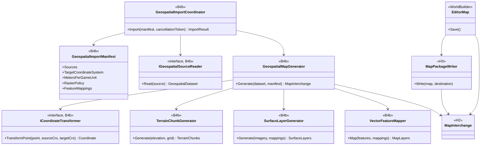
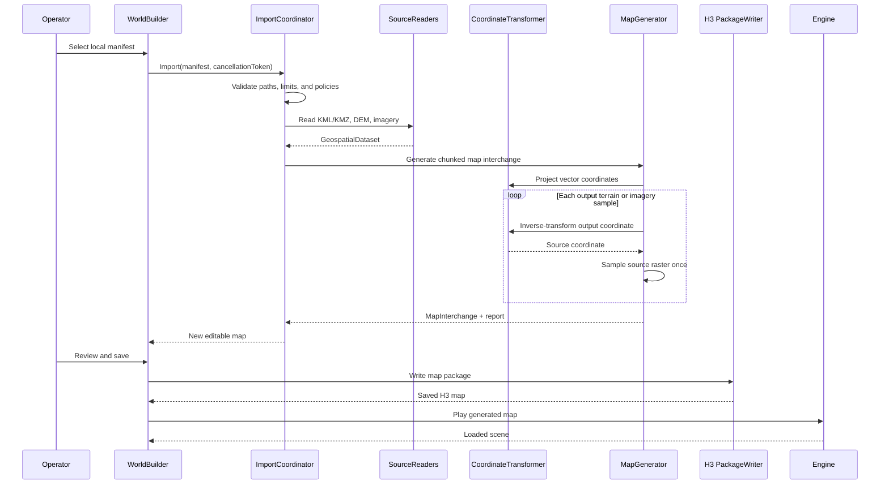

# Deep Dive: Geospatial Map Generation

> Expands phase B4b of [Track B: Scale](../track-b-scale.md). Part of the
> [Large-Scale RTS Roadmap](../README.md).
>
> Audience: human design for offline generation of OpenSAGE maps from operator-supplied
> geospatial data. Code references are in the agent-context appendix.

Purpose: generate an editable, playable OpenSAGE map from a bounded real-world area selected in
Google Earth or prepared through Google Earth Engine. The importer converts local KML/KMZ from
Google Earth and georeferenced raster exports from operator-authorized Earth Engine datasets or
other authorized sources into the B4a/H3 map representation. Google basemap imagery and terrain
are not input sources. The pipeline does not couple the engine to a network service or treat
geographic coordinates as game-space coordinates.

---

## 1. Scope and completion boundary

B4b owns an offline source-to-map pipeline:

1. Read a local import manifest and its referenced files.
2. Parse KML/KMZ vector data and georeferenced elevation/imagery rasters.
3. Reproject every source into one local planar coordinate system.
4. Generate chunked terrain, imagery, and configured vector-derived map layers.
5. Write the H3 map package through the H2 map interchange boundary.
6. Open, edit, save, reload, and play the generated map through WorldBuilder.

The first completed pipeline supports:

- one KML or KMZ document containing an extent and named point, line, or polygon features;
- one georeferenced DEM raster;
- one optional georeferenced imagery raster;
- one optional classification raster;
- one explicitly selected projected coordinate reference system;
- deterministic nearest-neighbour, bilinear, and area-weighted resampling;
- a visual imagery layer and explicit vector-to-map mapping rules;
- a machine-readable import report and source manifest.

The milestone is not visual resemblance alone. Source control points must map to the generated
terrain and named landmarks within declared horizontal and vertical tolerances. The generated map
must then survive a WorldBuilder save/reload and run in the engine.

Out of scope:

- authenticating to Google or another provider;
- downloading map tiles, resolving remote KML links, or scraping a service;
- automatically inferring object definitions from arbitrary feature names;
- globe-scale coordinates or rendering Earth curvature;
- reconstructing buildings from imagery;
- merging a changed source dataset into arbitrary hand edits;
- guaranteeing legacy `.map` export for data outside legacy limits.

## 2. Source and provenance boundary

The [geospatial-import Decision](../open-questions.md) fixes an offline boundary. The operator
supplies every input file and is responsible for the right to use it. B4b records provenance but
does not implement license adjudication.

The manifest records:

- source file paths and content hashes;
- source label and optional attribution text;
- source and target coordinate reference systems;
- horizontal and vertical units;
- vertical datum or an explicit `unknown` value;
- selected extent and local origin;
- meters per game unit and vertical exaggeration;
- terrain lattice spacing, chunk size, and border;
- resampling and no-data policies;
- horizontal and vertical validation tolerances;
- imagery and vector mapping rules.

Paths resolve relative to the manifest. Absolute paths may be used interactively but are rewritten
as relative paths when all inputs share a project root. A saved map retains hashes and descriptive
metadata, not copies of source files unless the operator explicitly embeds generated assets.

KMZ is treated as an archive, not a remote-document container. Archive-local resources are
allowed. Path traversal, absolute archive paths, `NetworkLink`, and remote `href` values fail
before extraction.

## 3. Input and normalized interchange

Format-specific readers produce CPU-only values before map generation:

```text
GeospatialImportManifest
  Sources[]
  ExtentPolicy
  TargetCoordinateSystem
  LocalOrigin
  MetersPerGameUnit
  VerticalPolicy
  RasterPolicy
  FeatureMappings[]

GeospatialDataset
  Extent
  ElevationRaster
  Optional ImageryRaster
  VectorLayers[]
  Provenance

GeospatialRaster<T>
  Width, Height
  AffineTransform
  CoordinateSystem
  NoData
  Samples

GeospatialFeature
  SourceId
  Geometry
  Attributes
  CoordinateSystem
```

These types do not reference `MapFile`, renderer resources, Google SDK types, or a selected
GeoTIFF/projection library. Readers and coordinate transforms sit behind narrow interfaces so a
dependency can be replaced without changing the generation pipeline.

KML support is deliberately bounded:

- `Point`, `LineString`, `Polygon`, and `MultiGeometry`;
- folder and placemark names;
- extended string/number attributes;
- longitude, latitude, and optional altitude coordinates;
- `clampToGround` and absolute altitude interpreted through explicit policy.

Styles may supply a mapping key but do not define engine materials directly. Tours, models,
overlays with remote resources, network links, and dynamic updates are unsupported.

The initial raster contract is GeoTIFF with an affine transform, declared CRS, bands, and no-data
metadata. Google Earth supplies KML/KMZ vectors; raster inputs come from operator-authorized
datasets exported through Earth Engine or another geospatial tool. Google Earth basemap imagery
and terrain are explicitly unsupported. A dependency spike chooses the decoding and projection
implementation based on:

- Windows, Linux, and macOS support;
- deterministic offline transforms;
- GeoTIFF key and vertical-metadata coverage;
- absence of process-global mutable state;
- package licensing and deployment cost.

The selected libraries remain behind `IGeospatialRasterReader` and
`ICoordinateTransformer`.

## 4. Coordinate and elevation contract

KML coordinates are WGS84 longitude/latitude. They are never copied directly into game X/Y.
Raster coordinates come from their embedded CRS and affine transform.

Import uses this sequence:

1. Transform the selected KML polygon into the manifest's projected CRS.
2. Build the smallest axis-aligned target-CRS rectangle containing that polygon, rounded outward
   to the terrain lattice and chunk boundaries. Retain the polygon as the playable-area mask.
3. Choose the declared origin, normally the southwest corner or center of that rectangle.
4. Subtract the origin to obtain local meters.
5. Divide by `metersPerGameUnit` to obtain OpenSAGE horizontal world units.
6. For each output sample, inverse-transform its target-CRS location into each source raster and
   sample that raster exactly once.

`ICoordinateTransformer` transforms coordinates only; it never creates an intermediate warped
raster. This single inverse-warp rule avoids two rounds of interpolation.

Projected easting maps to game +X and projected northing maps to game +Y. Raster row order comes
from the affine transform: a north-up raster with negative row scale is flipped while sampling so
it is not mirrored in game space.

The initial terrain lattice remains the engine's ten game units per sample. Therefore:

```text
outputSpacingMeters = 10 * metersPerGameUnit
```

The values are not independent controls. A later B4a/H3 variable-lattice contract may replace the
constant, but it must preserve the same declared relation.

The transform is retained as map metadata:

```text
GeospatialMapTransform
  SourceCoordinateSystems[]
  ProjectedCoordinateSystem
  OriginEastingNorthing
  MetersPerGameUnit
  VerticalDatum
  VerticalOriginMeters
  VerticalExaggeration
```

The target CRS must be projected and suitable for the selected extent. Import fails when the
extent exceeds a configured distortion threshold. Supporting multiple zones in one import or
Earth-curvature rendering is deferred.

Elevation conversion is explicit:

```text
gameZ =
  (sourceElevationMeters - verticalOriginMeters)
  * verticalExaggeration
  / metersPerGameUnit
```

The H3 terrain payload retains enough precision for the configured tolerance. Optional legacy
export quantizes to the target game's height representation only after reporting range and
precision loss.

Source no-data handling is selected in the manifest:

- `fail`: any output sample touching no-data rejects the import;
- `nearest-valid`: fill from the nearest valid source sample within a bounded radius, choosing the
  lowest source row and then column when candidates are equidistant;
- `constant`: fill with an explicit elevation.

There is no silent zero fill. The report records filled sample counts and affected bounds.

Coverage outside a source raster footprint is distinct from an in-raster no-data value. The
manifest's `edgePolicy` either fails, uses a bounded nearest-edge sample, or supplies an explicit
constant. The report records outside-footprint and no-data counts separately.

Resampling follows source and output ground-sample distance:

- nearest-neighbour is for categorical masks;
- bilinear is for continuous elevation or imagery when output spacing does not exceed source
  ground-sample distance;
- deterministic area-weighted sampling is required for decimation.

The report records source ground-sample distance, output spacing, their ratio, and the selected
kernel.

Default validation tolerances are owned by the manifest:

- horizontal: at most the greater of one output sample spacing and the source's stated horizontal
  accuracy;
- vertical: the DEM's stated vertical accuracy when available; otherwise the operator must supply
  a tolerance.

The H3 output elevation quantum must be no greater than half the vertical tolerance. An operator
may tighten either tolerance. Absolute vertical validation requires a declared vertical datum.
With `unknown`, the report marks absolute validation `not evaluated` and requires an explicit
relative-elevation tolerance.

## 5. Terrain, imagery, and vector generation

### 5.1 Terrain

The output grid follows B4a-5's chunk boundaries. Each terrain chunk includes the overlap samples
needed for interpolation, normals, and seam-free patch generation. Sampling order, floating-point
rounding, and chunk traversal are fixed. Identical inputs, settings, platform, and pinned
geospatial dependency versions produce identical payloads. Cross-platform validation compares
coordinates and samples within declared tolerances rather than requiring byte-identical chunks.

The generator computes:

- height samples and min/max elevation;
- chunk bounds and overlap samples;
- normals or the inputs needed to derive them consistently;
- initial passability/buildability masks where explicit vector rules provide them;
- a deterministic content hash per chunk.

B4b does not create another terrain store. It populates B4a's runtime chunk contract and H3's
serialized terrain section.

Vertical exaggeration changes derived slopes. The report records it beside passability and
buildability generation, and those masks are regenerated whenever exaggeration changes.

### 5.2 Imagery

Source imagery is a georeferenced visual reference, not automatically a gameplay material map.
The initial path resamples imagery into chunk-aligned image assets and exposes them through an
editor-only 2-D overlay outside `GameViewportRenderer`. Imagery validation is asset-level:
control pixels are compared with the source after the declared resampling. The current renderer
has one whole-map macro texture, not a streamed imagery layer, so displaying chunked source
imagery in game is deferred until B4a or B5 provides that binding. The playable proof uses
generated terrain material layers.

Gameplay terrain materials remain explicit. A manifest can map a classification raster or vector
polygon attributes to a controlled OpenSAGE material palette. Arbitrary imagery colors are not
silently quantized into legacy `BlendTileData`. The manifest requires one default base terrain
material; cells not matched by a classification or vector rule use that material.

### 5.3 Vector features

Feature mappings are declarative:

| Source geometry | Initial targets |
|---|---|
| Point | Landmark, waypoint, spawn/object candidate |
| Line | Road, rail, river, or annotation candidate |
| Polygon | Water, material, passability, buildability, or annotation region |

A mapping rule selects source layer and attributes, target kind, and target parameters. Object
placement requires an explicit object-definition name and orientation policy. Unmapped features
remain inspectable annotations and produce no gameplay state.

Generated points sample terrain Z after terrain creation. Lines and polygons are clipped to the
selected extent before rasterization. Stable source IDs and attributes remain attached to
generated authoring records for diagnostics.

## 6. H2/H3 and WorldBuilder boundary

B4b depends on B4a and H6, but format-specific parsing must not write H3 bytes directly.

- B4b owns source parsing, coordinate normalization, generation policy, and diagnostics.
- B4a owns chunked runtime terrain and streaming.
- H2 owns the format-neutral map interchange boundary.
- H3 owns the versioned on-disk package and serialization.
- H6 supplies WorldBuilder's H3 read/write lifecycle.
- B4b owns the interactive import command, preview, generation report, and capability-gated
  new-to-legacy export.

The generated result enters WorldBuilder as a normal editable map. The import operation is one
transaction: cancellation or a blocking diagnostic leaves the current editor session unchanged.
Successful import creates a new dirty document and an import report.

Initial reimport is replace-only. A source change generates a new map document; B4b does not
attempt a three-way merge with edited terrain or objects. The retained manifest and feature IDs
make a later layer-aware reimport experiment possible.

Legacy `.map` export is optional. It is offered only when dimensions, elevation range, texture
count, object count, and required metadata are representable. Otherwise the exporter reports
specific capability failures and leaves the H3 map intact.

## 7. Diagnostics and security

Diagnostics have stable codes and stages:

| Stage | Example failures |
|---|---|
| Manifest | Missing source, invalid policy, path outside project root |
| Archive | Unsafe KMZ path, remote reference, unsupported compression |
| Parse | Unsupported KML geometry, malformed raster metadata |
| Coordinates | Missing CRS, projection failure, excessive distortion |
| Raster | Outside-footprint policy, no-data threshold, incompatible bands, invalid affine transform |
| Generate | Elevation overflow, invalid chunk seam, unknown material/object mapping |
| Write | H3 capability or serialization failure |
| Validate | Control-point, round-trip, or playability mismatch |

Errors are not inferred from exception messages. Reader adapters translate known dependency
failures into typed diagnostics and preserve the original exception as detail.

Resource limits are checked before allocation or extraction:

- maximum manifest and KML entry size;
- maximum KMZ entry count, expanded bytes, and compression ratio;
- maximum raster dimensions and decoded bytes;
- maximum feature and coordinate counts;
- checked output dimensions and chunk counts.

## 8. Determinism and validation

Repository tests use generated fixtures, never downloaded data:

- a small KML file with point, line, polygon, and nested geometry;
- a KMZ containing the same data and archive-local resources;
- a synthetic projected DEM with a known plane, ridge, no-data hole, edge values, and row order
  that exposes vertical mirroring;
- deterministic imagery with known control pixels;
- mismatched-CRS and malformed-input fixtures.

Validation layers:

1. Unit tests: parsing, archive safety, transforms, extent clipping, raster kernels, no-data,
   elevation conversion, feature mapping, and diagnostic codes.
2. Chunk tests: adjacent borders, overlap samples, pinned-platform hashes, cross-platform numeric
   tolerances, traversal order, and bounded memory.
3. Package tests: generated H3 package save/reload and retained transform/provenance metadata.
4. WorldBuilder tests: import transaction, cancellation, dirty state, preview, edit, and save.
5. Engine test: load and play a generated synthetic map.
6. Operator proof: import one authorized real-world area, compare named control points against the
   source within declared tolerances, save/reload it in WorldBuilder, and play it. This is an
   operator-local gate; no source data is committed or required in CI.
7. B1 benchmark: import time, peak memory, chunk generation/streaming time, and editor latency.

## 9. Sub-phases

| Phase | Goal | Status |
|---|---|---|
| B4b-1. Input contract and dependency spike | Specify the manifest, bounded KML/KMZ and GeoTIFF subsets, projection requirements, limits, and choose replaceable raster/projection dependencies. | Not started |
| B4b-2. Geospatial interchange | Add immutable extent, raster, feature, coordinate-transform, provenance, and diagnostic values independent of engine map types. | Not started |
| B4b-3. Local source readers | Parse KML/KMZ and georeferenced DEM/imagery files with archive and resource limits; reject network references. | Not started |
| B4b-4. Coordinate normalization | Reproject sources into local planar meters, retain the reversible metadata transform, and validate distortion and control points. | Not started |
| B4b-5. Terrain and imagery generation | Resample elevation and imagery into B4a-aligned chunks with explicit no-data, precision, seam, and material policies. | Not started |
| B4b-6. Vector semantics | Clip and map configured points, lines, and polygons into annotations, masks, waypoints, and explicit object candidates. | Not started |
| B4b-7. H3 package output | Populate the H2 map interchange and write chunked terrain, generated assets, vector-derived layers, provenance, and diagnostics through H3. | Not started |
| B4b-8. WorldBuilder workflow | Build on H6 to add transactional import, preview, cancellation, report display, edit/save/reload, and B4b-owned capability-gated legacy export. | Not started |
| B4b-9. Validation and scale proof | Add synthetic fixtures, deterministic tests, package and engine round-trips, one operator-supplied control-point proof, and B1 measurements. | Not started |

## 10. Architecture diagrams

Types marked `<<B4b>>` are planned. `MapInterchange` and `MapPackageWriter` name the boundaries H2
and H3 must provide; their final names are owned by Track H.

### 10.1 Import types and ownership



### 10.2 Transactional import flow



## 11. Deferred decisions

B4b-1 must settle these before source-edit cards are written:

- the GeoTIFF and projection dependencies;
- supported projected coordinate systems and bundled CRS definitions;
- vertical datum conversion versus metadata-only preservation;
- H3 height precision and imagery asset representation;
- chunk dimensions and overlap ownership shared with B4a;
- multi-zone or low-distortion projection support for extents beyond the first bounded pipeline;
- initial KML altitude and style behavior;
- classification-raster and vector mapping vocabulary;
- legacy export capability limits;
- whether a later reimport model preserves editor-owned delta layers.

These do not block the deep dive. They are bounded decisions assigned to the first sub-phase.

## Appendix: Current-state hooks (agent context)

- `src/OpenSage.Tools.WorldBuilder.Maui/MainPage.xaml.cs:91-157` owns current new/open/save UI
  commands and opens legacy maps through `MapFile.FromStream`.
- `src/OpenSage.Tools.WorldBuilder.Core/EditorMap.cs:8-72` owns editor map state, dirty tracking,
  undo, save, and save-as.
- `src/OpenSage.Tools.WorldBuilder.Core/NewMapFactory.cs:7-38` creates maps through
  `MapFile.CreateEmpty`.
- `src/OpenSage.Game/Data/Map/MapFile.cs:166-206` creates the resident height grid;
  `MapFile.cs:348-430` writes legacy map assets eagerly.
- `src/OpenSage.Game/Data/Map/HeightMapData.cs:6-64` stores dimensions, border, elevation encoding,
  and the resident `ushort[,]`.
- `src/OpenSage.Game/Terrain/HeightMap.cs:8-31,80-165` defines the current ten-world-unit sample
  spacing, border translation, horizontal X/Y axes, vertical Z axis, and height interpolation.
- `src/OpenSage.Game/Data/Map/BlendTileData.cs:6-176` stores current texture, blend,
  passability, buildability, visibility, and related per-cell data.
- `src/OpenSage.Game/Terrain/Terrain.cs:24-130` eagerly creates terrain resources and patches from
  the full map.
- `src/OpenSage.Game/Assets/Shaders/Terrain.frag:43,203-214` samples one whole-map macro texture in
  the current terrain shader.
- `src/OpenSage.Game/Graphics/Shaders/TerrainShaderResources.cs:34-60` owns the current
  macro-texture and terrain resource bindings.
- `src/OpenSage.Tools.WorldBuilder.Core/PlaceObjectTool.cs:6-44` maps viewport world coordinates
  directly into placed `MapObject` positions.
- `src/OpenSage.Tools.WorldBuilder.Core/GameViewportRenderer.cs:47-130` creates the editor's game
  viewport and reloads terrain after edits.
- `src/OpenSage.Game.Tests/Data/Map/MapFileTests.cs:10-180` contains existing map round-trip and
  blend/texture-cell coverage.
- `src/OpenSage.Tools.WorldBuilder.Core/OpenSage.Tools.WorldBuilder.Core.csproj:1-14` has no current
  geospatial package dependency.
