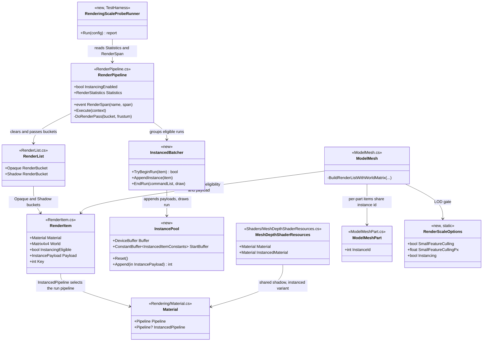
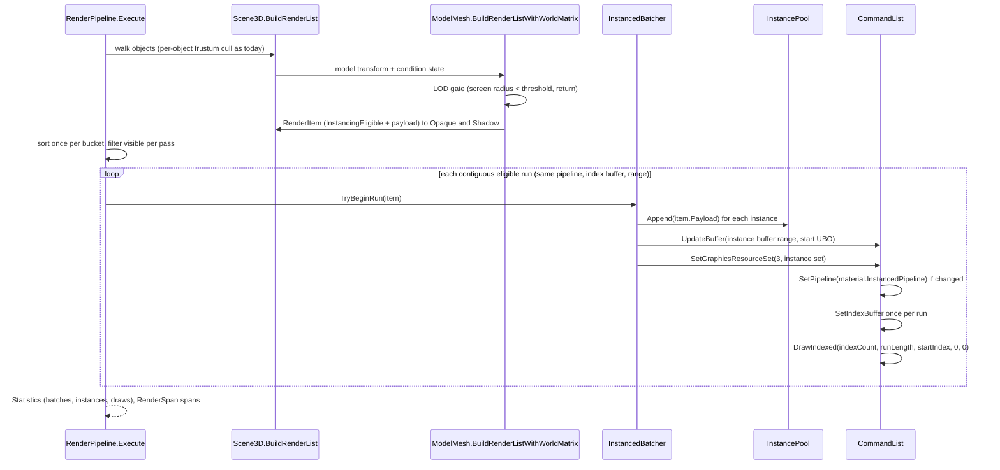

# Deep Dive: B5 Rendering at scale

> Part of [Track B: Scale](../track-b-scale.md). GPU instancing for repeated unit models,
> distance LOD/culling, and render-bucket/shadow submit improvements so presentation keeps up
> with large logic scenes.
>
> Audience: human overview of the design; agent context for the B5 cards. Grounded against
> commit `bc5661dda` (origin/main at authoring); file references are that revision.

## 1. Current state

Per-frame presentation flow (all types exist today):

| Step | Code | Per-frame cost at N units |
|---|---|---|
| Object walk | `Scene3D.BuildRenderList` (`src/Panopticon.Simulation/Scene3D.cs:416`) | N objects; per-object frustum cull via `RoughCollider`, then `Drawable.BuildObjectRenderList` (`src/Panopticon.Simulation/Client/Drawable.cs:474`) |
| Model walk | `W3dModelDraw.BuildRenderList` → `ModelInstance.BuildRenderList` (`src/Panopticon.Simulation/Graphics/ModelInstance.cs:304`) → `ModelMesh.BuildRenderListWithWorldMatrix` (`src/Panopticon.Simulation/Graphics/ModelMesh.cs:94`) | one `AxisAlignedBoundingBox.Transform` plus one `RenderItem` add per mesh part, to the Opaque or Transparent bucket, plus one to the Shadow bucket |
| Item struct | `RenderItem` (`src/Panopticon.Simulation/Graphics/Rendering/RenderItem.cs:9`) carries `Material`, `BoundingBox`, `World`, index range, and a `BeforeRenderDelegate` | struct copies into `RenderItemCollection._items` (`RenderItemCollection.cs:43`) |
| Cull + sort | `RenderItemCollection.CullAndSort` (`RenderItemCollection.cs:67`) runs per pass | frustum test per item, then `List.Sort` of visible indices, per pass |
| Passes | `RenderPipeline.Execute` (`src/Panopticon.Simulation/Graphics/Rendering/RenderPipeline.cs:200`) runs `DoRenderPass` (`RenderPipeline.cs:459`) for: Shadow bucket once per shadow cascade (`ShadowMapRenderer.RenderShadowMap`, `src/Panopticon.Simulation/Graphics/Rendering/Shadows/ShadowMapRenderer.cs:35`), Opaque, Transparent, Water, plus Opaque again for water refraction and reflection when water is visible | up to 7 cull+sort+draw sweeps of the item list |
| Per-item draw | `DoRenderPass` per item: `PushDebugGroup($"Render item: {name}")` (string interpolation), `BeforeRenderCallback` → `ModelMeshInstance.OnBeforeRender` (`src/Panopticon.Simulation/Graphics/ModelMeshInstance.cs:233`) updates a per-mesh `ConstantBuffer<RenderItemConstantsVS>` and binds resource set 3, then `SetIndexBuffer`, `DrawIndexed(count, 1, ...)` | one draw call, one index-buffer bind, one resource-set bind, one debug-group pair per item per pass |

Per-instance GPU state today: `MeshShaderResources.RenderItemConstantsResourceLayout`
(`src/Panopticon.Simulation/Graphics/Shaders/MeshShaderResources.cs:21`) binds
`MeshConstants` (shared per skinning/house-color combination), `RenderItemConstantsVS`
(world matrix + UV scroll, per `ModelMeshInstance`), `SkinningBuffer` (per `ModelInstance`),
and `RenderItemConstantsPS` (house color, opacity, tint, property-animation overrides, per
`ModelMeshPartInstance`). Every mesh part of every unit is drawn with instance count 1.

Model sources are already unified at this layer: W3D (`W3dModelImporter`), glTF
(`GltfModelImporter`), and EE2 NIF (`NifModelImporter`) all materialize into
`Model`/`ModelMesh`/`ModelMeshPart` and submit `RenderItem`s through the same path, so an
instancing seam placed at `RenderItem`/`RenderPipeline` level is source-agnostic by
construction. This is the coordination requirement from
[Track B](../track-b-scale.md): instancing must not be W3D-specific, and WorldBuilder (B4a-7)
and ReplaySketch (A5-5) viewports reuse it because they render through the same
`RenderPipeline`.

Culling that exists: per-object `RoughCollider` frustum cull in `Scene3D.BuildRenderList`
(gated by `Scene3D.FrustumCulling`), per-item frustum cull plus water clipping planes in
`CullAndSort`. No distance or screen-size LOD of any kind; `StaticGameLod`/`DynamicGameLod`
INI data (`src/Panopticon.Simulation/Lod/`) is parsed but not applied to rendering.

Measurement that exists: B1 (`BenchmarkMetricRecorder`,
`src/Panopticon.Benchmarks.Simulation/BenchmarkMetricRecorder.cs`) records logic tick spans
(`gameLogic`, `scene3d`, `network`) through `LogicStepper.SystemSpan`; the TestHarness
capacity probe (`MassBattleCapacityProbeRunner.RunEngagement`,
`src/Panopticon.Tools.TestHarness/MassBattleCapacityProbeRunner.cs:425`) drives frames and
writes a `BenchmarkRunRecord`. None of these measure the render pass: headless probe loops
call `Game.Update` only and never `Game.Render`. Presentation has no counters.

## 2. Problem at the scale anchor

The [scale anchor](../open-questions.md) is 10k units at ~30 fps single-node. A 10k-unit scene
with a two-part-per-unit model produces roughly 20k Opaque items and 20k Shadow items per
frame. At 4 shadow cascades plus forward plus water passes, the current pipeline performs
about 100k+ single-instance draw calls, one `SetIndexBuffer` and one debug-group pair per
draw, and 6 sorts of a 20k-element list, every frame. The CPU submit cost dominates before
the GPU raster cost matters. Two structural fixes:

1. Draw repeated identical geometry once with an instance count instead of N times.
2. Stop paying per-item and per-pass overhead that does not depend on item state (sorting,
   index-buffer binds, debug-group recording), and stop submitting geometry whose screen
   size is negligible.

Skinned meshes cannot batch under one draw with this design: the per-instance
`SkinningBuffer` is a distinct bound buffer per `ModelInstance`. Skinned meshes stay on the
per-item path; this is an explicit, recorded limitation (see Budgets). Rigid hierarchies
(vehicles, structures, imported static/props), whose per-mesh world matrix is written
per-instance into the instance stream, batch fully.

## 3. Design

### 3.1 Instancing seam (source-agnostic)

The seam is the `RenderItem` → `RenderPipeline.DoRenderPass` boundary, not any importer:

- `RenderItem` gains an `InstancingEligible` flag and, for eligible items, an instance
  payload (`World`, `UVOffset`, `HouseColor`, `Opacity`, `TintColor`) captured at
  construction. Eligibility is decided in `ModelMesh.BuildRenderListWithWorldMatrix`, the
  single point every model source flows through, and requires: mesh not `Skinned`, no morph
  vertex buffer, mesh not `CameraOriented`, no forced blend, and item PS constants at
  defaults (no property-animation overrides, opacity 1, white tint; house color varies per
  instance and is part of the payload).
- Eligible items sort by material then mesh-part identity (a stable interned id on
  `ModelMeshPart`), so equal-geometry runs are contiguous after `CullAndSort`.
- `DoRenderPass` groups maximal contiguous runs with equal instanced pipeline, index buffer,
  and index range, appends their payloads into a frame instance pool, and issues one
  `DrawIndexed(indexCount, runLength, ...)` per run. Ineligible items draw exactly as today.
- Per-instance data reaches the shader through a structured buffer, not extra vertex
  attributes: the mesh vertex layout already occupies the guaranteed minimum of 16 vertex
  attribute locations (`MeshShaderResources.MeshVertex.VertexDescriptors`,
  `MeshShaderResources.cs:162`), so instance attributes would exceed the Vulkan
  minimum `maxVertexAttributeCount`. A `readonly buffer` indexed by an explicit batch start
  (a small UBO updated per batch, the same update-then-bind pattern
  `ModelMeshInstance.OnBeforeRender` already uses) keeps the layout portable and the vertex
  layout untouched.

Instanced pipeline variants are opt-in per shader family, behind `Material.InstancedPipeline`
(nullable; null means ineligible). B5 lands variants for the families a repeated-model scene
actually uses: `FixedFunctionInstanced` (forward, W3D fixed-function materials), a
`PbrMetallicRoughnessInstanced` vertex variant (forward, glTF/SC2 imports; the fragment
shader reads no item constants and is reused verbatim), and `MeshDepthInstanced` (shadow
pass; all shadow items share `MeshDepthShaderResources.Material` today). `NormalMapped` and
`Simple` shader-material families stay per-item; recorded as a follow-up gap, not silently.

The instance payload layout (GLSL `Mesh.h` addition) is one std430 struct shared by every
instanced family: `mat4 World; vec4 UVOffset; vec4 HouseColorOpacity; vec4 Tint;`
(112 bytes). House color and tint travel as flat varyings from the instanced vertex shader
to the instanced fragment shader; override branches compile out because eligibility
requires default PS state.

`RenderPipeline.InstancingEnabled` (default on) toggles the whole path for A/B measurement
and as a safety valve.

### 3.2 Distance LOD gate (small-feature culling)

One gate, applied where items are built, covering both Opaque and Shadow buckets: in
`ModelMesh.BuildRenderListWithWorldMatrix`, after computing the world matrix, project the
mesh bounding sphere to screen and return early when its radius falls below a threshold
(default 1 px). A whole model at sub-pixel size contributes nothing to either pass. The
threshold and enable flag live on a mutable static `RenderScaleOptions`
(the `PhysicsBackendPolicy.Current` pattern) so the probe and tools can sweep it without
graphics-settings plumbing. Camera fields needed for the projection
(`FieldOfView`, `ScreenSize`, `Position`) already exist
(`src/Panopticon.Simulation/Graphics/Cameras/Camera.cs`).

Impostors (billboard replacements at distance) are out of scope for B5 and recorded as a
follow-up; the gate is the LOD floor. Model-asset multi-LOD selection (importing W3D HLod
arrays beyond the first) is likewise out of scope; the importer currently keeps one LOD
(`W3dModelImporter`).

### 3.3 Render-bucket and shadow submit improvements

All are state-independent overhead removals in `RenderItemCollection`/`DoRenderPass`:

- Sort once per frame per bucket: item keys do not depend on the frustum. `CullAndSort`
  splits into a per-frame sort of the full item list and a per-pass visible-index filter
  that preserves order. Four-cascade shadows drop from 6 sorts of the visible list to 1 sort
  of the full list plus 6 linear filters.
- Bind the index buffer only when it changes across the pass (it is currently bound per
  item).
- Record per-item debug groups only when a debug flag is set; today every item allocates a
  formatted string and records a debug-group pair per pass.
- The Shadow bucket keeps per-cascade frustum culling (already correct); with the LOD gate
  above, negligible items never enter the bucket.

### 3.4 Measurement: the render-scale probe

A TestHarness built-in scenario `RenderingScaleProbe`
(`--built-in-scenario RenderingScaleProbe`), modeled on `MassBattleCapacityProbeRunner`:

- Boots a real game headless (offscreen Vulkan device, `GraphicsDeviceUtility`), spawns a
  configurable repeated-model field (default 10k of one rigid definition) plus optionally
  the b1 anchor composition (10k Rangers, skinned), fixes the camera over the field, runs
  warmup frames then measured frames of `game.Update` + `game.Render`, drains with
  `GraphicsDevice.WaitForIdle`, and writes a `BenchmarkRunRecord` through the B1 writers
  (`BenchmarkReportWriter`).
- `RenderPipeline` publishes per-frame `RenderStatistics` (items per bucket, visible items
  per pass, draw calls, instanced batches, instances drawn, instances per batch) and a
  `RenderSpan` event (`buildRenderList`, `shadowPass`, `forwardPass`, `render` total,
  `gpuIdle` drain), mirroring `LogicStepper.SystemSpan`.
- A/B switches via environment and probe options: instancing on/off, LOD gate on/off,
  shadow tier, unit count, definition.
- Captures a PNG at the end (`FrameCapturer.CaptureToPng`, the capacity-probe pattern) for
  visual evidence and for the pixel A/B check below.

Correctness gate: for eligible items, instanced and per-item draws must produce identical
pixels (same matrices, same constants, same submission order within a run). The probe
verifies this by capturing one frame with instancing on and off and comparing bytes;
any difference is a deviation, not a tuning knob.

## 4. Budgets (scale anchor)

Anchor: 10k units at ~30 fps (33.3 ms frame budget) per the
[scale-anchor Decision](../open-questions.md). B5 budgets presentation only; the logic-side
budget belongs to B2/B3. Verdicts from the `WI-B5-05` matrix (dev host, offscreen
Vulkan/RADV, 1280x800, Enhanced preset, 30 warmup / 60 measured frames, idle units).

| Budget | Target | Measured | Verdict |
|---|---|---|---|
| Frame incl. logic at 1k rigid repeated models | within 33.3 ms | 28.85 ms (34.7 fps) | met |
| Presentation span (render submit + GPU drain) at 10k rigid | within 33.3 ms | 132.07 ms (121.48 + 10.59) | missed |
| GPU drain alone at 10k rigid | within 33.3 ms | 10.59 ms | met |
| Draw calls at 10k rigid | orders below item count | 155 draws for 61167 visible instances (91447 per-item) | met |
| Logic update at 10k (B2/B3 scope, context) | within 33.3 ms | 100.7 ms | out of B5 scope |

The 10k presentation miss is dominated by CPU render-list construction: of the 121.48 ms
render submit, buildRenderList is 102.1 ms (61k surviving items after the LOD gate; 91k
without it). Draw submission after B5 is 155 calls and the GPU finishes in 10.59 ms, so the
next presentation lever is per-mesh item-build cost (bounding-box transforms, per-part item
construction), not draws. Recorded as the follow-up this phase does not attempt.

If a budget cannot be met on the available render path, the gap is recorded here with its
measurement; numbers are never tuned to flatter the result.

## 5. Sub-phases and cards

| Sub-phase | Card | Scope |
|---|---|---|
| B5-1 baseline | `WI-B5-01` | render-path counters, `RenderSpan`/`RenderStatistics`, the `RenderingScaleProbe` scenario, baseline numbers into this deep dive |
| B5-2 instancing | `WI-B5-02` | instance payload seam, instanced shader families, batched draws, pixel A/B |
| B5-3 LOD/culling | `WI-B5-03` | small-feature LOD gate, sort-once filter-per-pass |
| B5-4 submit/shadow | `WI-B5-04` | index-buffer bind hoist, debug-group gating, shadow-path verification |
| B5-5 budget proof | `WI-B5-05` | anchor-scene verification runs, numbers, evidence artifacts |

Cards live in [`../agent/cards/`](../agent/cards/); the sequence is strictly in this order.

## 6. Architecture Diagrams

Grounded in the post-B5 types. `<<new>>` marks types B5 introduces.

Instanced frame flow (opaque pass; the shadow pass is identical with the depth material and
a world-only payload):

## 7. Measured results

Baseline by `WI-B5-01` (before any B5 rendering change), final matrix by `WI-B5-05`. Host:
offscreen Vulkan (RADV, Radeon RX 7600), headless probe, 1280x800 panel, Enhanced preset,
30 warmup / 60 measured frames, idle units, fixed camera framing the whole field. Map
`deepdivide`; the original default map, Twilight Flame, fails terrain materialization under
the Enhanced preset with a pre-existing `LinearMipBuilder.ResizeLinear` contiguity defect
(recorded in the WI-B5-01 card; the probe default moved to `deepdivide`). The
`WI-B5-01` baseline row was measured before the probe sized its panel (1x1 fallback
viewport), so the per-item recheck below is the authoritative sized-panel baseline.

Scene: `AmericaTankCrusader` grid (about 9 items per tank), unless noted.

| Cell | Instancing | LOD gate | Frame ms (median) | Render submit ms | GPU drain ms | FPS | Items opaque | LOD-skipped | Draws | Instanced batches / instances |
|---|---|---|---|---|---|---|---|---|---|---|
| Per-item baseline (WI-B5-01, 1x1 panel) | off | none | 375.92 | 232.76 | 43.76 | 2.7 | 91515 | n/a | 91433 | 0 / 0 |
| (a) Per-item recheck | off | off | 418.49 | 287.86 | 29.72 | 2.4 | 91517 | 0 | 91447 | 0 / 0 |
| (b) + instancing | on | off | 245.90 | 129.57 | 11.81 | 4.1 | 91517 | 0 | 180 | 118 / 91385 |
| (c) + instancing + LOD (default) | on | on | 230.38 | 121.48 | 10.59 | 4.3 | 61282 | 30257 | 155 | 111 / 61167 |
| (d) as (c), Original shadow tier | on | on | 232.29 | 121.44 | 10.57 | 4.3 | 61282 | 30257 | 155 | 111 / 61167 |
| (e1) 1k tanks, defaults | on | on | 28.85 | 16.74 | 4.08 | 34.7 | 9893 | 0 | 108 | 95 / 10879 |
| (e30) 30k tanks, defaults | on | on | 626.52 | 283.90 | 12.22 | 1.6 | 124669 | 99307 | 133 | 84 / 124321 |
| (f) 10k skinned Rangers (anchor composition) | on | on | 270.09 | 106.37 | 12.43 | 3.7 | 11282 | 224 | 10149 | 105 / 1167 |

Reading the table:

- Instancing is the dominant win: draws 91447 to 180 at 10k with pixel-identical output;
  render submit 287.86 to 129.57 ms. The LOD gate trims a further 30257 sub-pixel meshes
  at this framing (items 91517 to 61282).
- (d) shows the shadow tier is not the presentation bottleneck at this camera: the
  cascades cover none of the field (visible shadow 0), so the tier switch is noise.
- (e1) meets the 30 fps anchor frame budget outright at 1k rigid models.
- (f) records the skinned-mesh gap: the anchor composition (10k Rangers) cannot batch its
  skinned bodies (per-instance skinning buffer); only rigid accessories instance (1167 of
  11282 opaque items). Presentation still lands at 106.37 ms submit, but draws stay at
  10149. Closing this needs per-instance skinning data in the instance stream (recorded
  follow-up, out of B5 scope).
- The remaining 10k rigid presentation cost is buildRenderList (102.1 of 121.48 ms
  submit): CPU item construction, not draw submission. Follow-up recorded in section 4.
- Logic update at 10k is 100.7 ms (tanks) / 151.9 ms (Rangers): B2/B3 scope, included in
  the frame column for context only.

## 8. Validation

- Standard build/test/format/brace checks (`agent/README.md#standard-validation`).
- GraphicsFact unit tests for the instanced shader families and batching (headless Vulkan
  gate via `GraphicsFactAttribute`), including the pixel A/B comparison.
- Probe runs on this host for numbers; screenshots through the probe for evidence.
- Track G regressions: `GraphicsSettings`-related suites, shadow (`ShadowSettingsTests`,
  `ShadowFrustumCalculatorTests`), `SingleSamplePipelineVariantTests`, linear-shading and
  proportions tests stay green; the visual-regression golden manifest is host-pinned, so
  any intended pixel change would require regenerating goldens on the reference host and is
  treated as a deviation here (B5 requires pixel-identical output for eligible items).

## 9. Related

- [Track B](../track-b-scale.md): phase row and coordination note.
- [A3 sim/presentation seam](a3-sim-presentation-seam.md): B5 lives entirely on the
  presentation side and reads logic state only.
- [B1 benchmarking](b1-benchmarking.md): record schema and statistics reused by the probe.
- [G8 shadow quality](g8-shadow-quality.md): shadow cascades the submit improvements must
  not regress.
- Scale anchor Decision: [open-questions.md](../open-questions.md).
