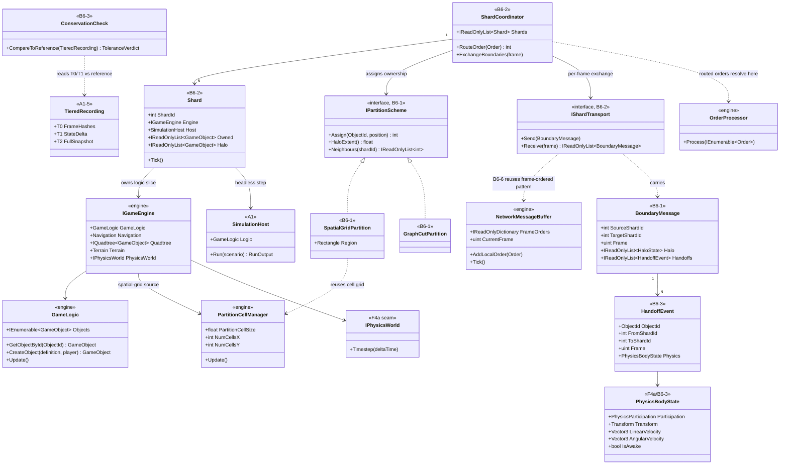
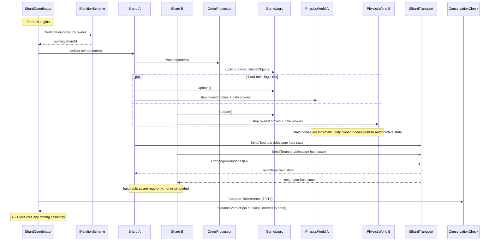
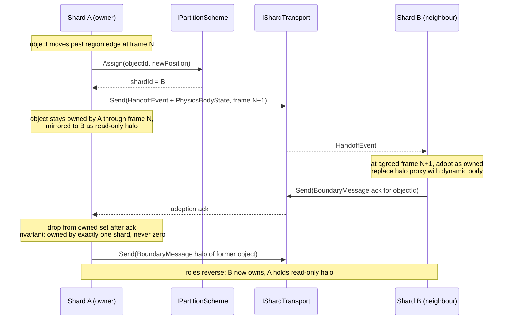

# Deep Dive: Distributed Simulation

> Expands phase B6 of [Track B: Scale](../track-b-scale.md). Part of the
> [Large-Scale RTS Roadmap](../README.md).
>
> Audience: human overview of the distributed-simulation design. Code references are in the agent-context appendix at the bottom.
>
> The agent-context section at the bottom ([Current-state hooks appendix](#appendix-current-state-hooks-agent-context)) contains code-level details about what the implementation builds on. Skip it if reading for design intent.

Purpose: run one simulation beyond a single machine by partitioning the world across processes or
machines. The design uses spatial sharding and domain-parameterized handoff rules.

The design is domain-parameterized rather than RTS-only. Partitioning, halo derivation, handoff,
and interaction resolution are driven by the [Simulation Domain Model seam (A4)](../track-a-foundations.md), so the infrastructure also serves non-RTS simulations. The domain's topology model selects the partitioning scheme:
- 2-D spatial grid for RTS/open-field battles (the reference domain; built on [B4a-5 chunks](b4a-larger-maps.md)).
- Graph/network partitioning for transport/logistics simulations (roads, rail, utility networks): partition the graph and treat cut edges as boundaries.
- Zone/region adjacency for city builders: partition by districts and treat resource/utility/traffic flow as cross-border coupling.
RTS spatial sharding is the first implementation; the rest of this document notes where each problem is domain-parameterized.

---

## 1. Dependencies

Spatial sharding is the last major scale phase because it composes the earlier work:

- [A1 Headless host](a1-headless-host.md): a shard is a headless `SimulationHost` instance;
  no shard renders. The host's logic-only step and run-output hooks are prerequisites.
- [A2 Statistical validation](../track-a-foundations.md): supplies optional distribution reports
  for sharded experiments. It is not an implementation gate.
- [B3 Parallel/data-oriented logic](../track-b-scale.md): the data-oriented storage and
  safe-parallel update model are what make a region's slice cheap to step and to serialize.
- [B4a-5 Chunked terrain storage](b4a-larger-maps.md): the chunk/region concept used for
  large-map streaming is the natural unit of spatial partitioning for shards.
- [A4 Simulation Domain Model seam](../track-a-foundations.md): supplies the topology model
  (grid / graph / zones), interaction locality (halo derivation), resolution authority, and
  metrics, so the sharding machinery here is domain-parameterized rather than RTS-specific.
- [F4a object physics adoption](../track-f-terrain-destruction.md): the RTS implementation gives
  each shard one Bepu world. B6-1 design can proceed independently, but B6 implementation waits
  for F4a's participation, filter, contact, and persistence-neutral state.

---

## 2. Core problems to solve

1. Partitioning policy. How is the world divided and who owns each partition? The scheme is
   chosen by the [domain topology model (A4)](../track-a-foundations.md): a static grid of regions
   (RTS), a graph cut (transport networks), or a set of districts (city builder). Start static;
   consider adaptive load-balanced rebalancing later.
2. Ghost/halo objects. Each shard needs read-only replicas of entities just across its
   borders (for targeting, collision, vision, flow coupling). The halo extent is derived from
   the domain's interaction locality: the largest weapon/vision/collision radius for spatial
   domains, the hop-distance of cross-edge effects for graph domains, or adjacent-zone coupling
   for city builders. An RTS halo body is a read-only kinematic proxy in the local Bepu world,
   never a second simulated dynamic body.
3. Ownership handoff. When an entity crosses a partition boundary (a region edge, a graph
   node/edge, or a district border), ownership transfers to the neighbouring shard with no
   duplication or loss, on an agreed frame.
4. Boundary synchronization. Per-frame exchange of halo state and handoff events, frame-
   aligned so neighbouring shards stay in step at the region seams.
5. Cross-shard interactions. Effects that span a boundary: combat/abilities (RTS), a vehicle
   traversing a cut edge or a passenger trip (transport), a utility/resource flow across districts
   (city), need a domain-defined resolution-authority rule (RTS: initiator's shard;
   transport: edge owner; flows: conservation at the cut) to avoid double resolution. For an RTS
   physical contact, only the owning shard applies impulses/gameplay effects; the neighbour
   receives the resulting state and contact outcome.
6. Cross-shard routing/flow. Long-range coupling spanning partitions: a coarse global graph
   for routing + local per-shard refinement (RTS pathing and transport routing), or relayed
   requests; for flow domains this is cross-boundary flow/conservation rather than path
   requests.
7. Partition correctness. Validate conservation and ownership invariants for each shard layout.
   Aggregate comparison against a single-shard run is diagnostic, not a parity requirement.
8. Fault/latency model. What happens if a shard stalls or drops, does the whole sim block
   (true single-sim) or degrade? First pass: block (correctness over availability).

---

## 3. Sub-phases

| Phase | Goal | Status |
|---|---|---|
| B6-1. Partition model & boundary spec | Define the partitioning against the [domain topology model (A4)](../track-a-foundations.md): a `IPartitionScheme`-style abstraction with a spatial-grid implementation first (built on B4a-5 chunks), then a graph-cut implementation as the first non-RTS validation domain (per the [domain-scope Decision](../open-questions.md)), with zone-adjacency for later domains, plus halo-extent derivation and the boundary message format. Pure design + simulation-on-paper. | Not started |
| B6-2. Single-process multi-shard | Run N shards in one process over a partitioned world, with halo exchange + handoff through an in-memory transport. Validates correctness without networking. | Not started |
| B6-3. Handoff & halo correctness | Make ownership handoff and halo sync frame-aligned and conservation-correct with no duplication or loss. RTS handoff carries engine-level participation, transform, velocities, sleep, and constraint state; the source removes its body only after adoption is acknowledged. | Not started |
| B6-4. Cross-shard interactions | Implement the domain-defined resolution-authority rule for boundary-spanning effects, including Bepu contacts against kinematic halo proxies, so impulses and gameplay contact effects resolve exactly once. | Not started |
| B6-5. Cross-shard routing/flow | Coarse global routing + per-shard local refinement (RTS pathing, transport routing) or relayed requests; cross-boundary flow/conservation for flow domains. | Not started |
| B6-6. Multi-process transport | Replace the in-memory transport with a real inter-process/network transport (reusing the frame-ordered `NetworkMessageBuffer` pattern). | Not started |
| B6-7. Load balancing (optional) | Adaptive region resizing/migration to balance per-shard load; deferred until static sharding is proven. | Not started |

---

## 4. Sequencing notes

- B6-1 is design-only and can begin early (it informs B4a-5's chunk boundaries), but
  implementation waits on A1/B3/F4a.
- B6-2/3 run in one process first so handoff and conflict resolution can be debugged against a
  single-shard reference before networking is introduced.
- The RTS slice of B6-3/4 starts after F4a. Each shard simulates owned dynamic bodies and mirrors
  neighbour bodies as filtered kinematic proxies. Raw Bepu handles never cross a boundary.
- The [result replayer/visualizer (A5-3)](a5-visualization.md) is the validation surface. Its
  run-comparison shows where a sharded run drifts beyond tolerance from the single-shard
  reference.
- B6-7 (load balancing) is optional and last. Static sharding must be correct and scalable first.
- Save/load is single-node only. Per the [StatePersister-reach Decision](../open-questions.md),
  `StatePersister` does not need to serialize sharded state; analyze and replay sharded runs via
  the recorded snapshot/delta stream instead. The domain-scope Decision's "one save/persist path"
  means one path per node.

## 5. Scenario Matrix

The P0-5b-style matrix runner validates B6 by sweeping over shard count and partition
configurations and checking each run for unit duplication or loss. This matrix uses a benchmarking runner, via the A1 headless
host and B1 harness, rather than the P0 game-scenario harness, but it follows the same
`ScenarioMatrix` data model and axis-expansion pattern.

| Axis | Values | Notes |
|---|---|---|
| `shardCount` | 1, 2, 4 | Number of simulation shards; 1-shard is the reference run |
| `scenario` | `largeBattle` (two armies meeting), `multiRegion` (units distributed across regions) | Tests different spatial distributions |
| `partitionStrategy` | `spatial-grid`, `spatial-graph-cut` | The two partitioning approaches in B6-3 |

Constraints:
- `shardCount = 1` is only valid with `partitionStrategy = spatial-grid` (the reference run).
- `spatial-graph-cut` requires `shardCount ≥ 2`.

Each cell runs the scenario with the given shard configuration and asserts:
- Unit count at end of run equals the reference (no units duplicated or lost across shards).
- Ownership and conservation invariants hold for every shard configuration.
- Aggregate metrics are reported for analysis without an equality assertion.

## 6. Architecture Diagrams

The diagrams anchor B6 to the real engine seams a shard owns: `IGameEngine` (the logic-side
services `GameLogic`, `Navigation`, `Quadtree`, `PartitionCellManager`), the `Order` /
`OrderProcessor` pipeline, and the frame-ordered `NetworkMessageBuffer` / `IConnection` transport.
New B6 types wrap those seams rather than replacing them; borrowed Track A types (`SimulationHost`
from [A1](a1-headless-host.md), `TieredRecording` from [A1-5](a1-headless-host.md)) are the host and
recording substrate. Stereotypes mark provenance: `<<engine>>` types exist in `src/` today,
`<<A1>>` / `<<A1-5>>` belong to Track A, and `<<B6-n>>` types are B6 deliverables introduced in the
named sub-phase.

Boundary exchange and handoff carry state and events. Correctness is validated through ownership
and conservation invariants. The [T0/T1 tiered recording (A1-5)](a5-visualization.md) and
[A5-4 diagnostics](a5-visualization.md) support investigation.

### 6.1 Types

### 6.2 One sharded tick

Order routing reuses the real `Order` / `OrderProcessor` pipeline: the coordinator routes each order
to the owning shard rather than running a parallel command path. Halo exchange and the consistency
check are frame-aligned at the seams.

### 6.3 Cross-boundary ownership handoff

When an object crosses a partition boundary its ownership transfers on an agreed frame with no
duplication and no loss. The source shard drops the object only once the target confirms adoption, so
the object is owned by exactly one shard across the transition.

## 7. Related

- Track B overview: [`../track-b-scale.md`](../track-b-scale.md)
- Headless host (a shard is a host): [`a1-headless-host.md`](a1-headless-host.md)
- Larger maps / chunked storage (shard unit): [`b4a-larger-maps.md`](b4a-larger-maps.md)
- Open questions: [`../open-questions.md`](../open-questions.md)

---

## Appendix: Current-state hooks (agent context)

> Agent context: this section contains file:line code references for agents
> implementing this phase. Human readers: the design intent above does not
> require reading this section.

| Concern | Current code | Note |
|---|---|---|
| Object storage | `GameLogic` `List<GameObject>` by `ObjectId` (`src/OpenSage.Game/Logic/GameLogic.cs`) | Single flat list; needs a region-owned view + non-resident "ghost" objects for neighbours. |
| Spatial partitioning | `PartitionCellManager`, `Quadtree` (`src/OpenSage.Game/DataStructures/`) | Already cell-based; the partition grid is the candidate boundary primitive for the spatial-grid domain. Graph/zone domains plug in a different partition primitive (graph cut / district set) behind the same B6 boundary interface. |
| Pathfinding | `Navigation` A* graph (`src/OpenSage.Game/Navigation/`) | Cross-shard paths need either a shared coarse graph or per-shard graphs with boundary stitching. Generalizes to domain routing/flow (transport routing, utility flow) via the domain model. |
| Object physics | `IPhysicsWorld` / `IPhysicsBody` and Bepu backend (`src/OpenSage.Physics/`) | F4a supplies engine-level body state and contact dispatch. B6 adds one world per shard, kinematic halo proxies, ownership-authoritative contacts, and handle-free handoff. |
| Order/frame model | `NetworkMessageBuffer`, `ReplayConnection` (`src/OpenSage.Game/Network/`) | Frame-ordered lockstep-style processing; the transport pattern for exchanging boundary/handoff messages. |
| Conflict resolution | B3 intent/merge model | Cross-shard write conflicts use the same [B3](../track-b-scale.md) conflict-resolution and authority rules. |

---