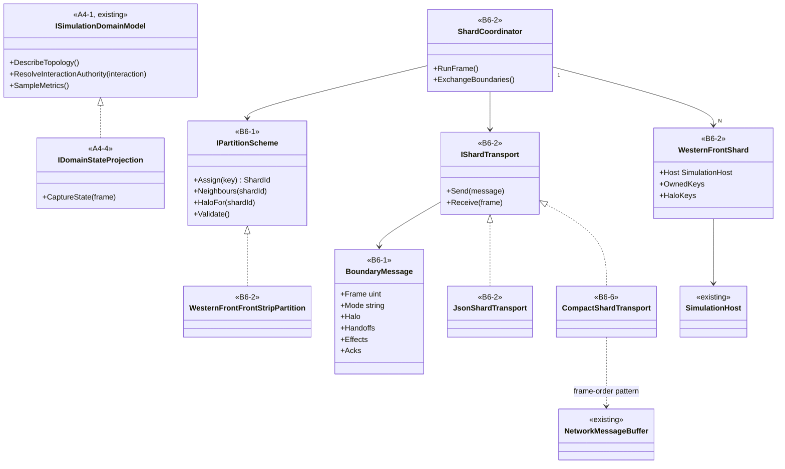
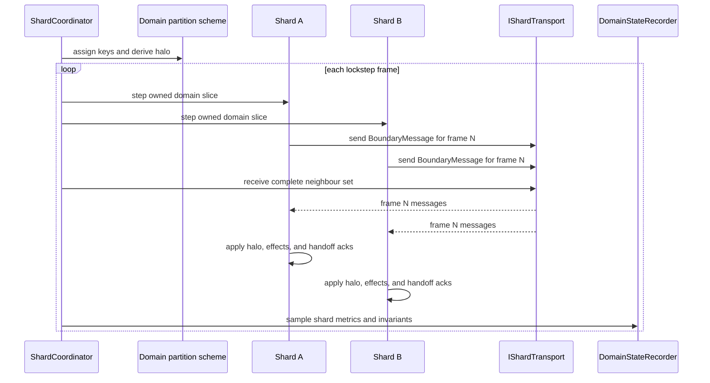

# Deep Dive: Distributed Simulation

> Expands phase B6 of [Track B: Scale](../track-b-scale.md). Part of the
> [Large-Scale RTS Roadmap](../README.md).
>
> Audience: human overview of the distributed-simulation design. Code references are in the
> agent-context appendix.

Purpose: run one simulation beyond a single host by partitioning domain-owned state across shards.
B6 is domain-parameterized through the A4 seam. The first implementation domain is the Western
Front aggregate/tactical domain, not the RTS/Bepu slice. The RTS slice remains planned and still
waits for F4a body adoption, contact filtering, and persistence-neutral physics state.

---

## 1. Decisions applied

| Decision | B6 application |
|---|---|
| First implementation domain | Western Front through the A4 domain seam. |
| RTS/Bepu dependency | RTS sharding waits for F4a. B6-1 design and B6-2 Western Front work do not. |
| Western Front partition | Frontage strips perpendicular to the front, each owning both sides of its frontage. |
| Contested pairs | Western Front contested pairs never cross shards. |
| Sync | Lockstep barrier per operational tick in compressed mode and per logic frame in tactical mode. |
| Handoff cadence | Every host frame. |
| B6-2 messages | In-process JSON. |
| B6-6 messages | Compact binary transport after the JSON contract is proven. |

## 2. Dependencies

- A4 provides domain identity, topology, interaction authority, and metrics through
  `ISimulationDomainModel`.
- A4-4 provides reconstructable domain-state artifacts and conservation checks.
- W1 provides aggregate command, logistics, combat, and one-minute operational ticks.
- W2 provides tactical activation and soldier-level materialization.
- W5 consumes B6-2 as the Western Front capacity proof.
- A5-3 and A5-4 provide replay, comparison, and divergence localization.
- F4a remains a later dependency for RTS/Bepu sharding only.

## 3. Sub-phases

| Phase | Goal | Status |
|---|---|---|
| B6-1. Partition model and boundary spec | Define domain partition contracts, halo derivation, and boundary message formats. Design and simulation-on-paper. | Not started |
| B6-2. Western Front in-process multi-shard | Run Western Front shards in one process through an in-memory JSON transport. | Not started |
| B6-3. Handoff and halo correctness | Generalize handoff and halo correctness from B6-2, then prepare RTS object handoff after F4a. | Not started |
| B6-4. Cross-shard interactions | Implement exactly-once domain authority for boundary effects. Western Front covers lateral logistics and command; RTS combat waits for F4a. | Not started |
| B6-5. Cross-shard routing and flow | Route or flow across boundaries using domain topology. Western Front validates lateral messages and logistics links. | Not started |
| B6-6. Multi-process transport | Replace in-process JSON with compact binary framed transport while preserving frame order. | Not started |
| B6-7. Load balancing | Optional adaptive migration after static sharding is correct. | Deferred |

## 4. B6-1 contracts

`IPartitionScheme` is a domain contract:

- assigns stable domain keys to shard ids;
- reports neighbours and halo requirements;
- validates that domain-specific indivisible interactions do not cross shard boundaries;
- names the authority for cross-boundary effects.

Halo derivation comes from domain topology:

- Western Front: lateral neighbouring regions, boundary links, pending cross-strip messages, and
  formations or soldiers near strip edges;
- RTS later: weapon, vision, collision, pathing, and physics interaction radii;
- graph domains: cut edges and hop-distance effects;
- zone domains: adjacent districts and shared utility/resource flows.

Boundary messages carry frame, mode, source and target shard, halo state, handoff events,
cross-boundary effects, acknowledgements, and invariant summaries.

## 5. B6-2 Western Front in-process shards

The first executable slice uses W1/W2 state:

- one `SimulationHost` per Western Front shard;
- static front-strip partition;
- in-process JSON `IShardTransport`;
- lockstep coordinator with compressed and tactical barriers;
- ownership and conservation checks across shard ledgers;
- A5 visualization of shard strips, halo age, boundary effects, and handoffs.

Each shard applies incoming boundary messages in frame, source shard key, then sequence order, so
a sharded run reproduces within its run identity; the shard layout is part of that identity
([A1-6 §3](a1-6-operational-recording.md#3-determinism-contract)). Each shard writes its own
A1-6 checkpoints at shared campaign boundaries.

B6-2 is gated on W1 cards because W1 owns command, logistics, aggregate combat, and the operational
tick systems. W2 is needed before tactical soldier handoff is tested.

## 6. B6-6 multi-process transport

B6-6 preserves the B6-2 message semantics and replaces the transport:

- framed compact binary envelope with schema/version, frame, mode, source, target, and payload;
- one deterministic order per frame and per neighbour pair;
- transport-level acknowledgements for handoff adoption;
- diagnostics for late, duplicate, corrupt, and out-of-order frames;
- compatibility tests that encode a JSON fixture and the compact form to the same semantic
  `BoundaryMessage`.

## 7. Scenario matrix

| Axis | Values | Notes |
|---|---|---|
| Domain | `western-front` | First implementation domain. |
| Shard count | 1, 2, 4, 8 | One shard is the reference. |
| Scenario | W1 synthetic, W2 tactical contact, W3b generated sector when available | W3b is optional until its payload exists. |
| Partition | front strips | Other schemes are design-only until separate domains need them. |
| Mode | compressed, tactical | Tactical mode validates per-frame barriers. |

Assertions:

- every domain key has exactly one owner;
- every conserved family has empty residuals across all shards;
- every boundary effect resolves once;
- handoff adoption leaves no zero-owner or two-owner interval;
- comparison metrics stay within the declared phase envelope.

## 8. Cards

| Sub-phase | Cards | Status |
|---|---|---|
| B6-1 | [`WI-B6-01`](../agent/cards/WI-B6-01-partition-scheme-contract.md), [`WI-B6-02`](../agent/cards/WI-B6-02-halo-derivation-contract.md), [`WI-B6-03`](../agent/cards/WI-B6-03-boundary-message-format.md) | Ready |
| B6-2 | [`WI-B6-04`](../agent/cards/WI-B6-04-western-front-front-strip-partition.md), [`WI-B6-05`](../agent/cards/WI-B6-05-inprocess-shard-coordinator.md), [`WI-B6-06`](../agent/cards/WI-B6-06-json-boundary-transport.md), [`WI-B6-07`](../agent/cards/WI-B6-07-western-front-shard-evidence.md) | Draft |
| B6-6 | [`WI-B6-08`](../agent/cards/WI-B6-08-compact-boundary-codec.md), [`WI-B6-09`](../agent/cards/WI-B6-09-multiprocess-shard-transport.md), [`WI-B6-10`](../agent/cards/WI-B6-10-transport-fault-diagnostics.md) | Draft |

## 9. Architecture diagrams

## 10. Related

- Track B overview: [`../track-b-scale.md`](../track-b-scale.md)
- Western Front W5: [`w5-distributed-regional-simulation.md`](w5-distributed-regional-simulation.md)
- A5 visualization: [`a5-visualization.md`](a5-visualization.md)
- A4 domain state: [`a4-4-domain-state-projection.md`](a4-4-domain-state-projection.md)

## Appendix: Current-state hooks (agent context)

- `src/Panopticon.Simulation/Simulation/ISimulationDomainModel.cs:15-63`: domain seam that supplies
  identity, capture, metrics, and interaction authority.
- `src/Panopticon.Simulation/IGameEngine.cs:14-41`: engine services available to a shard.
- `src/Panopticon.Simulation/SimulationHost.cs:47-73`: headless host and frame events.
- `src/Panopticon.Simulation/SimulationHost.cs:107-108`: order injection path used by shard
  coordinators.
- `src/Panopticon.Simulation/Logic/GameLogic.cs:12-34`: object storage and lifecycle event source.
- `src/Panopticon.Simulation/Logic/GameLogic.cs:272-296`: logic update loop a shard host advances.
- `src/Panopticon.Simulation/Logic/PartitionCellManager.cs:10-31`: current spatial cell manager.
- `src/Panopticon.Simulation/Logic/PartitionCellManager.cs:89-90`: cell manager update entry.
- `src/Panopticon.Simulation/Network/NetworkMessageBuffer.cs:10-48`: frame-ordered buffer and
  immediate order injection pattern.
- `src/Panopticon.Simulation/Network/NetworkMessageBuffer.cs:75-78`: frame orders process through
  `OrderProcessor`.
- `src/Panopticon.Simulation/Logic/Orders/OrderProcessor.cs:13-29`: real order processor path.
- `src/Panopticon.Physics/IPhysicsWorld.cs:6-14`: future RTS/Bepu shard dependency.
- `src/Panopticon.Simulation/Recording/RunRecording.cs:15-58`: sampler used for run comparison.
