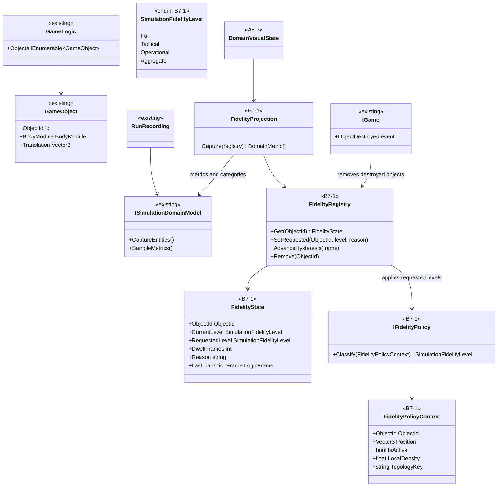
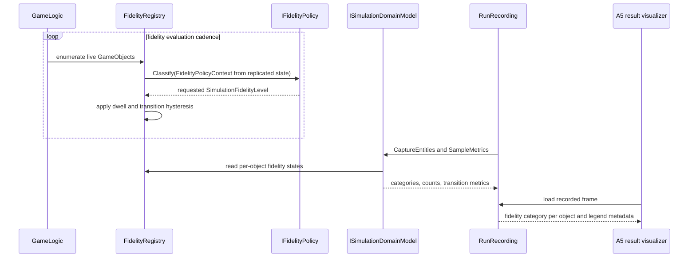

# Deep Dive: Variable Simulation Fidelity

> Expands phase B7 of [Track B: Scale](../track-b-scale.md). Part of the
> [Large-Scale RTS Roadmap](../README.md).
>
> Audience: human + agent overview of the variable-fidelity model, scope, and task cards.

Purpose: record and visualize per-object simulation fidelity while preserving detail-first
semantics. B7 currently plans the common fidelity model, a reusable group-aggregation contract
generalized from W2, and visualization/error measurement. Techniques that reduce detail only for
speed remain unplanned.

---

## 1. Concept

The current stance is detail-first. The all-tactical Western Front run is a primary product, not
only a baseline for cheaper approximations. Variable fidelity therefore starts as an explicit,
recorded state model and measurement surface before it adds reductions that trade detail for speed.

Each `GameObject` can have a fidelity level. The level is stored in a `FidelityRegistry` keyed by
object id, alongside hysteresis state such as current level, requested level, dwell counters,
reason, and last-transition frame. Policies compute requested levels from replicated simulation
state. The registry applies hysteresis so levels do not thrash.

## 2. Planned toolkit scope

| Technique | Current planning status | Reason |
|---|---|---|
| Fidelity model and policy stance | Planned as B7-1. | Required to record and compare fidelity choices. |
| Temporal LOD | Unplanned. | Trades detail for speed; revisit through open questions if the detail-first stance changes. |
| Simplified behavior/physics | Unplanned. | Trades detail for speed and needs F4a body-mode policy before cards. |
| Group aggregation | Planned as B7-4. | W2 needs promotion and reconciliation now; B7 extracts the reusable contract later. |
| Precision reduction | Unplanned. | Trades detail for speed and risks hidden numerical error. |
| Fidelity visualization and validation | Planned as B7-6. | Needed to inspect and measure any fidelity policy. |

The stance and revisit point live in [open questions](../open-questions.md). This document records
only the scoped B7 work.

## 3. FidelityRegistry

`FidelityRegistry` lives in `Panopticon.Simulation` so domains, recorders, and visualizers can
share it without depending on Western Front types.

Planned shape:

```csharp
public enum SimulationFidelityLevel
{
    Full = 0,
    Tactical = 1,
    Operational = 2,
    Aggregate = 3,
}

public readonly record struct FidelityState(
    ObjectId ObjectId,
    SimulationFidelityLevel CurrentLevel,
    SimulationFidelityLevel RequestedLevel,
    int DwellFrames,
    string Reason,
    LogicFrame LastTransitionFrame);
```

The registry is keyed by object id. It stores only simulation fidelity, not presentation LOD.
Destroyed objects are removed when the engine raises destruction events. Snapshot and domain
visualization surfaces can read the registry to produce stable categorical values.

## 4. Policy input contract

`IFidelityPolicy` classifies objects from replicated simulation state:

- object id, owner, kind, position, health, activity, and current orders;
- local density from the simulation partition;
- domain topology key and replicated shard hint when B6 exists;
- current registry state and dwell counters.

Camera position and local view are excluded for shared and distributed runs. Single-node
view-driven experiments remain future work behind open questions, not a carded B7 path.

## 5. Group aggregation contract

B7-4 generalizes W2 promotion/demotion into reusable contracts:

- aggregate identity distinct from member object ids;
- member ledger with conserved quantities and owner;
- materialization into one or more `GameObject`s;
- reconciliation from live objects back to aggregate state;
- transition record carrying reason, inputs, and moved quantities;
- error hooks comparing aggregate and full-fidelity runs through A2.

The first concrete consumer is W2. B7-4 waits until W2 proves the Western Front-specific version.

## 6. Visualization and error measurement

B7-6 exposes fidelity states to A5-3. The A5 overlay card `WI-A5-19` is currently blocked, so B7
visualization cards are Draft until that surface exists.

The output is:

- a categorical fidelity overlay and legend in recorded-state playback;
- per-frame counts by fidelity level;
- transition event lists with reason and dwell state;
- A2 comparison reports for all-tactical or full-fidelity reference runs against mixed or
  aggregate runs.

## 7. Scenario matrix

The reduced-technique matrix is deferred. The near-term matrix measures only registry, group
aggregation, and visualization/error reporting:

| Axis | Values | Notes |
|---|---|---|
| `fidelityPolicy` | `full`, `contact`, `operator-interest` | Policies must read replicated state. |
| `aggregation` | `off`, `w2-group-contract` | Enabled after W2 lands. |
| `seed` | 64 values where a stochastic domain participates | Matches W2/W4 statistical convention. |

Every mixed run compares against a full-fidelity or all-tactical reference using A2 reports.

## 8. Sub-items and cards

| Item | Card | Deliverable | Acceptance criteria |
|---|---|---|---|
| B7-1 | [`WI-B7-01`](../agent/cards/WI-B7-01-fidelity-model-registry.md) | `SimulationFidelityLevel`, `FidelityState`, and `FidelityRegistry`. | Registry stores per-object level and hysteresis state, removes destroyed objects, and is queryable by object id. |
| B7-1 | [`WI-B7-02`](../agent/cards/WI-B7-02-replicated-policy-input-contract.md) | Replicated-state policy input contract. | Policies classify from shared simulation state only and reject camera/view inputs for shared runs. |
| B7-1 | [`WI-B7-03`](../agent/cards/WI-B7-03-registry-domain-projection.md) | Registry projection into domain state and metrics. | Recorded runs reconstruct fidelity level counts and per-object categories. |
| B7-4 | [`WI-B7-04`](../agent/cards/WI-B7-04-group-aggregation-contract.md) | Reusable group aggregation contract generalized from W2. | Aggregate materialization and reconciliation preserve declared quantities and write transition records. |
| B7-4 | [`WI-B7-05`](../agent/cards/WI-B7-05-group-aggregation-error-hooks.md) | A2 error hooks for group aggregation. | Mixed aggregate runs compare against a full-fidelity reference with declared metrics. |
| B7-6 | [`WI-B7-06`](../agent/cards/WI-B7-06-fidelity-visualization-bridge.md) | A5-3 fidelity visualization bridge. | Recorded fidelity categories render through A5 without duplicating B7 policy types. |
| B7-6 | [`WI-B7-07`](../agent/cards/WI-B7-07-fidelity-error-report.md) | Fidelity error and transition report. | Reports include transition counts, dwell, level occupancy, and A2 error tables. |

## 9. Architecture diagrams

Variable fidelity attaches to existing `GameObject` identity and recording/domain seams. It does
not fork `GameLogic.Update`, and it does not change presentation LOD. Types marked `existing` are
verified in source. Types marked `B7-n` are planned B7 deliverables.

### 9.1 Fidelity registry and projection



### 9.2 Policy tick and visualization



## 10. Related

- Track B overview: [`../track-b-scale.md`](../track-b-scale.md)
- Statistical validation: [`../track-a-foundations.md`](../track-a-foundations.md)
- Distributed sim: [`b6-distributed-simulation.md`](b6-distributed-simulation.md)
- Western Front W2 first aggregation instance: [`w2-fidelity-promotion.md`](w2-fidelity-promotion.md)
- Replayer and visualizer: [`a5-visualization.md`](a5-visualization.md)
- Open questions and settled stance: [`../open-questions.md`](../open-questions.md)
