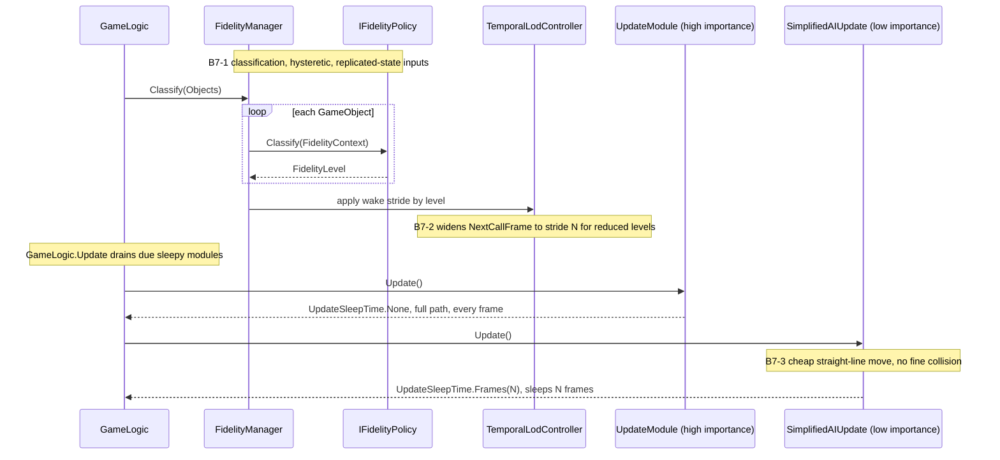
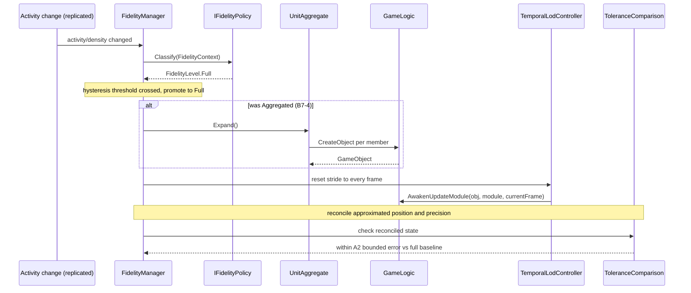

# Deep Dive: Variable Simulation Fidelity

> Expands phase B7 of [Track B: Scale](../track-b-scale.md). Part of the
> [Large-Scale RTS Roadmap](../README.md).
>
> Audience: human overview of the variable-fidelity design.

Purpose: trade simulation detail for scale by lowering fidelity for less-important objects. The
design centers on a composable toolkit of fidelity-reduction techniques rather than a single
mechanism.

---

## 1. Concept

Not every unit needs full-fidelity simulation every frame. Units that are off-screen, far from any
player's interest, idle, or part of a large uniform crowd can often be simulated more cheaply
without a perceptible difference. Variable fidelity assigns each unit or region a fidelity level and
adjusts simulation accordingly.

This is primarily a scaling tool. It lets us push unit counts beyond full-fidelity limits and
measure the trade-off between cost and simulation accuracy.

---

## 2. Toolkit of techniques

| Technique | Idea | Strongest existing hook |
|---|---|---|
| Temporal LOD | Update distant/idle units less frequently, every N frames instead of every frame. | `UpdateModule.SetWakeFrame`/`NextCallFrame`/`UpdateOrder` already implement a per-module sleepy-update queue (`src/OpenSage.Game/Logic/Object/Update/UpdateModule.cs`, `GameLogic` sleepy queue). Temporal LOD generalizes this. |
| Simplified behavior/physics | Keep F4a participation fixed but replace full Bepu stepping for background physical objects with sleep, game-driven kinematic motion, or an aggregate collider. Promote before decisive contact. | Module composition selects cheap behavior; F4a's physics registry owns body-mode transitions. |
| Group aggregation | Represent a crowd of similar units as one statistical or aggregate entity, expanding back to individuals only when it matters, such as combat or a close camera. | Quadtree/partition (`PartitionCellManager`, `Quadtree`) can cluster; aggregate is a new entity kind. |
| Precision reduction | Lower numeric or spatial precision for low-fidelity units. | Caution: contributes to bounded error. See §4. |

These techniques are independent and composable. The roadmap keeps all four so each can be
measured.

---

## 3. What drives a unit's fidelity level

A fidelity policy maps context to level. Candidate inputs:

- Interest/visibility: on-screen or near a player's camera/selection vs. far away.
- Distance from any player or active front.
- Activity: idle/garrisoned vs. moving/fighting.
- Local density: units in a dense crowd can share an aggregate.
- Per-shard hint: in [distributed sim (B6)](b6-distributed-simulation.md), a shard with no observing
  client can run its whole region at reduced fidelity.

For shared/distributed runs the policy must be driven by replicated state, see §4, and should
ideally be hysteretic so units do not thrash between levels frame to frame.

---

## 4. Shared-state fidelity policy

Variable fidelity interacts with [A2: Statistical validation](../track-a-foundations.md) and
[B6: Distributed simulation](b6-distributed-simulation.md):

- If fidelity depends on camera or interest, two players or two shards can choose different
  fidelity levels and therefore run different simulations. In a shared/distributed run, that is only
  acceptable if the error stays within tolerance and all shards agree on each unit's fidelity. That
  requires fidelity to be driven by replicated simulation state rather than local view.
- Decision, settled in [open-questions](../open-questions.md):
  - (a) Replicated-state fidelity inputs: drive fidelity only from shared simulation state such as
    position, activity, and density, never from local camera/view. This keeps shards consistent and
    is required for shared/distributed runs.
  - (b) View-driven fidelity: allow local view to drive fidelity, treating low-fidelity results as
    provisional and bounding the error. This is allowed only for single-node, non-distributed
    scaling experiments.

The [result replayer/visualizer (A5-3)](a5-visualization.md) should visualize fidelity levels, for
example by colouring units by level, and run comparison must account for expected fidelity-induced
differences within tolerance.

---

## 5. Sub-phases

| Phase | Goal | Status |
|---|---|---|
| B7-1. Fidelity model & policy stance | Define the fidelity-level abstraction and the policy inputs (§3). The shared-state policy is settled in [§4](#4-shared-state-fidelity-policy): replicated-state fidelity inputs are required for shared/distributed runs; view-driven fidelity is single-node only. Design + benchmark targets via [B1](../track-b-scale.md). | Not started |
| B7-2. Temporal LOD | Generalize the existing wake-frame/sleepy-update mechanism so units update every N frames based on fidelity level; measure cost vs. accuracy. | Not started |
| B7-3. Simplified behavior/physics | Provide low-fidelity update paths and F4a registry transitions: sleeping dynamic bodies, kinematic straight-line motion, or aggregate colliders. Participation classification does not change, and promotion restores full dynamic state before decisive contact. | Not started |
| B7-4. Group aggregation | Represent dense crowds of similar units as aggregate entities; expand to individuals on demand, such as combat or close interest. | Not started |
| B7-5. Precision reduction (experimental) | Explore coarser numeric/spatial precision for low-fidelity units, gated by the §4 policy and the bounded-error tolerance. | Not started |
| B7-6. Fidelity visualization & validation | Extend the [replayer/visualizer (A5-3)](a5-visualization.md) to show per-unit fidelity levels and quantify the cost/accuracy trade-off across scaling experiments. | Not started |

---

## 6. Sequencing notes

- B7-1 gates the rest and must be settled alongside [A2](../track-a-foundations.md). A fidelity
  policy driven by non-replicated state would make shards disagree on shared/distributed runs.
- B7-2 is the cheapest first win. It extends machinery that already exists in `UpdateModule` wake
  frames and is low-risk.
- B7-3/4 build on [B3](../track-b-scale.md) so low-fidelity paths and aggregates are cheap to store
  and iterate.
- B7-3 also builds on [F4a](../track-f-terrain-destruction.md). It changes the active
  representation of a physical object, not the participation result or collision semantics.
- In [distributed sim (B6)](b6-distributed-simulation.md), a shard-level fidelity hint, where a whole
  region runs at low fidelity when unobserved, is a powerful lever. Coordinate B7's per-unit policy
  with B6's per-shard policy.
- Every B7 technique is measured against [B1](../track-b-scale.md) benchmarks and validated with the
  [visualizer (A5-3)](a5-visualization.md). Variable fidelity is explicitly a scaling experiment toolkit.

## 7. Scenario Matrix

The P0-5b matrix runner validates B7 by sweeping over fidelity level and unit count and confirming
that each technique reduces cost proportionally while staying within the bounded statistical error.
Like B6, this uses the benchmarking runner, A1 headless host + B1, rather than the P0 game harness.
It follows the same `ScenarioMatrix` pattern.

| Axis | Values | Notes |
|---|---|---|
| `fidelityLevel` | `full`, `temporal-lod`, `simplified-behavior`, `aggregated` | Each B7 technique in isolation |
| `unitCount` | 1000, 5000, 10000 | The near-term scale anchor and fractions of it |
| `importanceConfig` | `all-high`, `mixed` (50% high / 50% low), `all-low` | Tests that fidelity policy is driven by importance correctly |

Constraints:
- `aggregated` requires `unitCount ≥ 5000` because groups are too small to matter below that.
- The `full` baseline cell is required and is the comparison reference for error bounds.

Each cell runs a fixed-length simulation and asserts:
- Mean tick time is lower than the `full` baseline for the same `unitCount`, so the technique saves
  compute.
- Unit count at end of run equals the reference within B7's bounded-error tolerance.
- Aggregate metrics, positions, and money report the cost/accuracy trade-off against `full`.

B7-6 extends the A5-3 replayer to display per-unit fidelity levels and graph the cost/accuracy
trade-off across matrix cells side by side.

## 8. Architecture Diagrams

Variable fidelity attaches to the existing per-object update path. `GameLogic.Update` drains a
sleepy-update queue of `UpdateModule` instances, each of which returns an `UpdateSleepTime` that
sets its next wake frame (`src/OpenSage.Game/Logic/GameLogic.cs`,
`src/OpenSage.Game/Logic/Object/Update/UpdateModule.cs`). B7 does not fork this loop. It adds a
fidelity policy seam (the A4 `Fidelity policy` seam in [seams.md](../seams.md)) that classifies each
`GameObject` by importance, then leans on machinery that already exists: temporal LOD widens the
wake stride through `AwakenUpdateModule`, simplified behavior substitutes a cheaper `UpdateModule`
via module composition, F4a transitions physical bodies through sleep/kinematic/aggregate modes,
and aggregation clusters units using `PartitionCellManager`. The engine's
`StaticGameLod`/`LodType` machinery (`src/OpenSage.Game/Lod/`) is presentation-only (particles,
shadows, model detail) and is orthogonal: B7 introduces simulation-side fidelity and reuses the LOD
naming convention without touching that path.

Types marked `<<engine>>` exist today. Types marked `<<B7-n>>` are B7 deliverables for the numbered
sub-phase in [§5](#5-sub-phases). Cross-phase types are marked with their owning phase.

### 8.1 Types

```mermaid
classDiagram
  class GameLogic {
    <<engine>>
    +IEnumerable~GameObject~ Objects
    +Update()
    +CreateObject(definition, player) GameObject
    +AwakenUpdateModule(obj, module, whenToWakeUp)
  }
  class GameObject {
    <<engine>>
    +ObjectId Id
    +IReadOnlyList~BehaviorModule~ BehaviorModules
    +Update()
  }
  class UpdateModule {
    <<engine>>
    +Update() UpdateSleepTime
    +NextCallFrame LogicFrame
    #SetWakeFrame(UpdateSleepTime)
  }
  class AIUpdate {
    <<engine>>
  }
  class PartitionCellManager {
    <<engine>>
    +QueryObjects(obj, pos, radius, query) IEnumerable~GameObject~
  }
  class Camera {
    <<engine>>
    +Position Vector3
    +BoundingFrustum
  }

  class FidelityLevel {
    <<enum, B7-1>>
    Full
    TemporalLod
    SimplifiedBehavior
    Aggregated
  }
  class FidelityContext {
    <<B7-1>>
    +Vector3 Position
    +bool IsActive
    +float LocalDensity
    +int ShardHint
  }
  class IFidelityPolicy {
    <<A4 seam, B7-1>>
    +Classify(FidelityContext) FidelityLevel
  }
  class FullFidelityPolicy {
    <<B7-1>>
  }
  class ReplicatedStateFidelityPolicy {
    <<B7-1>>
  }
  class ViewDrivenFidelityPolicy {
    <<B7-1>>
  }
  class FidelityManager {
    <<B7-1>>
    +Classify(objects)
    +LevelOf(ObjectId) FidelityLevel
  }
  class TemporalLodController {
    <<B7-2>>
    +StrideFor(FidelityLevel) LogicFrameSpan
    +Apply(obj, module)
  }
  class SimplifiedAIUpdate {
    <<B7-3>>
  }
  class UnitAggregate {
    <<B7-4>>
    +Expand() IReadOnlyList~GameObject~
  }
  class PhysicsFidelityAdapter {
    <<B7-3>>
    +Apply(ObjectId, FidelityLevel)
    +PromoteToFull(ObjectId)
  }
  class GameObjectPhysicsRegistry {
    <<F4a>>
    +Transition(ObjectId, PhysicsParticipation)
  }
  class SimShard {
    <<B6>>
  }
  class ToleranceComparison {
    <<A2>>
  }

  UpdateModule <|-- AIUpdate
  AIUpdate <|-- SimplifiedAIUpdate
  IFidelityPolicy <|.. FullFidelityPolicy
  IFidelityPolicy <|.. ReplicatedStateFidelityPolicy
  IFidelityPolicy <|.. ViewDrivenFidelityPolicy

  FidelityManager --> IFidelityPolicy : selected via A4
  FidelityManager ..> GameLogic : classifies Objects
  FidelityManager ..> FidelityContext : builds per object
  FidelityContext ..> PartitionCellManager : density query
  ReplicatedStateFidelityPolicy ..> SimShard : replicated inputs only
  ViewDrivenFidelityPolicy ..> Camera : single-node only
  FidelityManager ..> TemporalLodController : B7-2 wake stride
  TemporalLodController ..> GameLogic : AwakenUpdateModule
  FidelityManager ..> SimplifiedAIUpdate : B7-3 module swap
  FidelityManager ..> PhysicsFidelityAdapter : B7-3 body mode
  PhysicsFidelityAdapter ..> GameObjectPhysicsRegistry : sleep / kinematic / aggregate
  FidelityManager ..> UnitAggregate : B7-4 cluster
  UnitAggregate ..> GameObject : expands to members
  ToleranceComparison ..> FidelityManager : bounds error vs full baseline

  classDef engine fill:#e8eef7,stroke:#33517a,color:#12233d
  classDef newtype fill:#f3e8d8,stroke:#9a6b1f,color:#3d2a08
  class GameLogic engine
  class GameObject engine
  class UpdateModule engine
  class AIUpdate engine
  class PartitionCellManager engine
  class Camera engine
  class FidelityLevel newtype
  class FidelityContext newtype
  class IFidelityPolicy newtype
  class FullFidelityPolicy newtype
  class ReplicatedStateFidelityPolicy newtype
  class ViewDrivenFidelityPolicy newtype
  class FidelityManager newtype
  class TemporalLodController newtype
  class SimplifiedAIUpdate newtype
  class PhysicsFidelityAdapter newtype
  class GameObjectPhysicsRegistry newtype
  class UnitAggregate newtype
```

`FullFidelityPolicy` is the seam's reference implementation: it classifies every object as `Full`,
so the seam is a no-op until a reducing policy is selected. `ReplicatedStateFidelityPolicy` is the
policy required for shared and distributed runs; it reads only replicated simulation state
(position, activity, density, per-shard hint from [B6](b6-distributed-simulation.md)).
`ViewDrivenFidelityPolicy` may additionally read `Camera` and is restricted to single-node scaling
experiments, per the [§4](#4-shared-state-fidelity-policy) decision.

### 8.2 Classified logic tick

A single logic frame after classification. A high-importance object runs the full path every frame;
a low-importance object runs a cheaper path on a widened wake stride.

### 8.3 Promotion and reconciliation

An object gains importance (enters combat, a replicated activity change) and is promoted back to
`Full`. Its approximated state is reconciled and the result is bounded against the full-fidelity
baseline. Combat is replicated state, so this path holds for shared and distributed runs; a camera
trigger is single-node only.

## 9. Related

- Track B overview: [`../track-b-scale.md`](../track-b-scale.md)
- Statistical validation: [`../track-a-foundations.md`](../track-a-foundations.md)
- Distributed sim (per-shard fidelity): [`b6-distributed-simulation.md`](b6-distributed-simulation.md)
- Replayer/visualizer (fidelity visualization): [`a1-headless-host.md`](a1-headless-host.md)
- Open questions: [`../open-questions.md`](../open-questions.md)
