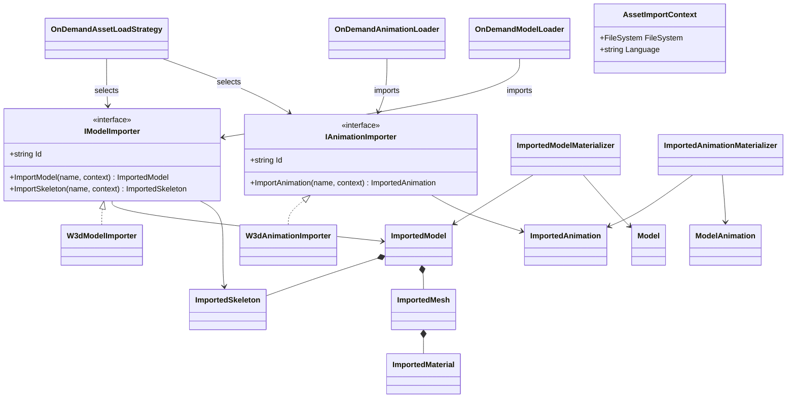
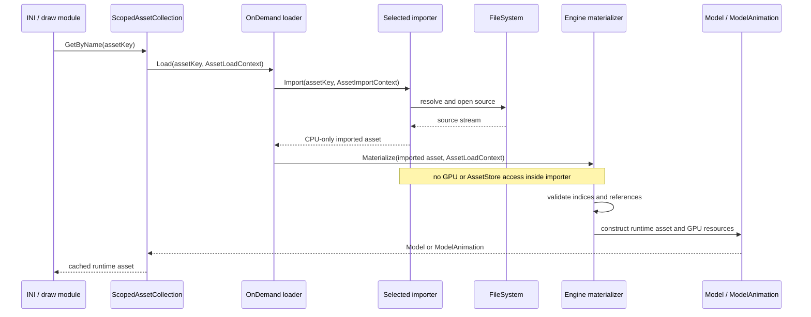

# Deep Dive: Format-Agnostic Model and Animation Import (C1)

> Expands phase C1 of [Track C: External Models & Animations](../track-c-external-assets.md).
> Audit: [implementation/track-c-c1-import-abstraction.md](../implementation/track-c-c1-import-abstraction.md).
>
> Audience: human design for the import seam. Code references are in the agent-context appendix.

Purpose: separate file-format parsing from runtime model construction. W3D becomes the reference
implementation of a CPU-only import contract, while the existing `Model`, `ModelInstance`, render
resources, and gameplay animation-state behavior remain the runtime boundary.

---

## 1. Boundary

C1 divides asset loading into three stages:

1. Asset lookup chooses an importer and resolves the source file.
2. The importer parses source data into CPU-only interchange values.
3. Engine-owned materializers validate those values and construct runtime assets and GPU resources.

Importers never create Veldrid resources, read render state, or return W3D parser types. Runtime
code never switches on source format. C2 consumes skeleton and animation interchange values for
bone remapping. C3 extends material conversion. C4 adds glTF importers without changing the
runtime materializers.

## 2. Interchange model

Types live under `OpenSage.Content.Importing`, one type per file.

| Type | Owns |
|---|---|
| `ImportedModel` | Asset name, one `ImportedSkeleton`, ordered sub-objects. |
| `ImportedSkeleton` | Skeleton name and parent-before-child `ImportedBone` list. |
| `ImportedBone` | Name, parent index, bind translation, bind rotation. |
| `ImportedSubObject` | Full name, display name, parent bone index, one render object. |
| `ImportedRenderObject` | Base contract for `ImportedMesh` and `ImportedBox`. |
| `ImportedMesh` | Vertices, indices, bounds, flags, and ordered mesh parts. |
| `ImportedVertex` | Position, normal, optional secondary geometry, and two-bone skinning data. |
| `ImportedMeshPart` | Texture coordinates, index range, blend flag, and material reference. |
| `ImportedMaterial` | Engine material semantics and ordered named properties, no textures or GPU objects. |
| `ImportedMaterialProperty` | Property name, explicit value kind, and bool/float/vector/int/texture-name value. |
| `ImportedBox` | Center and extent for the existing bounds-only box path. |
| `ImportedAnimation` | Asset name, duration, and ordered animation channels. |
| `ImportedAnimationChannel` | Bone index, channel type, ordered keyframes. |
| `ImportedKeyframe` | Time and typed transform or visibility value. |

C1 preserves the current two-bone vertex layout and current material capabilities. Those are
runtime constraints, not promises for every future format. A later phase may widen the runtime
representation, but a new importer must not silently truncate data that the runtime cannot
represent.

`ImportedMaterial` describes the existing engine material model: shader family, cull/depth/blend
state, fixed-function shading values, and an ordered named-property bag. Each property has an
explicit kind: bool, float, `Vector2`, `Vector3`, `Vector4`, int, or texture asset name. This
preserves the current effect-specific W3D shader-material constants and textures without carrying
W3D material indices, chunks, flags, or GPU handles. C3 adds PBR-to-engine translation without
changing this ownership rule.

## 3. Import contracts and selection

```csharp
internal interface IModelImporter
{
    string Id { get; }
    ImportedModel? ImportModel(string name, AssetImportContext context);
    ImportedSkeleton? ImportSkeleton(string name, AssetImportContext context);
}

internal interface IAnimationImporter
{
    string Id { get; }
    ImportedAnimation? ImportAnimation(string name, AssetImportContext context);
}
```

`AssetImportContext` contains only the virtual `FileSystem` and language. Each importer owns its
format-specific path resolver and parsing rules. The context contains no `AssetStore`,
`GraphicsDevice`, shader store, or runtime model factory.

`OnDemandAssetLoadStrategy` receives the selected model and animation importers and passes them to
the existing on-demand loaders. The contracts and importer implementations remain internal to
`OpenSage.Game`. A public `OnDemandAssetLoadStrategy.CreateW3d(w3dPathResolver,
texturePathResolver)` factory lets the separate `OpenSage.Mods.*` assemblies select the shipped
W3D implementation without exposing importer internals. `OnDemandAssetLoadStrategy.None`
continues to return no presentation-asset loaders. A4 may later register importer identifiers, but
C1 owns the contracts and construction.

Referenced W3D hierarchies use `IModelImporter.ImportSkeleton`; the existing
`ModelBoneHierarchies` collection remains the cache and delegates to the selected model importer.
This preserves cache behavior without adding a third public importer contract.

## 4. Runtime materialization

`ImportedModelMaterializer` converts `ImportedModel` into the existing runtime types:

- `ImportedSkeleton` becomes `ModelBoneHierarchy`.
- `ImportedBox` becomes `ModelBox`.
- `ImportedMesh` becomes `ModelMesh`, including vertex/index buffers, textures, materials, and
  shader resources.
- `ImportedSubObject` becomes `ModelSubObject`.
- The resulting hierarchy and sub-objects become `Model`.

`ImportedAnimationMaterializer` converts `ImportedAnimation` into a format-neutral
`ModelAnimation`. `ModelAnimation` replaces the format-leaking `W3DAnimation` asset name while
keeping `AnimationClip`, `AnimationInstance`, INI references, and playback behavior unchanged.

GPU allocation starts only in `ImportedModelMaterializer` and runtime `ModelInstance`. The
interchange graph is safe to inspect and validate without a graphics device. Texture lookup stays
in the materializer through `AssetStore.Textures`; importers emit texture names only.

## 5. W3D reference implementation

`W3dModelImporter` owns:

- W3D path resolution and `W3dFile` parsing.
- Embedded, referenced, and default hierarchy selection.
- HLOD and single-renderable model composition.
- W3D bone indices, names, mesh flags, bounds, geometry, skinning, box data, and sub-object names.
- Delegation of material-pass conversion to W3D-specific conversion code.

`W3dAnimationImporter` owns:

- `hierarchy.animation` key parsing and W3D path resolution.
- Uncompressed, bit/visibility, time-coded, adaptive-delta, and motion-channel decoding.
- W3D frame-rate conversion and source-name validation.

W3D-only conventions remain inside these implementations: W3D chunks and flags, HLOD selection,
dot-separated names, `HOUSECOLOR`, `.fx` suffix handling, per-face material ids, two-stage W3D
textures, and W3D channel codecs.

Runtime contracts remain source-format neutral: parent-before-child bones, bone-indexed
sub-objects and animation channels, supported animation channel types, ordered keyframes, mesh
bounds, render flags, and the current two-bone skinning limit.

## 6. Failure contract

The seam uses one rule per failure category:

| Failure | Result |
|---|---|
| Invalid asset key or source file not found | Importer returns null. The on-demand loader logs one warning and returns null. |
| Referenced source missing from an otherwise valid asset | Throw `InvalidDataException` naming the requesting asset and missing reference. |
| Optional source section absent | Importer applies the documented default, such as the one-root skeleton. |
| Source data malformed | Throw `InvalidDataException` with asset key and source path. |
| Valid source feature unsupported by the runtime | Throw `NotSupportedException` naming the feature and asset. |
| Imported index or reference violates runtime invariants | Materializer throws `InvalidDataException` before GPU allocation. |

This normalizes the inconsistent missing-hierarchy, empty-model, and animation-key behavior found
by the audits. C1 parity applies to valid shipped assets. Failure-contract changes must have
focused tests and must not turn malformed input into a successful partial asset.

## 7. Parity contract

The W3D cutover is complete only when representative shipped assets produce the same observable
runtime description before and after the seam:

- model and hierarchy names;
- bone count, order, parents, bind transforms;
- sub-object names and parent bones;
- mesh vertex/index counts, bounds, flags, skinning values, mesh-part ranges;
- material/shader selection, render state, texture names, and every named shader-material property;
- animation name, duration, channels, bone indices, keyframe times and values;
- one gameplay animation state driving the same bone transforms at fixed sample times.

Tests use CPU descriptor snapshots for broad comparison and focused runtime assertions for GPU
materialization. Installed-asset parity tests use `[GameFact]`; synthetic interchange tests remain
non-interactive.

## 8. Implementation sequence

| Card | Scope |
|---|---|
| `WI-C1-04` | Add CPU-only interchange value types and invariant tests. |
| `WI-C1-05` | Add importer contracts, import context, and injected selection. |
| `WI-C1-06` | Extract W3D animation parsing into `IAnimationImporter`. |
| `WI-C1-07` | Add neutral animation materialization and runtime naming. |
| `WI-C1-08` | Extract W3D material-pass conversion into CPU interchange data. |
| `WI-C1-09` | Extract W3D mesh, bounds, flags, and skinning conversion. |
| `WI-C1-10` | Compose W3D models and referenced skeletons through `IModelImporter`. |
| `WI-C1-11` | Add engine-owned imported-model materialization. |
| `WI-C1-12` | Lock W3D descriptor and playback parity while both paths are callable. |
| `WI-C1-13` | Switch all loaders and shipped game definitions to the seam. |
| `WI-C1-14` | Remove direct W3D-to-runtime construction and complete C1. |

Each card leaves the current W3D path buildable. The old construction path remains available until
`WI-C1-12` compares both paths before cutover; `WI-C1-13` switches loader ownership;
`WI-C1-14` removes the old path only after post-cutover parity remains green.

## 9. Architecture Diagrams





## Appendix: current-code grounding

The complete current-path trace and file:line evidence are in
[the C1 implementation audit](../implementation/track-c-c1-import-abstraction.md).

- Model lookup and loader injection: `ScopedAssetCollection<T>`, `AssetStore`,
  `OnDemandAssetLoadStrategy`.
- W3D model and hierarchy conversion: `OnDemandModelLoader`,
  `OnDemandModelBoneHierarchyLoader`, `ModelMesh.W3d.cs`.
- Runtime model boundary: `Model`, `ModelBoneHierarchy`, `ModelSubObject`, `ModelMesh`,
  `ModelInstance`.
- W3D animation conversion: `OnDemandAnimationLoader`, `W3DAnimation.*`.
- Runtime animation boundary: `AnimationClip`, `AnimationInstance`, `ModelInstance`,
  `W3dModelDraw`.
