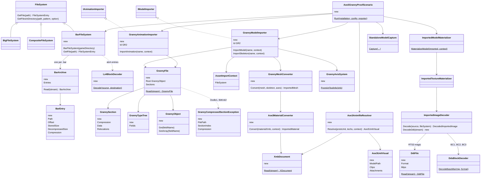
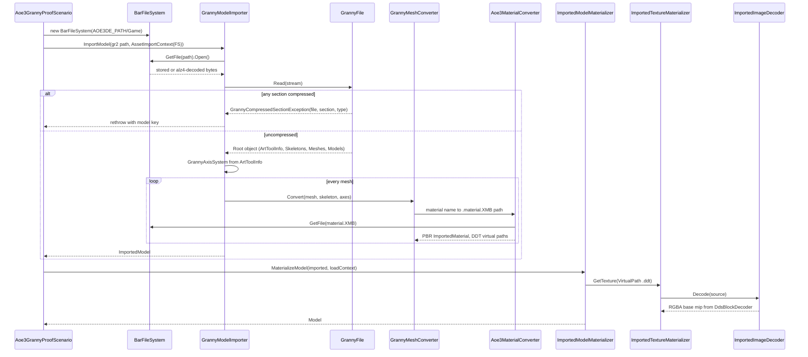
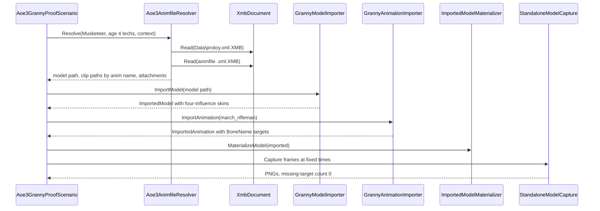
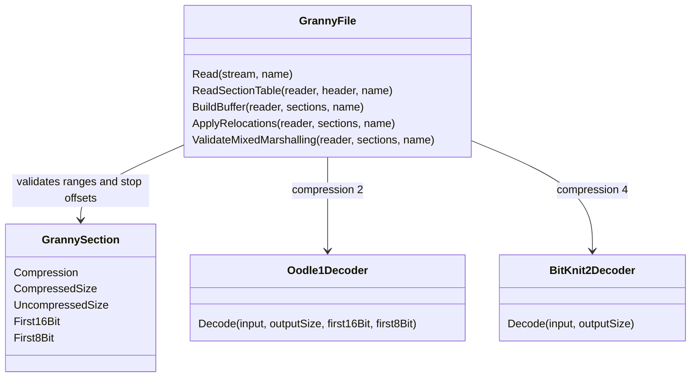
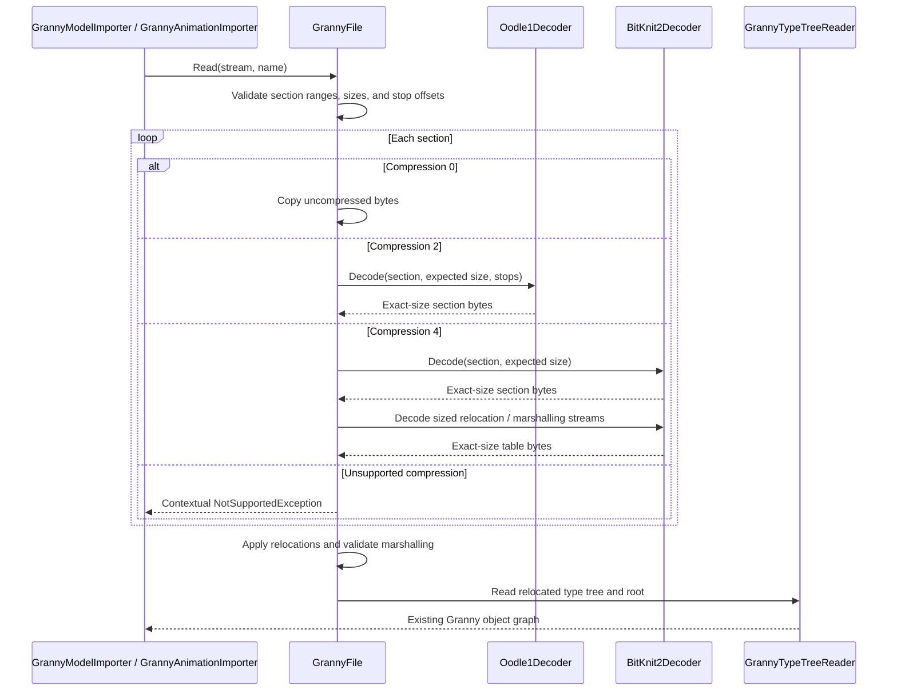

# Deep Dive: Age of Empires III: Definitive Edition models (C10a, C10b, C10c, C10d)

> Expands phases C10a through C10d of [Track C: External Models & Animations](../track-c-external-assets.md).
>
> Audience: human design for reading Age of Empires III: DE `.bar` archives and importing Granny
> 3D `.gr2` unit models and animations through the C1-C3 contracts.

Purpose: add a gunpowder-era external format whose units bind tech- and age-dependent model
variants to shared Biped animation clips. The archive, texture, and material layers are simple; the
risk concentrates in the proprietary Granny 3D container and its optional section compression.

Facts below were measured on 2026-10-14 against an operator-supplied install with temporary Python
parsers outside the repository.

---

## 1. Scope

C10a supports:

- `.bar` version 6 archives under `Game/`, exposed as a read-only, case-insensitive `FileSystem`;
- entry compression flag 0 (stored) and 1 (`alz4`: LZ4 block);
- `.XMB` binary XML (`X1`, `XR` version 8) decoded to an XML tree;
- `.ddt` (`RTS3`) textures in BC1, BC2, BC3, BGRA, or R8, decoded to RGBA for C3 (section 7).

C10b supports:

- uncompressed Granny `.gr2` file format version 7 (64-bit little-endian magic), read generically
  from the embedded type trees, with pointer fixups and mixed marshalling;
- static meshes, vertex data, topology groups, and the skeleton bind pose;
- `.material.XMB` with `materialdef` inputs BaseColor, Normals, Masks, and Details mapped onto C3
  metallic-roughness;
- Granny `ArtToolInfo` units and axes normalized to engine space.

C10c supports:

- `BoneBindings` and per-vertex weights as C1 skins of up to four influences;
- per-clip `.gr2` animations with `DaK32fC32f` transform tracks (Position, Orientation,
  ScaleShear) resampled to C1 TRS channels;
- animfile XML: `GrannyModel` and `GrannyAnim` asset references, tech `logic` variants, and
  `frombone`/`tobone` attachments.

C10d supports Oodle1 (section type 2) and BitKnit2 (type 4) Granny section
decompression using the approved sources in section 6. Other curve codecs remain separate.

C10 rejects:

- compressed Granny sections before C10d, with file, section index, and compression type;
- encrypted sound entries (flag 2, `Sound.bar` only), which models never need;
- `.gr2.precomp` and `.xml.precomp` engine caches, which are not read.

## 2. Archives

42 `.bar` files hold about 46 GB stored and 75 GB decompressed; no model files are loose.
`Art/ArtUnits.bar` (968 MB, 13,640 entries) holds unit models; `Art/Art.bar` (759 MB) holds the
shared `animation_library` (2,512 clips).

- Header: `ESPN`, u32 version 6, u32 `0x44332211`, zero padding to `0x114`, u32 checksum, u32 file
  count, u64 file-table offset at `0x120`.
- File table: UTF-16LE root path, entry count, then per entry u64 offset, u32 decompressed size,
  u32 stored size, u32 padded size (2 KB alignment), UTF-16 relative path, u32 compression flag.
- Names are plaintext paths, for example `Art\units\artillery\falconet\falconet.gr2`. The parser
  consumed every table in all 42 archives exactly to end of file.
- `alz4`: magic, u32 decompressed size, u32 compressed size, u32 version 1, raw LZ4 block.

## 3. Granny models and animations

16,459 `.gr2` files exist, 4,942 in `ArtUnits.bar`. Exporter: Granny Standard Exporter 2.11.9.1
from Maya scenes. The engine links Granny statically.

| Sample | Uncompressed | Oodle1 section | BitKnit2 sections |
|---|---|---|---|
| 400 unit models | 340 | 60 | 14 |
| 80 library clips | 79 | 1 | 0 |

Type trees name their fields, so files are self-describing: `Skeletons/Bones/ParentIndex/
Transform/InverseWorldTransform`, `Meshes/PrimaryVertexData/TriTopologies/Groups/BoneBindings`,
and the vertex layout `Position, Normal, Tangent, Binormal, DiffuseColor0, TextureCoordinates0,
BoneWeights, BoneIndices` (struct member names; the `VertexComponentNames` strings differ,
naming the same slots `UnnamedColor0` and `map1`). `InverseWorldTransform` is a `Real32` array
of 16, not a Transform. Granny material and texture records reference source PNGs and are
ignored in favor of `.material.XMB`.

Skeletons are Biped style (`Bip01_Pelvis` through `Bip01_Prop1/2`). LODs are separate files
(`lp_*.gr2`, `*_low.gr2`). Each clip is its own `.gr2`; all sampled curves use
`CurveDataHeader_DaK32fC32f` (uncompressed float knots and controls).

## 4. Textures and materials

`.ddt` header: `RTS3`, u8 usage, u8 alpha, u8 format, u8 mip count, u32 width, u32 height, then
mip offset and size pairs. Format codes: 1 BGRA, 4 BC1, 5 BC1 with alpha, 7 R8, 8 BC2, 9 BC3.
44,740 files, all `alz4` in the archive.

`Render\materialdefs\default.materialdef.XMB` declares BaseColor (sRGB), Normals, Masks, and
Details plus AO, roughness, and metallic range sliders. Unit models carry a sibling
`.material.xmb` (mesh name minus `Shape`, same directory) whose `submaterial` elements are keyed
by the Granny material name (`mata`, `matb`) and hold texture role overrides plus optional float
slider overrides; override paths are unit-relative under `Art/` and resolve by appending `.ddt`.

Masks channel layout, confirmed in C10b by decoding mip 0 of the musketeer and hussar horse
textures: R = ambient occlusion, G = roughness, B = metallic, which is the glTF
occlusion/roughness/metallic packing, so no channel swizzle is needed. Evidence: musketeer matA
B is near-binary (97.9% black, 0.7% white); where B is set, G averages 121 (roughness about
0.47, polished metal) against 191 (about 0.75) elsewhere; R averages 217 with a small dark tail
(crevices). Horse matA and matB Masks match (B 99% black, R high, G mid-range; horse matA also
overrides AO Intensity to 0.2). Slider overrides apply as factors: AO Intensity to occlusion
strength, Metallic/Roughness Max to the PBR factors; min offsets and lift sliders are recorded
as material properties only.

## 5. Unit binding and proof units

`Data\protoy.xml.XMB` gives each unit an `<animfile>`. The animfile holds `<component>` blocks with
tech `logic` variants pointing to `GrannyModel` files, `<anim>` blocks pointing to `GrannyAnim`
files, attachments, and `definebone` entries. Infantry and cavalry reuse library clips on the
shared Bip01 skeleton.

| Unit | Model | Clips | Note |
|---|---|---|---|
| Musketeer (286) | `Art\units\infantry_ranged\musketeer\musketeer_4age.gr2` | `animation_library\range\march_rifleman`, `range\volley\volley_standing_fire` | uncompressed |
| Hussar (308) | `Art\units\cavalry\light_cavalry\light_cavalry_age4_horse.gr2` | `animation_library\cavalry\horse_idle_A` | uncompressed |
| Falconet (310) | `Art\units\artillery\falconet\falconet.gr2` | `falconet_walk`, `falconet_limber`, `falconet_reload` | Oodle1, C10d proof |
| Frigate (441) | `Art\units\naval\frigate\frigate.gr2` | `frigate_idle`, `frigate_deathanim` | naval alternative |

Textures live in `ArtUnitsTextures*.bar`, for example
`...\musketeer\textures\musketeer_4age_matA_{BaseColor,Normals,Masks,Details}.ddt`.

## 6. References and licensing

- Resource Manager (github.com/eBaeza/Resource-Manager, MIT): BAR v6, `alz4`, XMB, DDT. Usable
  with credit; the C10a readers were written against game data with this project as reference, no
  code copied (RefPack precedent).
- LSLib (github.com/Norbyte/lslib, MIT, reviewed at commit 6f5f698): type-tree-driven Granny v6/v7
  container reference. Its decompressor (`LSLibNative/granny2wrapper.cpp`) is a Windows P/Invoke
  shim into the proprietary `granny2.dll` and contains no algorithm code, so it is not a port
  source; the MIT umbrella does not reach the DLL. Its managed reader supplies two verified
  container facts: Oodle1 stops are (`first16bit`, `first8bit`, `uncompressedSize`), and type-4
  sections also compress their relocation and marshalling blobs (u32 size prefix, 12/16 bytes
  per entry).
- C10d approved sources (pinned 2026-10-30). The C10d decoders are original C# written against
  the written specs, with these implementations as cross-check references only; no code is
  copied. Reference attribution is retained alongside the implementation; any adapted MIT
  code must retain its upstream notice:
  - liboodle (github.com/LunaticInAHat/liboodle@7837c253f8ca505a3ba3cd8e35d8bc3f5ab76a30,
    Unlicense; each file header restates the public-domain dedication). `README.md` is the Oodle1
    written spec: bitstream, adaptive symbol coder, LZ layer, 12-byte header, and the Granny
    three-stream wrapper (three headers, 36 bytes, shared arithmetic stream, dictionary re-init
    at stops). `src/Oodle1.cpp` and `include/oodle/Oodle1.h` are a reference decoder. No
    external derivation claims.
  - libbg3 (github.com/eiz/libbg3@23c701a943a189a789163af40b0398e290d2681a, MIT, copyright
    2024 Mackenzie Straight). `docs/bitknit2.txt` is the BitKnit2 written spec: magic 0x75B1,
    2-way interleaved rANS (L=2^16, M=2^15), 64 KiB quanta, 8-entry LRU offset cache, deferred
    adaptive models. The file self-describes as an unverified draft, so the paired decoder
    below anchors correctness.
  - pybg3 (github.com/eiz/pybg3@3b02e59bb4484c27e49e51ee9d83e8a9d09df4ed, MIT, copyright 2024
    Mackenzie Straight; `src/rans.h` carries the notice inline and is unchanged since 9ebda24).
    Complete BitKnit2 C++ decoder built on the libbg3 spec; its reference list cites public
    papers and blog posts only, with no copied-code provenance chain.
  - blendergranny (github.com/Rasetsuu/blendergranny@aec91bbd8e244d82277d1f5435dc20feff3086f9,
    MIT, copyright 2026 ciupix and contributors). Clean-room Python Oodle1 decoder
    (`io_scene_gr2/gr2/decompress/oodle1.py`) for cross-checking; `docs/PROVENANCE.md` bars
    proprietary-derived code in that repository. Its BitKnit decoder is in flux (README claims
    ahead of the pending entropy core) and is reference-only.
- Excluded from C10d: the Granny SDK and `granny2.dll` (proprietary, no public format
  specification; the shim path is rejected); the rygorous BitKnit gist
  (gist.github.com/rygorous/b434cf2916be5c9573796b5f96671cbe, RAD-authored codec source with no
  license); powzix/ooz (no license); and Knit (github.com/neptuwunium/Knit, EUPL-1.2 repository
  with a per-file SPDX-MIT BitKnit port, unnecessary given pybg3). Both codecs remain
  reverse-engineered RAD/Epic formats with no public specification. The operator AoE3 DE install
  ships no granny2.dll, so validation is cross-implementation agreement plus full-file
  structural checks through the Interactive corpus tests.
- No AoE3 asset is committed. Assets are read from the operator's install only.

## 7. Phase split

| Phase | Deliverable | Proof | Cards |
|---|---|---|---|
| C10a | `BarFileSystem`, LZ4, XMB, DDT decode | All 42 archives enumerate; musketeer textures decode with recorded sizes | [`WI-C10a-01`](../agent/cards/WI-C10a-01-bar-archive-file-system.md), [`WI-C10a-02`](../agent/cards/WI-C10a-02-xmb-binary-xml-decoder.md), [`WI-C10a-03`](../agent/cards/WI-C10a-03-ddt-texture-decode.md) |
| C10b | Generic uncompressed GR2 reader, static meshes, materials on C3 PBR | Musketeer and hussar horse render textured beside a Generals Ranger | [`WI-C10b-01`](../agent/cards/WI-C10b-01-granny-container-reader.md), [`WI-C10b-02`](../agent/cards/WI-C10b-02-granny-static-model-import.md), [`WI-C10b-03`](../agent/cards/WI-C10b-03-aoe3-material-mapping.md), [`WI-C10b-04`](../agent/cards/WI-C10b-04-aoe3-static-proof.md) |
| C10c | Skins, float-curve clips, animfile resolution with variants and attachments | Musketeer march and volley clips and hussar idles bind and capture deterministically | [`WI-C10c-01`](../agent/cards/WI-C10c-01-granny-skin-import.md), [`WI-C10c-02`](../agent/cards/WI-C10c-02-granny-animation-import.md), [`WI-C10c-03`](../agent/cards/WI-C10c-03-aoe3-animfile-resolver.md), [`WI-C10c-04`](../agent/cards/WI-C10c-04-aoe3-animated-proof.md) |
| C10d | Oodle1 and BitKnit2 section decompression after license review | Falconet imports and plays `falconet_limber` | `WI-C10d-01` through `WI-C10d-04`, linked from the Track C resources |

Card order: `WI-C10a-01` first; `WI-C10a-02`, `WI-C10a-03`, and `WI-C10b-01` in parallel after it;
`WI-C10b-02`, then `WI-C10b-03` (also after `WI-C10a-02` and `WI-C10a-03`), then `WI-C10b-04`.
`WI-C10c-01` and `WI-C10c-02` after `WI-C10b-02`; `WI-C10c-03` after `WI-C10a-02`; `WI-C10c-04`
last.

### Implementation decisions

- Two format projects, no engine dependency: `Panopticon.FileFormats.Bar` (archive table, `alz4`,
  XMB, DDT header and mips) and `Panopticon.FileFormats.Granny` (container, type tree, generic
  objects). `BarFileSystem` lives in `Panopticon.IO` beside `BigFileSystem`.
- LZ4 block decoding is an in-repo decoder in a `Panopticon.FileFormats.Lz4` project, matching the
  in-repo RefPack precedent and shared with [C12a](c12-total-war-shogun2-models.md#9-phase-split)
  packs; whichever phase lands first creates it. No package is added.
- DDT reaches C3 through `ImportedImageDecoder`: an `RTS3` magic branch decodes the base mip to
  RGBA with `DdsBlockDecoder` and lets the materializer regenerate mips. No GPU-side
  pre-installation as in the EE2 texcache path, because C3 PBR bindings resolve textures through
  `ImportedTextureMaterializer`.
- The Granny reader is generic: it walks the type tree into `GrannyObject` field maps and the
  importer reads fields by name. No per-struct hand layouts.
- Importer ids `GR2` (model and animation). Asset keys are archive paths, for example
  `Art\units\infantry_ranged\musketeer\musketeer_4age.gr2`.
- Install discovery: `AOE3DE_PATH` names the install root that holds `Game/`. Tests that need it are
  `Category=Interactive`, like the EE2 tests.
- `ImportedMesh.Indices` is `ushort`. A Granny mesh with more than 65,535 vertices is split per
  topology group, or rejected with file and mesh name if one group exceeds the limit.

### C10a results

Recorded by the C10a Interactive tests against the reference install:

- All 42 `Game/` archives parse to exact end of table. Entry counts range from 4 (`Data/Fonts.bar`)
  to 17,844 (`Sound/Sound.bar`). Compression flags seen: 0 stored, 1 `alz4`, 2 encrypted
  (`Sound.bar` only, 16,463 entries; opening those throws with archive and entry path).
- Header layout confirmed: u32 file count at `0x118`, reserved u32 at `0x11C`, u64 table offset at
  `0x120`.
- `Data\protoy.xml.XMB`: root `proto`, 2,673 `unit` elements (lowercase tag); Musketeer animfile
  `units\infantry_ranged\musketeer\musketeer.xml`. Every `.XMB` in `Data.bar` (1,112 files)
  decodes.
- Musketeer `matA` textures: BC1, 10 mips, 1024x1024, mip 0 is 524,288 bytes, the last mip is
  2 bytes with trailing padding. `musketeer_4age.ddt` is BC2 and `musketeer_4age_bump.ddt` is
  BC3, both 64x64.

### C10b reader findings

- `ArtUnits.bar` GR2 corpus: 4,942 files, 4,189 parsed uncompressed, 753 rejected compressed
  (`GrannyCompressedSectionException`), 0 other failures.
- 38 corpus files use the version 7 little-endian 32-bit pointer layout (distinct 16-byte
  signatures); the reader supports both pointer widths. Compressed 32-bit files occur too.
- Curve data is a Granny user type: every curve variant carries the same DaK32fC32f-shaped
  type definition regardless of the `CurveDataHeader` Format byte (observed: 1 DaK32fC32f,
  3 DaConstant32f, 4 D3Constant32f), so the generic walk cannot follow the type tree into
  curve bodies. The reader exposes `Format`, `Degree`, and `CurveDataKind` and leaves the body
  opaque; real curve decoding belongs to `WI-C10c-02`.

### C10b results

Recorded by the C10b import and proof work against the reference install:

- Musketeer imports at 23 bones, 1 sub-object, 1,197 vertices, 1,344 triangles, engine bounds
  0.67 x 1.33 x 0.37 m (upright). Hussar horse imports at 32 bones, 3,978 vertices, 1,404
  triangles in two groups with two materials (`mata`, `matb`).
- Matrices are row-vector convention: local `R * T` chained as `local * world[parent]`;
  `InverseWorldTransform` reads directly row-major. Every bone's inverse bind times its bind
  world is identity within 1e-4.
- Engine space is right-handed Z-up; the AoE3 art basis (Y-up, `Right = (-1, 0, 0)`, 1.5625
  units per meter) is conjugated into it with the same 3-cycle the glTF converter uses.
- W3D header bounding boxes carry exporter junk (inverted min/max on `AIRNGR-SKN`), so the
  proof calibrates scale from the Ranger rest-pose skeleton height: 12.031 units for a 1.8 m
  human gives 6.684 game units per meter.
- Proof captures: musketeer and hussar horse stand textured beside the Generals Ranger with
  feet aligned; the Oodle1 falconet fails naming file, section 0, and compression type
  (`artifacts/proofs/aoe3-granny-proof`, evidence `aoe3-musketeer-beside-ranger-c10b-v1.png`
  and `aoe3-horse-beside-ranger-c10b-v1.png` in the screenshot viewer).

### C10c results

Recorded by the C10c skin, animation, animfile, and proof work:

- Art units are misreported corpus-wide: files declare 1.5625 units per meter, but the art is
  authored near 1.15 units per meter (musketeer 2.073 units tall = 1.80 m standing; horse
  nose-to-tail 2.757 units = 2.40 m, width 0.731 units = 0.63 m). `GrannyAxisSystem` substitutes
  1.15 when a file declares 1.5625; other values pass through.
- Skinning: vertex `BoneIndices` index the mesh `BoneBindings` list, not the skeleton; weights
  sum to exactly 255. Musketeer 18 bindings, horse 27; aggregate-remap keeps the 4 largest
  influences and renormalizes. Weight sums are 1 within 1e-3 and bind-pose skinning is identity
  within 4e-6 m on both models.
- Clip track names use Maya space separators where skeletons use underscores (`Bip01 Head` vs
  `Bip01_Head`); targets normalize spaces to underscores.
- Shared animation-library clips carry tracks beyond a single model's skeleton. Bound channels:
  march_rifleman 88 of 96 (extras `Bip01_Ponytail1/11`), volley_standing_fire 92 of 128 (extras
  `LAUNCHPOINT` spellings, `Bip01_L/R_Toe0`, `Ponytail1`), horse_idle_A 143 of 143 (none). The
  proof drops extra-track channels before binding and reports them; binding then resolves every
  remaining target with zero misses.
- Curve semantics (corrected after the first animated proof was found wrong): format-1
  `DaK32fC32f` curves are B-splines at the header degree (quadratic corpus-wide), not linear
  keyframe lists; knots are a clamped knot vector and controls form the control polygon. The
  decoder evaluates De Boor over the full clamped vector (first and last controls hit exactly,
  values stay in the control hull); a linear-lerp read of knots-as-times misshapes mid-clip.
- Channel composition (corrected with it): Granny clips store absolute local transforms per
  track, while the runtime composes channels as offsets on the bone bind (`AnimatedOffset *
  bind`). Feeding absolutes directly double-composed the bind and catastrophically splayed the
  meshes. `GrannyAnimationImporter.ImportAnimation(name, context, targetSkeleton)` converts each
  sampled local to `engineLocal * inverse(bindLocal)` against the target skeleton; the
  parameterless GR2 overload throws, since a targetless absolute clip cannot convert. Clips
  embed no skeleton of their own, so the caller supplies the model's.
- Visual corrections found by reviewing the published evidence (the first animated proof and the
  v3 stills were wrong): multi-influence vertices collapsed toward the origin because
  `in_Position1`/`in_Normal1` fell back to zero when a source has no W3D secondary position
  (fallback is now the primary position); standalone captures double-transformed skinned meshes
  by uploading `AbsoluteBoneTransforms` where `ModelMesh.BuildRenderList` uses the world matrix;
  and the capture camera fitted rest-pose bounds, cropping animated poses (captures can now pass
  explicit `CameraFitBounds`; the proof computes CPU-skinned bounds across the sampled times).
- The musket, hats, and backpack the animfile lists are attachments (separate models bound
  `bone_gun` -> `Bip01 Prop1` etc.); the body meshes carry no weapon geometry, so their absence
  from the proof renders is expected, not a defect.
- Animfile resolution: `protoy` names the animfile; the model component is `ModelComp` when
  present, else the unit-named component, else the first component resolving to one model.
  Tech variants may nest further logics; non-tech logics such as Destruction select their
  undamaged last phase (`p99`). Weighted GrannyAnim variants pick the highest weight, first on
  ties (horse idle: A and I both weight 40; A wins). Rider attachments resolve through includes
  whose model component is named `ModelComp`, not the attachment name.
- Default `matA` texture sets are desaturated where the engine applies runtime player-color
  tinting (confirmed by the modding reference: BaseColor carries the desaturated player-color
  areas and the Details mask marks them); Panopticon does not tint, so the grey render is
  expected. Pre-colored variant models (redcoats, blue_guard, legionario, danish_musketeer)
  are all internally Oodle1-compressed, so the red proof capture overlays
  `redcoats_age4.material.xmb` on the uncompressed musketeer mesh through a zip file system.
- Color pipeline (corrected twice; the second review found the first fix wrong): standalone
  captures run through `RenderPipeline.Execute`, which ends in the output sRGB pass, so PNGs
  were always display-encoded (numeric proof: a (0.2, 0.4, 0.9) clear captures as
  (124, 170, 243)); an interim frame-wide encodeSrgb double-encoded and was reverted. Masks
  pack ORM (R = ambient occlusion, G = roughness, B = metallic; AoE3 DE modding reference),
  confirmed by measured R histograms (graded, AO-like: musketeer 68% in the top eighth,
  redcoat 34% near zero plus 45% high), so the Masks texture binds both MetallicRoughness
  and Occlusion. Materials that omit `AO Intensity` get 0.2 (the corpus's only explicit
  value, from the horse's `mata`); full strength crushes coats whose R is mostly dark. The
  'Lift'/'Max' sliders are engine channel remaps, not glTF factors; they are recorded as
  `Aoe3Slider_*` material properties. The Details texture is a player-color mask (the
  reference guide describes it marking where the engine tints player color; editor practice
  paints it black to remove tinting). Lit captures stay dim because the default lighting rig
  is dim (ambient 0.3 + 0.7 directional; the native Ranger reads (47,47,55) through it); the
  unlit albedo debug views carry the colour proof: redcoat albedo mean (120,87,55), 71% warm,
  matching the DDT statistics (102,66,55), musketeer (155,146,140).
- Texture orientation (found by vision-reviewed debug views after textures still misassigned):
  GR2 stores DCC-convention UVs (origin bottom-left, v up); every consumer flips V. LSLib's
  GR2 exporter defaults `FlipUVs = true` and writes `1 - v`; W3D and glTF sources are already
  v-down and pass through verbatim. `GrannyMeshConverter.ReadTextureCoordinates` now returns
  `(u, 1 - v)`. The flip's absence produced coherent but cross-assigned atlas regions (cloth
  folds across the face, leather on sleeves, sideways insignia); after the fix the unlit
  albedo views show the face, upright buttons and chevrons, and leather confined to the
  backpack. A tangent-frame fix landed alongside: Granny meshes ship tangents but no
  binormals, so the zero binormal degenerated every normal-mapped TBN; the materializer now
  regenerates the tangent frame when either component is missing, keeping provided source
  tangents (orthonormalized) and deriving handedness from the UV gradients.
- Clip unit scales disagree across files: march_rifleman.gr2 declares 0.6152 units per meter
  against the model's 1.5625, a ratio of exactly 2.54 (cm per inch), which stretched clip
  translations 2.54x and elongated the animated march. `GrannyAnimationImporter` self-calibrates:
  a median of bind-translation to clip-translation ratios over matched tracks (march: 0.535 over
  20 bones, recorded as a diagnostic note) scales clip engine translations before offset
  composition. Horse idle and volley declare consistent scales and need no correction. This
  mismatch also weakens the earlier 1.5625-to-1.15 substitution, which breaks the exact 2.54
  relation; that substitution stays flagged for review against an original-game reference.
- Ranger calibration corrected: the visible `AIRNGR-SKN` mesh height is 14.61 units
  (pixel-verified), not the 12.03-unit skeleton span that helmet and boot geometry extends past;
  the proof now uses 14.61 units per 1.8 m human = 8.117 game units per meter.
- Animated proof (re-captured after the corrections above; earlier GIFs and stills are
  superseded and retained only as history): march, volley, and idle clips sampled at 6 fixed
  times each; every frame captured twice and byte-identical; GIF frame timing follows each
  clip's duration. Vision review: coherent marching cycle with bind-consistent head proportions
  (height/width 1.1-1.2 versus 1.1 bind; 1.6-1.8 before the unit-scale fix), a volley arm
  sequence, and a near-static standing idle that matches the clip data (the idle is subtle by
  content: head, neck, and legs hold within ~1 degree, tail moves). Texture correspondence is
  proven by unlit albedo debug views (musketeer front/right/back, redcoat) beside UV-checker,
  normal-only, and masks views. The redcoat albedo view additionally shows region-level
  misassignment (cloth on the face, sideways insignia): inherent to the overlay proof, which
  textures the musketeer mesh with an atlas authored for the redcoat variant's own
  (Oodle1-compressed) mesh; it proves the colour pipeline, not per-region mapping, which
  resolves when C10d unlocks the real variant models. Evidence in the viewer:
  `aoe3-musketeer-march-c10c-v6.gif`, `aoe3-musketeer-volley-c10c-v6.gif`,
  `aoe3-horse-idle-c10c-v6.gif`, stills `aoe3-musketeer-beside-ranger-c10c-v8.png`,
  `aoe3-redcoat-beside-ranger-c10c-v6.png`, `aoe3-horse-beside-ranger-c10c-v8.png`, debug
  views `aoe3-musketeer-albedo-debug-v1.png` (three-view sheet) and
  `aoe3-redcoat-albedo-debug-v1.png`, and 18 per-frame PNGs under
  `frames/aoe3-animated-c10c-v4/`. Corrected comparison stills use mesh-grounded pairs and a
  angled perspective camera with matched foot depth and a shared baseline (see `docs/screenshots.md`). Earlier
  comparisons grounded only the import using authored bounds; Ranger collision bounds also
  extended below its visible feet. Both subjects now share world Z = 0 without changing
  scales. The musketeer and Ranger have near-equal rendered heights; physical scale remains
  empirically calibrated rather than independently verified.

### C10d reader and bind-transform results

Static proof captures use the actual redcoat variant, Oodle1 Falconet, and BitKnit2 johnboat.
All render coherent textured geometry through the existing angled, shared-ground comparison.
The redcoat no longer uses the C10c atlas overlay. Viewer evidence:
`aoe3-redcoat-beside-ranger-c10d-v1.png`, `aoe3-falconet-beside-ranger-c10d-v1.png`, and
`aoe3-johnboat-beside-ranger-c10d-v1.png`.

Falconet `Limber` review passes: six coherent poses, each captured twice byte-identically.
The horse moves about 2.35 m in depth with a constant rig-root height; its source mesh minimum
Z remains 0.006-0.015 m. A diagnostic ground-grid overlay makes this motion distinguishable
from floating without changing the camera, animation, or model scale. Bind identity error
is below 0.000004. Evidence: `aoe3-falconet-limber-c10d-v1.gif` and
`frames/aoe3-falconet-limber-c10d-v1/` in the viewer. The 3.7917 s clip uses six 630 ms GIF
frames. The source cannon dips about 0.143 m below grade near the end; nonuniform animated
scale remains reduced to the existing runtime's uniform-scale channels.

Validation: 155 Granny/AoE3 and bind-matrix tests pass, including all 4,942 corpus entries;
27 codec tests include independent decoded-byte comparisons. Non-interactive simulation
tests: 2,622 passed, seven skipped, one pre-existing `ParkingPlaceBehavior_ReportLanding`
failure. Six capture-framework tests, build, format, and brace checks pass.

The damaged sloop passes decoding but fails the normal-map tangent generator's degenerate-UV
guardrail. The guardrail remains unchanged. Large imported textures request contiguous
ImageSharp buffers because the GPU upload path requires a single pixel span.

- Managed section dispatch accepts uncompressed, Oodle1, and BitKnit2 payloads. BitKnit2
  relocation and mixed-marshalling tables use their length-prefixed compressed streams.
  Decode errors retain the file name, section index, and compression type.
- All 4,942 GR2 entries in `ArtUnits.bar` parse, including the previously blocked compressed
  models. Real 32-bit files exposed a type-member stride error: 32 bytes, not 36. The reader
  and synthetic fixture now use the correct stride.
- Falconet bind transforms contain nonuniform scale. `ImportedBone.BindLocalMatrix` preserves
  the full local matrix, including shear, through runtime materialization and animation-offset
  conversion. Existing importers retain their original scalar-transform path. Regression tests
  cover exact root and child matrices with root scales of 1 and 2.

## 8. Risks

- The generic Granny reader (64-bit pointer layout, fixup tables, type-tree marshalling) is the
  largest single piece of work in C10.
- Compressed models require C10d; the full `ArtUnits.bar` reader corpus now passes. Visual
  coverage remains narrower than parsing coverage.
- Tech and age variants mean one unit maps to several models; C10c selects one variant per request.

## 9. Architecture diagrams

Types marked new are added by C10 cards; the rest exist today.

Static import of one model (C10b):

Animated unit from protoy (C10c):

### C10d decompression architecture

Proposed types extend the existing `GrannyFile.Read` section assembly before relocation and
type-tree traversal. Codec inputs and outputs remain CPU-only. Implementation is gated by
the [provenance review](../agent/cards/WI-C10d-01-decompressor-provenance.md).

Grounding: `GrannyFile.Read`, `ReadSectionTable`, `BuildBuffer`, `ApplyRelocations`, and
`ValidateMixedMarshalling` own section assembly today. `GrannySection` already records
compression and sizes; the two stop offsets and codec types are additions.

## Appendix: grounding

| Fact | Location |
|---|---|
| Importer seams | `src/Panopticon.Simulation/Content/Importing/IModelImporter.cs`, `IAnimationImporter.cs` |
| Import context holds a `FileSystem` | `src/Panopticon.Simulation/Content/Importing/AssetImportContext.cs:18` |
| File system base and archive precedent | `src/Panopticon.IO/FileSystem.cs:3`, `BigFileSystem.cs:5`, `CompositeFileSystem.cs:3` |
| Four bone indices and weights per vertex | `src/Panopticon.Simulation/Content/Importing/ImportedVertex.cs:28`-`:42` |
| 16-bit indices | `src/Panopticon.Simulation/Content/Importing/ImportedMesh.cs:20` |
| PBR material factory | `ImportedMaterial.CreatePbrMetallicRoughness`, `ImportedMaterial.cs:121`; `ImportedPbrMetallicRoughness.cs` |
| Bone-name animation targets | `ImportedAnimationTarget.CreateBoneName`, `ImportedAnimationTarget.cs:71` |
| Image decode rejects DDS, decodes PNG, JPEG, TGA | `src/Panopticon.Simulation/Content/Loaders/ImportedImageDecoder.cs:24`, `:64`-`:90` |
| CPU BC decoder | `src/Panopticon.Simulation/Data/Dds/DdsBlockDecoder.cs:20` |
| Materializer | `src/Panopticon.Simulation/Content/Loaders/ImportedModelMaterializer.cs:27` |
| NIF importer and proof precedent | `src/Panopticon.Simulation/Content/Importing/Nif/NifModelImporter.cs:21`, `src/Panopticon.Tools.TestHarness/Ee2NifProofScenario.cs:313` |
| Capture helper | `src/Panopticon.Tools.TestHarness/StandaloneModelCapture.cs:42` |
| Interactive install-env test precedent | `test/Panopticon.Simulation.Tests/Content/Importing/Ee2NifImportTests.cs:17`, `:27` |
| In-repo decompressor precedent | `src/Panopticon.FileFormats.RefPack/` |
