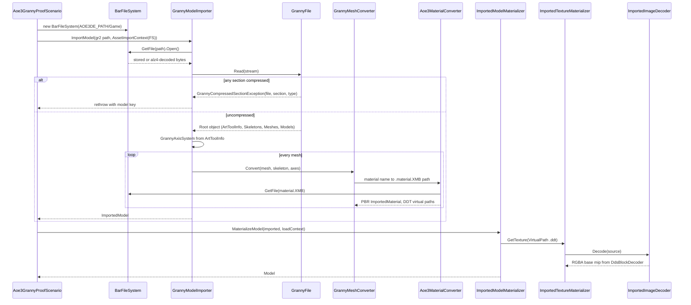
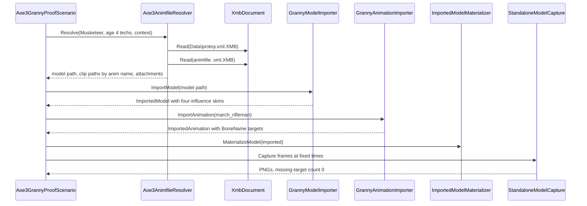

# Deep Dive: Age of Empires III: Definitive Edition models (C10a, C10b, C10c, C10d)

> Expands phases C10a through C10d of [Track C: External Models & Animations](../track-c-external-assets.md).
>
> Audience: human design for reading Age of Empires III: DE `.bar` archives and importing Granny
> 3D `.gr2` unit models and animations through the C1-C3 contracts.

Purpose: add a gunpowder-era external format whose units bind tech- and age-dependent model
variants to shared Biped animation clips. The archive, texture, and material layers are simple; the
risk concentrates in the proprietary Granny 3D container and its optional section compression.

Facts below were measured on 2026-10-14 against an operator-supplied install with temporary Python
parsers outside the repository.

---

## 1. Scope

C10a supports:

- `.bar` version 6 archives under `Game/`, exposed as a read-only, case-insensitive `FileSystem`;
- entry compression flag 0 (stored) and 1 (`alz4`: LZ4 block);
- `.XMB` binary XML (`X1`, `XR` version 8) decoded to an XML tree;
- `.ddt` (`RTS3`) textures in BC1, BC2, BC3, BGRA, or R8, decoded to RGBA for C3 (section 7).

C10b supports:

- uncompressed Granny `.gr2` file format version 7 (64-bit little-endian magic), read generically
  from the embedded type trees, with pointer fixups and mixed marshalling;
- static meshes, vertex data, topology groups, and the skeleton bind pose;
- `.material.XMB` with `materialdef` inputs BaseColor, Normals, Masks, and Details mapped onto C3
  metallic-roughness;
- Granny `ArtToolInfo` units and axes normalized to engine space.

C10c supports:

- `BoneBindings` and per-vertex weights as C1 skins of up to four influences;
- per-clip `.gr2` animations with `DaK32fC32f` transform tracks (Position, Orientation,
  ScaleShear) resampled to C1 TRS channels;
- animfile XML: `GrannyModel` and `GrannyAnim` asset references, tech `logic` variants, and
  `frombone`/`tobone` attachments.

C10d (deferred) supports Oodle1 (section type 2) and BitKnit2 (type 4) Granny section
decompression and any non-float curve codecs, only after the review in section 6.

C10 rejects:

- compressed Granny sections before C10d, with file, section index, and compression type;
- encrypted sound entries (flag 2, `Sound.bar` only), which models never need;
- `.gr2.precomp` and `.xml.precomp` engine caches, which are not read.

## 2. Archives

42 `.bar` files hold about 46 GB stored and 75 GB decompressed; no model files are loose.
`Art/ArtUnits.bar` (968 MB, 13,640 entries) holds unit models; `Art/Art.bar` (759 MB) holds the
shared `animation_library` (2,512 clips).

- Header: `ESPN`, u32 version 6, u32 `0x44332211`, zero padding to `0x114`, u32 checksum, u32 file
  count, u64 file-table offset at `0x120`.
- File table: UTF-16LE root path, entry count, then per entry u64 offset, u32 decompressed size,
  u32 stored size, u32 padded size (2 KB alignment), UTF-16 relative path, u32 compression flag.
- Names are plaintext paths, for example `Art\units\artillery\falconet\falconet.gr2`. The parser
  consumed every table in all 42 archives exactly to end of file.
- `alz4`: magic, u32 decompressed size, u32 compressed size, u32 version 1, raw LZ4 block.

## 3. Granny models and animations

16,459 `.gr2` files exist, 4,942 in `ArtUnits.bar`. Exporter: Granny Standard Exporter 2.11.9.1
from Maya scenes. The engine links Granny statically.

| Sample | Uncompressed | Oodle1 section | BitKnit2 sections |
|---|---|---|---|
| 400 unit models | 340 | 60 | 14 |
| 80 library clips | 79 | 1 | 0 |

Type trees name their fields, so files are self-describing: `Skeletons/Bones/ParentIndex/
Transform/InverseWorldTransform`, `Meshes/PrimaryVertexData/TriTopologies/Groups/BoneBindings`,
and the vertex layout `Position, Normal, Tangent, Binormal, DiffuseColor0, TextureCoordinates0,
BoneWeights, BoneIndices`. Granny material and texture records reference source PNGs and are
ignored in favor of `.material.XMB`.

Skeletons are Biped style (`Bip01_Pelvis` through `Bip01_Prop1/2`). LODs are separate files
(`lp_*.gr2`, `*_low.gr2`). Each clip is its own `.gr2`; all sampled curves use
`CurveDataHeader_DaK32fC32f` (uncompressed float knots and controls).

## 4. Textures and materials

`.ddt` header: `RTS3`, u8 usage, u8 alpha, u8 format, u8 mip count, u32 width, u32 height, then
mip offset and size pairs. Format codes: 1 BGRA, 4 BC1, 5 BC1 with alpha, 7 R8, 8 BC2, 9 BC3.
44,740 files, all `alz4` in the archive.

`Render\materialdefs\default.materialdef.XMB` declares BaseColor (sRGB), Normals, Masks, and
Details plus AO, roughness, and metallic range sliders. Open: the Masks channel layout, confirmed
empirically in C10b.

## 5. Unit binding and proof units

`Data\protoy.xml.XMB` gives each unit an `<animfile>`. The animfile holds `<component>` blocks with
tech `logic` variants pointing to `GrannyModel` files, `<anim>` blocks pointing to `GrannyAnim`
files, attachments, and `definebone` entries. Infantry and cavalry reuse library clips on the
shared Bip01 skeleton.

| Unit | Model | Clips | Note |
|---|---|---|---|
| Musketeer (286) | `Art\units\infantry_ranged\musketeer\musketeer_4age.gr2` | `animation_library\range\march_rifleman`, `range\volley\volley_standing_fire` | uncompressed |
| Hussar (308) | `Art\units\cavalry\light_cavalry\light_cavalry_age4_horse.gr2` | `animation_library\cavalry\horse_idle_A` | uncompressed |
| Falconet (310) | `Art\units\artillery\falconet\falconet.gr2` | `falconet_walk`, `falconet_limber`, `falconet_reload` | Oodle1, C10d proof |
| Frigate (441) | `Art\units\naval\frigate\frigate.gr2` | `frigate_idle`, `frigate_deathanim` | naval alternative |

Textures live in `ArtUnitsTextures*.bar`, for example
`...\musketeer\textures\musketeer_4age_matA_{BaseColor,Normals,Masks,Details}.ddt`.

## 6. References and licensing

- Resource Manager (github.com/eBaeza/Resource-Manager, MIT): BAR v6, `alz4`, XMB, DDT. Usable
  with credit; the C10a readers were written against game data with this project as reference, no
  code copied (RefPack precedent).
- LSLib (github.com/Norbyte/lslib, MIT): type-tree-driven Granny v6/v7 reader. Its decompressor is
  a native C++/CLI component; C10d reviews its provenance before any port, and C10b does not
  depend on it.
- The Granny SDK is proprietary with no public format specification.
- No AoE3 asset is committed. Assets are read from the operator's install only.

## 7. Phase split

| Phase | Deliverable | Proof | Cards |
|---|---|---|---|
| C10a | `BarFileSystem`, LZ4, XMB, DDT decode | All 42 archives enumerate; musketeer textures decode with recorded sizes | [`WI-C10a-01`](../agent/cards/WI-C10a-01-bar-archive-file-system.md), [`WI-C10a-02`](../agent/cards/WI-C10a-02-xmb-binary-xml-decoder.md), [`WI-C10a-03`](../agent/cards/WI-C10a-03-ddt-texture-decode.md) |
| C10b | Generic uncompressed GR2 reader, static meshes, materials on C3 PBR | Musketeer and hussar horse render textured beside a Generals Ranger | [`WI-C10b-01`](../agent/cards/WI-C10b-01-granny-container-reader.md), [`WI-C10b-02`](../agent/cards/WI-C10b-02-granny-static-model-import.md), [`WI-C10b-03`](../agent/cards/WI-C10b-03-aoe3-material-mapping.md), [`WI-C10b-04`](../agent/cards/WI-C10b-04-aoe3-static-proof.md) |
| C10c | Skins, float-curve clips, animfile resolution with variants and attachments | Musketeer march and volley clips and hussar idles bind and capture deterministically | [`WI-C10c-01`](../agent/cards/WI-C10c-01-granny-skin-import.md), [`WI-C10c-02`](../agent/cards/WI-C10c-02-granny-animation-import.md), [`WI-C10c-03`](../agent/cards/WI-C10c-03-aoe3-animfile-resolver.md), [`WI-C10c-04`](../agent/cards/WI-C10c-04-aoe3-animated-proof.md) |
| C10d | Oodle1 and BitKnit2 section decompression after license review | Falconet imports and plays `falconet_limber` | none until the review in section 6 |

Card order: `WI-C10a-01` first; `WI-C10a-02`, `WI-C10a-03`, and `WI-C10b-01` in parallel after it;
`WI-C10b-02`, then `WI-C10b-03` (also after `WI-C10a-02` and `WI-C10a-03`), then `WI-C10b-04`.
`WI-C10c-01` and `WI-C10c-02` after `WI-C10b-02`; `WI-C10c-03` after `WI-C10a-02`; `WI-C10c-04`
last.

### Implementation decisions

- Two format projects, no engine dependency: `Panopticon.FileFormats.Bar` (archive table, `alz4`,
  XMB, DDT header and mips) and `Panopticon.FileFormats.Granny` (container, type tree, generic
  objects). `BarFileSystem` lives in `Panopticon.IO` beside `BigFileSystem`.
- LZ4 block decoding is an in-repo decoder in a `Panopticon.FileFormats.Lz4` project, matching the
  in-repo RefPack precedent and shared with [C12a](c12-total-war-shogun2-models.md#9-phase-split)
  packs; whichever phase lands first creates it. No package is added.
- DDT reaches C3 through `ImportedImageDecoder`: an `RTS3` magic branch decodes the base mip to
  RGBA with `DdsBlockDecoder` and lets the materializer regenerate mips. No GPU-side
  pre-installation as in the EE2 texcache path, because C3 PBR bindings resolve textures through
  `ImportedTextureMaterializer`.
- The Granny reader is generic: it walks the type tree into `GrannyObject` field maps and the
  importer reads fields by name. No per-struct hand layouts.
- Importer ids `GR2` (model and animation). Asset keys are archive paths, for example
  `Art\units\infantry_ranged\musketeer\musketeer_4age.gr2`.
- Install discovery: `AOE3DE_PATH` names the install root that holds `Game/`. Tests that need it are
  `Category=Interactive`, like the EE2 tests.
- `ImportedMesh.Indices` is `ushort`. A Granny mesh with more than 65,535 vertices is split per
  topology group, or rejected with file and mesh name if one group exceeds the limit.

### C10a results

Recorded by the C10a Interactive tests against the reference install:

- All 42 `Game/` archives parse to exact end of table. Entry counts range from 4 (`Data/Fonts.bar`)
  to 17,844 (`Sound/Sound.bar`). Compression flags seen: 0 stored, 1 `alz4`, 2 encrypted
  (`Sound.bar` only, 16,463 entries; opening those throws with archive and entry path).
- Header layout confirmed: u32 file count at `0x118`, reserved u32 at `0x11C`, u64 table offset at
  `0x120`.
- `Data\protoy.xml.XMB`: root `proto`, 2,673 `unit` elements (lowercase tag); Musketeer animfile
  `units\infantry_ranged\musketeer\musketeer.xml`. Every `.XMB` in `Data.bar` (1,112 files)
  decodes.
- Musketeer `matA` textures: BC1, 10 mips, 1024x1024, mip 0 is 524,288 bytes, the last mip is
  2 bytes with trailing padding. `musketeer_4age.ddt` is BC2 and `musketeer_4age_bump.ddt` is
  BC3, both 64x64.

## 8. Risks

- The generic Granny reader (64-bit pointer layout, fixup tables, type-tree marshalling) is the
  largest single piece of work in C10.
- About 15% of unit models stay unloadable until C10d; C10b reports them explicitly.
- Tech and age variants mean one unit maps to several models; C10c selects one variant per request.

## 9. Architecture diagrams

Types marked new are added by C10 cards; the rest exist today.

```mermaid
classDiagram
  class FileSystem {
    GetFile(path) FileSystemEntry
    GetFilesInDirectory(path, pattern, option)
  }
  class BigFileSystem
  class CompositeFileSystem
  class BarFileSystem {
    new
    BarFileSystem(gameDirectory)
    GetFile(path) FileSystemEntry
  }
  class BarArchive {
    new
    Read(stream) BarArchive
    Entries
  }
  class BarEntry {
    new
    Path
    Offset
    StoredSize
    DecompressedSize
    Compression
  }
  class Lz4BlockDecoder {
    new
    Decode(source, destination)$
  }
  class XmbDocument {
    new
    Read(stream) XDocument$
  }
  class DdtFile {
    new
    Read(stream) DdtFile$
    Format
    Mips
  }
  FileSystem <|-- BigFileSystem
  FileSystem <|-- CompositeFileSystem
  FileSystem <|-- BarFileSystem
  BarFileSystem --> BarArchive : one per .bar
  BarArchive --> BarEntry
  BarFileSystem ..> Lz4BlockDecoder : alz4 entries

  class GrannyFile {
    new
    Read(stream) GrannyFile$
    Root GrannyObject
    Sections
  }
  class GrannySection {
    new
    Compression
    Data
    Relocations
  }
  class GrannyTypeTree {
    new
    Fields
  }
  class GrannyObject {
    new
    Get(fieldName)
    GetArray(fieldName)
  }
  class GrannyCompressedSectionException {
    new
    FilePath
    SectionIndex
    Compression
  }
  GrannyFile --> GrannySection
  GrannyFile --> GrannyTypeTree
  GrannyFile --> GrannyObject
  GrannyFile ..> GrannyCompressedSectionException : Oodle1, BitKnit2

  class IModelImporter
  class IAnimationImporter
  class AssetImportContext {
    FileSystem
  }
  class GrannyModelImporter {
    new
    Id GR2
    ImportModel(name, context)
    ImportSkeleton(name, context)
  }
  class GrannyAnimationImporter {
    new
    Id GR2
    ImportAnimation(name, context)
  }
  class GrannyMeshConverter {
    new
    Convert(mesh, skeleton, axes) ImportedMesh
  }
  class GrannyAxisSystem {
    new
    FromArtToolInfo(info)$
  }
  class Aoe3MaterialConverter {
    new
    Convert(materialXmb, context) ImportedMaterial
  }
  class Aoe3AnimfileResolver {
    new
    Resolve(protoUnit, techs, context) Aoe3UnitVisual
  }
  class Aoe3UnitVisual {
    new
    ModelPath
    Clips
    Attachments
  }
  IModelImporter <|.. GrannyModelImporter
  IAnimationImporter <|.. GrannyAnimationImporter
  GrannyModelImporter --> GrannyFile
  GrannyAnimationImporter --> GrannyFile
  GrannyModelImporter --> GrannyMeshConverter
  GrannyModelImporter --> GrannyAxisSystem
  GrannyMeshConverter --> Aoe3MaterialConverter
  Aoe3MaterialConverter --> XmbDocument
  Aoe3AnimfileResolver --> XmbDocument
  Aoe3AnimfileResolver --> Aoe3UnitVisual
  GrannyModelImporter --> AssetImportContext

  class ImportedImageDecoder {
    Decode(source, fileSystem) DecodedImportedImage
    DecodeDdt(stream) new
  }
  class DdsBlockDecoder {
    DecodeBaseMip(mip, format)$
  }
  class ImportedTextureMaterializer
  class ImportedModelMaterializer {
    MaterializeModel(imported, context)$
  }
  ImportedImageDecoder --> DdtFile : RTS3 magic
  ImportedImageDecoder --> DdsBlockDecoder : BC1, BC2, BC3
  ImportedTextureMaterializer --> ImportedImageDecoder
  ImportedModelMaterializer --> ImportedTextureMaterializer

  class Aoe3GrannyProofScenario {
    new
    Run(installation, config, reporter)$
  }
  class StandaloneModelCapture {
    Capture(...)$
  }
  Aoe3GrannyProofScenario --> BarFileSystem
  Aoe3GrannyProofScenario --> Aoe3AnimfileResolver
  Aoe3GrannyProofScenario --> GrannyModelImporter
  Aoe3GrannyProofScenario --> GrannyAnimationImporter
  Aoe3GrannyProofScenario --> ImportedModelMaterializer
  Aoe3GrannyProofScenario --> StandaloneModelCapture
```

Static import of one model (C10b):

Animated unit from protoy (C10c):

## Appendix: grounding

| Fact | Location |
|---|---|
| Importer seams | `src/Panopticon.Simulation/Content/Importing/IModelImporter.cs`, `IAnimationImporter.cs` |
| Import context holds a `FileSystem` | `src/Panopticon.Simulation/Content/Importing/AssetImportContext.cs:18` |
| File system base and archive precedent | `src/Panopticon.IO/FileSystem.cs:3`, `BigFileSystem.cs:5`, `CompositeFileSystem.cs:3` |
| Four bone indices and weights per vertex | `src/Panopticon.Simulation/Content/Importing/ImportedVertex.cs:28`-`:42` |
| 16-bit indices | `src/Panopticon.Simulation/Content/Importing/ImportedMesh.cs:20` |
| PBR material factory | `ImportedMaterial.CreatePbrMetallicRoughness`, `ImportedMaterial.cs:121`; `ImportedPbrMetallicRoughness.cs` |
| Bone-name animation targets | `ImportedAnimationTarget.CreateBoneName`, `ImportedAnimationTarget.cs:71` |
| Image decode rejects DDS, decodes PNG, JPEG, TGA | `src/Panopticon.Simulation/Content/Loaders/ImportedImageDecoder.cs:24`, `:64`-`:90` |
| CPU BC decoder | `src/Panopticon.Simulation/Data/Dds/DdsBlockDecoder.cs:20` |
| Materializer | `src/Panopticon.Simulation/Content/Loaders/ImportedModelMaterializer.cs:27` |
| NIF importer and proof precedent | `src/Panopticon.Simulation/Content/Importing/Nif/NifModelImporter.cs:21`, `src/Panopticon.Tools.TestHarness/Ee2NifProofScenario.cs:313` |
| Capture helper | `src/Panopticon.Tools.TestHarness/StandaloneModelCapture.cs:42` |
| Interactive install-env test precedent | `test/Panopticon.Simulation.Tests/Content/Importing/Ee2NifImportTests.cs:17`, `:27` |
| In-repo decompressor precedent | `src/Panopticon.FileFormats.RefPack/` |
