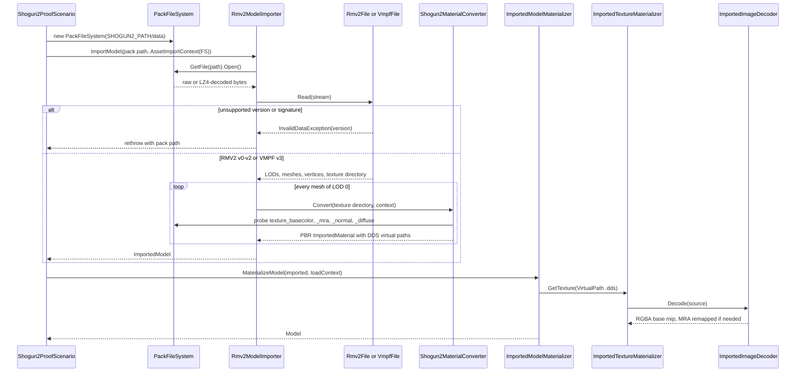
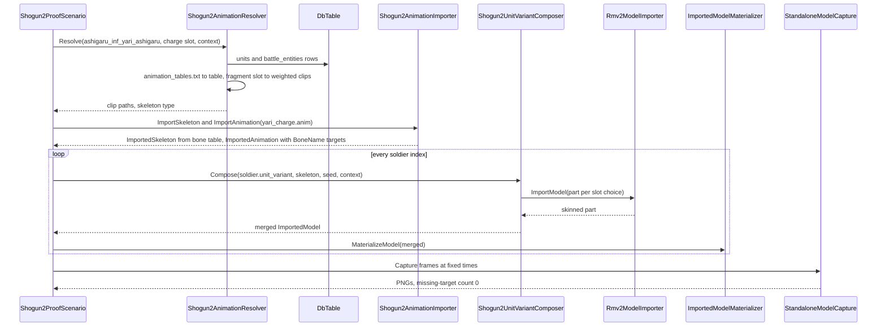

# Deep Dive: Total War: SHOGUN 2 models (C12a, C12b, C12c)

> Expands phases C12a through C12c of [Track C: External Models & Animations](../track-c-external-assets.md).
>
> Audience: human design for reading Total War: SHOGUN 2 Complete Edition packs and importing
> static models, composite soldier parts, and battle animations through the C1-C3 contracts.

Purpose: add the Warscape-era Total War family next to the [C9](c9-total-war-3k-models.md)
THREE KINGDOMS family. SHOGUN 2 shares the pack, DB-table, and fragment concepts with C9 but
none of its binary model or clip layouts, so it is a separate phase group that reuses the C9 pack
seam. Its battles are formation-based like C9 and feed the same [Track M](../track-m-mass-battle.md)
and [B5](../track-b-scale.md) consumers.

Facts below were measured on 2026-10-29 against an operator-supplied SHOGUN 2 Complete Edition
install (`shogun2_complete_edition.exe`, 64-bit, DX11 shaders) with temporary Python parsers
outside the repository. Install root: `/mnt/pit2/Network Storage/Transfer/Shogun 2 Complete Edition`.

---

## 1. Scope

C12a supports:

- `PFHs` packs under `data/` with pack types `0x1`, `0x4`, `0x21`, `0x40`, and `0x41`;
- LZ4 block-compressed entries (pack flag `0x20`), exposed with uncompressed entries as a
  read-only, case-insensitive `FileSystem` across packs;
- `db\<table>_tables\<name>` DB tables for the unit-binding subset in section 6, with schemas
  ported from the RPFM SHOGUN 2 schema subset.

C12b supports:

- `RMV2` versions 0, 1, and 2 static models (buildings, ships, artillery, props);
- `VMPF` version 3 `.variant_part_mesh` soldier and horse parts in bind pose;
- the Complete Edition texture sets `texture_basecolor`, `texture_mra`, `texture_normal`, and
  `texture_colour_mask` on C3 metallic-roughness, from DX10 BC1 sRGB, BC3, BC7, and BC7 sRGB DDS,
  with legacy `texture_diffuse` parts as base colour only.

C12c supports:

- version 1 `.anim` clips with their embedded bone tables as runtime bone hierarchies;
- `VMPF` skin weights;
- `.unit_variant` composition: slots, per-slot mesh and texture choices, and a seeded per-soldier
  pick;
- animation tables and battle-configuration fragments binding slots such as `RIDER_COMBAT_READY`
  to weighted clips.

C12 rejects or defers:

- `.rigid_model` (`0x12345678` signature), `.animatable_rigid_model`, and
  `.rigid_model_animation` families: deferred, explicit failure with path;
- `VMPF` versions 0 and 2 (12 files) and `VRNT` version 0 (268 files): explicit failure until a
  sample is decoded;
- the 53 `.anim` files that start with a frame rate instead of a version word;
- terrain, vegetation (`.tree_mesh`, `.tree_list`), audio (`.bnk`), and Bink movies;
- rider and mount pairing on one clip clock, which C9d designs; C12c stops at independent rider
  and horse clips.

## 2. Packs

Header (32 bytes): `PFHs` (`50 46 48 73`), u32 pack type, u32 pack-reference count, u32
pack-reference size, u32 file count, u32 index size, u64 timestamp. Each index entry is u64 data
offset, u32 uncompressed size, a u32 stored size when type flag `0x20` is set, a u64 timestamp
when flag `0x40` is set, and a NUL-terminated backslash path. Entry data is 16-byte aligned. The
last entry ends exactly at end of file in every pack.

Compressed entries are raw LZ4 blocks with no frame header; every compressed entry sampled for
section 3 to 5 decoded to its recorded size. Entries whose stored size equals the uncompressed
size are raw.

| Pack | Type | Files | Compressed | Content |
|---|---|---|---|---|
| `data.pack` (3.86 GB) | `0x21` | 24,802 | 24,793 | 4,111 `.anim`, 1,228 DB tables, 296 animation `.txt`, 99 RMV2 |
| `models.pack` (5.28 GB) | `0x21` | 10,654 | 10,646 | 2,533 RMV2, 309 `.rigid_model`, 6,394 DDS |
| `models2.pack` (5.12 GB) | `0x21` | 4,731 | 4,731 | 1,242 `.unit_variant`, 562 `.variant_part_mesh`, 2,756 DDS |
| `terrain.pack` (8.04 GB) | `0x21` | 36,085 | 36,084 | 680 RMV2, terrain and vegetation |
| `data_fots.pack` | `0x1` | 22,024 | 0 | Fall of the Samurai campaign and battle data |
| `boot.pack`, `shaders.pack` | `0x40`, `0x41` | 59, 786 | 0 | boot textures, DX11 shaders |
| `audio.pack`, `movies*.pack` | `0x1`, `0x4` | 32,288, 697 | 0 | out of scope |

`PFHs` is not the C9 `PFH5` layout: the index carries a u64 offset per entry instead of packing
data back to back, and compression is per entry.

## 3. RMV2 models

| Version | Files | Example |
|---|---|---|
| 0 | 62 | `rigidmodels\buildings\castle_01_gate\castle_01_gate_piece09_destruct01_gate_closed.rigid_model_v2` |
| 1 | 561 | `rigidmodels\buildings\1meterblock\1meterblock_piece01_destruct01.rigid_model_v2` |
| 2 | 2,688 | `rigidmodels\artillery\armstrong_gun\armstrong_gun.rigid_model_v2` |

- Header: `RMV2`, u32 version, u32 LOD count (0-5, usually 1 or 3), then per-LOD records; strings
  are UTF-16 (mesh names, texture directories, skeleton names such as `armstrong_gun.anim`).
- The layout differs from the C9 version 7 and 8 header, so no C9 reader code is shared.
- 6 files over 3 MB were not sampled.

Mesh headers, vertex formats, and strides are not decoded yet; C12b's first card records them.

## 4. Soldier parts and textures

`.variant_part_mesh` files start `VMPF`, version 3 in 551 of 563 files. Parts live under
`variantmodels\unitparts\<culture>\<slot>\<part>\mesh.variant_part_mesh` with a sibling `tex\`
folder. Positions are half floats. Each part also has an empty `mesh_noclip4` entry.

| Map | Files | Encoding |
|---|---|---|
| `texture_basecolor` | 547 | DX10 BC7 sRGB (99) or BC7 (98) |
| `texture_mra` | 556 | DX10 BC7 (98) or BC3 (77) |
| `texture_normal` | 634 | DX10 BC3 (77), legacy DXT5 |
| `texture_colour_mask` | 637 | DXT1 or DX10 BC1 sRGB (72) |
| `texture_diffuse` | 235 | DXT5 or DXT1, legacy parts only |

Open: the `mra` channel order (metal, roughness, ambient occlusion is assumed from the name), the
normal-map swizzle, and the colour-mask tint semantics are confirmed empirically in C12b.

## 5. Animation

Version 1 clip header: u32 version, f32 frame rate, f32 duration, u32 bone count, then per bone a
u16 length, a UTF-16 name, and an i32 parent index. Each clip carries its own bone table; no
separate skeleton files exist.

- 3,756 clips are version 1; 3,666 run at 20 fps and 90 at 30 fps.
- 3,242 man clips have 48 bones (`Hips`, `Weapon1`-`Weapon3`, `Armor_Front`, `LeftUpLeg`, `Spine`, ...).
- Horse clips have 40 bones.
- Frame data after the bone table is not decoded yet; C12c's first card records it.

`animations\animation_tables\animation_tables.txt` (`version 1` text) names tables such as
`shogun_man_katana` with `skeleton_type man_shogun`, fragments, and a `mount_table`. Fragments in
`animations\battleconfiguration\*_fragment.txt` map slots to weighted clip paths with
`blend_in_time`. Unlike C9 these are a line grammar, not JSON.

## 6. Unit binding

- `.unit_variant` files start `VRNT`, version 2 in 974 of 1,242 files.
- Files are named `<unit key>.<role>.unit_variant`: roles include `soldier` (182), `officer`
  (170), and `standard_bearer` (66).
- A variant lists slots (`heads`, `hands`, `legs`, `torsos`, `shoulders`, `arms`, `helmets`), each
  with weighted `mesh` and `tex/texture` choices as UTF-16 paths.
- DB tables start `FD FE FC FF` plus a GUID. Unit-binding candidates: `units`,
  `battle_entities`, `mount_variants`, `unit_stats_land`. C12a confirms which columns lead from a
  unit key to its animation table.

## 7. Proof units

| Unit | Mesh | Clips |
|---|---|---|
| `ashigaru_inf_yari_ashigaru` soldier | `variantmodels\units\ashigaru_inf_yari_ashigaru.soldier.unit_variant`, part `variantmodels\unitparts\japan\heads\ashigaru\mesh.variant_part_mesh` | `yari_combat_idle1`, `yari_charge`, `yar_banzai_cheer01` |
| horse | `variantmodels\unitparts\horse\_horseparts\body\horsebody\mesh.variant_part_mesh` | `horse_combat_idle_01`, `horse_stand_idle_01` |
| static | castle gate piece (RMV2 v0) and Armstrong gun (RMV2 v2) | none |

## 8. References

- RPFM (github.com/Frodo45127/rpfm, MIT): pack layouts and DB schemas, including SHOGUN 2. The
  schema subset may be ported with credit.
- AssetEditor (github.com/donkeyProgramming/TheAssetEditor): factual reference only, as in C9.
- No Total War asset is committed.

## 9. Phase split

| Phase | Deliverable | Proof | Cards |
|---|---|---|---|
| C12a | `PFHs` variant of the shared pack file system with LZ4 entries, DB reader for section 6 | All packs enumerate with section 2 counts; every compressed entry decodes to its size; proof unit rows resolve | [`WI-C12a-01`](../agent/cards/WI-C12a-01-pack-file-system.md), [`WI-C12a-02`](../agent/cards/WI-C12a-02-db-table-reader.md) |
| C12b | RMV2 v0-v2 static models, `VMPF` v3 parts in bind pose, Complete Edition texture sets on C3 PBR | Castle gate piece, Armstrong gun, ashigaru head, and horse body render textured beside a Generals Ranger | [`WI-C12b-01`](../agent/cards/WI-C12b-01-mesh-layout-investigation.md), [`WI-C12b-02`](../agent/cards/WI-C12b-02-dds-dx10-bc7-decode.md), [`WI-C12b-03`](../agent/cards/WI-C12b-03-rmv2-static-import.md), [`WI-C12b-04`](../agent/cards/WI-C12b-04-part-import-and-materials.md), [`WI-C12b-05`](../agent/cards/WI-C12b-05-static-proof.md) |
| C12c | Version 1 clips with embedded skeletons, `VMPF` skins, `.unit_variant` composition, tables and fragments | A seeded yari ashigaru squad renders with distinct variants and plays `yari_charge`; the horse plays an idle | [`WI-C12c-01`](../agent/cards/WI-C12c-01-anim-frame-investigation.md), [`WI-C12c-02`](../agent/cards/WI-C12c-02-anim-import.md), [`WI-C12c-03`](../agent/cards/WI-C12c-03-part-skin-import.md), [`WI-C12c-04`](../agent/cards/WI-C12c-04-unit-variant-composer.md), [`WI-C12c-05`](../agent/cards/WI-C12c-05-animation-table-resolver.md), [`WI-C12c-06`](../agent/cards/WI-C12c-06-animated-proof.md) |

Card order: `WI-C12a-01` and `WI-C12b-02` first, in parallel. `WI-C12a-02` and `WI-C12b-01` after
`WI-C12a-01`. `WI-C12b-03` after `WI-C12b-01`; `WI-C12b-04` after `WI-C12b-02` and `WI-C12b-03`;
`WI-C12b-05` last in C12b. `WI-C12c-01` after `WI-C12a-01`; `WI-C12c-02` after `WI-C12c-01`;
`WI-C12c-03` after `WI-C12b-04` and `WI-C12c-02`; `WI-C12c-04` after `WI-C12c-03`; `WI-C12c-05`
after `WI-C12a-02` and `WI-C12c-02`; `WI-C12c-06` last.

### Implementation decisions

- Shared pack project: `Panopticon.FileFormats.Pack` holds `PackFile` with one header variant per
  magic (`PFHs` here, `PFH5` added by [C9a](c9-total-war-3k-models.md#9-phase-split)) and the DB
  table reader, which takes a caller-supplied schema. `PackFileSystem` lives in `Panopticon.IO`
  beside `BigFileSystem`. Whichever of C9a and C12a lands first creates both.
- LZ4: one in-repo `Lz4BlockDecoder` in a new `Panopticon.FileFormats.Lz4` project, shared with
  C10a `alz4` entries. Whichever of C10a and C12a lands first creates it. No package is added.
- SHOGUN 2 readers live in `Panopticon.FileFormats.Shogun2`: `Rmv2File` (versions 0 to 2),
  `VmpfFile`, `VrntFile`, `AnimFile`, the DB schema subset, and the animation-table and fragment
  text parsers. No engine dependency.
- Importers: `Rmv2ModelImporter` (id `RMV2`, models and parts) and `Shogun2AnimationImporter` (id
  `ANIM`). Asset keys are pack paths, for example
  `variantmodels\unitparts\japan\heads\ashigaru\mesh.variant_part_mesh`.
- Textures: `DdsFile` gains the `DX10` extended header, and `DdsBlockDecoder` gains BC7. The
  `ImportedImageDecoder` DDS branch decodes the base mip to RGBA for imported sources and lets the
  materializer regenerate mips, the same route as C10a DDT. W3D textures keep their GPU path.
- MRA maps: if `WI-C12b-01` confirms an order other than the glTF layout (roughness in G, metal in
  B, occlusion in R), `WI-C12b-04` adds a channel remap applied after decode, not a converted copy
  in the pack.
- Colour masks: recorded, not tinted. Parts render untinted, as C9 does, until faction tint
  semantics are settled.
- Composition: `Shogun2UnitVariantComposer` picks slot choices with a seeded `System.Random` keyed
  by unit key, role, and soldier index, then merges parts into one `ImportedModel` on the clip
  skeleton. Composition runs once per soldier, never per frame.
- Install discovery: `SHOGUN2_PATH` names the install root that holds `data/`. Tests that need it
  are `Category=Interactive`, like the EE2 and AoE3 tests.
- `ImportedMesh.Indices` is `ushort`: an RMV2 or `VMPF` mesh over 65,535 vertices fails with file and
  mesh name; no SHOGUN 2 split rule is needed unless the investigation finds one.

## 10. Risks

- Unknown vertex formats: section 3 and 4 layouts are undecoded, so C12b starts with an
  investigation card before any import code.
- Composite cost: like C9, composition happens once per seed and hands B5 a merged result.
- LZ4 throughput: models packs are over 5 GB each; entries decode lazily per open, never per pack.

## 11. Architecture diagrams

Types marked new are added by C12 cards (or by C9a and C10a if they land first); the rest exist
today.

```mermaid
classDiagram
  class FileSystem {
    GetFile(path) FileSystemEntry
    GetFilesInDirectory(path, pattern, option)
  }
  class BigFileSystem
  class PackFileSystem {
    new
    PackFileSystem(dataDirectory)
    GetFile(path) FileSystemEntry
  }
  class PackFile {
    new
    Read(stream, path) PackFile$
    Variant
    Entries
  }
  class PackEntry {
    new
    Path
    Offset
    UncompressedSize
    StoredSize
  }
  class Lz4BlockDecoder {
    new
    Decode(source, destination)$
  }
  class DbTable {
    new
    Read(stream, schema) DbTable$
    Rows
  }
  class Shogun2DbSchema {
    new
    Units
    BattleEntities
    MountVariants
    UnitStatsLand
  }
  FileSystem <|-- BigFileSystem
  FileSystem <|-- PackFileSystem
  PackFileSystem --> PackFile : one per .pack
  PackFile --> PackEntry
  PackFileSystem ..> Lz4BlockDecoder : flag 0x20 entries
  DbTable ..> Shogun2DbSchema

  class Rmv2File {
    new
    Read(stream) Rmv2File$
    Version
    Lods
  }
  class VmpfFile {
    new
    Read(stream) VmpfFile$
    Vertices
    Influences
  }
  class VrntFile {
    new
    Read(stream) VrntFile$
    Slots
  }
  class AnimFile {
    new
    Read(stream) AnimFile$
    FrameRate
    Bones
    Frames
  }
  class AnimationTableSet {
    new
    Parse(text) AnimationTableSet$
  }
  class FragmentFile {
    new
    Parse(text) FragmentFile$
  }

  class IModelImporter
  class IAnimationImporter
  class AssetImportContext {
    FileSystem
  }
  class Rmv2ModelImporter {
    new
    Id RMV2
    ImportModel(name, context)
    ImportSkeleton(name, context)
  }
  class Shogun2AnimationImporter {
    new
    Id ANIM
    ImportAnimation(name, context)
  }
  class Shogun2MaterialConverter {
    new
    Convert(textureDirectory, context) ImportedMaterial
  }
  class Shogun2UnitVariantComposer {
    new
    Compose(variantPath, skeleton, seed, context) ImportedModel
  }
  class Shogun2AnimationResolver {
    new
    Resolve(unitKey, slot, context) Shogun2ClipChoice
  }
  IModelImporter <|.. Rmv2ModelImporter
  IAnimationImporter <|.. Shogun2AnimationImporter
  Rmv2ModelImporter --> Rmv2File
  Rmv2ModelImporter --> VmpfFile
  Rmv2ModelImporter --> Shogun2MaterialConverter
  Rmv2ModelImporter --> AssetImportContext
  Shogun2AnimationImporter --> AnimFile
  Shogun2UnitVariantComposer --> VrntFile
  Shogun2UnitVariantComposer --> Rmv2ModelImporter
  Shogun2AnimationResolver --> DbTable
  Shogun2AnimationResolver --> AnimationTableSet
  Shogun2AnimationResolver --> FragmentFile

  class ImportedImageDecoder {
    Decode(source, fileSystem) DecodedImportedImage
  }
  class DdsFile {
    FromStream(stream) DdsFile$
    Dx10Header new
  }
  class DdsBlockDecoder {
    DecodeBaseMip(mip, format)$
    DecodeBc7 new
  }
  class ImportedTextureMaterializer
  class ImportedModelMaterializer {
    MaterializeModel(imported, context)$
  }
  Shogun2MaterialConverter ..> ImportedImageDecoder : DDS virtual paths
  ImportedImageDecoder --> DdsFile : DDS magic, imported sources
  ImportedImageDecoder --> DdsBlockDecoder : BC1, BC3, BC7
  ImportedTextureMaterializer --> ImportedImageDecoder
  ImportedModelMaterializer --> ImportedTextureMaterializer

  class Shogun2ProofScenario {
    new
    Run(installation, config, reporter)$
  }
  class StandaloneModelCapture {
    Capture(...)$
  }
  Shogun2ProofScenario --> PackFileSystem
  Shogun2ProofScenario --> Rmv2ModelImporter
  Shogun2ProofScenario --> Shogun2UnitVariantComposer
  Shogun2ProofScenario --> Shogun2AnimationResolver
  Shogun2ProofScenario --> Shogun2AnimationImporter
  Shogun2ProofScenario --> ImportedModelMaterializer
  Shogun2ProofScenario --> StandaloneModelCapture
```

Static import of one model or part (C12b):

Composite animated soldier (C12c):

## Appendix: grounding

| Fact | Location |
|---|---|
| Importer seams | `src/Panopticon.Simulation/Content/Importing/IModelImporter.cs:10`, `IAnimationImporter.cs:10` |
| Format id to importer mapping, glTF only today | `src/Panopticon.Simulation/Content/Importing/ExternalFormatFactory.cs:13` |
| Import context holds a `FileSystem` | `src/Panopticon.Simulation/Content/Importing/AssetImportContext.cs:18` |
| File system base and archive precedent | `src/Panopticon.IO/FileSystem.cs:3`, `BigFileSystem.cs:5` |
| Four bone indices and weights per vertex | `src/Panopticon.Simulation/Content/Importing/ImportedVertex.cs:28`-`:42` |
| 16-bit indices | `src/Panopticon.Simulation/Content/Importing/ImportedMesh.cs:20` |
| House-colour flag on imported meshes | `src/Panopticon.Simulation/Content/Importing/ImportedMesh.cs:30` |
| PBR material with metallic-roughness, normal, occlusion bindings | `src/Panopticon.Simulation/Content/Importing/ImportedPbrMetallicRoughness.cs:21` |
| Image decode rejects DDS for imported sources | `src/Panopticon.Simulation/Content/Loaders/ImportedImageDecoder.cs:64` |
| DDS formats: BC1-BC3, RG8, RGBA8, RGBA16F; FourCC `DXT1/3/5` only, no `DX10` header | `src/Panopticon.Simulation/Data/Dds/DdsImageFormat.cs:3`, `DdsFile.cs:209`-`:226` |
| CPU BC decoder, no BC7 | `src/Panopticon.Simulation/Data/Dds/DdsBlockDecoder.cs:24`-`:26` |
| Materializer and mip regeneration | `src/Panopticon.Simulation/Content/Loaders/ImportedModelMaterializer.cs:27`, `ImportedTextureMaterializer.cs:141` |
| Capture helper | `src/Panopticon.Tools.TestHarness/StandaloneModelCapture.cs:42` |
| Proof scenario precedent | `src/Panopticon.Tools.TestHarness/BuiltInScenario.cs:18` (`Ee2NifProof`) |
| Interactive install-env test precedent | `test/Panopticon.Simulation.Tests/Content/Importing/Ee2NifImportTests.cs:17`, `:27` |
| In-repo decompressor precedent | `src/Panopticon.FileFormats.RefPack/` |
