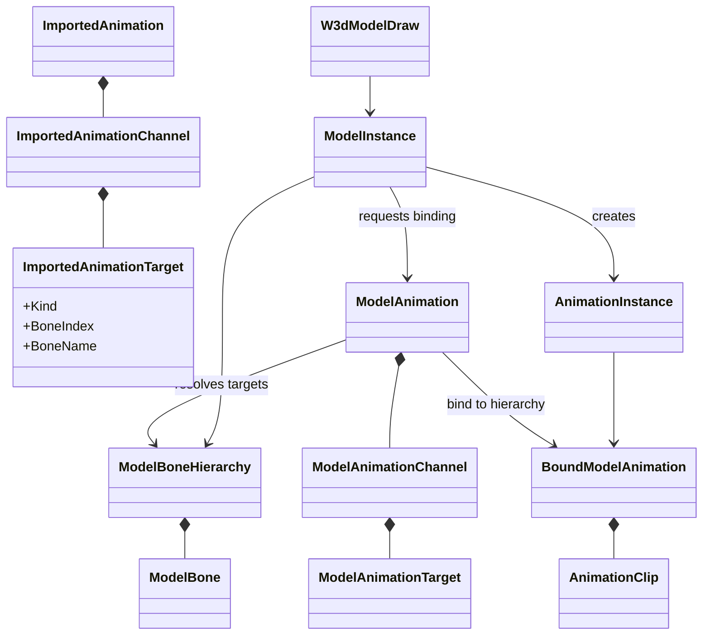
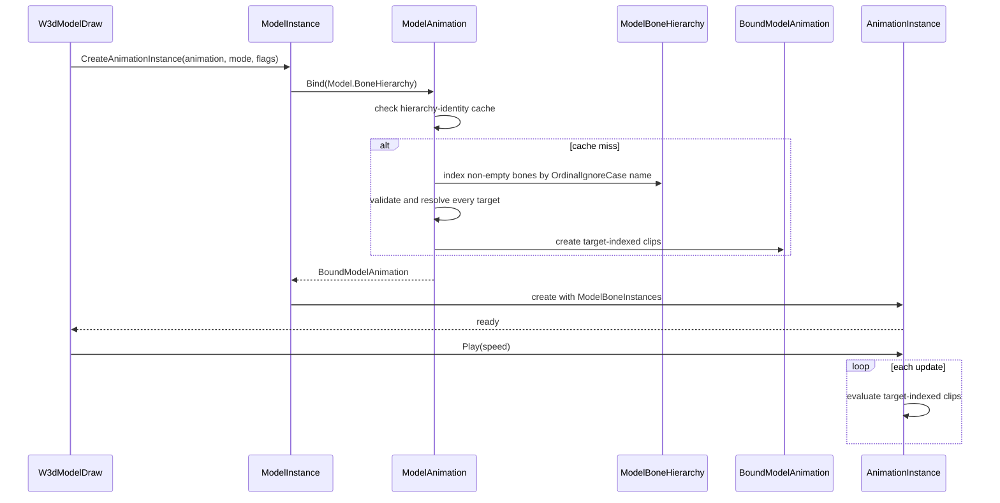

# Deep Dive: Skeleton and Animation Retargeting (C2)

> Expands phase C2 of [Track C: External Models & Animations](../track-c-external-assets.md).
>
> Audience: human design for binding imported animation channels to runtime model bones.
> Code references are in the agent-context appendix.

Purpose: let an imported animation address a materialized model by stable bone identity instead of
assuming that source and target bone arrays have the same order. Existing W3D index behavior and
runtime playback remain unchanged.

---

## 1. Scope

C2 defines retargeting as channel binding:

1. An importer emits animation channels addressed either by direct bone index or bone name.
2. The engine binds those targets to one `ModelBoneHierarchy`.
3. Playback consumes immutable, target-indexed `AnimationClip` values.

Direct indices preserve W3D compatibility. Named targets support external formats whose node order
does not match runtime bone order.

C2 does not perform humanoid or cross-proportion retargeting. It does not compensate for different
bind poses, infer semantic joints, rename bones heuristically, scale motion, or alter interpolation.
An imported model and its animations must share compatible local bind transforms.

## 2. Current constraints

`ImportedSkeleton` stores parent-before-child bones. Each `ImportedBone` has a name, parent index,
translation, and rotation. `ImportedAnimationChannel` currently carries only a non-negative bone
index. That index is copied into `AnimationClip.Bone` and later indexes
`ModelInstance.ModelBoneInstances` directly.

Animation assets load independently of models. The animation loader therefore cannot know which
runtime hierarchy will consume an animation. Binding belongs at model-instance animation
activation, after both assets exist.

Existing gameplay wiring already selects the required pair:

- `ModelConditionState.Model` selects the active model.
- `AnimationStateAnimation.Animation` selects the animation.
- `W3dModelDraw.SetActiveAnimationState` creates the animation instance for the active
  `ModelInstance`.

C2 changes that creation boundary, not INI syntax or state selection.

## 3. Channel target contract

Add an immutable `ImportedAnimationTarget` discriminated value:

| Kind | Value | Use |
|---|---|---|
| `DirectIndex` | non-negative source index | W3D and formats whose animation already addresses the target hierarchy |
| `BoneName` | non-empty source bone name | External animations bound by name |

`ImportedAnimationChannel` owns one target instead of an unqualified integer. Its current
integer constructor remains as the direct-index compatibility path while C1 is completed.

Materialization converts that value into the equivalent format-neutral `ModelAnimationTarget`
owned by `ModelAnimationChannel`. A `ModelAnimation` is therefore unbound and reusable across
compatible model hierarchies.

Named identity uses exact `OrdinalIgnoreCase` matching. No trimming, prefix removal, fuzzy match,
or source-format normalization occurs in the binding layer. Importers may decode their format's
stored string representation, but must not invent aliases.

## 4. Binding model

`ModelAnimation.Bind(ModelBoneHierarchy)` produces an immutable `BoundModelAnimation`:

- In-range direct targets retain their index; out-of-range direct targets are omitted.
- Named targets resolve through a case-insensitive target-name index.
- Channel type, duration, keyframe order, values, and timing are copied unchanged.
- The result contains the existing target-indexed `AnimationClip` values consumed by playback.

`ModelAnimation` caches bound results by target hierarchy object identity through
`ConditionalWeakTable<ModelBoneHierarchy, BoundModelAnimation>`. The cache must not keep a
hierarchy alive after its asset scope is popped. A model hierarchy name or hash is not sufficient
because two scoped assets may reuse a name with different bones.

`ModelInstance.CreateAnimationInstance` requests the bound animation and constructs
`AnimationInstance`. `W3dModelDraw` uses this method instead of invoking the animation-instance
constructor directly. `AnimationInstance` continues to evaluate target-indexed clips without
format checks or name lookups per frame.

The direct-index path is the W3D reference behavior. It binds without name lookup and must retain
the same indices and fixed-time playback results as C1 parity tests.

## 5. Validation and failure behavior

Binding validates before animation playback:

- Every named channel has exactly one case-insensitive target match.
- For each distinct referenced name, the hierarchy contains exactly one matching bone. Duplicate
  runtime names that no channel references do not block unrelated animation.
- Keyframe kinds and ordering remain protected by the interchange constructors.

A named source bone absent from the target is an `InvalidDataException` naming the animation,
source bone, and target hierarchy. An ambiguous target name is also invalid data. Valid features
outside C2, such as bind-pose compensation, throw `NotSupportedException` when explicitly
requested rather than silently approximating.

An out-of-range direct index preserves current W3D behavior: the binder omits that channel and logs
one warning with animation and hierarchy context. It does not fail the asset or repeat the range
check every frame. Channel ordering otherwise remains intact, including multiple channels that
address the same bone and component.

Bones with no animation channels require no mapping. C2 never inserts identity channels and never
binds a missing name to index zero.

## 6. Gameplay integration

No new INI field is required. Existing animation names and model-condition selection continue to
choose assets. The active model supplies the target hierarchy at animation activation.

The first milestone supports an externally authored model and animation using the same named
skeleton. Explicit alias profiles are deferred until a real asset requires differently named but
otherwise compatible bones. If added later, an alias profile remains format-neutral and becomes
part of the binding-cache key.

Weapon, particle, muzzle-flash, and sub-object attachment lookups continue using runtime model
bone names. They do not consume source animation names or the retarget map.

## 7. Acceptance

C2 is complete when:

- A named animation with source and target bones in different array orders drives the intended
  target bones.
- Translation, quaternion, and visibility channels retain values and timing after binding.
- A gameplay `AnimationState` activates that animation through `W3dModelDraw`.
- Missing or duplicate named targets fail before playback with asset context.
- Out-of-range direct targets are omitted with one warning, matching existing W3D playback.
- Repeated binding to the same hierarchy reuses one immutable result; a different hierarchy gets
  a distinct result.
- Existing W3D direct-index descriptors and fixed-time playback remain unchanged.
- No source-format branch or per-frame name lookup enters `AnimationInstance`.

Focused tests use synthetic skeletons and animations. W3D parity remains covered by C1 installed
asset tests. The end-to-end external-format unit belongs to C4.

## 8. Architecture diagrams

## Appendix: current-code grounding

- Interchange skeleton and animation values:
  `src/OpenSage.Game/Content/Importing/ImportedSkeleton.cs`,
  `ImportedBone.cs`, `ImportedAnimation.cs`, and `ImportedAnimationChannel.cs`.
- Current W3D channel conversion:
  `src/OpenSage.Game/Content/Importing/W3d/W3dAnimationImporter.cs`.
- Compatibility materialization:
  `src/OpenSage.Game/Graphics/Animation/W3DAnimation.cs`.
- Runtime hierarchy and indexed playback:
  `src/OpenSage.Game/Graphics/ModelBoneHierarchy.cs`,
  `ModelBone.cs`, `ModelInstance.cs`, and `Graphics/Animation/AnimationInstance.cs`.
- Gameplay selection:
  `src/OpenSage.Game/Logic/Object/ModelConditionState.cs`,
  `AnimationState.cs`, and `Draw/W3dModelDraw.cs`.
- Asset lookup:
  `src/OpenSage.Game/Content/LazyAssetReference.cs` and
  `src/OpenSage.Game/Data/Ini/IniParser.cs`.
