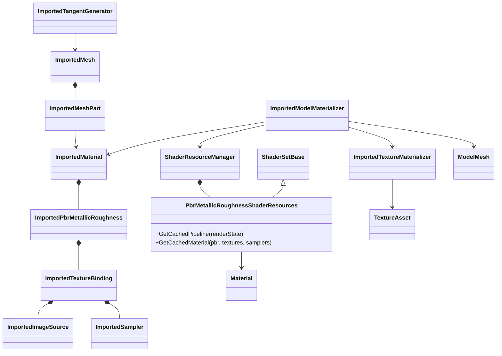
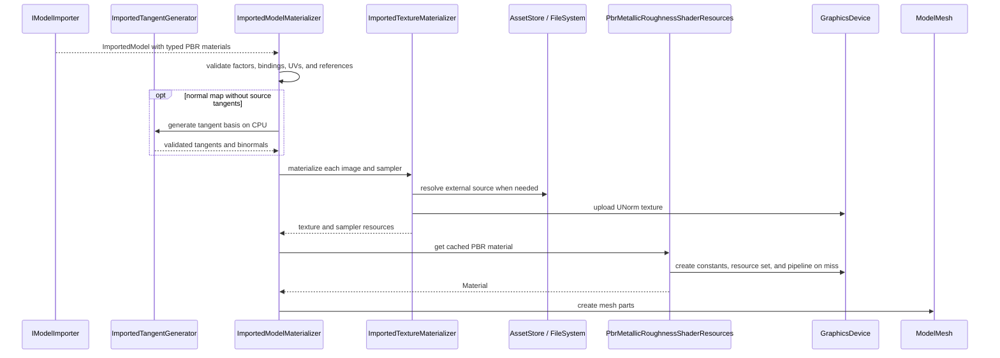

# Deep Dive: Material and Texture Mapping (C3)

> Expands phase C3 of [Track C: External Models & Animations](../track-c-external-assets.md).
>
> Audience: human design for format-neutral core PBR materials and engine-owned texture
> materialization. Code references are in the agent-context appendix.

Purpose: represent core metallic-roughness materials without leaking glTF parser types into the
engine, then materialize them through a bounded PBR shader path. Existing W3D fixed-function and
named shader-material behavior remains unchanged.

---

## 1. Scope

C3 covers the material features needed by C4:

- base color, metallic, roughness, normal, occlusion, and emissive inputs;
- opaque, alpha-mask, and alpha-blend modes;
- back-face or no culling;
- UV sets 0 and 1;
- repeat, mirrored-repeat, and clamp addressing;
- nearest and linear filtering with mip selection;
- external and embedded encoded images;
- sRGB versus linear texture interpretation.

Advanced material models and `KHR_materials_*` semantics remain C6. Texture transforms, UV sets
above 1, transmission, clearcoat, sheen, volume, iridescence, anisotropy, and specular extensions
are not part of C3.

Core glTF vertex colors are also outside C3 because the current mesh vertex layout has no color
attribute. C4 rejects a non-empty `COLOR_0` accessor with `NotSupportedException`; it does not
silently discard the color multiplier.

## 2. Current constraints

`ImportedMaterial` currently describes the W3D-era engine model: shader family, cull/depth/blend
state, optional fixed-function values, and typed named properties. `ImportedMeshPart` carries two
UV arrays. `ImportedVertex` can carry tangent and binormal vectors.

The runtime has fixed-function, `Simple`, and `NormalMapped` material paths. None implements
metallic-roughness lighting. Existing texture loading resolves an asset name to DDS, TGA, or JPG
and allocates a GPU texture immediately. It does not carry sampler or color-space intent and
cannot represent an image embedded in another model file.

Named material properties remain appropriate for effect-specific W3D shader constants. They are
not the core PBR contract because texture bindings need typed UV, sampler, channel, and color-space
semantics.

## 3. Interchange extensions

Add an optional typed `ImportedPbrMetallicRoughness` payload to `ImportedMaterial`. Existing
fixed-function and named shader-family materials remain valid and unchanged. A material cannot
combine fixed-function and PBR payloads.

The PBR payload owns:

| Value | Default |
|---|---|
| Base color factor and optional texture | `(1, 1, 1, 1)` |
| Metallic factor | `1` |
| Roughness factor | `1` |
| Optional packed metallic-roughness texture | none |
| Optional normal texture and scale | none, `1` |
| Optional occlusion texture and strength | none, `1` |
| Emissive factor and optional texture | `(0, 0, 0)`, none |
| Alpha mode and cutoff | `Opaque`, `0.5` |
| Double-sided | `false` |

`ImportedTextureBinding` contains:

- one immutable `ImportedImageSource`;
- UV set index 0 or 1;
- an `ImportedSampler`;
- texture role, which determines channel use and color space.

`ImportedImageSource` is either an exact normalized virtual-file path or immutable encoded bytes
with a MIME type and diagnostic name. Embedded bytes allow `.glb`, data URI, and buffer-view
images without giving the importer GPU access. For an external URI, the importer resolves the URI
relative to the model file and stores that virtual path; materialization opens it directly rather
than applying a SAGE texture-path resolver. Raw GPU textures and parser objects are forbidden.

`ImportedSampler` contains U/V address modes plus minification, magnification, and mip filters.
Enums use engine semantics rather than glTF numeric constants.

Texture role determines interpretation:

| Role | Color space | Channels |
|---|---|---|
| Base color | sRGB | RGBA |
| Metallic-roughness | linear | roughness G, metallic B |
| Normal | linear | tangent-space RGB |
| Occlusion | linear | R |
| Emissive | sRGB | RGB |

These types are format-neutral. C4 maps core glTF values into them; another importer can produce
the same payload without using glTF names.

## 4. CPU processing and validation

Before GPU allocation, the engine validates:

- factors are finite and within their defined ranges;
- texture roles and image sources are valid;
- UV indices are 0 or 1 and the referenced mesh part supplies that UV set;
- sampler enum combinations are supported;
- alpha cutoff is finite;
- a normal-mapped mesh has normals, tangents, and a complete UV set;
- material and mesh-part references satisfy the C1 invariants.

When a source omits tangents but supplies indexed triangles, normals, and the selected UV set, a
format-neutral CPU `ImportedTangentGenerator` creates a deterministic tangent basis before
materialization. Degenerate UV triangles or incomplete inputs produce `NotSupportedException`;
the engine does not silently disable the normal map.

UV arrays live on mesh parts while tangent vectors live on shared mesh vertices. When
normal-mapped parts share a vertex index, their selected UV values for that vertex must match.
Conflicting shared-vertex UVs fail with `NotSupportedException` rather than making tangent output
depend on part order. Disjoint parts may select different UV sets.

Malformed values or references throw contextual `InvalidDataException`. Valid unsupported
features throw `NotSupportedException`. For a PBR payload, missing referenced images are errors.
Neutral textures are used only for omitted optional bindings, never to hide a broken reference.
Existing fixed-function and named shader-family materials retain their current missing-texture
fallback behavior.

## 5. Engine materialization

`ImportedModelMaterializer` delegates PBR materials to
`PbrMetallicRoughnessShaderResources`. This is a dedicated `ShaderSetBase` implementation with
pipeline and material caches following `FixedFunctionShaderResources`; it does not derive from
the W3D-oriented `ShaderMaterialShaderResources`. The new shader family uses the existing mesh
vertex layout and global lighting resources; skinning remains selected by existing mesh constants
rather than a second material family.

Materialization:

1. Validates the complete imported graph.
2. Opens exact external virtual paths or decodes embedded PNG, JPEG, or TGA image bytes to RGBA8.
   DDS remains on the existing W3D texture path; C3 does not add block-compression decoding.
3. Uploads image data as ordinary UNorm texture data; the binding role controls shader conversion.
4. Creates or reuses the requested sampler.
5. Creates the PBR constants and texture resource set.
6. Selects a cached cull, depth, alpha-test, and blend pipeline state.
7. Returns the runtime `Material` used by `ModelMeshPart`.

Texture identity includes immutable content identity for embedded images and scoped virtual-path
identity for external images. Color-space role remains part of the material cache key even when
bindings share one uploaded UNorm texture.

The material cache key includes every value that affects output: factors, textures and color
spaces, UV selections, sampler state, alpha mode/cutoff, double-sided state, and pipeline state.

## 6. Core rendering policy

- `Opaque`: blending disabled and depth writes enabled.
- `Mask`: blending disabled, depth writes enabled, fragments below the cutoff discarded.
- `Blend`: source-alpha blending, depth writes disabled, transparent render ordering retained.
- Double-sided materials disable culling; otherwise back faces are culled.
- The PBR shader explicitly decodes base-color and emissive samples from sRGB before lighting.
  Other PBR textures remain linear.
- Metallic and roughness use the packed texture's B and G channels and multiply their factors.
- Occlusion modulates the summed per-light ambient contribution from the R channel.
- Normal maps use the generated or imported tangent basis and the declared normal scale.
- Omitted bindings use shader constants and neutral engine-owned one-pixel textures.

Alpha-blended sorting continues to use the existing transparent surface ordering. Order-independent
transparency is outside C3.

The current render target is non-sRGB. Until G6 establishes a renderer-wide gamma-correct output
path, the PBR fragment shader explicitly encodes its final linear color to sRGB before writing.
G6 replaces that local encode when the target performs the conversion. A focused emissive-only
test uses a known sRGB texel and verifies the captured channel value within one 8-bit step.

## 7. C4 and C6 boundaries

C3 owns reusable engine semantics, validation, image decoding/materialization, sampler creation,
the core PBR shader, and deterministic tangent generation.

C4 owns glTF parsing and conversion:

- glTF factors and core textures become the typed C3 payload.
- URI, data URI, and buffer-view images become `ImportedImageSource` values.
- External image URIs resolve relative to the model path and support PNG and JPEG. TGA remains
  available to other C3 producers but is not a core glTF image format.
- glTF sampler constants become `ImportedSampler` values.
- `TEXCOORD_0` and `TEXCOORD_1` map to the existing two UV arrays.
- A populated `COLOR_0` accessor is rejected because C3 does not extend the vertex layout.
- A required unsupported extension fails import.
- An optional advanced extension may be ignored with a diagnostic only when the core material
  remains valid.

C6 owns the semantics of advanced material extensions and morph targets. C3 does not add dormant
fields for them.

## 8. Acceptance

C3 is complete when synthetic static and two-influence skinned meshes render:

- base-color factor and texture;
- metallic and roughness factors plus packed texture;
- normal mapping with imported and generated tangents;
- occlusion and emissive inputs;
- opaque, masked, and blended alpha;
- single- and double-sided rasterization;
- UV0 and UV1 selection;
- repeat, mirrored-repeat, and clamp sampling;
- nearest and linear filtering;
- external and embedded images with correct sRGB or linear interpretation.

The color-space test includes an emissive-only material whose known sRGB source texel must round
trip to the expected captured 8-bit value within one step.

Tests prove validation occurs before GPU allocation and cache keys separate every output-affecting
state. Deterministic TestHarness captures cover a dielectric, a metal/roughness contrast model, a
normal-mapped model, emissive material, alpha mask, alpha blend, double-sided plane, UV selection,
and sampler addressing. C5 later exposes the same diagnostics in ReplaySketch.

## 9. Architecture diagrams

## Appendix: current-code grounding

- C1 material interchange:
  `src/OpenSage.Game/Content/Importing/ImportedMaterial.cs`,
  `ImportedFixedFunctionShading.cs`, `ImportedMaterialProperty.cs`,
  `ImportedMeshPart.cs`, and `ImportedVertex.cs`.
- Runtime material and mesh types:
  `src/OpenSage.Rendering/Material.cs`,
  `src/OpenSage.Game/Graphics/ModelMesh.cs`, and
  `Graphics/Shaders/MeshShaderResources.cs`.
- Current material paths:
  `src/OpenSage.Game/Graphics/Shaders/ShaderResourceManager.cs`,
  `FixedFunctionShaderResources.cs`, `ShaderMaterialShaderResources.cs`, and
  `NormalMappedShaderResources.cs`.
- Shader sources and build:
  `src/OpenSage.Game/Assets/Shaders/NormalMapped.vert`,
  `NormalMapped.frag`, shared mesh/lighting includes in the same directory, and the shader targets
  in `src/OpenSage.Game/OpenSage.Game.csproj`.
- Texture assets and loading:
  `src/OpenSage.Game/Graphics/TextureAsset.cs`,
  `src/OpenSage.Game/Content/AssetStore.cs`, and
  `Content/Loaders/OnDemandTextureLoader.cs`.
- Frame capture:
  `src/OpenSage.Tools.TestHarness/ScenarioCaptureRunner.cs` and
  `src/OpenSage.Game/Graphics/FrameCapturer.cs`.
