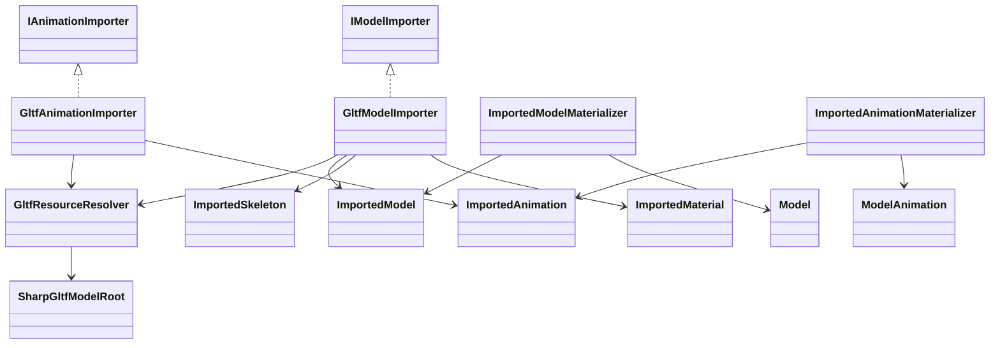
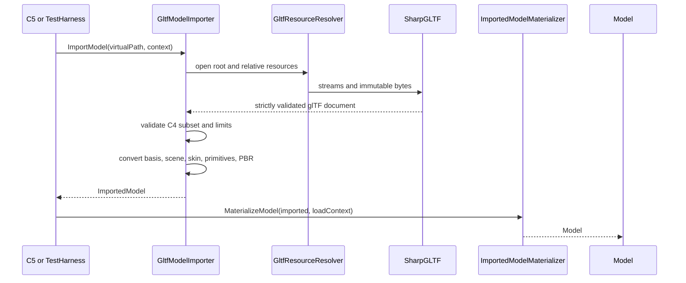
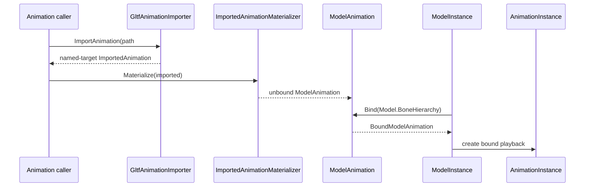

# Deep Dive: Production glTF 2.0 Importer (C4)

> Expands phase C4 of [Track C: External Models & Animations](../track-c-external-assets.md).
>
> Audience: human design for importing static and skinned glTF 2.0 models through the C1-C3
> contracts. Code references are in the agent-context appendix.

Purpose: add one production external format without introducing glTF types into runtime graphics
code. The importer targets the C1 interchange graph, C2 named animation binding, and C3 core PBR
materials.

---

## 1. Scope

C4 supports:

- `.gltf` JSON and `.glb` 2.0 containers;
- external, data-URI, and GLB buffer data;
- indexed and non-indexed triangle primitives;
- interleaved, normalized, and sparse typed accessors;
- positions, normals, tangents, UV0, UV1, two skin influences, and core PBR materials;
- one skin shared by all skinned primitives in the selected scene;
- skeletal translation and quaternion animation with `LINEAR` or `STEP` interpolation;
- external, data-URI, and buffer-view PNG or JPEG images;
- deterministic conversion from glTF coordinates into OpenSAGE model space.

C4 rejects:

- morph targets and animation weight channels;
- non-identity animation scale;
- more than two meaningful skin influences per vertex;
- multiple skins in one imported model;
- points, lines, triangle strips, and triangle fans;
- `COLOR_0`, UV sets above 1, and Draco or meshopt compression;
- `CUBICSPLINE` animation;
- advanced material extensions and texture transforms.

Those are valid features outside the committed subset, so they fail with `NotSupportedException`.
Malformed data fails with `InvalidDataException`.

## 2. Parser and ownership

C4 uses
[`SharpGLTF.Core`](https://www.nuget.org/packages/SharpGLTF.Core) behind
`OpenSage.Content.Importing.Gltf`. The centrally managed package version is pinned when the first
implementation card starts. The design was grounded against version 1.0.7.

SharpGLTF remains an implementation detail:

- parser objects exist only under `Content/Importing/Gltf`;
- accessors are decoded immediately into engine-owned arrays;
- no `SharpGLTF.Schema2` type appears in a public engine, interchange, or runtime signature;
- only `SharpGLTF.Core` is required; Runtime and Toolkit packages are not used;
- strict parser validation remains enabled.

The importer implements the existing `IModelImporter` and `IAnimationImporter` contracts.
`GltfImportOptions` is a public immutable value used as constructor state for the internal importer
and inspector implementations; `AssetImportContext` remains limited to filesystem and language.

C4 adds no source-format branches to `Model`, `ModelMesh`, `ModelInstance`, or
`AnimationInstance`. The format-neutral interpolation and inverse-bind changes described below
are runtime contract extensions used without glTF checks.

The Khronos glTF Validator checks committed fixtures during fixture updates. It is a development
check, not a runtime dependency.

## 3. Source keys and resource resolution

The model and skeleton key is a normalized virtual path ending in `.gltf` or `.glb`.

The animation key is:

```text
<normalized-model-path>#animation=<zero-based-index>
```

Animation indices are stable within one source document and avoid ambiguity from missing or
duplicate animation names. The imported animation name is the authored name when non-empty,
otherwise `<model-name>.Animation<index>`.

`GltfResourceResolver` adapts `AssetImportContext.FileSystem` to SharpGLTF's read callbacks:

- the root document is opened through `FileSystemEntry`;
- relative buffers and images resolve against the document's virtual directory;
- data URIs and GLB chunks remain in memory;
- absolute paths, schemes other than `data`, and paths escaping the virtual root are rejected;
- `System.IO.File` and process-current-directory lookup are forbidden;
- repeated references share one immutable byte payload during an import.

An invalid key or missing root document returns null, matching C1. A missing referenced buffer or
image is malformed asset data and throws.

## 4. Scene and coordinate conversion

The importer loads the declared default scene. If no default is declared, exactly one scene must
exist. Importing multiple scenes from one key is outside C4.

glTF is right-handed, Y-up, and asset-front +Z. OpenSAGE model space is right-handed, Z-up, and
object-forward +X. One basis conversion is applied everywhere:

```text
(x, y, z) glTF -> (z, x, y) OpenSAGE
```

The basis conversion has determinant +1, so triangle winding is preserved. A combined row-vector
conversion matrix `C` contains that basis and `UnitsPerMeter`. It applies to:

- positions, node and bind translations, and animation translation samples;
- normals, tangents, and binormals through the unscaled basis;
- node transforms and inverse binds through `C^-1 * M * C`;
- animation rotations through basis conjugation;
- computed bounds.

OpenSAGE's internal distance unit is the foot. One glTF meter therefore maps to
`1 / 0.3048`, approximately 3.28084, world units by default.
`GltfImportOptions.UnitsPerMeter` provides an explicit positive finite override for authoring
workflows. C4 never guesses scale from bounds. The conversion should use
`WorldUnits.ToFeet` when the [metric-units plan](../../plans/metric-units.md) supplies that helper.
The combined matrix ensures inverse-bind translation carries the same unit scale as positions and
bind translations.

UV coordinates are preserved. Tangent `xyz` is basis-converted and the binormal is derived as
`normalize(cross(normal, tangent)) * tangent.w`.

## 5. Nodes, meshes, and primitives

Selected-scene nodes become a parent-before-child `ImportedSkeleton` in stable depth-first order:

1. Insert one synthetic root only when the selected scene has multiple roots.
2. Preserve each node's authored name and local translation and rotation.
3. Assign a deterministic internal name to an unnamed static node.
4. Attach every unskinned primitive to its mesh-node bone.
5. Attach skinned primitives to the skeleton root and remap skin-joint indices into full imported
   bone order.
6. Require every skinned mesh node to reference the same skin and every joint to be reachable in
   the selected scene.

This preserves rigid sub-object motion, named attach points, and visibility control. Generated
static-node names use a reserved deterministic prefix and avoid every authored name. An animation
channel cannot target an unnamed node. Duplicate authored names are allowed until a named channel
references them; C2 then reports the ambiguous target.

Node matrix and TRS forms are both accepted. A matrix must decompose without shear. Positive
uniform scale on an unskinned hierarchy is removed by scaling descendant translations and attached
geometry. Positive non-uniform scale is accepted only on a leaf unskinned mesh node; positions and
tangents use the scale matrix, normals use its inverse transpose, and the tangent basis is
re-orthogonalized. Negative-determinant transforms are unsupported. Skin joints and their
ancestors require identity scale because the neutral skeleton has no scale channel.

A skinned mesh node's transform is not baked. glTF skin evaluation cancels that transform before
applying model-space joints and inverse binds.

Each triangle primitive becomes one `ImportedMesh` and one mesh part. This avoids merging
primitive-local attribute layouts and material state. Non-indexed primitives receive sequential
indices.

The runtime permits at most `ushort.MaxValue`, 65,535, distinct vertices in one mesh. A primitive
above that vertex limit is split deterministically at triangle boundaries, rebasing and
duplicating vertices as needed. Index count has a separate resource limit but does not trigger a
split. One source primitive can produce several numbered sub-objects without changing material or
skin semantics.

`POSITION` and `NORMAL` are required. Missing tangents are permitted when C3 can generate them.
Attribute counts must match. Indices must be in range before any array access.

## 6. Skinning and bind matrices

glTF skinning requires inverse bind matrices. C4 extends the neutral skeleton contract:

```text
ImportedBone
  Name
  ParentIndex
  BindTranslation
  BindRotation
  InverseBindMatrix
```

`ModelBone` retains the inverse bind matrix. `ModelInstance` uploads:

```text
_skinningBones[i] = bone.InverseBindMatrix * RelativeBoneTransforms[i]
```

This is the repository's row-vector `System.Numerics` multiplication order before matrix upload to
the shader. Existing W3D bones receive identity inverse binds, preserving their current upload
behavior.

Validation requires:

- one inverse bind per skin joint when the accessor is present;
- identity inverse binds when the accessor is absent, as specified by glTF;
- finite, invertible matrices after basis conversion;
- inverse-bind translation converted by the same unit scale as vertex positions;
- joint nodes reachable through the selected scene hierarchy;
- parent-before-child imported ordering;
- joint indices in range after remapping.

`JOINTS_0` and `WEIGHTS_0` must appear together. Weights must be finite and non-negative. The
importer normalizes a nonzero weight sum within a small numeric tolerance. A meaningful third or
fourth influence fails instead of being truncated. `JOINTS_1` and `WEIGHTS_1` are unsupported.

The existing vertex layout stores separate geometry for its two W3D influence slots. C4 writes the
same model-space position and normal to primary and secondary geometry for a two-influence glTF
vertex. Each skinning matrix carries its own inverse bind, so both slots start from the same source
vertex. A one-influence vertex leaves secondary geometry unused.

## 7. Animation mapping

One glTF animation becomes one `ImportedAnimation`. Channels targeting imported joints or their
ancestors use C2 `BoneName` targets. Exact authored names are preserved. Required animation target
nodes must have non-empty names unique under `OrdinalIgnoreCase`; otherwise import fails before
materialization.

glTF samples replace a node's local TRS, while OpenSAGE animation values are offsets applied before
the bone's stored bind transform. C4 converts every sample against that animation document's rest
transform:

```text
rotationOffset = animatedLocalRotation * inverse(restLocalRotation)
translationOffset = transform(
  animatedLocalTranslation - restLocalTranslation,
  inverse(restLocalRotation))
```

With row-vector composition, `offset * rest` reconstructs the authored local sample. The constant
rest conversion preserves linear translation interpolation and quaternion spherical interpolation,
so no resampling is required. An animation imported from another document uses that document's
rest TRS; C2 still requires compatible local bind transforms in the target model.

Channel mapping:

| glTF path | C2 channel |
|---|---|
| `translation` | `TranslationX`, `TranslationY`, `TranslationZ` |
| `rotation` | `Quaternion` |
| `scale` | omitted only when every sample is identity; otherwise unsupported |
| `weights` | unsupported until C6 |

`LINEAR` uses the existing linear or spherical interpolation. C4 adds a format-neutral
`AnimationInterpolation` value to `ImportedAnimationChannel`, `ModelAnimationChannel`, and
`AnimationClip`; W3D defaults to `Linear`. `AnimationInstance` evaluates `Step` by holding the
previous key and `Linear` through its existing interpolation. `CUBICSPLINE` is rejected; C4 does
not resample or approximate authored curves.

Input times must be finite, non-negative, and monotonically increasing. Quaternion values are
normalized and must remain finite. Duration is the maximum channel time. Empty animations and
channels targeting nodes outside the imported skeleton fail.

Animation loading parses the same source document independently. A bounded document cache may
share immutable source bytes between model and animation imports, but it must be scoped and must
not retain an asset filesystem after its scope is released.

## 8. Core PBR mapping

C4 maps glTF core materials directly into the C3 payload:

| glTF value | C3 value |
|---|---|
| `baseColorFactor` and texture | base-color factor and binding |
| `metallicFactor` | metallic factor |
| `roughnessFactor` | roughness factor |
| metallic-roughness texture | packed linear binding |
| normal texture and scale | normal binding and scale |
| occlusion texture and strength | occlusion binding and strength |
| emissive factor and texture | emissive factor and binding |
| `alphaMode` and cutoff | C3 alpha mode and cutoff |
| `doubleSided` | C3 double-sided state |

External image URIs become exact normalized virtual paths. Data URIs and buffer-view images become
immutable encoded bytes with MIME type and diagnostic name. C4 accepts PNG and JPEG. TGA remains
available to other C3 producers but is not a glTF image MIME type.

Sampler wrap and filter constants map to engine enums. Missing samplers use glTF defaults.
Texture-coordinate index 0 or 1 selects the matching mesh-part UV array.

`extensionsRequired` is checked before conversion. Any required unsupported extension fails.
Optional extensions may be ignored with one diagnostic only when core geometry and material
semantics remain complete. C4 does not interpret optional extension data.

## 9. Limits and failure behavior

The importer applies configurable limits before allocation:

- document and aggregate external-buffer bytes;
- node, mesh, primitive, vertex, aggregate index, joint, animation, channel, and keyframe counts;
- embedded image bytes and decoded image dimensions;
- data-URI length and nesting depth.

Defaults are high enough for a unit model and low enough to reject accidental unbounded input.
Limit violations are `InvalidDataException`.

Failure contract:

| Condition | Result |
|---|---|
| Invalid asset key or missing root source | null |
| Malformed JSON, GLB, accessor, reference, or numeric value | `InvalidDataException` |
| Missing referenced buffer or image | `InvalidDataException` |
| Valid feature outside C4 | `NotSupportedException` |
| Unsupported required extension | `NotSupportedException` |
| Ignored optional extension with complete core fallback | one warning |

Exceptions include the source path and the relevant scene, node, mesh, primitive, material,
animation, or accessor index. No malformed import returns a partial `ImportedModel`.

## 10. Acceptance and fixtures

C4 is complete when repository-owned fixtures prove:

- `.gltf` and `.glb` static triangles produce equivalent interchange data;
- external, data-URI, and GLB buffers resolve through the virtual filesystem;
- interleaved, normalized, sparse, and unsigned-index accessors decode correctly;
- a multi-primitive static model preserves materials, UVs, transforms, and bounds;
- named rigid nodes remain available as attach points and can move an unskinned sub-object;
- a two-influence skin preserves joint mapping and inverse binds;
- a two-influence vertex deforms identically to a CPU skinning reference;
- a named animation binds to a differently ordered runtime hierarchy and plays through C2;
- a joint with a non-identity rest transform reaches its authored absolute local pose;
- a step channel holds its previous value between keys;
- core PBR textures, alpha modes, samplers, UV1, and double-sided state render through C3;
- a one-meter coordinate fixture measures approximately 3.28084 world units and is upright,
  +X-forward, and correctly wound;
- positive scale handling preserves normals and tangent handedness, while mirrored transforms fail;
- every excluded feature fails with the documented exception type;
- required extensions never disappear silently;
- no SharpGLTF type crosses the importer boundary.

Fixtures are tiny, deterministic, and committed under
`OpenSage.Game.Tests/Content/Importing/Gltf/Fixtures`. They contain only project-authored geometry
and textures. Fixture updates run the Khronos validator. A headless TestHarness scenario captures
one static and one animated skinned unit without requiring third-party assets.

## 11. Architecture diagrams







## Appendix: current-code grounding

- Import contracts and context:
  `src/OpenSage.Game/Content/Importing/IModelImporter.cs`,
  `IAnimationImporter.cs`, and `AssetImportContext.cs`.
- W3D reference adapters:
  `src/OpenSage.Game/Content/Importing/W3d/W3dModelImporter.cs` and
  `W3dAnimationImporter.cs`.
- Interchange graph:
  `src/OpenSage.Game/Content/Importing/ImportedModel.cs`, `ImportedSkeleton.cs`,
  `ImportedBone.cs`, `ImportedMesh.cs`, `ImportedMeshPart.cs`, `ImportedVertex.cs`,
  `ImportedMaterial.cs`, `ImportedAnimation.cs`, and `ImportedAnimationChannel.cs`.
- Materialization:
  `src/OpenSage.Game/Content/Loaders/ImportedModelMaterializer.cs` and
  `ImportedAnimationMaterializer.cs`.
- Runtime bones and skinning:
  `src/OpenSage.Game/Graphics/ModelBone.cs`, `ModelBoneHierarchy.cs`, and
  `ModelInstance.cs`.
- Imported mesh GPU construction:
  `src/OpenSage.Game/Graphics/ModelMesh.Imported.cs`.
- Package versions:
  `src/Directory.Packages.props`.
