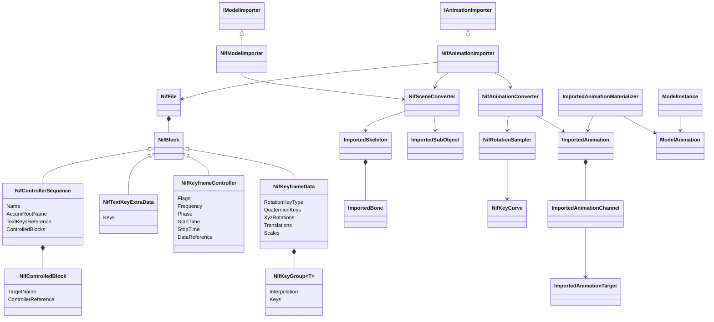
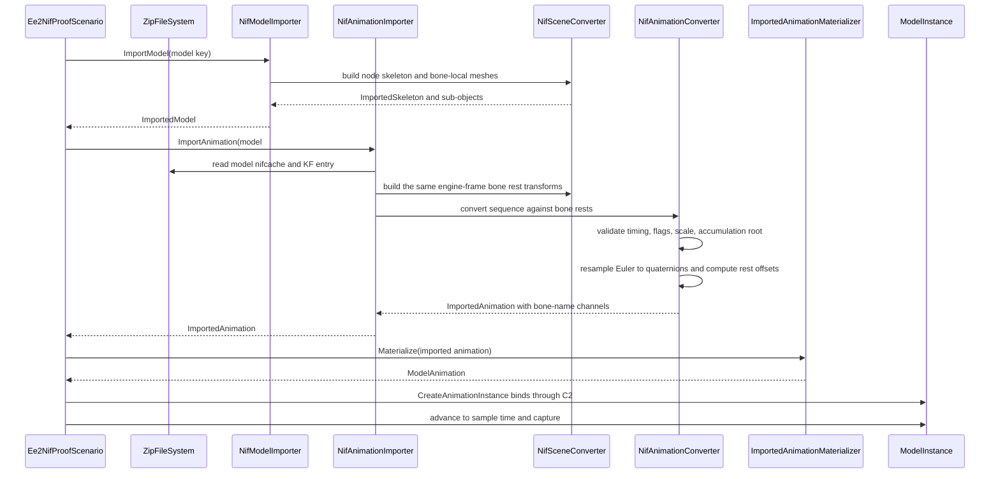

# Deep Dive: Empire Earth II rigid KF animation (C4c)

> Expands phase C4c of [Track C: External Models & Animations](../track-c-external-assets.md).
>
> Audience: human design for importing Empire Earth II Gamebryo `.kf` rigid node animation
> through the C1 and C2 contracts. Code references are in the agent-context appendix.

Purpose: animate the two C4a/C4b proof models with their own game clips. C4c keeps the NIF node
hierarchy as runtime bones, converts KF keys into C1 channels, and plays them through the
existing C2 binding. Skinned characters are [C4d](../track-c-external-assets.md).

The corpus survey and static proof live in
[`ee2-gamebryo-model-storage.md`](ee2-gamebryo-model-storage.md). Facts below were measured
on 2026-09-20 against the same local EE2 Gold install with a temporary parser kept outside the
repository. Reproduction steps are in the appendix.

---

## 1. Scope

C4c supports:

- NIF 10.1.0.0 `.kf` files built only from `NiControllerSequence`, `NiTextKeyExtraData`,
  `NiKeyframeController`, and `NiKeyframeData`;
- rigid animation of named `NiNode` bones in the C4a proof models;
- linear quaternion rotation keys;
- XYZ Euler rotation with linear or quadratic per-axis float keys;
- linear translation keys;
- identity scale keys, validated then dropped;
- constant accumulation-root channels, applied as ordinary pose channels.

C4c rejects:

- skinning (`NiSkinInstance`, `NiSkinData`), which is C4d;
- other controller families (visibility, texture transform, material color, alpha, morph);
- TBC keys, quadratic translation, and non-unit scale;
- varying accumulation-root motion;
- text keys other than `start` and `end`;
- NIF 10.0.1.0 and NetImmerse 4.2.2.0 animation files.

DDF parsing, EE2 state machines, sound and FX text keys, ReplaySketch Model-tab support for NIF,
and an EE2 game definition remain out of scope.

## 2. Target clips

The proof uses every clip that `db.zip` binds to the two proof models. Paths are in
`zips/graphics.zip`; DDF names differ only in case and resolve through the case-insensitive
`ZipFileSystem`.

| DDF state | Clip | Duration | Controllers | Content |
|---|---|---:|---:|---|
| Galley Idle | `Graphics/Vehicles/nwg1_galley_idle.kf` | 2.1667 s | 14 | Single-key oar pose equal to rest |
| Galley Walk | `Graphics/Vehicles/nwg1_galley_walk.kf` | 2.1667 s | 14 | 12 oars, 6 quadratic Euler keys per axis |
| Bomber Idle | `Graphics/Vehicles/ab11_TwinEngineBomber_idle.kf` | 1 s | 4 | Propellers plus flight pose |
| Bomber Walk | `Graphics/Vehicles/ab11_TwinEngineBomber_walk.kf` | 1 s | 4 | Propellers plus flight pose |
| Bomber Attack1 | `Graphics/Vehicles/ab11_TwinEngineBomber_attack.kf` | 1 s | 4 | Propellers plus flight pose |
| Bomber TakeOff | `Graphics/Vehicles/ab11_TwinEngineBomber_takeoff.kf` | 3 s | 4 | Ground pose to flight pose |
| Bomber Death | `Graphics/Vehicles/ab11_TwinEngineBomber_death.kf` | 1 s | 4 | Propellers plus flight pose |

Galley controllers target `R_OAR02..06`, `R_OAR13..19`, `ROOT`, and `ROOT NonAccum`. Bomber
controllers target `root`, `root NonAccum`, `prop_01`, and `prop_02`. Every target is a uniquely
named, unit-scale `NiNode` in its model.

`Graphics/Vehicles/ab11_TwinEngineBomber.kf` is not DDF-bound. It targets `prop_1`, `prop_2`,
and the `wheels` shape, none of which is a bone in the model. It is the negative fixture for
missing targets.

Observed motion:

- Propellers spin about source `Y`, the fore-aft axis. Two linear keys go from `-75.3982` to
  `-94.2478` rad in one second, three full turns. The quaternions at both keys are equal.
- The Bomber rest pose is a tail-dragger on the ground. `root` rests at
  `(0.0345, 0.9453, -0.6957)` with a `-0.1817` rad (10.4 degree) X rotation. The flight clips
  key `root` to identity and put a level pose on `root NonAccum`, raising the airframe 0.70 m.
- `TakeOff` starts `root NonAccum` at the exact `root` rest transform, then reaches the flight
  pose at 1.333 s. The ground pose at time 0 therefore equals rest.
- Galley Idle Euler values reproduce each oar's rest rotation. Walk sweeps the oars.

### 2.1 Corpus census

Over the 1427 `.kf` files in `graphics.zip`:

| Group | Files |
|---|---:|
| NIF 10.1.0.0, user version 0 | 972 |
| Parse to exact end-of-file with the C4c four-block layout | 849 |
| Same four blocks, inexact consumption (unsupported until inspected) | 29 |
| Other controllers: texture transform 45, visibility 37, material color 8, alpha 3, morph 1 | 94 |
| NIF 10.0.1.0 | 452 |
| NetImmerse 4.2.2.0 | 3 |

Across the 849 parsed clips:

- Key types: linear translation 22160, quadratic 7, TBC 1; linear quaternion rotation 19077,
  TBC 2; XYZ rotation 3291, with quadratic float groups 9573 and linear 300; scale quadratic
  2800, linear 1658. No file uses constant (type 5) keys.
- 197 controllers key non-unit scale.
- No clip varies its accumulation-root translation.
- Every sequence has exactly two text keys, `start` and `end`.
- Controller flags: `0x2C` 17893, `0x25` 4728, `0x28` 144.

C4c accepts the patterns its targets use. The wider counts size later work and are not
acceptance criteria.

## 3. KF 10.1.0.0 wire layout

Validated to exact end-of-file consumption on all eight Bomber and Galley clips. Header, leading
`u32 0` per block, sized strings, and the `(1, 0)` footer match the model layout in the
[C4a wire layout](ee2-gamebryo-model-storage.md#911-ee2-10100-wire-layout-validated-on-both-targets).
The KF footer's single root is block 0, the sequence.

| Block | Fields in order |
|---|---|
| `NiControllerSequence` | name, accumulation-root name, text-keys ref (`i32`), controlled-block count (`u32`), then per block: target node name, controller ref (`i32`) |
| `NiTextKeyExtraData` | name (empty in targets), key count (`u32`), then per key: time (`f32`), value (sized string) |
| `NiKeyframeController` | next-controller ref (`i32`), flags (`u16`), frequency, phase, start time, stop time (`f32` each), target ref (`i32`), data ref (`i32`) |
| `NiKeyframeData` | rotation key count (`u32`); when nonzero, rotation key type (`u32`) and rotation keys; translation key group of `Vector3`; scale key group of `f32` |

Key encodings:

- Key group: count (`u32`); when nonzero, key type (`u32`) and `count` keys.
- Key: time (`f32`), value; quadratic keys add forward then backward tangents of the value type;
  TBC keys add tension, bias, continuity (`f32` each).
- Quaternion key: time, then `w, x, y, z` (`f32` each).
- XYZ rotation (type 4): rotation key count is 1, then one `f32` order value, then three `f32`
  key groups for X, Y, and Z.

Target values: every controller has flags `0x2C`, frequency 1, phase 0, next ref `-1`, and
target ref `-1`. KF files contain no `NiNode`, so `NifFile.Roots` is empty for them.

## 4. Key semantics

### 4.1 Euler order

An XYZ key triple `(x, y, z)` reproduces the stored `NiAVObject` rotation, read exactly as
C4a's `NifMatrix33`, as the column-vector product `Rz(z) * Ry(y) * Rx(x)`. The Galley Idle
`R_OAR14` triple `(2.3865, 0.5080, -1.1135)` matches its rest matrix to 1.1e-4. No other axis
order or transpose matches within 0.01.

### 4.2 Quadratic keys

Quadratic float keys are cubic Hermite segments over the segment-normalized parameter
`s = (t - t0) / (t1 - t0)`:

```
v(s) = h00(s) v0 + h10(s) out0 + h01(s) v1 + h11(s) in1
```

The outgoing tangent `out0` is the first key's backward field. The incoming tangent `in1` is the
second key's forward field. This matches NifSkope's `glcontroller.cpp`, and the corpus confirms
it: at 3040 of 3204 nonzero interior quadratic keys, velocity is continuous
(`forward / dtBefore = backward / dtAfter`). The literal field-name reading is continuous at
only 573.

Linear keys interpolate linearly. Before the first key and after the last key, a curve holds the
end value.

### 4.3 Duration and timing

- The sequence must reference a text-key block containing exactly `start` at time 0 and `end`
  at time `D > 0`, compared case-insensitively. `ImportedAnimation.Duration` is `D`.
- Every key time must be finite and inside `[0, D]` with a 1e-4 s tolerance. Key times within a
  group must not decrease.
- Controller start must be at least 0 and stop at most `D` plus tolerance. The Galley `ROOT`
  controllers report `[0, 0]` with a single key, which is valid.
- Controller cycle type is ignored. EE2 DDF states and OpenSAGE `AnimationMode` own looping.

### 4.4 Accumulation root

The sequence's accumulation-root name (`root`, `ROOT`) names the model node that carries
`KFAccumRoot` metadata. Gamebryo can turn that node's keyed motion into locomotion. In OpenSAGE,
locomotors own world movement. C4c accepts an accumulation-root channel only when all its
translation keys and all its sampled rotations are equal within 1e-5. Such channels apply as
ordinary absolute pose channels. The `TakeOff` time-0 equality in section 2 confirms this
reading: `root` identity plus `root NonAccum` at the old `root` rest reproduces the rest pose.
Varying accumulation-root motion fails with `NotSupportedException`.

### 4.5 Scale

Scale keys must all be within 1e-4 of 1, and the target bone must have unit rest scale. After
that check, scale is dropped. This matches the C4 glTF identity-scale rule. `ImportedBone` has
no scale field.

## 5. Model hierarchy

C4a baked every shape into world space under one identity root bone. C4c replaces that with a
node skeleton, following the C4 precedent that scene nodes remain runtime bones for rigid
attachments.

- Every `NiNode` and `NiLODNode` reached from the root becomes an `ImportedBone`. Bones use
  depth-first order with the root first, and each keeps its source node name. The Galley yields
  30 bones and the Bomber 22.
- Each bone's local transform is the source local transform conjugated by C4a's source-to-engine
  matrix. Translation is scaled by 3.28084. Rotation uses `Rz(+90 degrees)` conjugation. This
  preserves composition, so bone world transforms equal converted source world transforms.
- A node whose scale differs from 1 by more than 1e-4 is not a bone. It and its descendants bake
  statically into the nearest bone ancestor, exactly as C4a did. A KF channel that targets a node
  in that subtree fails as a missing target. Neither proof model has such a node.
- Each `NiTriShape` bakes its own local transform, including shape scale such as the propeller's
  0.7416, into vertex positions and normals in its parent bone's engine frame. The sub-object
  attaches to that parent bone.
- Mesh bounds are recomputed in bone-local space. `StandaloneModelCapture` already fits bounds
  through rest-pose bone transforms.
- LOD selection, materials, texture names, UV flip, and culling are unchanged.
- Rest-pose parity is required. Composing bone rest transforms reproduces C4a's baked world
  positions within 1e-4, keeps both locked world AABBs, and keeps static captures visually
  identical.

## 6. Conversion to C1 channels

### 6.1 Source keys

A NIF animation key names both the model and the clip:

```
<model-key>#kf=<archive-relative-kf-path>
```

Example: `nwg1_galley#kf=Graphics/Vehicles/nwg1_galley_walk.kf`. This mirrors the glTF
`<model>#animation=<index>` form. Rest transforms come from the model, not from the KF file. The
importer returns null for a malformed key or a missing top-level model or KF entry.
`ImportedAnimation.Name` is the KF file stem, because sequence names such as
`EMPTY_SEQUENCE_AT_0f` do not identify clips.

### 6.2 Targets and offsets

- Each controlled block targets a model bone by case-insensitive name, and targets must be
  unique within a sequence. A target missing from the model skeleton fails at import with
  `InvalidDataException`. C2 performs the same check again at bind time.
- Channels use `ImportedAnimationTarget.CreateBoneName`, so C2 binds them to the runtime
  hierarchy.
- KF keys are absolute local transforms. Both the key sample and the bone rest are converted to
  the engine frame, then the C4 offset rule applies: rotation offset
  `Concatenate(Inverse(rest), sample)`, and translation offset `(sample - rest)` rotated by
  `Inverse(restRotation)`. Under the row-vector runtime, `offset * rest` reconstructs the
  sample.

### 6.3 Rotation

- Linear quaternion keys emit one `Quaternion` channel at the source key times with `Linear`
  interpolation.
- XYZ rotation resamples into one `Quaternion` channel. Sample times are the union of
  `k / 30` s for `k = 0..floor(30 D)`, `D`, and every source key time, deduplicated within 1e-6
  s. Each axis curve is evaluated with section 4.2, composed per section 4.1, and converted to a
  quaternion.
- Consecutive samples are flipped into one hemisphere, and the angle between them must stay
  below 90 degrees. Otherwise import fails with `NotSupportedException`. The propellers turn 36
  degrees per 1/30 s sample, and the Galley oars at most 6.1. Slerp follows the authored
  direction only because this limit holds; converting the two authored keys directly would
  produce no rotation.

### 6.4 Translation

Linear `Vector3` keys emit `TranslationX`, `TranslationY`, and `TranslationZ` channels at the
source key times with `Linear` interpolation. Bones without a channel keep their rest transform
through the runtime's identity offset.

## 7. Failure contract

| Condition | Result |
|---|---|
| Malformed key, missing model or KF entry | `null` |
| Wrong version, truncated data, bad reference, or block 0 not a sequence | `InvalidDataException` with asset context |
| Missing, non-`start`/`end`, or out-of-range text keys | `InvalidDataException` |
| Duplicate or missing target bone | `InvalidDataException` |
| Unsupported block, controller, key type, or flags other than `0x2C` | `NotSupportedException` |
| Frequency other than 1, phase other than 0, or non-null next or target ref | `NotSupportedException` |
| Non-unit scale, varying accumulation root, or excessive rotation step | `NotSupportedException` |

No channel is silently truncated or discarded. The only data dropped is scale that has been
validated as identity.

## 8. Proof and completion boundary

- Parser and converter behavior uses synthetic byte streams from `NifTestDataBuilder` in normal
  tests.
- Interactive installed-asset tests import all seven clips against their models, materialize
  them, and bind them through `ModelInstance.CreateAnimationInstance`. They assert sampled bone
  transforms:
  - Galley Idle offsets are identity within 1e-4.
  - `prop_01` turns 90 degrees within 0.5 degrees from 0 to 1/12 s of Walk.
  - The Bomber world pose at `TakeOff` time 0 equals rest.
  - `root NonAccum` at `TakeOff` 1.333 s equals the Walk pose.
- `ab11_TwinEngineBomber.kf` fails with a message naming `prop_1`.
- The `Ee2NifProof` TestHarness scenario adds deterministic textured captures:
  - Galley Walk at 0, 0.767, and 1.433 s;
  - Bomber Walk at 0 and 1/12 s;
  - Bomber TakeOff at 0 and 1.333 s.

  Galley Idle and TakeOff at time 0 must match the static captures.
- No EE2 asset is copied or committed.

C4c is complete when those tests pass and the captures show oar sweep, propeller rotation, and
the Bomber's ground-to-flight pose on both textured proof models.

## 9. C4d handoff

C4d adds skinned EE2 characters on top of the C4c hierarchy and channel converter. EE2 meshes
carry up to four influences per vertex, while the runtime and C4 support two. C4d starts with an
influence inventory of one DDF-bound skinned unit, then decides between widening the C1 and
runtime skinning path and rejecting assets with more than two meaningful influences. Silent
truncation is not an option. C4c must not add skinning types.

## 10. Architecture diagrams





## Appendix: current-code grounding

- NIF block dispatch: `src/OpenSage.FileFormats.Nif/NifFile.cs:118-155`; reference validation
  and root discovery: `NifFile.cs:157-312`.
- Static bake under one root bone: `src/OpenSage.Game/Content/Importing/Nif/NifSceneConverter.cs`.
- Source-to-engine matrix and local transform construction:
  `src/OpenSage.Game/Content/Importing/Nif/NifTransformConverter.cs:19-116`.
- C1 channel set (`TranslationX/Y/Z`, `Quaternion`, `Visibility`) and interpolation
  (`Linear`, `Step`): `src/OpenSage.Game/Content/Importing/ImportedAnimationChannel.cs`,
  `ImportedAnimationInterpolation.cs`.
- `ImportedBone` stores translation and rotation, no scale:
  `src/OpenSage.Game/Content/Importing/ImportedBone.cs:12-24`.
- C4 rest-offset rule and identity-scale rule:
  `src/OpenSage.Game/Content/Importing/Gltf/GltfAnimationConverter.cs:121-132,211-229`.
- Importer contract: `src/OpenSage.Game/Content/Importing/IAnimationImporter.cs`.
- Runtime composition `AnimatedOffset.Matrix * bone transform`:
  `src/OpenSage.Game/Graphics/ModelBoneInstance.cs:35`; C2 binding at
  `src/OpenSage.Game/Graphics/ModelInstance.cs:180`.
- Capture hooks: `StandaloneModelCapture.Capture(..., configureInstance)` at
  `src/OpenSage.Tools.TestHarness/StandaloneModelCapture.cs:41-95`; time sampling
  `ExternalModelSceneRenderer.PlayToTime` at
  `src/OpenSage.Tools.TestHarness/ExternalModels/ExternalModelSceneRenderer.cs:100-120`.
- Single-bone descriptor assertions to replace:
  `src/OpenSage.Game.Tests/Content/Importing/Ee2NifImportTests.cs:78-82`.

## Appendix: reproduction

```sh
EE2="Empire Earth II Gold"
unzip -l "$EE2/zips/graphics.zip" | grep -iE 'galley|twinengine'
unzip -p "$EE2/zips/db.zip" db/Units/war_galley.ddf | sed -n '164,180p'
unzip -p "$EE2/zips/db.zip" db/Units/bomber.ddf | sed -n '258,273p'
unzip -p "$EE2/zips/graphics.zip" Graphics/Vehicles/nwg1_galley_walk.kf | xxd | head -8
```

Hermite reference: NifSkope
[`src/gl/glcontroller.cpp`](https://github.com/niftools/nifskope/blob/develop/src/gl/glcontroller.cpp),
`interpolate`, case 2. The census and tangent-continuity scripts (about 200 lines of stdlib
Python) were kept out of the repository.
