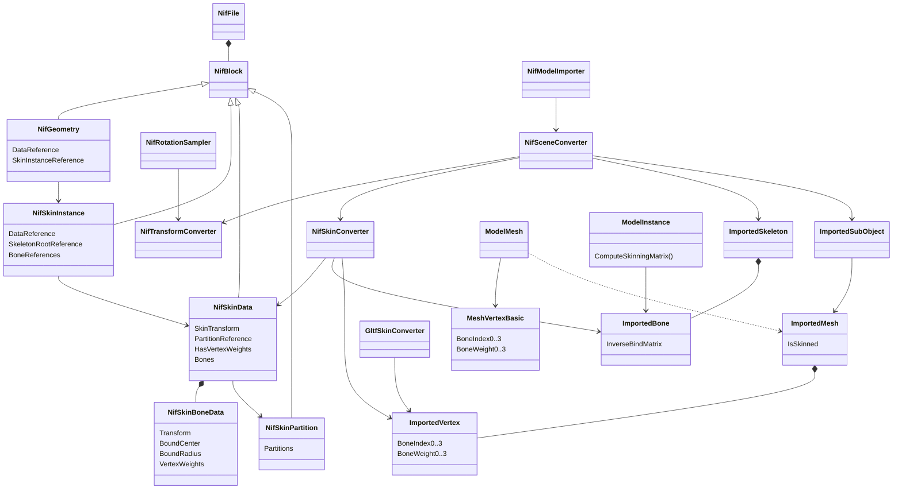
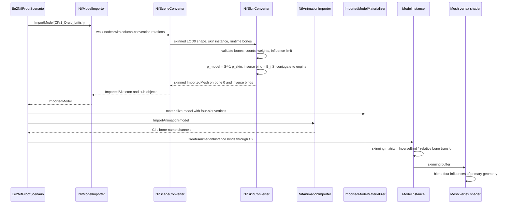

# Deep Dive: Empire Earth II skinned character animation (C4d)

> Expands phase C4d of [Track C: External Models & Animations](../track-c-external-assets.md).
>
> Audience: human design for importing Empire Earth II Gamebryo `NiSkinInstance` / `NiSkinData`
> skins and playing their KF clips through the C1 and C2 contracts. Code references are in the
> agent-context appendix.

Purpose: import one DDF-bound skinned EE2 character with its inverse binds and per-vertex
influences, and deform it with its own game clips through the
[C4c](c4c-ee2-rigid-animation.md) channel converter and C2 binding. C4d settles the
influence-count question left by the [C4c handoff](c4c-ee2-rigid-animation.md#9-c4d-handoff)
and fixes the NIF rotation convention that skinning exposes.

Facts below were measured on 2026-09-23 against the local EE2 Gold install with temporary
parsers kept outside the repository. Reproduction steps are in the appendix.

---

## 1. Scope

C4d supports:

- `NiSkinInstance` and `NiSkinData` on `NiTriShape` geometry in NIF 10.1.0.0 `.nifcache`
  models;
- up to four meaningful influences per vertex, through C1 and the runtime mesh path;
- inverse binds derived from `NiSkinData`, not from the node rest pose;
- `NiSkinPartition` blocks, parsed and validated, then ignored;
- playback of DDF-bound skinned clips through the unchanged C4c converter;
- the corrected NIF rotation convention for all NIF node, skin, and Euler matrices;
- widening the C4 glTF importer from two to four influences.

C4d rejects:

- vertices with more than four meaningful influences;
- influence weight sums further than 0.01 from 1;
- skin bones that are not runtime bones, including nodes with non-unit scale, which are
  [C4f](c4f-ee2-scale-animation.md);
- skeleton roots other than the model root node;
- `NiSkinData` without vertex weights.

DDF state machines, sound and FX text keys, `.pcpatch` player colors, ReplaySketch Model-tab
support for NIF, NIF 10.0.1.0 clips ([C4i](c4i-ee2-legacy-kf-formats.md)), and non-unit clip scale
([C4f](c4f-ee2-scale-animation.md)) remain out of scope.

## 2. Proof unit

The proof unit is `UnitModel UniqueUnitEnglish1` in `db/Units/UniqueUnit_English.ddf`, the
British Druid. `DefaultModel = CIV1_Druid_british.nif` resolves to
`cache/nifcache/CIV1_Druid_british.nifcache` in `graphics.zip`. Its texture
`CIV1_Druid_british.texcache` is in `textures.zip`. No override archive replaces either file.

Selection rules:

- the model is skinned and every DDF-bound clip passes the C4c rules (NIF 10.1, the four-block
  layout, `start` / `end` text keys, flags `0x2C`, constant accumulation root, identity scale);
- LOD0 contains vertices with three and four meaningful influences, so rejecting beyond two
  would fail it and truncating would visibly change it;
- every node has unit scale, so C4d does not wait on C4f;
- only blocks already supported by C4a, plus the two skin blocks, occur.

Model facts:

| Item | Value |
|---|---|
| Blocks | 31 `NiNode`, 1 `NiLODNode` (`body`), 4 `NiTriShape` (`body_LOD0..3`), 4 `NiSkinInstance`, 4 `NiSkinData`, fixed-function properties |
| Runtime bones | 32 unit-scale nodes, root `CIV1_Druid_british.nif` |
| LOD0 geometry | 648 vertices, 842 triangles, 19 skin bones |
| LOD0 influences | 486 vertices with one, 158 with two, 2 with three, 2 with four |
| Largest weight beyond two influences | 0.5 on vertices 151 and 153 |
| Weight sums | exactly 1 on every LOD0 vertex |
| Skin partitions | none |
| Accumulation root | `Bip01` (`KFAccumRoot` string extra data) |

DDF-bound clips, all in `Graphics/Humans/`:

| DDF state | Clip | Duration | Controllers | Rotation keys |
|---|---|---:|---:|---|
| Idle | `CIV1_Druid_british_idle01.kf` | 1 s | 27 | quaternion and XYZ |
| Walk | `CIV1_Druid_british_walk01.kf` | 0.8 s | 25 | quaternion |
| Run | `CIV1_Druid_british_jog01.kf` | 0.6667 s | 25 | quaternion |
| Attack1, AttackTolerance, Bless | `CIV1_Druid_british_attack01.kf` | 1.8667 s | 25 | quaternion |
| Death | `CIV1_Druid_british_death01.kf` | 1.2333 s | 25 | quaternion |

Every controlled block names an existing model node. The `Bip01` accumulation channel is
constant in all five clips. The largest angle between consecutive quaternion keys is 45.8
degrees.

Negative fixtures:

| Model | Shape | Failure |
|---|---|---|
| `lsf7_priest_fe` (DDF-bound as `KoreanCampaignDiplomat`) | `body_LOD0` | Two vertices carry five meaningful influences. |
| `llm2_mountedslinger_fe` | `horse_LOD0` | Weight sums fall to 0.842. |

## 3. Skin corpus census

The census parses 1410 of the 1638 `graphics.zip` models, including all 1457 skin instance and
skin data pairs. The 228 unparsed models contain particle, strip, billboard, and property
controller blocks, none skinned.

| Measure | Value |
|---|---|
| Skinned models / skinned shapes | 337 / 1457 |
| Vertices by meaningful influence count (all LODs) | 1: 489409, 2: 179604, 3: 18191, 4: 2532, 5: 16, 6: 7, 7: 4 |
| Models with a vertex beyond two influences | 284 of 337 |
| Models with a vertex beyond four influences | 8, all in the LOD0 shape |
| Skin bones per shape | at most 26 |
| Skeleton root equals model root | 1457 of 1457 |
| Skin transform equals the inverse shape world transform | 1394 of 1457 |
| `NiSkinData` with vertex weights | 1457 of 1457 |
| Shapes with a non-null `NiSkinPartition` | 75 |
| Non-unit `NiSkinData` scales | 0 |
| Models with non-unit skin bone nodes | 2 (`CIV1_RoyalChariot_Egyptian` 0.85, `CIV7_Mameluke_Babylonian` 0.5033) |

Lower LODs of the eight models beyond four influences have weight sums between 0.571 and
0.842. The cooker appears to have truncated them to four influences without renormalizing.
`llm2_mountedslinger_fe`, `_me`, and `_we` carry the same 0.842 sums in LOD0.

DDF-bound coverage: 124 `UnitModel` blocks (119 distinct models) name a skinned default model.
Their maximum influence counts are 1 (14 models), 2 (23), 3 (52), 4 (34), and 5 (1). 36 of them
have every bound clip within the C4c rules. Other clips are blocked by NIF 10.0.1.0 (70 clip
bindings, C4i), non-unit scale (53, C4f), or inexact parses still to be inspected.

## 4. Influence policy

Decision: C4d widens C1 and the runtime to four influences per vertex. Rejecting beyond two
would reject 87 of the 124 DDF-bound skinned unit models and 284 of 337 skinned models. Four is
also the fixed weights-per-vertex width of Gamebryo's hardware skin partitions. Vertices beyond
four influences are rejected, never truncated.

Rules, shared by the NIF and glTF converters:

- An influence is meaningful when its weight exceeds 1e-4. Smaller weights are dropped.
- More than four meaningful influences fail with `NotSupportedException`, naming the shape,
  vertex, and count.
- The meaningful weights must sum to within 0.01 of 1. Otherwise import fails with
  `InvalidDataException`. Accepted weights are normalized to sum to 1.
- Influences are stored in descending weight order. Unused slots carry bone index 0 and weight
  0.
- A mesh whose vertices all have two or fewer influences keeps its current layout values.

## 5. NIF rotation convention

Gamebryo stores `Matrix33` for column vectors: a stored matrix `R` maps a point `p` to `R p`.
C4a's `NifTransformConverter.CreateLocalMatrix` copies `R` positionally into a row-vector
`Matrix4x4`, which applies `R` transposed, the inverse rotation. C4c's `NifRotationSampler`
copies the Euler matrix the same way, so Euler clips agree with node rests. Quaternion keys go
through `System.Numerics` unchanged and apply the stored rotation. Node rests and quaternion
keys therefore disagree whenever a rest rotation is not symmetric.

Three independent measurements confirm the column reading:

- In column form, every druid skin transform is the exact inverse of its shape world transform.
  In the current row form, the error is 10.8.
- In column form, the druid's foot vertices land at height 0.03 and its head at 5.5. In the
  current row form, the feet land at 10.8, above the head.
- At `walk01` time 0, 17 of 25 quaternion channels equal their stored node rotations within
  0.001 in column form. Only 4 do in the current form.

Neither C4a proof model exposed this. Rigid shapes still render, and C4c's proof clips use
Euler keys or near-identity rests. The Bomber's pilot shapes and 13 Galley nodes, including
the animated oars, do have non-symmetric rotations. Their descriptors and captures change when
the convention is fixed.

Decision: every NIF rotation matrix, whether node, shape, skin, or Euler sample, is transposed
once when it enters `Matrix4x4`. Quaternion keys stay unchanged. The fix lands first in C4d,
and the C4a and C4c locked descriptors and captures are regenerated in the same change.

## 6. NIF 10.1 skin wire layout

Each block begins with the NIF 10.1 leading `u32 0` shared by all EE2 blocks. Neither skin
block has `NiObjectNET` fields.

| Block | Fields in order |
|---|---|
| `NiSkinInstance` | data ref (`i32`), skeleton-root ptr (`i32`), bone count (`u32`), bone ptrs (`i32` each) |
| `NiSkinData` | skin transform (rotation `Matrix33`, translation `Vector3`, scale `f32`), bone count (`u32`), skin-partition ref (`i32`), has-vertex-weights (`u8`), then per bone: transform (as above), bound center (`Vector3`), bound radius (`f32`), vertex count (`u16`), then per vertex: index (`u16`), weight (`f32`) |
| `NiSkinPartition` | partition count (`u32`), then per partition: vertex, triangle, bone, strip, and weights-per-vertex counts (`u16` each); bones (`u16` each); has-vertex-map (`u8`) and map; has-vertex-weights (`u8`) and weights; strip lengths; has-faces (`u8`) and strips or triangles; has-bone-indices (`u8`) and `u8` bone indices |

At 10.1.0.0 `NiSkinInstance` has no partition field: it starts at 10.1.0.101. `NiSkinData`
still carries its own partition ref, which ends at 10.1.0.0 inclusive. The parser validates that
the ref is null or names a `NiSkinPartition` block.

## 7. Skin conversion

### 7.1 Spaces

Gamebryo defines skinning in three spaces:

- skin space: the space the shape's vertices are stored in;
- bone space: `NiSkinData` bone transform `B_i` maps skin space to bone `i`;
- skeleton-root-parent space: the skin transform `S` maps it to skin space.

With column vectors, a skinned point is `sum_i w_i * W(bone_i) * B_i * p_skin`, where `W` is
the bone's world transform relative to the skeleton root's parent. In the bind pose,
`S * W(bone_i) * B_i = I`. Every EE2 skeleton root is the model root, so that parent space is
model space.

The shape's own transform is ignored for skinned geometry. In 63 of 1457 shapes it is not
`S` inverse, so the converter uses `S`.

### 7.2 Vertices and inverse binds

- Model-space vertex: `S^-1 * p_skin`, then the C4a source-to-engine map. Normals use the
  inverse transpose of the same linear part.
- Source inverse bind of bone `i`: `B_i * S`, the map from model space to bone space.
- Engine inverse bind: the source inverse bind conjugated by the source-to-engine map, the same
  conjugation C4c applies to bone rests. It is stored as `ImportedBone.InverseBindMatrix` in the
  row-vector form `ModelInstance.ComputeSkinningMatrix` expects.
- Primary and secondary geometry share the model-space position and normal, as in the C4 glTF
  path.
- The skinned sub-object attaches to bone 0, the model root, with `IsSkinned` set. Its bounds
  come from model-space bind positions.
- A bone that several shapes share gets one inverse bind. Shapes that disagree by more than 1e-4
  fail with `InvalidDataException`. The druid has one skinned shape per LOD.

### 7.3 Bind pose and rest pose

The node rest pose in the file is not the bind pose. The druid's bind-local and stored-local
rotations differ by up to 0.64 in a matrix element at the left hand. Bone lengths agree within
1e-4 except at the thighs, which differ by 0.01. An unanimated druid therefore renders in its
stored node pose, as Gamebryo does.

Parity is checked against the bind pose instead: posing each bone at the inverse of its inverse
bind makes every skinning matrix the identity, so deformed positions equal the imported
model-space positions within 1e-4.

### 7.4 LOD and bones

- Only the highest-detail LOD child converts, unchanged from C4a.
- Every skin bone pointer must resolve to a C4c runtime bone. A pointer to a node inside a
  non-unit-scale subtree fails with `NotSupportedException` naming the node and C4f.
- `NiSkinInstance` and `NiSkinData` bone counts must match.
- Vertex indices must be below the shape's vertex count, and a vertex may appear at most once
  per bone.
- `NiSkinPartition` is ignored after validation. `NiSkinData` weights are authoritative, and
  the runtime needs no partitions because the skinning buffer holds every bone.

## 8. C1 and runtime widening

C1:

- `ImportedVertex` adds `BoneIndex2`, `BoneIndex3`, `BoneWeight2`, and `BoneWeight3`, with the
  same `[0, 1]` weight checks.
- `ImportedMesh` rejects skin data on unskinned meshes across all four slots. It also rejects a
  vertex with a nonzero third or fourth weight whose secondary position or normal differs from
  the primary, because slots 2 and 3 skin primary geometry.
- `ImportedModel` validates all four bone indices against the skeleton.
- `ImportedTangentGenerator` and every converter that rebuilds vertices copy all four slots.

Runtime:

- `MeshShaderResources.MeshVertex.Basic` adds `BoneIndex2`, `BoneIndex3` (`UInt1`) and
  `BoneWeight2`, `BoneWeight3` (`Float1`), growing the vertex from 88 to 104 bytes.
  `VertexDescriptors` gains the four elements. The UV buffer moves to locations 14 and 15.
- `Mesh.h` declares the new inputs. `GetSkinnedVertexData` adds two terms that transform the
  primary position and normal by the third and fourth skinning matrices.
- `FixedFunction`, `NormalMapped`, `Simple`, `MeshDepth`, and `PbrMetallicRoughness` vertex
  shaders pass the new inputs. The PBR tangent and binormal blends also cover four influences.
- W3D meshes write zero weights in slots 2 and 3, so their output is unchanged.

Decision: one shared vertex layout, not a second four-influence pipeline family. A second
layout would double every mesh shader resource set for a 16-byte-per-vertex saving.

glTF: `GltfSkinConverter` accepts third and fourth meaningful influences under section 4 and
stops throwing for them. It still rejects `JOINTS_1` / `WEIGHTS_1`.

## 9. Animation

Skinned clips use the C4c path unchanged: `<model-key>#kf=<path>` keys, bone-name targets,
rest-relative offsets, Euler resampling, and the constant accumulation-root rule. The druid
clips need no new controller or key type. Offsets are relative to the stored node rest, not the
bind pose, because C2 composes `offset * rest` at runtime.

After the section 5 fix, the 17 `walk01` channels whose time-0 key equals their rest have
identity offsets at time 0. Before the fix they would carry twice the rest rotation. This is
the regression proof for the convention change on real data.

## 10. Failure contract

| Condition | Result |
|---|---|
| Skin block truncated, bad reference, or wrong referenced type | `InvalidDataException` |
| `NiSkinData` without vertex weights | `NotSupportedException` |
| Skeleton root is not the model root | `NotSupportedException` |
| Skin bone is not a runtime bone | `NotSupportedException` naming the node and C4f |
| Instance and data bone counts differ | `InvalidDataException` |
| Vertex index out of range or repeated for one bone | `InvalidDataException` |
| Non-finite weight, or weight outside `[0, 1]` | `InvalidDataException` |
| More than four meaningful influences | `NotSupportedException` naming shape, vertex, and count |
| Weight sum further than 0.01 from 1 | `InvalidDataException` |
| Shared bone with conflicting inverse binds | `InvalidDataException` |
| Clip-level failures | C4c contract, unchanged |

No influence is silently truncated. The only data dropped is influence weight at or below 1e-4
and `NiSkinPartition` hardware data.

## 11. Proof and completion boundary

- Synthetic `NifTestDataBuilder` streams cover the skin blocks, every failure row above, the
  rotation convention, and bind-pose parity in normal tests.
- Interactive installed-asset tests:
  - import `CIV1_Druid_british` with 32 bones, one skinned LOD0 sub-object, 648 vertices, and
    the section 2 influence histogram;
  - check bind-pose parity within 1e-4 and that vertices 151 and 153 keep their third and
    fourth influences;
  - import, materialize, and bind all five DDF-bound clips through
    `ModelInstance.CreateAnimationInstance`;
  - assert identity offsets for the matching `walk01` channels at time 0;
  - assert that `lsf7_priest_fe` and `llm2_mountedslinger_fe` fail per section 10.
- The `Ee2NifProof` TestHarness scenario adds deterministic textured druid captures:
  - rest pose;
  - Walk at 0, 0.2, and 0.4 s;
  - Attack1 at 0.9333 s;
  - Death at 1.2333 s.
- C4a and C4c captures and descriptors are regenerated once for section 5, reviewed, and locked
  again.
- No EE2 asset is copied or committed.

C4d is complete when those tests pass, the druid stands upright with its feet on the ground,
and the captures show limb deformation with no stretched or detached vertices.

## 12. Architecture diagrams





## Appendix: current-code grounding

- Skinned geometry rejection to replace: `src/Panopticon.FileFormats.Nif/NifFile.cs:241-245`;
  block dispatch: `NifFile.cs:118-160`; skin reference read:
  `src/Panopticon.FileFormats.Nif/Blocks/NifGeometry.cs:18-19`.
- Row-major matrix read: `src/Panopticon.FileFormats.Nif/NifBinaryReader.cs:183-195`. Positional
  copy into row-vector matrices:
  `src/Panopticon.Simulation/Content/Importing/Nif/NifTransformConverter.cs:43-67` and
  `src/Panopticon.Simulation/Content/Importing/Nif/NifRotationSampler.cs` `ToQuaternion`.
  Quaternion keys used directly: `src/Panopticon.FileFormats.Nif/NifKeys.cs:159`,
  `src/Panopticon.Simulation/Content/Importing/Nif/NifAnimationConverter.cs:356-360`.
- Scene walk and rigid shape bake: `src/Panopticon.Simulation/Content/Importing/Nif/NifSceneConverter.cs:63-286`.
- Two-influence C1 vertex: `src/Panopticon.Simulation/Content/Importing/ImportedVertex.cs:9-68`;
  unskinned check: `ImportedMesh.cs:157-175`; bone-index check: `ImportedModel.cs:74-84`;
  tangent copy: `ImportedTangentGenerator.cs:125-135`.
- glTF influence rejection: `src/Panopticon.Simulation/Content/Importing/Gltf/GltfSkinConverter.cs:199-258`;
  skinned sub-objects on bone 0: `GltfModelImporter.cs:126-131`.
- Runtime vertex: `src/Panopticon.Simulation/Graphics/Shaders/MeshShaderResources.cs:118-150`; vertex
  fill: `src/Panopticon.Simulation/Graphics/ModelMesh.Imported.cs:50-72`; shader inputs and blend:
  `src/Panopticon.Simulation/Assets/Shaders/Mesh.h:5-15,61-77`; per-shader calls in `FixedFunction.vert`,
  `NormalMapped.vert`, `Simple.vert`, `MeshDepth.vert`, `PbrMetallicRoughness.vert`.
- Skinning matrix: `src/Panopticon.Simulation/Graphics/ModelInstance.cs:259-262`.
- Installed tests and proof: `test/Panopticon.Simulation.Tests/Content/Importing/Ee2NifImportTests.cs`,
  `Ee2KfAnimationImportTests.cs`, `src/Panopticon.Tools.TestHarness/Ee2NifProofScenario.cs`,
  `test/Panopticon.Tools.ReplaySketch.Tests/Ee2NifProofScenarioTests.cs`.

## Appendix: reproduction

```sh
EE2="Empire Earth II Gold"
unzip -p "$EE2/zips/db.zip" db/Units/UniqueUnit_English.ddf | sed -n '54,80p'
unzip -l "$EE2/zips/graphics.zip" | grep -i 'druid_british'
unzip -l "$EE2/zips/textures.zip" | grep -i 'texcache/civ1_druid'
```

The census extended the C4a temporary decoder with the section 6 layouts and grouped
`NiSkinData` weights per vertex. The convention checks composed node chains in both matrix
readings and compared them against `S`, foot and head vertex centroids, and time-0 quaternion
keys. About 400 lines of stdlib Python were kept out of the repository.
