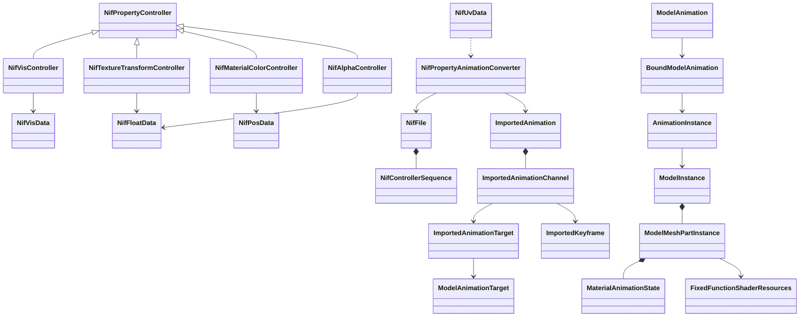
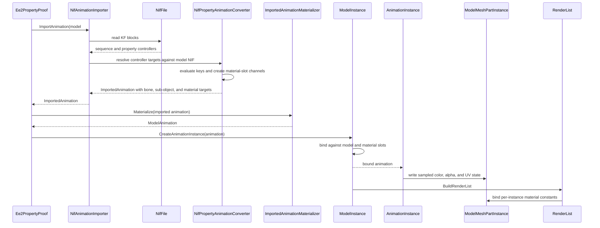

# Deep Dive: EE2 property animation (C4e)

> Expands phase C4e of [Track C: External Models & Animations](../track-c-external-assets.md).
>
> Audience: human design for Empire Earth II Gamebryo material, texture-coordinate, alpha, and
> visibility animation through the C1 and C2 animation contracts. Code references are in the
> agent-context appendix.

Purpose: extend the [C4c KF importer](c4c-ee2-rigid-animation.md) beyond rigid transforms for the
non-transform controller families used by DDF-bound Empire Earth II assets. C4e keeps the parser
and key-curve rules from C4c, adds material-slot targets to the interchange, and animates runtime
material parameters per model instance.

Facts below were measured on 2026-09-22 against the local EE2 Gold install. Reproduction steps are
in the appendix.

---

## 1. Scope and non-goals

C4e supports these NIF 10.1.0.0 property-controller families in `.kf` clips:

- `NiVisController` with `NiVisData`, and `NiBoolData` if a NIF 10.1 file uses the replacement
  data block;
- `NiTextureTransformController` with `NiFloatData`;
- `NiMaterialColorController` with `NiPosData`;
- `NiAlphaController` with `NiFloatData`.

C4e also records the same controller families when embedded in `.nifcache` models. DDF-bound proof
coverage focuses on `.kf` clips, with embedded model controllers used as parser fixtures.

C4e reuses C4c for:

- `NiControllerSequence`, `NiTextKeyExtraData`, time-controller fields, key groups, and text-key
  duration rules;
- model-qualified animation keys of the form `<model-key>#kf=<archive-relative-kf-path>`;
- model skeleton and sub-object construction;
- Hermite evaluation for quadratic keys.

C4e rejects:

- morph animation, including the one material-color `.kf` that also contains
  `NiGeomMorpherController`;
- NIF 10.0.1.0 and NetImmerse 4.2.2.0 clips;
- texture shader maps, non-base texture slots, unsupported texture-transform operations before
  their shader path is implemented, and `NiFlipController`;
- material targets that cannot resolve to one or more model material slots;
- root-motion, skinning, DDF state machines, sound keys, FX keys, and EE2 gameplay binding.

Decision: C4e imports property clips only after C4c target resolution exists. Reason: property
controllers share the same sequence, timing, and target-name machinery.

## 2. Target assets

The proof set uses DDF-bound files from `db/Units/*.ddf` and `zips/graphics.zip`.

| Family | DDF source | Unit model | Model | Clip | Proof role |
|---|---|---|---|---|---|
| Visibility | `db/Units/market.ddf` | `Market_8` | `bld_MARKET8.NIF` | `Graphics/Building/bld_market8_open.kf` | Two market-open nodes switch from hidden to visible at 0.033333 s. |
| Visibility | `db/Units/market.ddf` | `Market_8` | `bld_MARKET8.NIF` | `Graphics/Building/bld_market8_close.kf` | One close node appears while two open nodes hide. |
| Texture transform | `db/Units/UniqueUnit_Egyptian.ddf` | `UniqueUnitEgyptian3` | `civ12_EIFV_egypt.nif` | `Graphics/Vehicles/civ12_EIFV_egypt_walk.kf` | Base texture slot `TT_TRANSLATE_U` moves tread UVs from 0 to 1.5 in 1 s. |
| Material color | `db/Units/fighter_bomber.ddf` | `FighterBomber_14` | `afb14_StealthFighterBomber.nif` | `Graphics/Vehicles/afb14_StealthFighterBomber_idle.kf` | Ambient and specular property channels cover seven mesh materials. |
| Alpha | `db/Units/resources.ddf` | `ResourceFish` | `faufish.nif` | `Graphics/Animals/sh_faufish_idle01.kf` | Eight material alpha channels fade planes with quadratic float keys over 4 s. |

Embedded model fixtures that are DDF-bound:

| Family | DDF source | Unit model | Model | Embedded controller |
|---|---|---|---|---|
| Visibility | `db/Units/market.ddf` | `Market_8` | `cache/nifcache/bld_market8.nifcache` | `Object04` stays visible for the built-in text-key range. |
| Material color | `db/Units/wall.ddf` | `Wall_8_Connector` | `cache/nifcache/bld_wall8_connector.nifcache` | Ambient, diffuse, specular, and emissive target one `NiMaterialProperty`. |
| Alpha | `db/Units/ambients_campaign.ddf` | `Buoy` | `cache/nifcache/amb_buoy.nifcache` | Two material alpha controllers use linear fade-in and fade-out keys. |
| Alpha | `db/Units/non_combat_air2.ddf` | `Parachute` | `cache/nifcache/lla11_parachute.nifcache` | Eight alpha controllers share two `NiFloatData` blocks. |

The `.kf` proof assets cover all four requested families. The embedded fixtures cover the same
material target resolution path without requiring DDF animation lookup.

## 3. Corpus census

The `.kf` census covers the 1427 animation files in `graphics.zip`.

| Group | Files | Controllers | Data blocks | Notes |
|---|---:|---:|---:|---|
| NIF 10.1.0.0, user version 0 | 972 | | | Same header shape as C4c. |
| Texture transform | 45 | 45 `NiTextureTransformController` | 45 `NiFloatData` | 37 DDF-bound clips. |
| Visibility | 37 | 104 `NiVisController` | 104 `NiVisData` | 36 DDF-bound clips. |
| Material color | 9 | 130 `NiMaterialColorController` | 130 `NiPosData` | 5 DDF-bound clips. One file also contains morph data. |
| Alpha | 3 | 24 `NiAlphaController` | 24 `NiFloatData` | 1 DDF-bound clip. |
| `NiUVController` in `.kf` | 0 | 0 | 0 | Occurs only in `.nifcache` models. |

The material-color file count splits into eight files with only property controllers and
`Graphics/Building/bld_farm_yam.kf`, which also contains `NiGeomMorpherController` and
`NiMorphData`. The parser must decode its material-color blocks but the importer fails the clip
because morph animation remains outside C4e.

Controller flags in `.kf` files:

| Controller | Flags |
|---|---|
| `NiTextureTransformController` | `0x2C` on 44 controllers, `0x28` on 1 |
| `NiVisController` | `0x2C` on 39, `0x25` on 11, `0x21` on 54 |
| `NiMaterialColorController` | `0x2C` on 130 |
| `NiAlphaController` | `0x28` on 24 |

Key forms in `.kf` files:

| Controller | Key data | Key types | Key count |
|---|---|---|---:|
| `NiTextureTransformController` | `NiFloatData` | linear 29 groups, quadratic 16 groups | 99 keys |
| `NiVisController` | `NiVisData` | time plus byte, no key-type field | 299 keys |
| `NiMaterialColorController` | `NiPosData` | quadratic 130 groups | 228 keys |
| `NiAlphaController` | `NiFloatData` | quadratic 24 groups | 117 keys |

Material color target field values in `.kf` files are ambient `0` on 65 controllers, diffuse `1`
on 1, and specular `2` on 64. No `.kf` file uses emissive `3`, but DDF-bound embedded wall
models do.

Texture transform fields in `.kf` files are shader map `false` and texture slot `0` for every
controller. Operations are `TT_TRANSLATE_U` on 35 controllers and `TT_TRANSLATE_V` on 10. No
`.kf` clip uses rotate, scale U, or scale V.

Visibility byte values are `0` for hidden and nonzero for visible. `.kf` files contain 10 hidden
keys and 289 visible keys. Market clips prove a visible transition at the first nonzero key.

Embedded `.nifcache` census covers 1770 models across `graphics.zip`, `graphics_110.zip`,
`graphics_120.zip`, `Graphics_160.zip`, and `Graphics_LoewAmbientPack_160.zip`.

| Embedded block | Count | Files |
|---|---:|---:|
| `NiMaterialColorController` / `NiPosData` | 221 / 221 | 72 |
| `NiAlphaController` / `NiFloatData` | 56 / 53 | 43 |
| `NiUVController` / `NiUVData` | 19 / 15 | 7 |
| `NiTextureTransformController` / `NiFloatData` | 3 / 3 | 3 |
| `NiVisController` / `NiVisData` | 1 / 1 | 1 |

Only four unique DDF default models contain embedded controllers: `amb_buoy.NIF`,
`bld_MARKET8.NIF`, `lla11_parachute.nif`, and `bld_wall8_connector.NIF`.

## 4. Wire layout

C4e adds these block bodies to the C4c NIF 10.1 parser. All blocks retain the C4a leading `u32 0`
word and the C4c time-controller prefix.

| Block | Fields after the time-controller prefix or data header |
|---|---|
| `NiVisController` | data ref to `NiVisData` in observed files. `NiBoolData` is accepted for the replacement form. |
| `NiAlphaController` | data ref to `NiFloatData`. |
| `NiTextureTransformController` | shader-map byte, texture slot `u32`, operation `u32`, data ref to `NiFloatData`. |
| `NiMaterialColorController` | target color `u16`, data ref to `NiPosData`. |
| `NiVisData` | key count `u32`, then key count pairs of time `f32` and byte value. |
| `NiBoolData` | `KeyGroup<byte>`. Not observed in EE2 10.1 files, but it is the documented replacement for `NiVisData`. |
| `NiFloatData` | `KeyGroup<float>`. |
| `NiPosData` | `KeyGroup<Vector3>`. |
| `NiUVData` | four `KeyGroup<float>` values: U translation, V translation, U scale, V scale. Embedded only. |

Time-controller prefix fields are next controller ref, flags, frequency, phase, start time, stop
time, and target ref. `.kf` files use target ref `-1` and carry the target name in the sequence
controlled-block table. Embedded controllers use target refs to a property or object block.

`Graphics/Vehicles/LLA1_stone_thrower_attack01.kf` has two roots in its footer: root count `2`
with refs `0` and `122`. C4c's single-root assumption must become: KF files select every
`NiControllerSequence` root and import the first sequence whose name or text-key range matches the
asset request. C4e fails multi-sequence files until that selection rule is implemented.

## 5. Semantics

### 5.1 Controller flags

The importer accepts only observed flag values for the matching controller family. The cycle-type
bits are ignored for the same reason as C4c: EE2 DDF state playback owns looping. The apparent
active bit is not reliable in EE2 visibility files because `0x21` controllers are DDF-bound and
carry valid show keys.

### 5.2 Visibility

`NiVisData` keys are step keys. Value `0` means hidden. Any nonzero byte means visible.

The C1 `Visibility` channel type is reused. Target resolution decides whether the channel binds
to a bone target or a sub-object target. A `NiNode` target emits a bone-name visibility channel.
A `NiTriShape` target emits a sub-object visibility channel. A target that is neither an
`NiAVObject` nor a resolved controlled-block name fails.

Decision: visibility does not interpolate, even when the runtime clip interpolation is `Linear`.
Reason: the current runtime already holds the previous bool for visibility interpolation, and C4e
emits `Step` for clarity.

### 5.3 Texture transform and UV animation

`NiTextureTransformController.Operation` maps to scalar C1 channels:

| Operation | Channel | Runtime state |
|---|---|---|
| `0`, `TT_TRANSLATE_U` | `TextureTranslateU` | UV offset X |
| `1`, `TT_TRANSLATE_V` | `TextureTranslateV` | UV offset Y |
| `2`, `TT_ROTATE` | `TextureRotate` | UV rotation around the slot center |
| `3`, `TT_SCALE_U` | `TextureScaleU` | UV scale X |
| `4`, `TT_SCALE_V` | `TextureScaleV` | UV scale Y |

EE2 `.kf` files use only base texture slot `0`, shader map `false`, and translate U or V.
Embedded models add `NiUVController`, whose four groups map to translate U, translate V, scale U,
and scale V on UV set `Texture Set`. C4e supports `Texture Set = 0` only.

Panopticon currently has a per-mesh `UVOffset` vector for W3D treads. C4e replaces the C4e import
path's use of that scalar-only hook with a per-material-slot UV animation state containing offset,
scale, rotation, and center. W3D tread control continues to call `SetUvOffset` and maps into the
same state with rotation zero and scale one.

Decision: non-base texture slots and shader maps fail in C4e. Reason: every DDF-bound KF proof uses
base slot 0, and the fixed-function shader path currently binds one primary texture animation hook.

### 5.4 Material color

`NiMaterialColorController.Target Color` maps as follows:

| Value | Field |
|---:|---|
| 0 | `NiMaterialProperty.AmbientColor` |
| 1 | `NiMaterialProperty.DiffuseColor` |
| 2 | `NiMaterialProperty.SpecularColor` |
| 3 | `NiMaterialProperty.EmissiveColor` |

`NiPosData` values are RGB triples in material color space. Quadratic interpolation uses the C4c
Hermite evaluator. Values must be finite. C4e does not clamp color values because embedded wall
fixtures contain diffuse values above one.

Material target resolution resolves a property controller to one or more material slots. In `.kf`
files, controlled-block names use the pattern `<shape-name>\nPROP\nNiMaterialProperty` or
`<shape-name>\nPROP\nNiTexturingProperty`. In embedded files, the controller target ref points at
the property block. The importer finds every `NiTriShape` using that property, then emits channels
for each matching imported material slot.

Decision: channels target material slots, not material names. Reason: C1 materials are value
objects and can be shared; runtime animation must affect only the matching model instance and mesh
part.

### 5.5 Alpha

`NiAlphaController` animates `NiMaterialProperty.Alpha`. Values map to the fixed-function material
opacity used by the shader. Keys must be finite and inside `[0, 1]`. Out-of-range alpha fails
instead of relying on backend-specific blending behavior.

Alpha animation forces the affected material slot into the transparent render path whenever the
sampled value is below one. Shadow rendering stays disabled for that transparent draw, matching the
existing translucent material rule.

## 6. C1 interchange mapping

C1 currently exposes only bone-like animation targets and these channel types:
`TranslationX`, `TranslationY`, `TranslationZ`, `Quaternion`, and `Visibility`. Interpolation is
`Linear` or `Step`.

C4e adds target and channel concepts without changing rigid animation behavior:

| Addition | Shape |
|---|---|
| `ImportedAnimationTargetKind.SubObjectName` | Case-insensitive runtime sub-object name for visibility. |
| `ImportedAnimationTargetKind.MaterialSlot` | Sub-object full name plus material index, or importer-stable material slot id. |
| `ImportedAnimationChannelType.TextureTranslateU/V` | Float keys. |
| `ImportedAnimationChannelType.TextureScaleU/V` | Float keys. |
| `ImportedAnimationChannelType.TextureRotate` | Float keys, radians. |
| `ImportedAnimationChannelType.MaterialAmbient/Diffuse/Specular/EmissiveColor` | Vector3 keys. |
| `ImportedAnimationChannelType.MaterialAlpha` | Float keys. |
| `ImportedKeyframeKind.Vector3` | Color key payload. |

The existing `Visibility` channel type remains the only visibility channel. Its target kind can be
bone or sub-object. Direct-index targets remain valid only for bone channels.

Materialization creates `ModelAnimationChannel` values with the same target kind. Binding against a
`Model` resolves sub-object names and material slots. Bone-only animations keep the existing
hierarchy cache. Animations with sub-object or material channels bind through a model-identity
cache because material slots belong to a model, not only to a `ModelBoneHierarchy`.

Decision: use model binding for mixed property clips. Reason: a clip may contain transform,
visibility, and material channels, and all target validation must happen before playback.

## 7. Runtime renderer changes

C4e adds per-instance property state below `ModelInstance`:

- `ModelInstance` owns a bound property-animation state for sub-object visibility and material
  slots.
- `ModelMeshPartInstance` owns mutable defaults for UV transform, fixed-function colors, and
  opacity for its material slot.
- `AnimationInstance` evaluates bone clips as today and also evaluates property clips into that
  per-instance state.
- Render-list building chooses opaque or transparent queue from the sampled alpha as well as the
  static material blend flag.
- Fixed-function shader constants gain per-instance multipliers or overrides for ambient, diffuse,
  specular, emissive, opacity, UV offset, UV scale, and UV rotation.
- The shared material cache remains immutable. Animated values never mutate `Material`,
  `MaterialPass`, or cached `DeviceBuffer` instances used by other model instances.

The current renderer has only two related hooks:

- `RenderItemConstantsPS` stores model-wide `Opacity` and `TintColor`.
- `ModelMeshInstance.SetUvOffset` stores one mesh-wide UV offset for W3D treads.

Those hooks are not sufficient for EE2 because C4e targets individual material slots, not every
mesh in the instance.

## 8. Failure contract

| Condition | Result |
|---|---|
| Malformed key, missing model, missing KF entry, or unsupported animation key suffix | `null` |
| Wrong NIF version, bad block reference, truncated data, or invalid footer | `InvalidDataException` with asset context |
| Unsupported controller family mixed into an otherwise C4e clip | `NotSupportedException` naming the family |
| Unsupported flags for that family | `NotSupportedException` with the flag value |
| Frequency other than 1, nonzero phase, invalid time range, or non-null next controller in `.kf` | `NotSupportedException` |
| `NiTextureTransformController` shader map true, texture slot other than 0, or unsupported operation | `NotSupportedException` |
| `NiUVController` texture set other than 0 | `NotSupportedException` |
| Missing or ambiguous node, sub-object, property, or material-slot target | `InvalidDataException` |
| Material alpha outside `[0, 1]` | `InvalidDataException` |
| TBC keys, constant keys outside bool visibility, decreasing times, or nonfinite values | `NotSupportedException` or `InvalidDataException` per C4c's key rules |
| Multi-sequence KF without an implemented sequence selection rule | `NotSupportedException` |

No property channel is silently dropped. Unsupported variants fail before GPU allocation.

## 9. Proof and completion boundary

Parser tests use synthetic byte streams for every new block layout and real installed-asset
descriptors for the proof files.

Importer tests assert:

- `bld_market8_open.kf` emits `Visibility` step channels for `market_open_1` and
  `market_open_2` with hidden at 0 and visible at 0.033333 s;
- `bld_market8_close.kf` emits the inverse open-node visibility and the close-node show channel;
- `civ12_EIFV_egypt_walk.kf` emits one base-slot U translation channel from 0 to 1.5;
- `afb14_StealthFighterBomber_idle.kf` emits ambient and specular color channels for each
  resolved material slot;
- `sh_faufish_idle01.kf` emits eight material alpha channels with quadratic interpolation;
- `bld_wall8_connector.nifcache` embedded controllers decode ambient, diffuse, specular, and
  emissive target colors;
- the morph-bearing `bld_farm_yam.kf` fails as unsupported after decoding its material-color
  blocks.

Runtime tests bind the imported clips to their models, evaluate fixed times, and assert sampled
per-instance property state without a graphics device.

The visual proof extends the external-model TestHarness scenario with:

- Market open and close frames showing the correct sub-object visibility;
- Egyptian EIFV walk frames showing tread UV motion;
- Stealth Fighter Bomber idle frames showing its material color state;
- Resource fish frames showing alpha fade.

C4e is complete when those tests and captures pass without copying EE2 assets into the repository.

## 10. Dependencies and handoff

C4e depends on C4c for KF block infrastructure and named target resolution. It also depends on
C4b for textured proof captures because texture transform proof requires visible textures.

C4e hands these constraints to later phases:

- C4d skinning must preserve material-slot identity when a skinned mesh also carries property
  animation.
- C5 tooling should display property-channel diagnostics in the Model tab, but C4e does not
  require ReplaySketch UI work.
- C6 morph work owns `NiGeomMorpherController`; C4e only reports morph as an unsupported mixed
  controller.

## 11. Architecture diagrams





## Appendix: current-code grounding

- NIF header, block dispatch, and reference validation:
  `src/Panopticon.FileFormats.Nif/NifFile.cs:21-55`, `NifFile.cs:118-155`, and
  `NifFile.cs:157-312`.
- C4c parser and importer design to reuse:
  [`c4c-ee2-rigid-animation.md#3-kf-10100-wire-layout`](c4c-ee2-rigid-animation.md#3-kf-10100-wire-layout)
  and [`#6-conversion-to-c1-channels`](c4c-ee2-rigid-animation.md#6-conversion-to-c1-channels).
- Current C1 animation channel set:
  `src/Panopticon.Simulation/Content/Importing/ImportedAnimationChannel.cs:8-15`.
- Current interpolation set:
  `src/Panopticon.Simulation/Content/Importing/ImportedAnimationInterpolation.cs:3-7`.
- Runtime clip set:
  `src/Panopticon.Simulation/Graphics/Animation/AnimationClipType.cs:3-10`.
- Runtime visibility, translation, and quaternion evaluation:
  `src/Panopticon.Simulation/Graphics/Animation/AnimationInstance.cs:299-365`.
- C2 binding entry point:
  `src/Panopticon.Simulation/Graphics/ModelInstance.cs:173-184`.
- Existing per-model pixel constants:
  `src/Panopticon.Simulation/Graphics/ModelInstance.cs:126-137` and
  `ModelInstance.cs:281-289`.
- Existing per-mesh UV hook:
  `src/Panopticon.Simulation/Graphics/ModelMeshInstance.cs:80-117`.
- Fixed-function material constants containing colors, opacity, and texture mapping:
  `src/Panopticon.Simulation/Graphics/Shaders/FixedFunctionShaderResources.cs:235-337`.
- Mesh render resource layout for per-item constants:
  `src/Panopticon.Simulation/Graphics/Shaders/MeshShaderResources.cs:17-60`.
- C1 materials are immutable value descriptions:
  `src/Panopticon.Simulation/Content/Importing/ImportedMaterial.cs:43-137`.

## Appendix: reproduction

Run read-only commands from the repository root. The snippets below do not write EE2 assets into
the repository.

```sh
python3 - <<'PY'
from pathlib import Path
import zipfile, struct, collections
root = Path('/home/rmessinger/dev/Empire Earth II Gold/zips')
# Parse the NIF 10.1 header exactly as NifFile.cs does, then count block names.
# Extend the temporary script with the block-body readers listed in section 4.
PY
```

DDF binding checks used `db.zip`, `db_150.zip`, `db_155.zip`, `db_156_autofonts.zip`,
`db_158_protected.zip`, `db_160_protected.zip`, `db_160_protected2.zip`, and
`db_160_seasonal.zip`. The script scanned `UnitModel` blocks for `DefaultModel` and `AnimName`,
then matched animation basenames case-insensitively to `graphics.zip` entries.

Key NifSkope reference points from niftools `nif.xml`:

- `NiVisController`, `NiAlphaController`, `NiTextureTransformController`,
  `NiMaterialColorController`;
- `NiVisData`, `NiBoolData`, `NiFloatData`, `NiPosData`, `NiUVData`;
- `TexType`, `TransformMember`, and `MaterialColor` enums.
