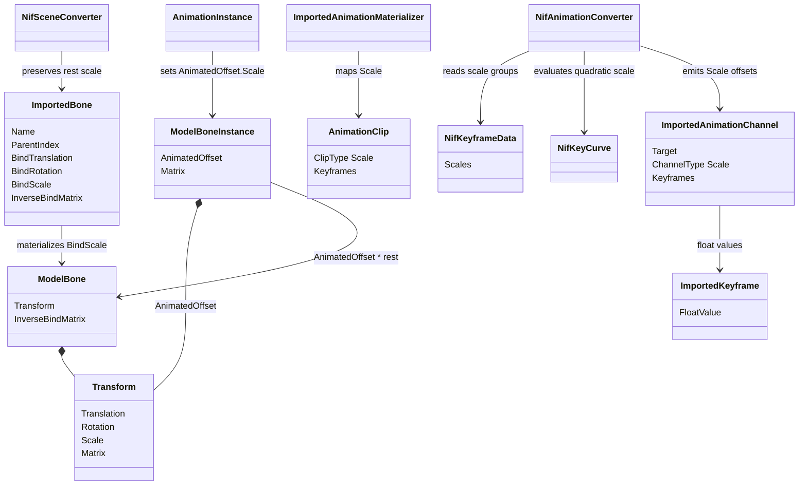
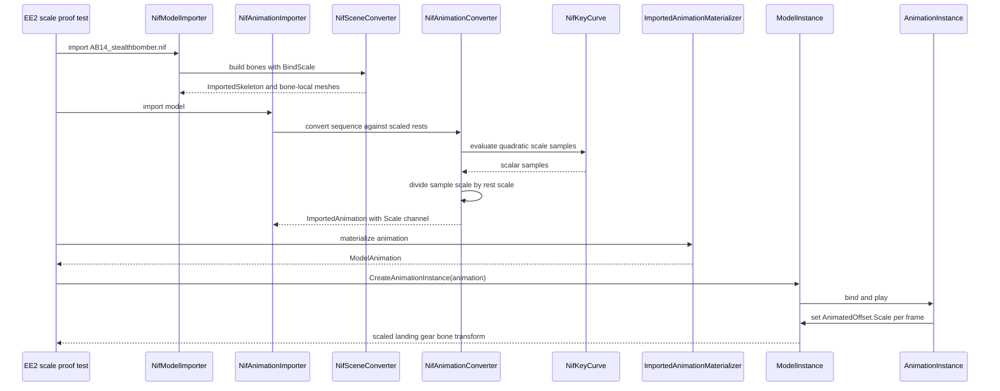

# Deep Dive: Empire Earth II scale animation (C4f)

> Expands phase C4f of [Track C: External Models & Animations](../track-c-external-assets.md).
>
> Audience: human design for importing Empire Earth II Gamebryo uniform scale animation through
> the C1 and C2 contracts. Code references are in the agent-context appendix.

Purpose: extend the C4c KF path so EE2 nodes can carry finite uniform rest scale and animated
uniform scale keys. C4f reuses the C4c KF parser, target binding, key evaluation, and rest-offset
rules instead of adding a second curve implementation.

The C4c design source is [C4c rigid KF animation](c4c-ee2-rigid-animation.md). Facts below were
measured on 2026-09-22 against the local EE2 Gold install. Reproduction steps are in the appendix.

---

## 1. Scope and non-goals

C4f supports:

- NIF 10.1.0.0 `NiKeyframeData` scale key groups on C4c `NiKeyframeController` blocks;
- linear and quadratic float scale groups, evaluated by the same helper as C4c quadratic Euler
  curves;
- finite non-negative animated uniform scale values, including zero scale samples for rigid
  hiding or reveal clips;
- finite positive rest scale on `NiNode` and `NiLODNode` bones;
- rest-relative scale offsets emitted as a C1 scale channel;
- rigid mesh, bounds, and shader-normal behavior for uniform animated scale.

C4f rejects:

- TBC scale keys and constant key type 5;
- negative, non-finite, or singular rest scale;
- animated targets under a rest-scale-zero node, because `AnimatedOffset * rest` cannot
  reconstruct a non-zero sample from a singular rest transform;
- non-keyframe controller families, older KF versions, and root-motion policy changes owned by
  C4c;
- widening skinned influence counts, owned by C4d.

Decision: scale is added as a uniform scalar only. NIF 10.1 node scale and KF scale keys are single
`float` values, so vector scale would add unused interchange surface.

Decision: singular rest scale remains unsupported for animated targets. The current rest-relative
runtime composition cannot invert or uncollapse a zero-scale bind transform without an absolute
local-transform track.

## 2. Target assets

Primary proof clips are DDF-bound, NIF 10.1, and use non-unit scale on skinless models.

| DDF unit and state | Model | Clip | Targets | Scale range | Notes |
|---|---|---|---|---:|---|
| `Bomber_14` `TakeOff` | `AB14_stealthbomber.nif` | `Graphics/Vehicles/ab14_stealthbomber_takeoff.kf` | `LandingGear_02`, `LandingGear_03` | 0.883883 to 1.0 | Skinless, landing gear scales during takeoff. |
| `Bomber_14` `Idle` | `AB14_stealthbomber.nif` | `Graphics/Vehicles/ab14_stealthbomber_idle.kf` | `LandingGear_02`, `LandingGear_03` | 0.891850 to 0.895959 | Skinless constant proof for held non-unit scale. |
| `Bomber_15` `TakeOff` | `AB15_orbital.nif` | `Graphics/Vehicles/ab15_orbital_takeoff.kf` | `LandingGear_02`, `LandingGear_03` | 0.883883 to 1.0 | Skinless second model with the same gear convention. |
| `FighterBomber_13` `Takeoff` | `afb13_StrikeFighter.nif` | `Graphics/Vehicles/afb13_StrikeFighter_takeoff.kf` | `rearwheeltwo` | 0.665078 to 1.0 | Skinless single-node proof with a wider range. |
| `UniqueUnitEgyptian1` `Idle` | `CIV1_RoyalChariot_Egyptian.nif` | `Graphics/Vehicles/CIV1_RoyalChariot_Egyptian_idle01.kf` | `Bone01` | 0.85 to 0.85 | Positive non-unit rest-scale proof. |

The blocked singular-rest evidence is `LightArtillery1_11` with model
`LLA11_FieldArtillery.nif`. Its animated `boom` node has rest scale `0.0`, and its DDF-bound clips
include `Attack1`, `Idle`, `Pack`, `Unpack`, and `Walk`. Those clips require an absolute local
transform mode and stay outside C4f.

## 3. Corpus census

Over the 1427 `.kf` files in `graphics.zip`, the C4c four-block parser consumed 849 NIF 10.1
files to exact end-of-file. The wider version census matches C4c: 972 NIF 10.1 files, 452 NIF
10.0.1.0 files, and 3 NetImmerse 4.2.2.0 files.

Scale key groups in the exact NIF 10.1 subset:

| Group | Count |
|---|---:|
| Quadratic scale groups | 2800 |
| Linear scale groups | 1658 |
| Controllers with any non-unit scale value | 197 |
| Files with any non-unit scale controller | 81 |
| DDF-bound non-unit scale controllers | 165 |
| DDF-bound files with non-unit scale controllers | 67 |

Non-unit scale values:

| Measure | Value |
|---|---:|
| Minimum | 0.0 |
| Maximum | 2.293333 |
| Values below 1 by more than 1e-4 | 406 |
| Values above 1 by more than 1e-4 | 35 |
| Values equal to 0 | 52 |
| Negative values | 0 |

Every non-unit controller in the exact subset used key type 2, quadratic. Linear scale groups were
identity in that subset, but the parser and converter must keep the linear path because C4c
already supports linear float groups and the corpus contains 1658 linear scale groups.

DDF-bound scale families with useful coverage:

| Family | Files | Controllers | Range | Model notes |
|---|---:|---:|---:|---|
| `LHA10_siegegun` pack, unpack, attack, death, unpacked states | 6 | 86 | 0.0 to 1.0 | Skinned artillery, C4d-dependent proof. |
| `AB14_stealthbomber` idle, walk, death, takeoff | 4 | 8 | 0.883883 to 1.0 | Skinless proof model. |
| `AB15_orbital` attack, idle, walk, death, takeoff | 5 | 10 | 0.883883 to 1.0 | Skinless proof model. |
| `afb13_StrikeFighter` attack, idle, walk, death, takeoff | 5 | 5 | 0.665078 to 1.0 | Skinless proof model. |
| `CIV3_AtlatlThrower_Aztec` attack, capture, death, idle, jog, walk | 6 | 12 | 0.0 to 2.293333 | Skinned character, C4d-dependent proof. |
| `CIV12_motarteam_korean` state set | 12 | 12 | 0.001 to 1.0 | Skinned character, C4d-dependent proof. |

Animated non-unit rest scale found in DDF-bound, parsed model pairs:

| Model | Node | Rest scale | DDF-bound clips | Scale keys |
|---|---|---:|---|---|
| `CIV1_RoyalChariot_Egyptian.nif` | `Bone01` | 0.8499998 | attack, death, idle, run, walk | Attack and idle also key scale 0.85. |
| `LLA11_FieldArtillery.nif` | `boom` | 0.0 | attack, death, idle, pack, unpack, unpacked idle, unpacked walk, walk | Several clips also key scale. Blocked by singular rest. |

The parsed proof models `AB14_stealthbomber.nif`, `AB15_orbital.nif`, and
`afb13_StrikeFighter.nif` have unit rest scale on every scale-animated node. Their scale is uniform
by construction because the NIF field is one scalar.

## 4. Wire layout

C4f does not add a new block layout. It relies on the C4c
[KF 10.1.0.0 wire layout](c4c-ee2-rigid-animation.md#3-kf-10100-wire-layout) and changes the
meaning of the `NiKeyframeData` scale group from validation-only to imported data.

`NiKeyframeData` stores rotation first, then translation, then scale:

| Field | Encoding |
|---|---|
| Scale key group | `count` (`u32`), optional `key type` (`u32`), then `count` float keys. |
| Linear scale key | time (`f32`), value (`f32`). |
| Quadratic scale key | time, value, forward tangent, backward tangent (`f32` each). |
| TBC scale key | time, value, tension, bias, continuity. Rejected. |

The scale key group appears even when `count = 0`. Identity groups remain accepted and dropped by
C4c-compatible code. Non-unit groups emit one channel.

Decision: C4f adds no parser-specific scale evaluator. `NifKeyCurve.Evaluate` from C4c evaluates
linear and quadratic `NifKeyGroup<float>` values for Euler axes and scale.

## 5. Semantics

NIF 10.1 scale is a local uniform scalar. Local transform order remains the C4a row-vector order
`S * R * T`, matching `Transform.Matrix` in `src/Panopticon.Simulation/Transform.cs:85-88`.

Scale keys are absolute local scale samples in the source model frame. Rest scale comes from the
model node, not the KF file. The imported channel value is rest-relative:

```
scaleOffset = sampleScale / restScale
```

This matches C4c's `offset * rest` reconstruction rule. For a nonzero rest scale, the local linear
part reconstructs as:

```
S(scaleOffset) * S(restScale) * R(rest) = S(sampleScale) * R(rest)
```

When rotation is also animated, uniform scale commutes with the C4c source-to-engine rotation
conjugation. The C4a `3.28084` meters-to-feet factor applies only to translation. Scale remains
dimensionless.

Translation offsets must include rest scale once non-unit rest scale is legal:

```
translationOffset = (sampleTranslation - restTranslation) * inverse(S(restScale) * R(restRotation))
```

For C4c's unit-rest targets, this reduces to the existing rotation-only translation offset.

Decision: animated sample scale may be zero for rigid meshes. EE2 uses zero and near-zero scale for
hide or reveal effects, and a zero offset can still collapse a nonzero rest transform. Rest scale
must be positive so rest-relative offsets and inverse bind matrices remain valid.

## 6. Mapping onto C1 and runtime animation

Current C1 and runtime gaps:

| Area | Current code | Gap |
|---|---|---|
| C1 rest bones | `ImportedBone` stores name, parent, bind translation, bind rotation, and inverse bind matrix in `src/Panopticon.Simulation/Content/Importing/ImportedBone.cs:14-22`. | No bind scale field. |
| C1 channel types | `ImportedAnimationChannelType` is `TranslationX`, `TranslationY`, `TranslationZ`, `Quaternion`, `Visibility` in `src/Panopticon.Simulation/Content/Importing/ImportedAnimationChannel.cs:8-15`. | No scale channel type. |
| C1 key values | `ImportedKeyframeKind` stores float, quaternion, and bool in `src/Panopticon.Simulation/Content/Importing/ImportedKeyframe.cs:8-13`. | Scale can reuse float. |
| Runtime clip types | `AnimationClipType` mirrors the same five types in `src/Panopticon.Simulation/Graphics/Animation/AnimationClipType.cs:3-10`. | No scale clip type. |
| Runtime rest bones | `ModelBone` constructs `Transform` from translation and rotation only in `src/Panopticon.Simulation/Graphics/ModelBone.cs:19-32`. | The existing `Transform` already has a scale field, but it is not populated from imported bones. |
| Runtime offsets | `ModelBoneInstance.Matrix` is `AnimatedOffset.Matrix * _modelBone.Transform.Matrix` in `src/Panopticon.Simulation/Graphics/ModelBoneInstance.cs:34-36`. | Scale composition works once rest and animated offset scale are set. |
| Animation reset | `AnimationInstance.ResetBoneTransforms` resets translation and rotation only in `src/Panopticon.Simulation/Graphics/Animation/AnimationInstance.cs:125-129`. | Offset scale must reset to 1. |
| Animation evaluation | `AnimationInstance.Evaluate` handles translation, quaternion, and visibility in `src/Panopticon.Simulation/Graphics/Animation/AnimationInstance.cs:333-365`. | Linear and step scale assignment are missing. |
| Materialization | `ImportedAnimationMaterializer` maps imported channel types in `src/Panopticon.Simulation/Content/Loaders/ImportedAnimationMaterializer.cs:26-34`. | Scale mapping is missing. |

Minimal C1 extension:

- add `ImportedBone.BindScale` with constructor overloads that default to `1.0f`;
- pass bind scale through `ModelBoneHierarchy` to `ModelBone`;
- construct `ModelBone.Transform` with translation, rotation, and scale;
- add `Scale` to `ImportedAnimationChannelType` and `AnimationClipType`;
- reuse float keyframes for scale channels;
- map imported scale channels in `ImportedAnimationMaterializer`;
- reset `AnimatedOffset.Scale` to `1.0f` and evaluate linear or step scale clips into it.

No new `ImportedKeyframeKind` is required.

## 7. NIF importer changes

C4c's node-collapse rule changes from:

- every non-unit-scale node collapses its subtree into the nearest bone ancestor;
- any KF target inside that subtree fails as missing.

to:

- a node with finite positive uniform rest scale becomes a bone and stores `BindScale`;
- a node with unit rest scale behaves exactly as C4c;
- a non-positive or non-finite rest-scale node still collapses if no KF channel targets it;
- a KF channel targeting a collapsed singular-scale node fails with `NotSupportedException`
  naming the node and scale.

C4f conversion steps:

1. Reuse C4c model-qualified key parsing and target resolution.
2. Build the model skeleton with rest scale preserved.
3. Validate every scale key value is finite and non-negative.
4. Evaluate quadratic scale keys through `NifKeyCurve.Evaluate` at the source key times. No 30 Hz
   resampling is needed for scalar scale because the runtime interpolates linearly between emitted
   samples only for linear groups. Quadratic groups require resampled keyframes at C4c's 30 Hz time
   set plus source key times.
5. Emit one `Scale` channel per target with float keyframes containing `sample / restScale`.
6. Keep identity scale groups as validation-only and drop them.

Decision: quadratic scale keys are resampled before entering C1. C1 supports linear and step
interpolation only, and C4c already uses 30 Hz resampling for quadratic Euler curves.

## 8. Skinning, bounds, and normals

Rigid meshes: parent-bone scale reaches rendering through `ModelInstance.AbsoluteBoneTransforms`.
`ModelMesh.BuildRenderList` uses that matrix for unskinned meshes in
`src/Panopticon.Simulation/Graphics/ModelMesh.cs:51-53`. The existing bounding box transform in
`ModelMesh.cs:109` expands render bounds under scale.

Skinned meshes: `ModelInstance.ComputeSkinningMatrix` returns `bone.InverseBindMatrix *
relativeBoneTransform` in `src/Panopticon.Simulation/Graphics/ModelInstance.cs:259-261`. C4d must include
rest scale in inverse bind matrices and verify scaled bone animation before choosing a proof asset.
C4f must not widen or truncate skin influences.

Normals: NIF scale is uniform, so normal direction is unchanged by scale and only vector length is
affected. The shader helper `TransformNormal` currently multiplies by the matrix without
normalizing in `src/Panopticon.Simulation/Assets/Shaders/Common.h:35-38`. C4f must normalize mesh normals
after world and skinning transforms, or otherwise prove fixed-function and PBR lighting are
unchanged under uniform scale. This is required for fixed-function EE2 proofs because
`FixedFunction.frag` uses `in_WorldNormal` directly.

Bounds: imported mesh bounds remain bone-local. Runtime render bounds use the scaled bone world
matrix. Capture and descriptor tests must include a frame where scale changes the rendered AABB.

Decision: C4f normalizes transformed mesh normals in shader code rather than baking scale out of
animation. The source animation must still affect geometry size and bounds.

## 9. Failure contract

| Condition | Result |
|---|---|
| Identity scale group | Accepted and dropped. |
| Linear scale group with non-unit values | Emits a `Scale` channel at source key times. |
| Quadratic scale group with non-unit values | Emits a resampled `Scale` channel using C4c Hermite evaluation. |
| TBC, constant, or unknown scale key type | `NotSupportedException`. |
| Non-finite or negative scale key value | `InvalidDataException`. |
| Animated scale target has positive non-unit rest scale | Accepted, channel values are divided by rest scale. |
| Animated target has rest scale 0 or non-finite rest scale | `NotSupportedException` naming the target. |
| Missing or duplicate target | Same C4c result. |
| Skinned proof has more influences than runtime supports | C4d-owned `NotSupportedException`; no truncation. |

No scale channel is silently truncated or approximated. The only dropped scale data is an identity
group already equivalent to the runtime default.

## 10. Proof and completion boundary

C4f is complete when:

- C1 and runtime descriptors expose bone rest scale and a scale animation channel;
- C4c rigid proof clips still import and render unchanged;
- the four skinless proof clips in section 2 import, bind through C2, and show the expected gear or
  wheel scale at fixed times;
- `CIV1_RoyalChariot_Egyptian_idle01.kf` proves positive non-unit rest scale reconstruction;
- `LLA11_FieldArtillery_idle01.kf` fails with a singular-rest-scale message naming `boom`;
- fixed-function captures keep normal lighting stable while geometry scale changes;
- no EE2 asset is copied or committed.

## 11. Cross-phase handoff

C4d may need C4f before choosing a skinned proof asset. DDF-bound skinned scale candidates include
`LHA10_siegegun`, `CIV3_AtlatlThrower_Aztec`, `CIV12_motarteam_korean`,
`lhi15_ObjectiveForceWarrior`, and `LLI13_incendiarymortar`. C4d must account for uniform scale in
inverse bind matrices, skinning normals, and influence-limit decisions.

C4c must keep rejecting non-unit scale until C4f lands. C4f cards should change that rejection in
one place and keep C4c's parser, target resolution, and Hermite evaluation as the shared path.

C7c widens this surface after C4f lands: `Vector3` bind scale, `ScaleX/Y/Z` channels, and
absolute local clip composition, with the uniform C4f paths unchanged. C4f should keep scale
state per bone, not packed into `Transform`, so the widening stays local. See the
[C7c deep dive](c7c-sc2-skinned-animation.md#73-widening-c4f).

## 12. Architecture diagrams





## Appendix: current-code grounding

- `ImportedBone` has no rest scale field: `src/Panopticon.Simulation/Content/Importing/ImportedBone.cs:14-22`.
- C1 animation channel types omit scale: `src/Panopticon.Simulation/Content/Importing/ImportedAnimationChannel.cs:8-15`.
- `ImportedKeyframe` already supports float values: `src/Panopticon.Simulation/Content/Importing/ImportedKeyframe.cs:8-13,45-48`.
- Runtime clip types omit scale: `src/Panopticon.Simulation/Graphics/Animation/AnimationClipType.cs:3-10`.
- `Transform` supports uniform scale and composes `Scale * Rotation * Translation`:
  `src/Panopticon.Simulation/Transform.cs:47-69,85-88`.
- `ModelBone` currently creates `Transform` without scale:
  `src/Panopticon.Simulation/Graphics/ModelBone.cs:19-32`.
- `ModelBoneHierarchy` materializes imported translation and rotation only:
  `src/Panopticon.Simulation/Graphics/ModelBoneHierarchy.cs:37-43`.
- Bone local composition uses animated offset before rest:
  `src/Panopticon.Simulation/Graphics/ModelBoneInstance.cs:34-36`.
- `AnimationInstance` resets and evaluates translation, rotation, and visibility only:
  `src/Panopticon.Simulation/Graphics/Animation/AnimationInstance.cs:125-129,333-365`.
- `ImportedAnimationMaterializer` maps only the existing five channel types:
  `src/Panopticon.Simulation/Content/Loaders/ImportedAnimationMaterializer.cs:24-55`.
- C4c's current scale rejection mirrors glTF's non-identity scale rejection:
  `src/Panopticon.Simulation/Content/Importing/Gltf/GltfAnimationConverter.cs:121-132`.
- NIF source-to-engine conversion applies meters-to-feet in the basis matrix:
  `src/Panopticon.Simulation/Content/Importing/Nif/NifTransformConverter.cs:19-35`.
- Unskinned render bounds use the parent bone world matrix:
  `src/Panopticon.Simulation/Graphics/ModelMesh.cs:51-53,109`.
- Skinning matrix composition is inverse bind followed by relative transform:
  `src/Panopticon.Simulation/Graphics/ModelInstance.cs:259-261`.
- Shader normal transform currently does not normalize:
  `src/Panopticon.Simulation/Assets/Shaders/Common.h:35-38`.

## Appendix: reproduction

The census used Python 3 stdlib only, reading EE2 archives in place and committing no assets.
Commands below reproduce the source data locations and proof rows.

```sh
EE2="/home/rmessinger/dev/Empire Earth II Gold"
unzip -l "$EE2/zips/graphics.zip" | grep -iE 'ab14_stealthbomber|ab15_orbital|afb13_StrikeFighter|RoyalChariot|FieldArtillery'
unzip -p "$EE2/zips/db.zip" db/Units/air_bomber.ddf | grep -n -i -A20 'Bomber_14'
unzip -p "$EE2/zips/db.zip" db/Units/air_fighterbomber.ddf | grep -n -i -A20 'FighterBomber_13'
unzip -p "$EE2/zips/db.zip" db/Units/UniqueUnit_Egyptian.ddf | grep -n -i -A20 'UniqueUnitEgyptian1'
unzip -p "$EE2/zips/db.zip" db/Units/light_artillery1.ddf | grep -n -i -A30 'LightArtillery1_11'
```

The temporary parser reproduced the C4c NIF 10.1 header parse, decoded the four KF block types to
exact end-of-file, counted scale key groups and values, parsed `db/Units/*.ddf` `UnitModel` blocks,
and parsed model `NiNode` and `NiLODNode` rest scale for DDF-bound model pairs. No script or
extracted asset was committed.
