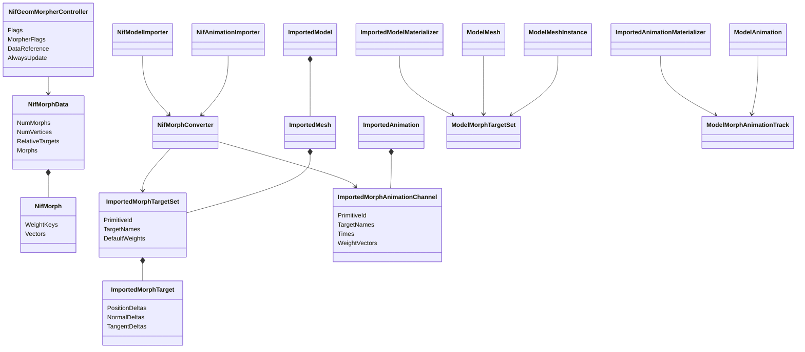
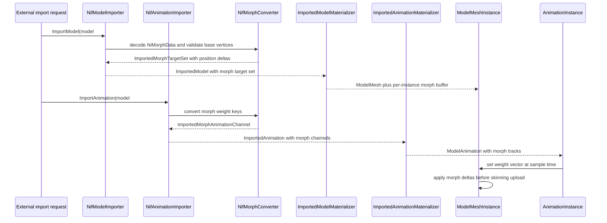

# Deep Dive: EE2 morph animation (C4g)

> Expands phase C4g of [Track C: External Models & Animations](../track-c-external-assets.md).
>
> Audience: human design for importing Empire Earth II Gamebryo morph target animation through
> the C1, C2, C4c, and C6 contracts. Code references are in the current-code appendix.

Purpose: animate EE2 vertex-blend morphs without adding a format-specific render path. C4g uses
the C6 morph-target gate and interchange shape, adds the shared morph runtime needed by C6, and
maps NIF `NiGeomMorpherController` / `NiMorphData` data onto that shape.

The corpus survey below was measured on 2026-09-22 against the local EE2 Gold install listed in
the reproduction appendix. No EE2 asset is copied into the repository.

---

## 1. Scope and non-goals

C4g supports:

- NIF 10.1.0.0 `NiGeomMorpherController` and `NiMorphData`;
- `NiMorphData.RelativeTargets = 1`, where morph 0 is the absolute base shape and morphs
  1..N are position deltas;
- morph target sets with position deltas only;
- linear and quadratic float weight keys, with quadratic curves resampled to linear C6 weight
  vectors;
- DDF-bound proof assets from `db/Units/*.ddf`;
- the request-scoped C6 `morph-targets` gate;
- CPU morph deformation before existing skinning.

C4g rejects:

- NIF 10.0.1.0 morph bodies, beyond block-type-name census;
- `NiFloatInterpolator` morph paths, because none occur on the 10.1 morph controllers;
- `RelativeTargets = 0`;
- morph targets that do not match the base primitive vertex count;
- normal and tangent deltas, because EE2 `NiMorphData` stores positions only;
- more than eight imported targets per primitive;
- animation-supplied morph targets that cannot be paired with the model before materialization.

Decision: C4g implements the shared C6 morph-target runtime instead of depending on C6 as a
completed phase. Reason: C6 is an experiment envelope, and the EE2 proof supplies the first
concrete reduced morph trigger. C6 later reuses the C4g morph runtime for glTF and tooling work.

Decision: C4g keeps the C6 `morph-targets` feature gate request-scoped. Reason: the runtime
changes must not affect C4, W3D, or shipped-game models when the gate is disabled.

## 2. Target assets

The primary proof asset is DDF-bound unit data:

| DDF source | Model | Animation | Binding |
|---|---|---|---|
| `db/Units/farm.ddf` and `db_155.zip/db/Units/farm_15.ddf` | `bld_farm_yam.nif` | `bld_farm_yam.kf` | `Seeding_1..4`, `ModelName = bld_farm_yam.nif`, `AnimName = bld_farm_yam.kf` |

`Graphics/Building/bld_farm_yam.kf` is the only NIF 10.1 `.kf` file with
`NiGeomMorpherController` and `NiMorphData`. It targets `Editable Mesh`, the single 720-vertex
shape in `cache/nifcache/bld_farm_yam.nifcache`.

Verified facts:

- The KF sequence duration is 0.9666667 s.
- The controlled blocks are `Editable Mesh`, two material color controllers, `root`, and
  `root NonAccum`.
- The morph controller has flags `0x2c`, frequency 1, phase 0, target ref `-1`,
  morpher flags 0, data ref 3, and `AlwaysUpdate = 0`.
- `NiMorphData` has 2 morph entries, 720 vertices, and `RelativeTargets = 1`.
- Morph 0 has 3 linear keys with value 0 and 720 nonzero vectors. Those vectors match
  `bld_farm_yam.nifcache` `NiTriShapeData` positions exactly, max difference 0.
- Morph 1 has 2 linear keys, value 0 at time 0 and value 1 at 0.9666667 s. It has 600 nonzero
  deltas and max delta 5.4214 source units.

Secondary proof asset for embedded model morphs:

| DDF source | Model | Binding |
|---|---|---|
| `db/Units/light_artillery1.ddf` | `fx_muzzle_cannon.NIF` | `ModelFileName = fx_muzzle_cannon.NIF` |

`cache/nifcache/fx_muzzle_cannon.nifcache` contains an embedded morph controller on a 6-vertex
`Editable Mesh`. It has one quadratic weight curve and validates the model-owned morph target
path, but it is an effect-sized asset, not the main completion proof.

## 3. Corpus census

The graphics archive scan covered every `.kf` and `.nifcache` entry in base and patch graphics
zips.

| Group | Files |
|---|---:|
| `.kf` NIF 10.1.0.0 | 972 |
| `.kf` NIF 10.0.1.0 | 452 |
| `.kf` NetImmerse 4.2.2.0 | 3 |
| `.nifcache` NIF 10.1.0.0 | 2479 |
| `.nifcache` NIF 10.2.0.0 | 1 |

Morph block occurrence summary:

| Flavor | Files | Controllers | `NiMorphData` blocks | DDF-bound |
|---|---:|---:|---:|---|
| 10.1 `.kf` | 1 | 1 | 1 | yes, farm unit |
| 10.0.1 `.kf` | 3 | 5 | 5 | two farm unit clips, one unbound FX clip |
| 10.1 `.nifcache` | 12 | 16 | 16 | seven visual or unit DDF references found |

The 10.1 morph occurrences are:

| Asset | DDF evidence | Controllers | Morph targets | Vertices | Key types |
|---|---|---:|---:|---:|---|
| `Graphics/Building/bld_farm_yam.kf` | `db/Units/farm.ddf` and `farm_15.ddf` | 1 | 2 | 720 | linear, linear |
| `cache/nifcache/explo_01.nifcache` | none found | 1 | 2 | 4 | linear, quadratic |
| `cache/nifcache/fx_EMP_1.nifcache` | none found | 3 | 2 each | 155 each | linear, quadratic |
| `cache/nifcache/fx_emp_flash.nifcache` | `db/Visuals/visual_expl_ammo_emp.ddf` | 1 | 3 | 4 | linear, quadratic, quadratic |
| `cache/nifcache/fx_emp_flash2.nifcache` | `db/Visuals/visual_expl_ammo_emp.ddf` | 1 | 3 | 4 | linear, quadratic, quadratic |
| `cache/nifcache/fx_emp_noflash.nifcache` | `db/Visuals/visual_expl_ammo_emp.ddf` | 2 | 2 each | 155 and 289 | linear, quadratic |
| `cache/nifcache/fx_explosion_nuke.nifcache` | none found | 1 | 2 | 155 | linear, quadratic |
| `cache/nifcache/fx_muzzle_cannon.nifcache` | `db/Units/light_artillery1.ddf` | 1 | 2 | 6 | linear, quadratic |
| `cache/nifcache/fx_muzzle_outpost7.nifcache` | `db/Visuals/visual_fx_weapon.ddf` | 1 | 2 | 8 | linear, quadratic |
| `cache/nifcache/fx_nuke_blast01.nifcache` | `db/Visuals/visual_expl_ammo_nuke.ddf` | 1 | 2 | 289 | linear, quadratic |
| `cache/nifcache/fx_nuke_blast02.nifcache` | none found | 1 | 3 | 4 | linear, quadratic, quadratic |
| `cache/nifcache/fx_nuke_flash02.nifcache` | `db/Visuals/visual_expl_ammo_nuke.ddf` | 1 | 3 | 4 | linear, quadratic, quadratic |
| `cache/nifcache/fx_rapid_deployment.nifcache` | `db/Visuals/visual_fx_misc.ddf` | 1 | 2 | 162 | linear, quadratic |

All 10.1 `NiMorphData` blocks have `RelativeTargets = 1`. For every embedded model occurrence
whose target mesh was decoded, morph 0 matches the target `NiTriShapeData` base positions exactly,
except `fx_muzzle_cannon`, whose target count differs under the lightweight census scanner and is
therefore retained as a parser test rather than a base-diff assertion until the implementation
decoder inspects it with full reference validation.

The 10.0.1.0 block-type-name census is:

| Asset | DDF evidence | Blocks |
|---|---|---|
| `Graphics/Building/bld_farm_sugarcane.kf` | `db/Units/farm.ddf` and `farm_15.ddf` | 1 sequence, 1 text-key block, 3 keyframe controllers, 3 keyframe data blocks, 1 morph controller, 1 morph data block, 3 material color controllers, 3 pos data blocks |
| `Graphics/Building/bld_farm_wheat_seeding.kf` | `db/Units/farm.ddf` and `farm_15.ddf` | 1 sequence, 1 text-key block, 3 morph controllers, 3 morph data blocks, 3 material color controllers, 3 pos data blocks, 2 keyframe controllers, 2 keyframe data blocks |
| `Graphics/Fx/Fx_BoatDeath_oil.kf` | none found | 1 sequence, 1 text-key block, 3 keyframe controllers, 3 keyframe data blocks, 1 morph controller, 1 UV controller, 1 UV data block, 1 morph data block, 6 material color controllers, 5 pos data blocks |

## 4. Verified NIF 10.1 wire layout

The following layout parses `bld_farm_yam.kf` through the end of its `NiMorphData` block and
matches the embedded 10.1 morph bodies found by the census.

| Block | Fields in order |
|---|---|
| `NiGeomMorpherController` | `NiTimeController` fields: next controller ref, flags (`u16`), frequency, phase, start, stop, target ref. Then morpher flags (`u16`), data ref (`i32` to `NiMorphData`), `AlwaysUpdate` (`u8`). |
| `NiMorphData` | morph count (`u32`), vertex count (`u32`), relative targets (`u8`), then that many `Morph` records. |
| `Morph` at 10.1.0.0 | key count (`u32`), interpolation (`u32`) even when key count is zero, float keys, then `NumVertices` vectors. |
| Float key, linear | time (`f32`), value (`f32`). |
| Float key, quadratic | time, value, forward tangent, backward tangent (`f32` each). |
| Float key, TBC | time, value, tension, bias, continuity (`f32` each), rejected for C4g. |

No 10.1 morph controller references `NiFloatInterpolator`, `NiFloatData`, or the later
`Interpolators` array. Those fields begin in later Gamebryo versions and stay out of C4g.

Controller flags are `0x2c` for the proof KF and `0x25` or `0x2c` for embedded models.
`0x25` is accepted only for embedded model controllers, where bit 0 marks a different animation
type while the data still provides ordinary weight keys. `0x2c` remains the C4c manager-controlled
KF value.

## 5. Semantics

Morph 0 is the base shape. Its weight keys are always 0 in the 10.1 corpus. It is not imported as
a target. The importer verifies that morph 0 equals the target primitive's source positions before
any C4a or C4c coordinate conversion. A mismatch fails with `InvalidDataException`.

Morphs 1..N are relative position deltas when `RelativeTargets = 1`. Each target vector is
converted with the same linear source-to-engine transform used for the target primitive, without
the translation component. Missing normal and tangent deltas map to zero in the C6 target.

Weight curves are per-target float curves:

- linear keys map directly to C6 linear weight vectors;
- quadratic keys use the C4c Hermite helper and are resampled at 30 Hz, with all source key times
  included, before emission as linear weight vectors;
- TBC keys fail with `NotSupportedException`.

Default target weights are 0. Allowed ranges are `[0, 1]` for EE2 morph targets because the
observed authored curves stay in that interval. The imported clip still records observed minima
and maxima for diagnostics.

Decision: C4g omits morph 0 from the C6 target list. Reason: C6 targets are deltas added to the
base primitive, and importing morph 0 as a weighted target would double the base geometry.

Decision: quadratic weight curves are resampled instead of adding cubic interpolation to C6.
Reason: C6 explicitly defers cubic spline weights, and C4c already owns the 30 Hz resampling
pattern for source curves that cannot be represented exactly.

## 6. Mapping onto C1 and C6

C4g extends the C1 imported model and animation contracts with the C6 morph shapes from
[C6 sections 2 through 4](c6-extended-model-features.md#2-morph-interchange).

| NIF concept | C6 interchange |
|---|---|
| Target `NiTriShape` / C4c bone-local primitive | `ImportedMorphTargetSet.PrimitiveId` |
| `NiMorphData.NumMorphs - 1` | `TargetNames = Target1..TargetN` |
| Morph 0 vectors | Validation against base primitive source positions |
| Morph vectors 1..N | `ImportedMorphTarget.PositionDeltas` |
| No normal or tangent vectors | missing `NormalDeltas` and `TangentDeltas` |
| `RelativeTargets = 1` | deltas added to base before skinning |
| Per-morph float keys | one `ImportedMorphAnimationChannel` with full weight vectors |

Embedded model morphs are model-owned. The NIF model importer reads the controller attached to a
`NiTriShape` and adds an `ImportedMorphTargetSet` to that primitive. The NIF animation importer
exposes the embedded controller's weight keys through a synthetic embedded-morph animation key.

KF morphs are paired with the model before materialization. The model key may include a morph
source qualifier:

```text
<model-key>#morph-kf=<archive-relative-kf-path>
```

The animation key keeps the C4c form:

```text
<model-key>#kf=<archive-relative-kf-path>
```

The EE2 DDF adapter can synthesize both keys from one `ModelName` plus `AnimName` pair. The
proof tests can use the paired keys directly. A malformed or unpaired morph-KF request returns
null before materialization.

Decision: C4g uses a paired model key for KF-owned morph target data. Reason: C6 target sets are
model-side, and the runtime must allocate morph buffers before animation playback binds weight
tracks.

## 7. Runtime design

The `morph-targets` gate adds model-side morph target buffers and instance-side weight storage.
With the gate disabled, the existing model and mesh paths remain unchanged.

CPU deformation is the first implementation and the correctness oracle:

1. Copy base vertices from the immutable model mesh into a per-instance dynamic vertex buffer.
2. Add weighted position deltas for every target in stable target order.
3. Recompute or preserve normals using the C6 policy. EE2 starts with position-only deltas, so
   the first proof preserves base normals.
4. Upload the morphed vertex buffer.
5. Run the existing skinning path.

This follows C6's fixed order: morph before skinning. The shader path remains a later C6
optimization.

The initial active target limit is eight per primitive. EE2's largest observed 10.1 block has
three morph entries, which means two imported targets after the base is omitted.

## 8. Failure contract

| Condition | Result |
|---|---|
| Missing model, missing KF, malformed morph key | importer returns null |
| Wrong version, truncated body, bad reference, or bad block type | `InvalidDataException` with asset context |
| `RelativeTargets = 0` | `NotSupportedException` |
| morph 0 does not match the base primitive | `InvalidDataException` |
| target count exceeds eight after base omission | `NotSupportedException` |
| vertex count mismatch after C4c mesh splitting | `InvalidDataException` |
| TBC key, unknown key type, non-finite vector, or non-finite weight | `NotSupportedException` |
| weight track targets a primitive without the named morph targets | bind failure before playback |
| `morph-targets` gate disabled for a morph asset | blocking diagnostic before GPU allocation |

No morph target, delta, or key is silently truncated. If a target cannot bind exactly, the import
or bind fails.

## 9. Proof and completion boundary

C4g is complete when:

- NIF parser tests decode synthetic 10.1 morph controllers and morph data to exact end-of-block;
- installed-asset tests decode `bld_farm_yam.kf`, verify morph 0 against
  `bld_farm_yam.nifcache`, and import one target with 600 nonzero deltas;
- the model materializer creates a gated morph target set and a per-instance CPU morph buffer;
- the animation materializer binds a morph weight channel to that target set;
- TestHarness captures show the farm yam seeding morph at weight 0, 0.5, and 1;
- an embedded-model smoke test imports `fx_muzzle_cannon.nifcache` or an equivalent reduced
  synthetic fixture and evaluates a quadratic weight curve;
- feature-disabled model output matches existing C4a/C4b/C4c output.

The proof does not claim full EE2 FX playback, 10.0.1.0 support, or glTF morph import. It creates
the shared runtime that those later tasks can reuse.

## 10. Architecture diagrams





## Appendix: current-code grounding

- NIF block dispatch currently has no morph blocks and rejects unknown types:
  `src/Panopticon.FileFormats.Nif/NifFile.cs:118-155`.
- The NIF static converter bakes source positions directly into `ImportedVertex`:
  `src/Panopticon.Simulation/Content/Importing/Nif/NifSceneConverter.cs:119-135`.
- The current NIF converter parents every sub-object to bone 0:
  `src/Panopticon.Simulation/Content/Importing/Nif/NifSceneConverter.cs:215-219`. C4c replaces this
  with node-hierarchy bones before C4g lands.
- glTF morph targets are explicitly rejected today:
  `src/Panopticon.Simulation/Content/Importing/Gltf/GltfPrimitiveConverter.cs:108-112`.
- glTF morph weight animation is explicitly rejected today:
  `src/Panopticon.Simulation/Content/Importing/Gltf/GltfAnimationConverter.cs:121-123`.
- `ImportedVertex` stores base and secondary positions and normals, not morph target arrays:
  `src/Panopticon.Simulation/Content/Importing/ImportedVertex.cs:9-34`.
- Imported meshes upload one static vertex buffer during materialization:
  `src/Panopticon.Simulation/Graphics/ModelMesh.Imported.cs:37-47`.
- Runtime vertex inputs have no morph target attributes or weight buffer:
  `src/Panopticon.Simulation/Assets/Shaders/Mesh.h:5-17`.
- Existing shader skinning blends two positions and two normals after the vertex input:
  `src/Panopticon.Simulation/Assets/Shaders/Mesh.h:60-76`.
- Skinning buffer upload happens after bone animation in `ModelInstance.Update`:
  `src/Panopticon.Simulation/Graphics/ModelInstance.cs:241-251`. C4g inserts morph buffer updates before
  rendering and before any future shader skinning path consumes vertex data.

## Appendix: reproduction

Commands use the EE2 install at `/home/rmessinger/dev/Empire Earth II Gold/`.

```sh
python3 - <<'PY'
from pathlib import Path
import zipfile
root = Path("/home/rmessinger/dev/Empire Earth II Gold/zips")
for archive in sorted(root.glob("*graphics*.zip")):
    with zipfile.ZipFile(archive) as z:
        for info in z.infolist():
            name = info.filename
            if not name.lower().endswith((".kf", ".nifcache")):
                continue
            data = z.read(info)
            if b"NiGeomMorpherController" in data or b"NiMorphData" in data:
                print(archive.name, name)
PY
```

```sh
python3 - <<'PY'
from pathlib import Path
import zipfile
root = Path("/home/rmessinger/dev/Empire Earth II Gold/zips")
terms = ["bld_farm_yam.kf", "fx_muzzle_cannon"]
for archive in sorted(root.glob("db*.zip")):
    with zipfile.ZipFile(archive) as z:
        for info in z.infolist():
            if not info.filename.lower().endswith(".ddf"):
                continue
            text = z.read(info).decode("utf-8", "ignore")
            for term in terms:
                if term.lower() in text.lower():
                    print(archive.name, info.filename, term)
PY
```

The detailed census used a stdlib Python parser for the NIF 10.1 header, `NiControllerSequence`,
`NiTextKeyExtraData`, `NiGeomMorpherController`, `NiMorphData`, `NiTriShape`, and
`NiTriShapeData`. It verified the `bld_farm_yam.kf` morph data against the model's 720 source
vertices with max difference 0.
