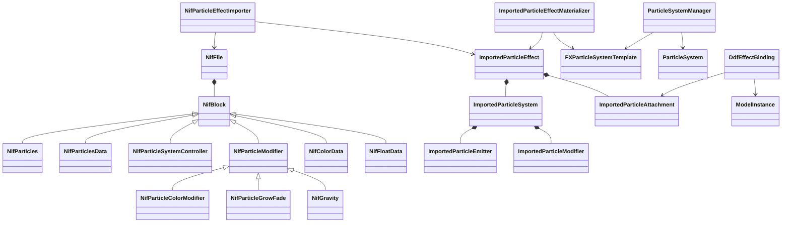
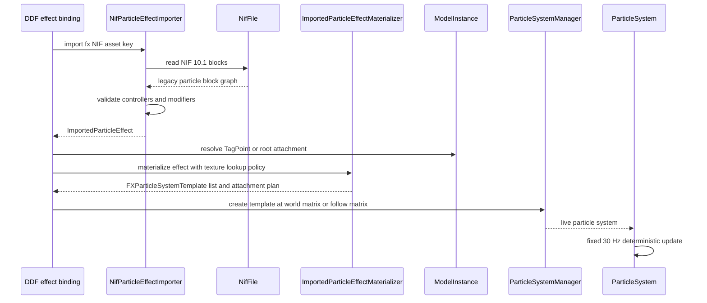

# Deep Dive: EE2 particle effects (C4h)

> Expands phase C4h of [Track C: External Models & Animations](../track-c-external-assets.md).
>
> Audience: human design for importing Empire Earth II Gamebryo particle effect NIFs through the
> C1 import boundary and the existing Panopticon particle runtime. Code references are in the
> current-code appendix.

Purpose: render DDF-bound EE2 `fx_*` particle NIFs without adding a second particle runtime. C4h
parses the legacy particle blocks used by EE2, converts the supported subset into CPU-only
interchange values, and materializes those values as existing Panopticon `FXParticleSystemTemplate`
instances attached to model bones or effect origins.

Facts below were measured on 2026-09-22 against the local Empire Earth II Gold install. Temporary
stdlib Python parsers were kept outside the repository.

---

## 1. Scope and non-goals

C4h supports the EE2 legacy `NiParticles` path found in `fx_*` `.nifcache` models:

- `NiParticles`, `NiParticlesData`, and `NiParticleSystemController`;
- `NiParticleColorModifier`, `NiParticleGrowFade`, `NiColorData`, and `NiFloatData`;
- simple `NiGravity` as an explicitly mapped acceleration modifier after the proof set;
- `NiAlphaController`, `NiMaterialColorController`, `NiKeyframeController`, and their data only
  when they drive the particle effect's visual timing;
- particle NIFs referenced by `db.zip` DDF visual tables or unit text keys;
- attachment to DDF tag points, child visual names, or an explicit root when the DDF entry is
  standalone.

C4h rejects:

- `NiParticleBomb`, morph, UV, and texture-transform controllers;
- `NiPSys*` particle systems, because none occur in the measured EE2 `fx_*` NIF corpus;
- mesh emission, collision spawning, particle mesh instances, and subtexture atlases;
- older NIF versions, patch-layer merge semantics, and general EE2 game support;
- sound, damage, and gameplay effect state machines beyond DDF effect-name discovery.

Decision: translate NIF particles into the existing Panopticon particle template model. Reason: the
runtime already has CPU simulation, emitter volumes, color and alpha keys, draw quads, burst
creation, bone-follow creation hooks, rendering, and save/load; the EE2 proof subset fits after a
C1-style import and materialization layer.

## 2. Target assets from DDF-bound data

The DDF census found 821 unique `fx_*` tokens in the `db.zip` stack. Of those, 492 resolve to
`cache/nifcache/fx_*.nifcache` entries in `graphics.zip`; 74 resolved entries contain the EE2
legacy particle block set.

The proof uses three DDF-bound effects:

| Effect | Archive file | DDF source | Reason |
|---|---|---|---|
| `fx_explosion_1` | `cache/nifcache/fx_explosion_1.nifcache` | `db/Visuals/visual_expl_ammo.ddf`, `db/Visuals/visual_explosion.ddf` `SequenceNames` | Compact explosion with two particle systems plus material-color and keyframe controllers. |
| `fx_muzzle_tank` | `cache/nifcache/fx_muzzle_tank.nifcache` | `db/Visuals/visual_fx_weapon.ddf` `MuzzleSmokeEffect` | Four smoke systems, stencil state, alpha materials, and the common grow-fade path. |
| `fx_watersplash_1` | `cache/nifcache/fx_watersplash_1.nifcache` | `db/Units/bridge.ddf` `SplashNifNames`; weapon splash tables | Five systems, alpha controller plus `NiFloatData`, and water-splash scale coverage. |

`fx_conversion` is a follow-up fixture for `NiGravity`, referenced by `db/Units/priest.ddf` text
keys. It stays outside the initial proof because the three selected effects cover the common
emitter, color, grow-fade, controller, and render-state set.

## 3. Corpus census

Over the 613 `cache/nifcache/fx_*.nifcache` entries in `graphics.zip`, 129 files contain particle
blocks. The legacy particle and adjacent controller block counts in those files are:

| Block type | Count | Role |
|---|---:|---|
| `NiParticles` | 259 | Particle render node, equivalent to one imported particle system. |
| `NiParticleSystemController` | 259 | Emitter parameters, lifetime, birth rate, initial velocity, and modifier chain refs. |
| `NiParticlesData` | 259 | Particle vertex slots, radii, sizes, rotations, and active count. |
| `NiParticleColorModifier` | 246 | Color-over-life modifier reference. |
| `NiColorData` | 246 | Color key groups. |
| `NiKeyframeController` / `NiKeyframeData` | 217 / 217 | Node transform animation reused from C4c for moving effect parts. |
| `NiParticleGrowFade` | 211 | Grow and fade times. |
| `NiMaterialColorController` / `NiPosData` | 90 / 90 | Material color curves for effect quads and helper geometry. |
| `NiFloatData` | 40 | Float curves, usually alpha or controller data. |
| `NiAlphaController` | 38 | Alpha curves. |
| `NiFlipController` | 16 | Texture flipbook controller. Rejected in C4h. |
| `NiGravity` | 11 | Legacy force modifier. Deferred until after the proof set. |
| `NiGeomMorpherController` | 5 | Morph controller. Rejected. |
| `NiTextureTransformController` | 2 | Texture transform. Rejected. |
| `NiParticleBomb` | 1 | Bomb force modifier. Rejected. |
| `NiUVController` | 1 | UV animation. Rejected. |

No `NiParticleSystem`, `NiPSysData`, `NiPSysBoxEmitter`, `NiPSysMeshEmitter`,
`NiPSysSphereEmitter`, `NiPSysGravityModifier`, `NiPSysGrowFadeModifier`, `NiPSysColorModifier`,
`NiPSysRotationModifier`, `NiPSysAgeDeathModifier`, `NiPSysSpawnModifier`,
`NiPSysBoundUpdateModifier`, `NiPSysPositionModifier`, `NiPSysEmitterCtlr`, or
`NiPSysUpdateCtlr` block appears in the measured EE2 `fx_*` NIF corpus. Those names remain
reserved parser rejections with tests.

## 4. Verified wire layout

The NIF 10.1 header, leading per-block `u32 0`, sized strings, references, and `(1, 0)` footer
match the [C4a layout](ee2-gamebryo-model-storage.md#911-ee2-10100-wire-layout-validated-on-both-targets).
C4h extends the existing parser with the legacy particle blocks and the adjacent controller/data
blocks needed by the proof effects.

The temporary parser consumed these proof files to exact EOF:

| Effect | Blocks | Bytes | Extra layout coverage |
|---|---:|---:|---|
| `fx_explosion_1.nifcache` | 68 | 22041 | `NiBillboardNode`, `NiTriStrips`, material-color controllers, two particle systems. |
| `fx_muzzle_tank.nifcache` | 88 | 12815 | `NiStencilProperty`, four particle systems, alpha render state. |
| `fx_watersplash_1.nifcache` | 89 | 31478 | `NiAlphaController`, `NiFloatData`, five particle systems. |

Fields decoded for the particle subset:

| Block | Fields in order |
|---|---|
| `NiParticles` | `NiGeometry`: `NiObjectNET`, `NiAVObject`, data ref, skin ref, has-shader byte. Data ref must target `NiParticlesData`; skin ref must be `-1`; shader byte must be 0. |
| `NiParticlesData` | `NiGeometryData`, has-radii byte, radii array when present, active count, has-sizes byte, size array when present, has-rotations byte, quaternion array when present. |
| `NiParticleSystemController` | `NiTimeController`; speed, speed variation, declination, declination variation, planar angle, planar-angle variation; initial normal; initial color; initial size; emit start and stop; reset byte; birth rate; lifetime and variation; use-birth-rate byte; spawn-on-death byte; emitter dimensions; emitter object ref; spawn-generation fields; particle slot count and valid count; `NiParticleInfo` array; emitter modifier ref; first particle modifier ref; collider ref; static-target-bound byte. |
| `NiParticleColorModifier` | next modifier ref, controller ref, color-data ref. |
| `NiParticleGrowFade` | next modifier ref, controller ref, grow time, fade time. |
| `NiGravity` | next modifier ref, controller ref, decay, force, type, position, direction. |
| `NiColorData` | `KeyGroup<Color4>`. |
| `NiFloatData` | `KeyGroup<float>`. |
| `NiParticleBomb` | next modifier ref, controller ref, decay, duration, delta-v, start time, decay type, symmetry type, position, direction. Parsed only to reject with a contextual unsupported-feature error. |

Adjacent support blocks required for exact proof parsing:

- `NiBillboardNode`: `NiNode` plus `BillboardMode` (`u16`).
- `NiTriStrips` and `NiTriStripsData`: `NiGeometry` plus strip counts, lengths, and point lists.
- `NiStencilProperty`: `NiObjectNET`, enabled byte, function, ref, mask, fail, z-fail, pass, draw-mode.
- `NiAlphaController`, `NiMaterialColorController`, `NiKeyframeController`, `NiKeyframeData`,
  `NiPosData`, and `NiFloatData`: reuse [C4c](c4c-ee2-rigid-animation.md#3-kf-10100-wire-layout)
  key-group decoding and time-controller rules.

Decision: parser support is legacy-first. Reason: EE2 uses the pre-`NiPSys` particle family even
though nif.xml documents newer `NiPSys*` blocks for nearby Gamebryo versions.

## 5. Semantics

A `NiParticles` block becomes one imported particle system. Its source transform provides the
local emitter transform. The source-to-engine conversion follows C4a/C4c.

`NiParticleSystemController` owns emission:

- `Birth Rate` maps to particles per second. The materializer converts it to a deterministic
  30 Hz burst schedule for `FXParticleSystemTemplate`.
- `Lifetime` and `Lifetime Variation` map to particle lifetime ranges in frames.
- `Speed`, `Speed Variation`, `Declination`, `Declination Variation`, `Planar Angle`, and
  `Planar Angle Variation` map to a local cone or spherical velocity sampler. The proof effects
  use the legacy controller's emitter orientation, not `NiPSys` volume emitters.
- `Emitter Dimensions` maps to point, box, or line emission only when the proof file's values
  are unambiguous. Otherwise import fails with `NotSupportedException` naming the effect and
  particle block.
- `Initial Color`, `Initial Size`, color-data keys, grow time, and fade time map to existing
  color, size, and alpha keyframes.

`NiParticlesData` initial particle arrays are seed data, not runtime state for a fresh effect.
C4h uses counts and optional radii/sizes as capacity and initial-size evidence. Active particles in
source files are not replayed.

`NiParticleColorModifier` applies color over life. `NiParticleGrowFade` applies size and alpha
ramps. `NiGravity` maps to `FXParticleDefaultPhysics.Gravity` only when the force is directional,
constant, and expressible as world or emitter-local acceleration. Point and decay-based gravity
fail explicitly.

Material color and alpha controllers apply to helper geometry and billboard materials. C4h supports
the proof effects only when the controller can be folded into particle color/alpha keyframes or a
static material value. Texture flip controllers fail because the existing particle runtime has no
NIF flipbook sampler.

## 6. Mapping onto C1 interchange and runtime

C4h adds CPU-only import values under `Panopticon.Simulation/Content/Importing`:

| Type | Owns |
|---|---|
| `ImportedParticleEffect` | Source asset name, ordered particle systems, helper sub-objects, and attachment hints. |
| `ImportedParticleSystem` | Local transform, lifetime, emission, velocity, color, alpha, size, material, and texture-name data. |
| `ImportedParticleEmitter` | Point, box, line, sphere, or cone emission data in source-neutral units. |
| `ImportedParticleModifier` | Grow-fade, color-over-life, gravity, and explicit unsupported markers for diagnostics. |
| `ImportedParticleAttachment` | Optional target bone or tag name, follow mode, local offset, and scale from DDF. |

Importers emit only those CPU values. They do not create `FXParticleSystemTemplate`, GPU buffers,
`AssetStore` entries, or live `ParticleSystem` objects.

`ImportedParticleEffectMaterializer` converts the import values to the existing particle runtime:

- one or more `FXParticleSystemTemplate` instances;
- deterministic texture references by name, reusing C4b texcache decoding;
- `ParticleSystemManager.Create(template, matrix)` for standalone effects;
- `ParticleSystemManager.Create(template, getWorldMatrix)` for follow-bone effects.

Decision: no new runtime is added in C4h. Reason: the current runtime has the required simulation
and rendering path, and unsupported NIF semantics can fail at import or materialization before any
per-frame source-format branch is needed.

## 7. Current engine fit and gaps

The existing runtime fit:

- `FXParticleSystemTemplate` owns particle system modules and parser tables at
  `src/Panopticon.Simulation/Graphics/ParticleSystems/FXParticleSystemTemplate.cs:11`, with color,
  alpha, update, physics, draw, emission velocity, and emission volume modules registered at
  lines 20-31.
- Emission velocities include cylinder, ortho, outward, sphere, and hemisphere families at
  `FXParticleSystemTemplate.cs:469` onward.
- Emission volumes include cylinder, line, sphere, box, point, and lightning families at
  `FXParticleSystemTemplate.cs:623` onward.
- Runtime particle creation and updates live in `ParticleSystem.cs:316`, `ParticleSystem.cs:353`,
  and `ParticleSystem.cs:408`.
- Rendering uses a dynamic quad vertex buffer in `ParticleSystem.cs:545`.
- `ParticleSystemManager` creates world-matrix and follow-matrix systems at
  `ParticleSystemManager.cs:32` and `ParticleSystemManager.cs:50`, updates them at line 77, and
  persists them at line 112.
- INI particle assets are already asset-store entries at `Content/AssetStore.cs:114` and
  `Content/AssetStore.cs:288`.
- INI loading registers `Data\INI\ParticleSystem.ini` through `Content/SubsystemLoader.cs:89`
  and maps `Subsystem.ParticleSystems` at `Content/SubsystemLoader.cs:299`.
- FX nuggets can request particle effects by name and create runtime systems at
  `FX/FXNuggets/ParticleSystemFXNugget.cs:9` and `ParticleSystemFXNugget.cs:94`.

Gaps C4h must fill:

- no imported particle interchange exists in C1;
- the NIF parser has no `NiParticles`, `NiParticlesData`, legacy particle controller, legacy
  modifiers, `NiTriStrips`, `NiBillboardNode`, or `NiStencilProperty` blocks;
- the current runtime random source is a static seeded `Random` at
  `Graphics/ParticleSystems/ParticleSystemUtility.cs:9`, with no request-scoped seed reset;
- `ParticleSystemFXNugget.AttachToBone` is parsed at `ParticleSystemFXNugget.cs:16` but not used
  by `Execute`;
- the current runtime has no NIF flipbook, mesh emission, collision, point-gravity, or bomb-force
  semantics.

## 8. Attachment model

DDF effect references supply the attachment context:

- `BaseModel` entries use `ModelFileName`, `TagPoint`, and `DeletionMode`.
- weapon visual tables use `MuzzleSmokeEffect`, `EffectModel`, `EffectScale`, and muzzle tag
  names supplied by the firing object.
- `ExplosionSequence` entries use `SequenceNames`, `SequenceWorldScales`, timing, and drawing
  order.
- unit `TextKeys` can attach visual names, for example priest conversion visuals.

The materialized effect resolves the attachment name against the C4c node hierarchy by exact
case-insensitive bone name. When the DDF reference says to follow a tag, the system uses the
follow-matrix overload and samples the model bone world matrix each update. One-shot explosion and
splash effects use a fixed world matrix captured at spawn. Missing or duplicate target bones fail
before playback.

Decision: DDF names stay outside the NIF parser. Reason: C1 importers parse source assets, while
DDF effect placement belongs to the game-data binding layer that already owns unit visual tables.

## 9. Determinism and seeding

C4h requires deterministic captures:

- `ParticleSystemUtility` gains an internal seed scope used by TestHarness and ReplaySketch
  captures.
- Imported particle effects derive a default seed from the effect asset key plus proof sample
  index.
- Simulation advances in fixed 30 Hz ticks, matching the existing `ParticleSystem.Update` cadence.
- Capture tests reset the seed before every effect instance and compare stable CPU descriptors or
  golden frame hashes only after seed control is in place.
- Save/load persists live particles through the existing `ParticleSystem` persistence path; import
  descriptors remain immutable assets.

No import step may depend on wall-clock time, `Random.Shared`, iteration order from a hash table,
or archive entry order without sorting.

## 10. Failure contract and completion boundary

| Condition | Result |
|---|---|
| Missing DDF effect name or missing NIF entry | Return null or report a skipped optional visual, matching the caller's effect policy. |
| Wrong NIF version, malformed block body, bad reference, or non-exact parse | `InvalidDataException` with effect path and block index. |
| `NiPSys*`, bomb, morph, UV, texture transform, point gravity, collision, mesh emission, or flipbook semantics | `NotSupportedException` naming the exact feature and block. |
| Missing texture | Use the existing untextured fallback only when the materializer policy allows it; otherwise fail with context. |
| Missing or duplicate attachment bone | `InvalidDataException` naming the DDF source, effect, and target. |
| Unsupported random distribution or non-deterministic seed use | `NotSupportedException` or test failure before capture approval. |

C4h is complete when:

- the proof files parse to exact EOF;
- all proof particle systems convert to CPU-only imported particle descriptors;
- the materializer creates existing Panopticon particle templates without source-format branches in
  per-frame runtime code;
- deterministic captures show explosion, tank muzzle smoke, and water splash effects at their DDF
  attachment points or world origins;
- unsupported particle features have focused parser or materializer tests that fail explicitly.

## 11. Architecture diagrams





## Appendix: current-code grounding

- Current NIF parser dispatch and reference validation:
  `src/Panopticon.FileFormats.Nif/NifFile.cs:118-155` and `NifFile.cs:157-312`.
- C4a NIF geometry and material parser patterns:
  `src/Panopticon.FileFormats.Nif/Blocks/NifGeometry.cs`, `NifGeometryData.cs`,
  `NifTriShapeData.cs`, and `NifMaterialProperty.cs`.
- C4c time-controller and key-group design:
  [C4c wire layout](c4c-ee2-rigid-animation.md#3-kf-10100-wire-layout) and
  [key semantics](c4c-ee2-rigid-animation.md#4-key-semantics).
- C1 import boundary:
  [C1 boundary](c1-import-abstraction.md#1-boundary) and
  [runtime materialization](c1-import-abstraction.md#4-runtime-materialization).
- Particle template parser and module surface:
  `src/Panopticon.Simulation/Graphics/ParticleSystems/FXParticleSystemTemplate.cs:11-172`.
- Runtime particle update, emission, initialization, per-particle update, rendering, and persistence:
  `src/Panopticon.Simulation/Graphics/ParticleSystems/ParticleSystem.cs:232`, `ParticleSystem.cs:316`,
  `ParticleSystem.cs:353`, `ParticleSystem.cs:408`, `ParticleSystem.cs:545`, and
  `ParticleSystem.cs:573`.
- Particle manager creation and lifetime:
  `src/Panopticon.Simulation/Graphics/ParticleSystems/ParticleSystemManager.cs:32-112`.
- Current static seeded random source:
  `src/Panopticon.Simulation/Graphics/ParticleSystems/ParticleSystemUtility.cs:9-58`.
- FX particle nugget parsing and current create path:
  `src/Panopticon.Simulation/FX/FXNuggets/ParticleSystemFXNugget.cs:9-94`.

## Appendix: reproduction

Commands were run from the repository parent with no extracted EE2 assets committed.

```sh
EE2="Empire Earth II Gold"
python3 - <<'PY'
import collections, os, re, struct, zipfile
root = 'Empire Earth II Gold'
with zipfile.ZipFile(root + '/zips/graphics.zip') as z:
    fx = [n for n in z.namelist() if n.lower().startswith('cache/nifcache/fx_') and n.lower().endswith('.nifcache')]
    print(len(fx))
PY
unzip -p "$EE2/zips/db.zip" db/Visuals/visual_fx_weapon.ddf | grep -i "fx_muzzle_tank" -n
unzip -p "$EE2/zips/db.zip" db/Visuals/visual_expl_ammo.ddf | grep -i "fx_explosion_1" -n
unzip -p "$EE2/zips/db.zip" db/Units/bridge.ddf | grep -i "fx_watersplash_1" -n
```

The block census used the NIF 10.1 header parse from `NifFile.cs`, then counted block type names
for `cache/nifcache/fx_*.nifcache`. The exact-layout check used niftools nif.xml for the legacy
particle block field order and parsed the selected proof files through their footers. No script or
asset sample was added to the repository.
