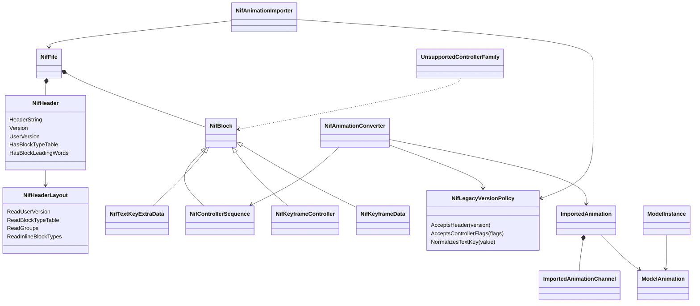
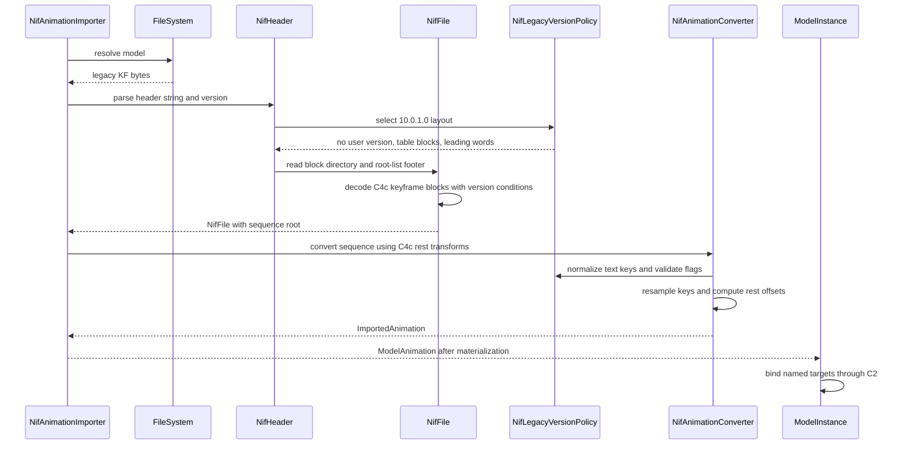

# Deep Dive: EE2 legacy KF formats (C4i)

> Expands phase C4i of [Track C: External Models & Animations](../track-c-external-assets.md).
>
> Audience: human design for extending the C4c Empire Earth II KF reader to older DDF-bound
> animation vintages.

Purpose: add the older Empire Earth II `.kf` files that share the C4c keyframe controller model
but use older NIF headers and several legacy controller conventions. C4i depends on
[C4c](c4c-ee2-rigid-animation.md) and reuses its model-qualified `#kf=` animation key, node
hierarchy bones, key evaluation, rest-offset conversion, and C2 binding.

The corpus survey was run on 2026-09-22 against the local EE2 Gold install. Scripts were kept out
of the repository and read ZIP members directly.

---

## 1. Scope and non-goals

C4i supports DDF-bound NIF 10.0.1.0 legacy KF clips whose bodies use the same C4c keyframe
controller family:

- `NiControllerSequence`, `NiTextKeyExtraData`, `NiKeyframeController`, and `NiKeyframeData`;
- the NIF 10.0.1.0 header and root-list footer;
- uppercase `.KF` archive entries and DDF `AnimName` values;
- legacy text key spelling where `end` may be stored as `end `;
- legacy controller flags observed in the proof clips;
- rigid proof targets that depend only on C4c hierarchy bones and not on C4d skinning.

C4i inventories but does not implement these legacy families:

- material color controllers and `NiPosData`, owned by C4e;
- visibility controllers and `NiVisData`, owned by C4e;
- UV controllers and `NiUVData`, owned by C4e texture-property work;
- morph controllers and `NiMorphData`, owned by C4g;
- skinned target models, owned by C4d.

NetImmerse 4.2.2.0 `.KF` files are explicitly rejected. They are structurally different, have no
DDF bindings in `db/Units/*.ddf`, and add only three unreferenced clips.

DDF state-machine loading, event text keys, sound and FX events, root-motion extraction, and
skinning remain outside this phase.

Decision: support NIF 10.0.1.0 first and reject NetImmerse 4.2.2.0. Reason: 10.0.1.0 has 201
DDF-bound clips and reuses the C4c block bodies, while 4.2.2.0 has no DDF-bound consumer and lacks
the block directory used by the current parser.

## 2. Target assets

The proof clips are DDF-bound, rigid, and use only the C4c keyframe block family.

| Unit model | Model kind | DDF file | Clip | Duration | Controllers | Proof role |
|---|---|---|---|---:|---:|---|
| `LLM11_guntank.NIF` | Rigid | `db/Units/light_mounted1.ddf` | `Graphics/Vehicles/LLM11_guntank_idle.kf` | 1.5667 s | 8 | Legacy XYZ quadratic wheels plus constant roots. |
| `LLM11_guntank.NIF` | Rigid | `db/Units/light_mounted1.ddf` | `Graphics/Vehicles/LLM11_guntank_walk.kf` | 1.5667 s | 8 | Wheel rotation proof using flags `0x05`. |
| `bld_palisade1_gate.NIF` | Rigid | `db/Units/palisade_gate.ddf` | `Graphics/Building/bld_palisade1_gate_open.kf` | 0.9667 s | 4 | Linear translation proof on two gate leaves. |
| `bld_palisade1_gate.NIF` | Rigid | `db/Units/palisade_gate.ddf` | `Graphics/Building/bld_palisade1_gate_close.kf` | 0.9667 s | 4 | Reverse linear translation proof. |

The guntank controllers target `wheel_F`, `Wheel1`, `wheel2`, `wheel3`, `wheel4`, `wheel_r`,
`Dummy01`, and `Dummy01 NonAccum`. The palisade controllers target `bld_palisade1_gate2`,
`bld_palisade1_gate3`, `ROOT`, and `ROOT NonAccum`. All targets resolve to nodes in rigid models.

Skinned DDF-bound legacy clips are deferred C4d consumers. They are still valuable parser fixtures
because they exercise the same 10.0.1.0 header and keyframe block bodies.

## 3. Corpus census

Only `graphics.zip` contributes legacy KF entries. `graphics_110.zip`, `graphics_120.zip`,
`Graphics_160.zip`, and `Graphics_LoewAmbientPack_160.zip` add no `.kf` or `.KF` entries.

| Flavor | Header string | Version word | Files | Lowercase `.kf` | Uppercase `.KF` | DDF-bound unique clips |
|---|---|---:|---:|---:|---:|---:|
| C4c baseline | `Gamebryo File Format, Version 10.1.0.0` | `0x0A010000` | 972 | 958 | 14 | Not counted here |
| Legacy target | `NetImmerse File Format, Version 10.0.1.0` | `0x0A000100` | 452 | 413 | 39 | 201 |
| Legacy rejected | `NetImmerse File Format, Version 4.2.2.0` | `0x04020200` | 3 | 0 | 3 | 0 |

The 10.0.1.0 files contain 482 sequences across 452 files. Thirty files have two root entries in
the footer. All parse to exact end-of-file with the layout in section 4.

### 3.1 Legacy 10.0.1.0 block families

| File family | Files | Implemented in C4i | Follow-up owner |
|---|---:|---|---|
| Keyframe only | 431 | Yes, through C4c conversion. | None |
| Keyframe plus material color | 14 | No | C4e |
| Keyframe plus visibility | 2 | No | C4e |
| Material color only | 2 | No | C4e |
| Keyframe plus morph plus material color | 2 | No | C4g and C4e |
| Keyframe plus morph plus material color plus UV | 1 | No | C4g and C4e |

Block counts across all 10.0.1.0 files:

| Block type | Blocks | Files | Notes |
|---|---:|---:|---|
| `NiControllerSequence` | 482 | 452 | Same controlled-block form as C4c. |
| `NiTextKeyExtraData` | 482 | 452 | Text values are `start`, `end`, or `end `. |
| `NiKeyframeController` | 13778 | 450 | Same data reference field as C4c. |
| `NiKeyframeData` | 13778 | 450 | Quaternion or XYZ rotation, translation, scale. |
| `NiMaterialColorController` | 414 | 19 | C4e property controller growth. |
| `NiPosData` | 227 | 19 | Vector key data for material color. |
| `NiVisController` | 4 | 2 | C4e visibility growth. |
| `NiVisData` | 4 | 2 | 16 byte keys total. |
| `NiUVController` | 1 | 1 | Legacy texture-coordinate controller, C4e growth. |
| `NiUVData` | 1 | 1 | Four float key groups. |
| `NiGeomMorpherController` | 5 | 3 | C4g morph growth. |
| `NiMorphData` | 5 | 3 | 9 morph targets total. |

No legacy KF file contains `NiSkinInstance`, `NiSkinData`, or particle-system blocks. Skinning is
present on many target models, not inside the `.kf` files.

### 3.2 Key and flag census

| Item | Count |
|---|---:|
| Quaternion rotation groups, linear | 12850 |
| XYZ rotation groups | 766 |
| `Vector3` translation groups, linear | 13603 |
| `Vector3` translation groups, quadratic | 227 |
| Float groups, quadratic | 2719 |
| Float groups, linear | 920 |
| Text keys named `start` | 482 |
| Text keys named `end ` | 466 |
| Text keys named `end` | 16 |

Controller flags by controller count: `0x0C` 13793, `0x05` 156, `0x2C` 76, `0x18` 76, `0x3C`
55, and `0x1C` 46. The proof clips use only `0x05` and `0x0C`.

## 4. Verified wire layout

The layouts below were checked against real files by parsing every block body and footer to exact
end-of-file. They also match nif.xml header conditions unless noted.

### 4.1 Header vintages

| Field | 10.1.0.0 C4c baseline | 10.0.1.0 C4i target | 4.2.2.0 rejected |
|---|---|---|---|
| Header string | Line string | Line string | Line string |
| Version | `u32` | `u32` | `u32` |
| User version | `u32`, observed `0` | Absent. nif.xml gates `User Version` from `10.0.1.8`; `0x0A000100` is below it. | Absent |
| Num blocks | `u32` after user version | `u32` immediately after version. Observed range 8 to 170. | `u32` immediately after version |
| Num block types | `u16` | `u16` | Absent |
| Block types | Sized strings | Sized strings | Absent, each block stores its type name inline |
| Block type index | `u16` per block | `u16` per block | Absent |
| Num groups | `u32`, observed `0` | `u32`, observed `0` | Absent |
| Per-block leading word | `u32 0` | `u32 0` | Absent |
| Footer | Root count and roots, observed `(1, 0)` in C4c targets | Root count and roots. Observed 422 files with one root and 30 with two roots. | Root count and roots, observed `(1, 0)` |

The first post-version word in 10.0.1.0 is `Num Blocks`, not a user version. The observed 8 to 170
range therefore describes block counts.

### 4.2 NIF 10.0.1.0 keyframe blocks

The four C4c reader blocks keep the same field order under 10.0.1.0:

| Block | Fields in order |
|---|---|
| `NiControllerSequence` | leading `u32 0`, name, accumulation-root name, text-keys ref, controlled-block count, then `target name`, `controller ref` pairs. |
| `NiTextKeyExtraData` | leading `u32 0`, name, text-key count, then `time`, `value` pairs. |
| `NiKeyframeController` | leading `u32 0`, next-controller ref, flags `u16`, frequency, phase, start, stop, target ref, data ref. |
| `NiKeyframeData` | leading `u32 0`, rotation key count, optional rotation type and rotation keys, translations key group, scales key group. |

`NiControllerSequence` uses the pre-interpolator controlled-block layout because 10.0.1.0 is less
than nif.xml `10.1.0.104` and `10.1.0.106` gates. Controlled blocks therefore contain no
interpolator ref, node-name string palette, property type, controller type, controller id, or
interpolator id.

`NiKeyframeController` uses the pre-`NiSingleInterpController` layout because `Data` exists until
`10.1.0.103`. There is no interpolator ref.

`NiKeyframeData` matches C4c key groups. XYZ rotation contains one order `f32`, then X, Y, and Z
float key groups. This is gated by nif.xml `Order` until `10.1.0.0` and is observed in the
10.0.1.0 files.

### 4.3 NetImmerse 4.2.2.0 layout

The three 4.2.2.0 files parse with a different container shape:

- header string, version, and num blocks only;
- no user version, no block type table, no block type index, and no group count;
- each block begins with a sized type string such as `NiSequence`, not a table index;
- block bodies have no leading `u32 0`;
- `NiSequence` contains name, accumulation-root name, text-key ref, controlled-block count, and
  target/controller pairs;
- the observed `NiSequence` text-key ref is `-1` in all three files;
- footer is a root-count list, observed root `0`.

Inventory:

| File | Blocks | Sequence targets | Text keys |
|---|---|---:|---|
| `Graphics/Humans/sh_gunattack01_a.KF` | `NiSequence`, 24 `NiKeyframeController`, 24 `NiKeyframeData` | 24 | None |
| `Graphics/Humans/sh_swordrun02.KF` | `NiSequence`, 24 `NiKeyframeController`, 24 `NiKeyframeData` | 24 | None |
| `Graphics/Vehicles/lha2_onager_reload.KF` | `NiSequence`, 3 `NiKeyframeController`, 3 `NiKeyframeData` | 3 | None |

This layout is rejected before block decoding in C4i.

## 5. Semantics and C4c deltas

C4i keeps the C4c conversion semantics for accepted keyframe data:

- model-qualified animation keys stay `<model-key>#kf=<archive-relative-kf-path>`;
- named targets bind through C2 by exact case-insensitive bone name;
- KF samples are absolute local transforms converted to rest-relative C1 offsets;
- C4c Euler order, Hermite tangent interpretation, and 30 Hz resampling are reused;
- identity scale is validated and dropped.

Legacy-specific changes:

- header parsing is version-gated instead of hard-coded to 10.1.0.0;
- the root-list footer is parsed as `num roots` plus refs for every version, not as the fixed pair
  `(1, 0)`;
- `NiControllerSequence`, `NiKeyframeController`, and `NiKeyframeData` readers accept 10.0.1.0
  under the same field conditions as 10.1.0.0 C4c;
- text key values are trimmed before comparison, so `end ` is accepted as `end`;
- uppercase `.KF` entry lookup is case-insensitive through the ZIP file system and importer path
  resolver;
- legacy controller flags `0x05` and `0x0C` are accepted for proof clips after frequency, phase,
  target ref, timing, and data refs validate. Other observed legacy flags are decoded and may be
  accepted only with fixtures.

The C4c failure contract still applies to unsupported controllers, non-unit scale, unsupported key
types, varying accumulation root, missing targets, and skinned model requirements.

Decision: C4i trims only text-key values, not target names. Reason: `end ` is a corpus-wide marker
spelling, while target names must remain exact C2 bone identities.

## 6. DDF-bound legacy targets

`db.zip` binds 305 legacy 10.0.1.0 animation references, 201 unique clip names, and 61 resolved
model targets after `UnitModel` parent inheritance and comment removal. `db_155.zip` repeats 31 of
the same unique clips and adds no new legacy clip. No DDF file references the three 4.2.2.0 clips.

Unique clip target classes:

| Target class | Unique clips | Notes |
|---|---:|---|
| Rigid | 34 | C4i proof candidates. |
| Skinned | 162 | C4d consumers after the parser can read the clip. |
| Mixed | 5 | `LLM4_mountedskirmisher.NIF` resolves to skinned regional variants plus a rigid projectile variant. Treat as C4d for unit animation. |

| Model target | Kind | Clips |
|---|---|---|
| `LLM4_mountedskirmisher.NIF` | Mixed | `sh_mountedskirmisher_attack01.KF`, `sh_mountedskirmisher_death01.KF`, `sh_mountedskirmisher_idle01.KF`, `sh_mountedskirmisher_run01.KF`, `sh_mountedskirmisher_walk01.KF` |
| `bld_palisade10_gate.NIF` | Rigid | `bld_palisade10_gate_close.kf`, `bld_palisade10_gate_close_idle.kf`, `bld_palisade10_gate_open.kf`, `bld_palisade10_gate_open_idle.kf` |
| `bld_palisade13_gate.NIF` | Rigid | `bld_palisade13_gate_close.kf`, `bld_palisade13_gate_close_idle.kf`, `bld_palisade13_gate_open.kf`, `bld_palisade13_gate_open_idle.kf` |
| `bld_palisade1_gate.NIF` | Rigid | `bld_palisade1_gate_close.kf`, `bld_palisade1_gate_close_idle.kf`, `bld_palisade1_gate_open.kf`, `bld_palisade1_gate_open_idle.kf` |
| `bld_palisade4_gate.NIF` | Rigid | `bld_palisade4_gate_close.kf`, `bld_palisade4_gate_close_idle.kf`, `bld_palisade4_gate_open.kf`, `bld_palisade4_gate_open_idle.kf` |
| `bld_palisade7_gate.NIF` | Rigid | `bld_palisade7_gate_close.kf`, `bld_palisade7_gate_close_idle.kf`, `bld_palisade7_gate_open.kf`, `bld_palisade7_gate_open_idle.kf` |
| `bld_wall2_gate.NIF` | Rigid | `bld_wall2_gate_close.kf`, `bld_wall2_gate_close_idle.kf`, `bld_wall2_gate_open.kf`, `bld_wall2_gate_open_idle.kf` |
| `bld_wall5_gate.NIF` | Rigid | `bld_wall5_gate_close.kf`, `bld_wall5_gate_close_idle.kf`, `bld_wall5_gate_open.kf`, `bld_wall5_gate_open_idle.kf` |
| `bld_wall8_gate.NIF` | Rigid | `bld_wall8_gate_close.kf`, `bld_wall8_gate_close_idle.kf`, `bld_wall8_gate_open.kf`, `bld_wall8_gate_open_idle.kf` |
| `LLM11_guntank.NIF` | Rigid | `LLM11_guntank_idle.kf`, `LLM11_guntank_walk.kf` |
| `CIV12_JungleHealder_Aztec.nif` | Skinned | `sh_medic_12_death01.KF`, `sh_medic_12_heal01.KF`, `sh_medic_12_idle01.KF`, `sh_medic_12_jog01.KF`, `sh_medic_12_walk01.KF` |
| `CIV1_Barbarian_German.nif` | Skinned | `sh_sword_death01.KF`, `sh_sword_idle01.KF`, `sh_sword_jog01.KF`, `sh_sword_walk01.KF` |
| `CIV1_Hwarang_Korean.NIF` | Skinned | `sh_lancer_attack01.kf`, `sh_lancer_death01.kf`, `sh_lancer_idle01.kf`, `sh_lancer_run01.kf`, `sh_lancer_walk01.kf` |
| `CIV1_QuetzalWarrior_Mayan.nif` | Skinned | `sh_sword_death01.KF`, `sh_sword_idle01.KF`, `sh_sword_jog01.KF`, `sh_sword_walk01.KF` |
| `CIV1_Spahi_Turkish.NIF` | Skinned | `sh_elitecavalry_attack01.KF`, `sh_elitecavalry_idle01.kf`, `sh_elitecavalry_run01.KF`, `sh_elitecavalry_walk01.KF` |
| `CIV2_hoplite_greek.nif` | Skinned | `CIV2_hoplite_greek_death01.kf`, `CIV2_hoplite_greek_idle01.kf`, `CIV2_hoplite_greek_jog01.kf`, `CIV2_hoplite_greek_walk01.kf` |
| `CIV7_Janissary_Turkish.nif` | Skinned | `sh_musketeer_attack01.KF`, `sh_musketeer_conversion01.KF`, `sh_musketeer_death01.KF`, `sh_musketeer_idle01.KF`, `sh_musketeer_jog01.KF`, `sh_musketeer_pack.KF`, `sh_musketeer_unpack.KF`, `sh_musketeer_walk01.KF` |
| `CIV7_Mameluke_Babylonian.NIF` | Skinned | `sh_dragoon_attack01.KF`, `sh_dragoon_death01.KF`, `sh_dragoon_idle01.KF`, `sh_dragoon_run01.KF`, `sh_dragoon_walk01.KF` |
| `CIV7_mercenary_roman.nif` | Skinned | `CIV7_mercenary_roman_attack01.kf`, `CIV7_mercenary_roman_death01.kf`, `CIV7_mercenary_roman_idle01.kf`, `CIV7_mercenary_roman_jog01.kf`, `CIV7_mercenary_roman_walk01.kf` |
| `CIV7_Minuteman_American.nif` | Skinned | `sh_regular_attack01.KF`, `sh_regular_death01.KF`, `sh_regular_idle01.KF`, `sh_regular_jog01.KF`, `sh_regular_walk01.KF` |
| `CIV7_Teut_Knight_German.NIF` | Skinned | `sh_elitecavalry_attack01.KF`, `sh_elitecavalry_idle01.kf`, `sh_elitecavalry_run01.KF`, `sh_elitecavalry_walk01.KF` |
| `faucow.nif` | Skinned | `sh_faucow_idle01.kf`, `sh_faucow_walk01.kf` |
| `faudeer.nif` | Skinned | `sh_faudeer_idle01.kf`, `sh_faudeer_walk01.kf` |
| `LHI11_machinegunner.nif` | Skinned | `sh_machinegunner_jog01.KF`, `sh_machinegunner_walk01.KF` |
| `lhi11_rifleman.nif` | Skinned | `sh_rifleman_capture01.KF`, `sh_rifleman_capture_bomb01.KF`, `sh_rifleman_jog01.KF`, `sh_rifleman_walk01.KF` |
| `lhi13_assaultrifleman.nif` | Skinned | `sh_assaultrifleman_attack01.KF`, `sh_assaultrifleman_death01.KF`, `sh_assaultrifleman_idle01.KF`, `sh_assaultrifleman_jog01.KF`, `sh_assaultrifleman_walk01.KF` |
| `LHI14_minigunner.nif` | Skinned | `sh_minigunner_attack01.KF`, `sh_minigunner_death01.KF`, `sh_minigunner_jog01.KF` |
| `lhi15_ObjectiveForceWarrior.nif` | Skinned | `sh_ObjectiveForceWarrior_pack01.KF`, `sh_ObjectiveForceWarrior_unpack01.KF` |
| `LHI2_spearman.nif` | Skinned | `sh_spear_attack01.kf`, `sh_spear_death01.kf`, `sh_spear_idle01.kf`, `sh_spear_jog01.kf`, `sh_spear_walk01.kf` |
| `LHI3_swordsman.nif` | Skinned | `sh_sword_attack02.KF`, `sh_sword_death01.KF`, `sh_sword_idle01.KF`, `sh_sword_jog01.KF`, `sh_sword_walk01.KF` |
| `LHI5_manatarms.nif` | Skinned | `sh_sword_attack01.KF`, `sh_sword_death01.KF`, `sh_sword_idle01.KF`, `sh_sword_jog01.KF`, `sh_sword_walk01.KF` |
| `LHI5_pikeman.nif` | Skinned | `sh_pike_attack01.kf`, `sh_pike_death01.kf`, `sh_pike_idle01.kf`, `sh_pike_jog01.kf`, `sh_pike_walk01.kf` |
| `LHI7_musketeer.nif` | Skinned | `sh_musketeer_attack01.KF`, `sh_musketeer_conversion01.KF`, `sh_musketeer_death01.KF`, `sh_musketeer_idle01.KF`, `sh_musketeer_jog01.KF`, `sh_musketeer_pack.KF`, `sh_musketeer_unpack.KF`, `sh_musketeer_walk01.KF` |
| `LHI8_halberdier.nif` | Skinned | `sh_halberdier_attack01.kf`, `sh_halberdier_death01.kf`, `sh_halberdier_idle01.kf`, `sh_halberdier_jog01.kf`, `sh_halberdier_walk01.kf` |
| `LHI9_regular.nif` | Skinned | `sh_regular_attack01.KF`, `sh_regular_death01.KF`, `sh_regular_idle01.KF`, `sh_regular_jog01.KF`, `sh_regular_walk01.KF` |
| `LHM10_imperiallancer.NIF` | Skinned | `sh_imperiallancer_attack01.kf`, `sh_imperiallancer_death01.kf`, `sh_imperiallancer_idle01.kf`, `sh_imperiallancer_run01.kf`, `sh_imperiallancer_walk01.kf` |
| `LHM2_mountedinfantry.NIF` | Skinned | `sh_mountedinfantry_attack01.kf`, `sh_mountedinfantry_death01.kf`, `sh_mountedinfantry_idle01.kf`, `sh_mountedinfantry_run01.kf`, `sh_mountedinfantry_walk01.kf` |
| `LHM4_armoredcavalry.NIF` | Skinned | `sh_armoredcavalry_attack01.kf`, `sh_armoredcavalry_death01.kf`, `sh_armoredcavalry_idle01.kf`, `sh_armoredcavalry_run01.kf`, `sh_armoredcavalry_walk01.kf` |
| `LHM6_elitecavalry.NIF` | Skinned | `sh_elitecavalry_attack01.KF`, `sh_elitecavalry_idle01.kf`, `sh_elitecavalry_run01.KF`, `sh_elitecavalry_walk01.KF` |
| `LHM8_lancer.NIF` | Skinned | `sh_lancer_attack01.kf`, `sh_lancer_death01.kf`, `sh_lancer_idle01.kf`, `sh_lancer_run01.kf`, `sh_lancer_walk01.kf` |
| `LLI11_mortar.nif` | Skinned | `sh_mortar_death01.KF`, `sh_mortar_idle01.KF`, `sh_mortar_jog01.KF`, `sh_mortar_pack01.KF`, `sh_mortar_unpack01.KF`, `sh_mortar_walk01.KF` |
| `LLI13_incendiarymortar.nif` | Skinned | `sh_incendiarymortar_death01.KF`, `sh_incendiarymortar_idle01.KF`, `sh_incendiarymortar_jog01.KF`, `sh_incendiarymortar_pack01.KF`, `sh_incendiarymortar_unpack01.KF`, `sh_incendiarymortar_walk01.KF` |
| `LLI15_bombletmortar.nif` | Skinned | `sh_bombletmortar_death01.KF`, `sh_bombletmortar_death02.KF`, `sh_bombletmortar_idle01.KF`, `sh_bombletmortar_walk01.KF` |
| `LLI5_crossbowman.nif` | Skinned | `sh_crossbowman_death01.kf`, `sh_crossbowman_idle01.KF`, `sh_crossbowman_run01.kf` |
| `LLI7_grenadepistoleer.nif` | Skinned | `sh_grenadepistoleer_death01.KF`, `sh_grenadepistoleer_idle01.KF`, `sh_grenadepistoleer_run01.KF`, `sh_grenadepistoleer_walk01.KF` |
| `LLI9_grenadier.nif` | Skinned | `sh_grenadier_attack01.KF`, `sh_grenadier_death02.KF`, `sh_grenadier_idle01.KF`, `sh_grenadier_jog01.KF`, `sh_grenadier_walk01.KF` |
| `LLM10_dragoon.NIF` | Skinned | `sh_dragoon_attack01.KF`, `sh_dragoon_death01.KF`, `sh_dragoon_idle01.KF`, `sh_dragoon_run01.KF`, `sh_dragoon_walk01.KF` |
| `LLM2_mountedslinger.NIF` | Skinned | `sh_mountedslinger_attack01.KF`, `sh_mountedslinger_death01.KF`, `sh_mountedslinger_idle01.KF`, `sh_mountedslinger_run01.KF`, `sh_mountedslinger_walk01.KF` |
| `lm6_king.nif` | Skinned | `sh_leader_attack01.kf`, `sh_leader_death01.kf`, `sh_leader_idle01.kf`, `sh_leader_run01.KF`, `sh_leader_walk01.KF` |
| `LSF10_spy.nif` | Skinned | `sh_spy_attack01.KF`, `sh_spy_death01.KF`, `sh_spy_idle01.KF`, `sh_spy_jog01.KF`, `sh_spy_walk01.KF` |
| `lsf12_medic.nif` | Skinned | `sh_medic_12_death01.KF`, `sh_medic_12_heal01.KF`, `sh_medic_12_idle01.KF`, `sh_medic_12_jog01.KF`, `sh_medic_12_walk01.KF` |
| `LSF13_spy.nif` | Skinned | `sh_spy_attack01.KF`, `sh_spy_death01.KF`, `sh_spy_idle01.KF`, `sh_spy_jog01.KF`, `sh_spy_walk01.KF` |
| `lsf14_medic.nif` | Skinned | `sh_medic_12_death01.KF`, `sh_medic_12_heal01.KF`, `sh_medic_12_idle01.KF`, `sh_medic_12_jog01.KF`, `sh_medic_12_walk01.KF` |
| `LSF1_citizen_m.NIF` | Skinned | `sh_citizen_idle01.kf`, `sh_citizen_tool_farm_forage.kf`, `sh_citizen_tool_farm_scythe.KF`, `sh_citizen_tool_farm_seedbag.KF`, `sh_citizen_tool_mine_PickAxe.KF`, `sh_citizen_walk01.kf` |
| `LSF1_spy.nif` | Skinned | `sh_spy_attack01.KF`, `sh_spy_death01.KF`, `sh_spy_idle01.KF`, `sh_spy_jog01.KF`, `sh_spy_walk01.KF` |
| `LSF2_tradecart.NIF` | Skinned | `LSF2_tradecart_death01.kf`, `LSF2_tradecart_idle01.KF`, `LSF2_tradecart_walk01.kf` |
| `lsf4_priest.nif` | Skinned | `sh_Priest_4_attack01.KF`, `sh_Priest_4_attack02.KF`, `sh_Priest_4_death01.KF`, `sh_Priest_4_idle01.KF`, `sh_Priest_4_jog01.KF`, `sh_Priest_4_walk01.KF` |
| `lsf4_spy.nif` | Skinned | `sh_spy_attack01.KF`, `sh_spy_death01.KF`, `sh_spy_idle01.KF`, `sh_spy_jog01.KF`, `sh_spy_walk01.KF` |
| `LSF6_tradecart.NIF` | Skinned | `LSF6_tradecart_death01.kf`, `LSF6_tradecart_idle01.KF`, `LSF6_tradecart_walk01.kf` |
| `LSF7_priest.nif` | Skinned | `sh_Priest_7_attack01.KF`, `sh_Priest_7_death01.KF`, `sh_Priest_7_idle01.KF`, `sh_Priest_7_walk01.KF` |
| `LSF7_spy.nif` | Skinned | `sh_spy_attack01.KF`, `sh_spy_death01.KF`, `sh_spy_idle01.KF`, `sh_spy_jog01.KF`, `sh_spy_walk01.KF` |

## 7. Mapping onto C1 and runtime

C4i has no new interchange type. It widens the C4c parser gate so accepted legacy clips feed the
same C4c `ImportedAnimation` conversion:

- `NifHeader` becomes a version-aware header model rather than a single 10.1.0.0 record.
- `NifFile.Read` keeps table-based block dispatch for 10.0.1.0 and 10.1.0.0, but reads root lists
  generically.
- `NifFile.Read` rejects 4.2.2.0 before block dispatch because there is no block directory.
- The C4c block readers receive the active NIF version and apply nif.xml field conditions.
- `NifAnimationImporter` resolves `.KF` and `.kf` paths case-insensitively through the existing
  file-system abstraction.
- The C4c converter trims text key marker values before checking `start` and `end`.

Current gaps:

- `NifHeader` accepts only 10.1.0.0 with user version 0 at
  `src/OpenSage.FileFormats.Nif/NifHeader.cs:19-43`.
- `NifHeader` always reads user version before num blocks at
  `src/OpenSage.FileFormats.Nif/NifHeader.cs:39-50`, which misreads 10.0.1.0.
- `NifFile.Read` assumes a leading `u32 0` for every block and a fixed `(1, 0)` footer at
  `src/OpenSage.FileFormats.Nif/NifFile.cs:27-46`.
- `NifFile.ReadBlock` lacks all C4c KF block types at
  `src/OpenSage.FileFormats.Nif/NifFile.cs:118-154` until C4c lands.
- `NifModelImporter` currently resolves only model entries and produces a default skeleton at
  `src/OpenSage.Game/Content/Importing/Nif/NifModelImporter.cs:38-59`; C4c changes that before
  C4i conversion can run.
- C4 rest-offset and identity-scale precedent live in
  `src/OpenSage.Game/Content/Importing/Gltf/GltfAnimationConverter.cs:121-128` and
  `src/OpenSage.Game/Content/Importing/Gltf/GltfAnimationConverter.cs:211-229`.

## 8. Failure contract

| Condition | Result |
|---|---|
| NetImmerse 4.2.2.0 file | `NotSupportedException` naming the header version and lack of DDF binding. |
| 10.0.1.0 file with no block type table | `InvalidDataException`, because that would contradict the verified layout. |
| 10.0.1.0 unsupported controller block | `NotSupportedException` naming the block and follow-up phase. |
| 10.0.1.0 text key value other than trimmed `start` or `end` | `InvalidDataException`. |
| Legacy controller flag outside the accepted fixture set | `NotSupportedException` naming the flag and asset. |
| DDF-bound skinned target before C4d | `NotSupportedException` from the model or animation binding path. |
| Missing target node in a rigid proof model | `InvalidDataException` naming the target. |
| Any C4c unsupported key, scale, or accumulation-root condition | Same result as C4c. |

Unsupported controller families are not silently skipped. A file containing keyframe controllers
and a material, visibility, UV, or morph controller is rejected until the owning phase implements
that family.

## 9. Proof and completion boundary

C4i is complete when:

- synthetic parser tests lock the 10.0.1.0 no-user-version header, block table, root-list footer,
  and four C4c keyframe block bodies;
- the three NetImmerse 4.2.2.0 files are rejected with a stable diagnostic;
- the uppercase `.KF` resolver test passes on at least one DDF-bound clip;
- `LLM11_guntank_idle.kf`, `LLM11_guntank_walk.kf`, `bld_palisade1_gate_open.kf`, and
  `bld_palisade1_gate_close.kf` import, bind, and sample against their rigid models;
- deterministic captures show guntank wheel motion and palisade gate translation;
- C4e, C4g, and C4d handoff tests prove unsupported legacy families fail with the owning phase
  named in the message.

## 10. Architecture diagrams





## Appendix: current-code grounding

- Single-version header gate: `src/OpenSage.FileFormats.Nif/NifHeader.cs:19-43`.
- Current user-version and block-table parse: `src/OpenSage.FileFormats.Nif/NifHeader.cs:39-77`.
- Current fixed block leading word and fixed footer: `src/OpenSage.FileFormats.Nif/NifFile.cs:27-46`.
- Current block dispatch before C4c: `src/OpenSage.FileFormats.Nif/NifFile.cs:118-154`.
- Reference validation and root discovery: `src/OpenSage.FileFormats.Nif/NifFile.cs:157-312`.
- Current NIF model importer path and default skeleton: `src/OpenSage.Game/Content/Importing/Nif/NifModelImporter.cs:38-59` and `:72-78`.
- C1 channel target and C2 binding context: [C1](c1-import-abstraction.md#2-interchange-model) and
  [C2](c2-skeleton-animation-retargeting.md#3-channel-target-contract).
- C4c conversion source of truth: [C4c sections 3 to 6](c4c-ee2-rigid-animation.md#3-kf-10100-wire-layout).

## Appendix: reproduction

Commands read archive members directly and create no repository artifacts:

```sh
python3 - <<'PY'
from pathlib import Path
import collections, struct, zipfile
base = Path('/home/rmessinger/dev/Empire Earth II Gold/zips')
with zipfile.ZipFile(base / 'graphics.zip') as z:
    counts = collections.Counter()
    exts = collections.defaultdict(collections.Counter)
    for name in z.namelist():
        if name.lower().endswith('.kf'):
            data = z.read(name)
            off = data.index(b'\n') + 1
            header = data[:off - 1].decode('latin1')
            version = struct.unpack_from('<I', data, off)[0]
            key = (header, version)
            counts[key] += 1
            exts[key][Path(name).suffix] += 1
    for key, count in counts.items():
        print(key, count, dict(exts[key]))
PY
```

The block-layout census used the same header parser plus minimal stdlib readers for the block
families listed in section 3.1. DDF binding used `db.zip` `db/Units/*.ddf`, resolved `UnitModel`
parent `DefaultModel` inheritance, then matched `AnimName` values case-insensitively against
`graphics.zip` entry basenames.
