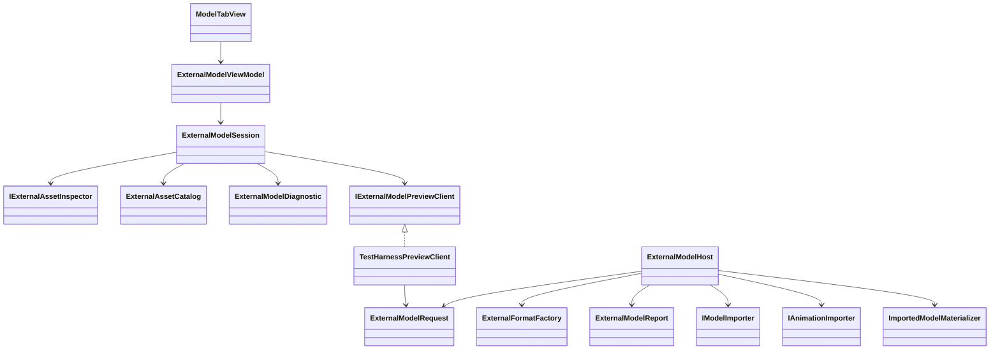
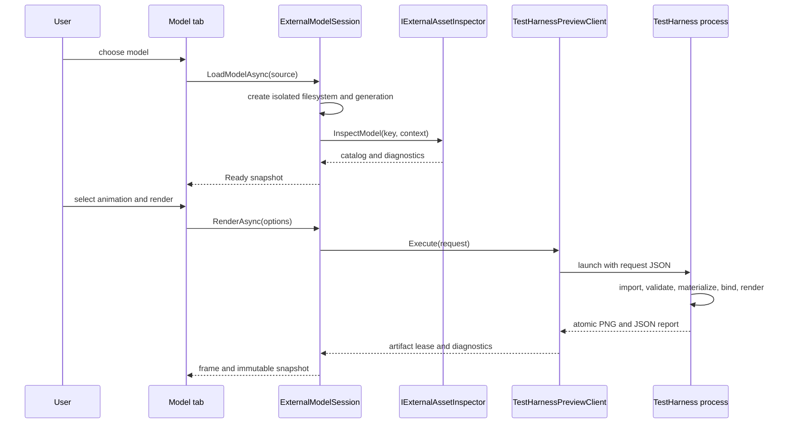
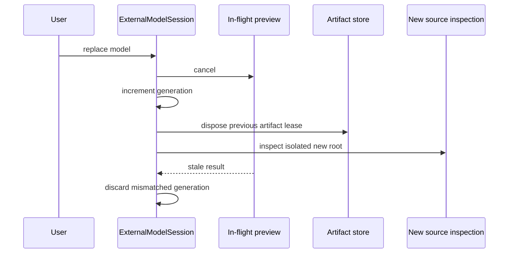

# Deep Dive: External Model Tooling (C5)

> Expands phase C5 of [Track C: External Models & Animations](../track-c-external-assets.md).
>
> Audience: human design for inspecting, validating, and previewing external models through
> ReplaySketch. Code references are in the agent-context appendix.

Purpose: make the C1-C4 import pipeline usable without adding a second asset viewer or embedding
format-specific rules in the user interface.

---

## 1. Scope

C5 adds a Model tab to ReplaySketch with:

- external model selection;
- source summary and animation discovery;
- structured validation diagnostics;
- explicit model and animation pairing;
- camera, unit-scale, axis, animation, and sample-time controls;
- graphics-backed preview captures;
- machine-readable reports and deterministic headless captures.

ReplaySketch remains the only external-model authoring tool. TestHarness remains the graphics
host. C5 does not add model editing, conversion, source-file rewriting, provenance tracking,
licensing metadata, or a second standalone viewer.

## 2. Project boundaries

Responsibilities remain split by existing project boundaries:

| Project | Responsibility |
|---|---|
| ReplaySketch MAUI | File picking, commands, tab presentation, image display |
| ReplaySketch Core | Session state, format selection, diagnostics, reports, preview requests |
| OpenSage.Game | Import, validation, materialization, animation binding |
| TestHarness | Graphics device, scene, model lifetime, frame capture |

The external-model session path in ReplaySketch Core never creates a graphics device. MAUI does
not parse glTF or duplicate C1-C4 validation. TestHarness does not own source selection or
diagnostic presentation.

The Model tab is independent of the Tree, Map, and Validation Ground tabs. Loading an external
model does not mutate the current replay scenario or Generals asset store.

## 3. Explicit importer selection

Shipped game definitions continue to select one model importer and one animation importer through
their asset load strategy. C5 does not replace that with a global multi-format registry.

An external-model session creates an explicit `ExternalFormatSelection` from the selected file:

| Extension | Model importer | Animation importer | Inspector |
|---|---|---|---|
| `.gltf`, `.glb` | C4 glTF importer | C4 glTF importer | C4 glTF inspector |

The selection object is immutable and local to the session. It contains a public format identifier,
options, and inspection facade, not the internal C1 importer interfaces. TestHarness maps the
format identifier to internal importer instances through an engine-owned factory. Adding a format
requires one explicit factory entry and inspector implementation. Unknown extensions produce
`EXT001 UnsupportedFormat`.

The external source directory is mounted through a dedicated read-only wrapper that rejects rooted,
escaping, and non-normalized virtual paths before delegating to `DiskFileSystem`. The selected
filename becomes the root virtual key. The root is never layered into the Generals installation
filesystem, so an external texture or model cannot shadow a game asset.

## 4. Inspection contract

C5 adds a public, format-neutral `IExternalAssetInspector` facade beside the internal C1 import
contracts:

```text
InspectModel(assetKey, context) -> ExternalAssetCatalog
```

The catalog contains only engine-owned values:

- source display name and format;
- scene, node, primitive, vertex, index, material, image, skin, and joint counts;
- model bounds;
- required and optional feature identifiers;
- animation descriptors with stable asset keys, names, duration, and channel count;
- parser diagnostics that do not prevent a valid import.

`ExternalAssetInspection.CreateGltf(options)` returns the public facade while its implementation and
C1 importer instances remain internal to `OpenSage.Game`. ReplaySketch Core therefore needs no
friend-assembly access. The C4 inspector uses the same parser, resolver, limits, and subset checks
as the importers. It must not become a second permissive parser path. The catalog does not contain
parser objects or materialized assets.

An animation descriptor key uses C4's
`<normalized-model-path>#animation=<zero-based-index>` form. A model can pair with an animation
from the same document or another selected document. C2 performs late binding against the loaded
model hierarchy; the tooling does not require declared source ownership.

## 5. Session state

`ExternalModelSession` is the single source of truth for the Model tab:

```text
State: Empty | Inspecting | Ready | Rendering | Failed | Disposed
Model source and importer selection
Optional animation source and selected descriptor
Preview options
ExternalAssetCatalog
Diagnostics
Preview eligibility
Latest preview artifact
Monotonic request generation
```

Operation state and diagnostic severity are separate. A ready session can contain warnings. An
operation fails only when it cannot produce the requested catalog, import graph, or preview.

Replacing a model:

1. Cancels the current inspection or preview request.
2. Increments the request generation.
3. Disposes the source filesystem and prior preview artifact lease.
4. Clears animation selection and source-specific corrections.
5. Starts inspection for the new source.

Results carrying an older generation are discarded. Cancellation is not reported as an import
error. Session methods are asynchronous and publish immutable snapshots so MAUI does not observe
partially updated state.

## 6. Diagnostics

`ExternalModelDiagnostic` contains:

| Field | Meaning |
|---|---|
| Code | Stable machine-readable identifier |
| Severity | `Info`, `Warning`, or `Error` |
| Stage | Selection, Resolve, Parse, Convert, Validate, Materialize, Bind, or Render |
| Source | Model or animation source |
| Context | Optional scene, node, primitive, material, image, bone, or animation identity |
| Message | Concise human-readable description |
| FixHint | Optional corrective action |

Codes are uppercase family prefixes plus three digits:

- `EXT` for source selection and session failures;
- `GLTF` for C4 parse and conversion results;
- `IMP` for C1 interchange validation;
- `ANIM` for C2 binding;
- `PBR` for C3 materials and textures;
- `GPU` for materialization and rendering.

C5 owns one explicit exception-to-code table keyed by operation stage and exception type. It maps
the C1-C4 `InvalidDataException` and `NotSupportedException` contracts without parsing exception
messages or reimplementing checks. The detecting subsystem still owns the contextual message. An
unexpected exception becomes `EXT999 InternalFailure`, retains its exception as diagnostic detail
for logs, and fails the operation. It is not converted into a warning.

Diagnostics sort by severity, stage, source order, context, and code. Duplicate diagnostics with
the same code, source, context, and message collapse with an occurrence count.

`PreviewEligibility` is a separate value:

```text
CanRender
BlockingDiagnosticCodes
MissingCapabilities
```

Warnings never block a preview by themselves.

## 7. Import and preview options

Importer options are explicit session values:

- `UnitsPerMeter`, positive and finite;
- C6 feature gates and per-target allowed morph-weight ranges.

Changing an importer option cancels current work and reruns inspection and import. These values
affect interchange data and appear in the report, but never modify the source file.

Preview corrections are explicit session values:

- model yaw, pitch, and roll;
- model translation;
- camera orbit, elevation, distance, and field of view;
- selected animation and sample time;
- background and lighting preset.

When the C6 morph gate is enabled, preview corrections also include per-target weights. They are
hidden otherwise and must remain inside the importer option's allowed ranges.

C4's coordinate conversion remains fixed. `UnitsPerMeter` changes magnitude only. Axis controls
are post-import preview transforms, not alternate importer semantics. The UI labels every
non-default option or correction and includes it in the report and preview request.

Corrections never modify the source file, imported arrays, or game definitions. Reset restores
canonical C4 import and default camera values.

## 8. Graphics preview protocol

ReplaySketch does not embed a second real-time renderer. `IExternalModelPreviewClient` is a new
awaitable, cancellable process abstraction with exit code and standard-error capture; it does not
reuse the existing fire-and-forget `IProcessLauncher`. Its implementation locates the built
TestHarness executable using the existing sibling-build-directory convention, then launches
external-model mode with one JSON request:

```sh
<OpenSage.Tools.TestHarness executable> --external-model-request <request.json>
```

`dotnet run --project src/OpenSage.Tools.TestHarness -- --external-model-request <request.json>`
is a developer fallback, not the ReplaySketch launch path.

The request contains:

- schema version and request generation;
- absolute model source root and virtual key, plus optional animation source root and virtual key;
- importer options, feature gates, and preview corrections;
- animation sample time;
- camera, lighting, viewport, output image, and output report paths.

Absolute host paths exist only in the process request. Importers still receive virtual keys and a
dedicated filesystem.

TestHarness:

1. Validates the request schema and output paths.
2. Resolves a game installation as the rendering host.
3. Creates isolated model and optional animation filesystems and explicit importer selections.
4. Imports and validates the model and optional animation in their respective contexts.
5. Creates an external `AssetLoadContext` using the model filesystem plus the host's graphics,
   shader, and asset-store services, then materializes GPU assets.
6. Binds and samples the animation through C2.
7. Renders a deterministic model scene.
8. Atomically writes PNG and JSON results.
9. Disposes the model, textures, buffers, filesystem, scene, game, and graphics device.

The external filesystem is the materializer's filesystem for that request, so relative C3 image
paths cannot resolve from or shadow the game installation. Engine-owned neutral resources still
come from the host asset and shader services.

One request uses one process. Cancellation terminates that owned process and awaits exit. Process
exit gives GPU resources an explicit upper-bound lifetime and isolates driver failure from MAUI. A
later phase may add a persistent preview worker only if latency measurements require it; the
protocol and session generation remain unchanged.

The Model tab displays the returned PNG. Animation controls choose a sample time and request a new
frame; C5 does not claim real-time embedded playback.

Preview artifacts live in one session-owned temporary directory with explicit filenames. Replacing
or disposing the session releases the artifact lease and deletes only that directory. Failed
requests preserve their report until the next request so diagnostics remain inspectable.

## 9. Model tab

The tab has four areas:

| Area | Contents |
|---|---|
| Source | Model picker, optional animation picker, discovered clips, reload |
| Summary | Bounds and structural counts |
| Preview | Captured frame, camera controls, animation time, render command |
| Diagnostics | Filterable severity/stage table and selected detail |

The render command is enabled only when `PreviewEligibility.CanRender` is true and no render is in
flight. Source and animation picker services are injected into the view model. Core tests use
fake inspectors, preview clients, clocks, and artifact stores.

The existing ReplaySketch screenshot mode accepts
`REPLAYSKETCH_SCREENSHOT_TAB=model`. A deterministic fake session populates the tab for UI
screenshots without starting TestHarness. Every Model-tab screenshot change is paired with a Map
tab screenshot to catch tab-layout regressions.

## 10. Reports and headless use

`ExternalModelReport` is versioned JSON containing:

- normalized source identities and content hashes;
- importer and report schema versions;
- catalog summary;
- animation pairing and binding results;
- importer options, preview corrections, and feature gates;
- sorted structured diagnostics;
- preview eligibility;
- render metadata and optional capture hash.

Reports never contain parser objects, temporary paths, stack traces, or machine-specific game
installation paths. Exception detail stays in local logs.

The same TestHarness request protocol is the headless entry point. Omitting the output image runs
inspection, import, materialization, and optional binding without frame capture. CPU-only Core
tests stop before TestHarness and require no game installation or GPU. Graphics-backed requests
require the normal TestHarness game installation and device checks.

## 11. Acceptance

C5 is complete when:

- ReplaySketch opens a glTF or GLB from outside the game installation;
- relative resources resolve only inside its dedicated external root;
- the Model tab shows counts, bounds, discovered animations, and structured diagnostics;
- an animation from the same or another document binds through C2 by name;
- warnings remain visible without blocking an otherwise valid preview;
- C1-C4 exception types and stages map through the tested stable-code table and block rendering;
- a glTF with a relative external PNG renders through the external materialization context;
- changing `UnitsPerMeter` reloads the import while preview transforms affect only the captured
  scene, and both appear in the report;
- replacing a source cancels stale work and releases filesystem and artifact leases;
- each TestHarness request disposes all GPU resources before exit;
- a versioned headless report and deterministic PNG can be generated from a request file;
- session orchestration and report ordering are covered by install-free Core tests;
- TestHarness covers one static PBR model, one skinned animation, and one failure report;
- ReplaySketch screenshot mode covers the Model tab and confirms the Map tab remains unchanged.

## 12. Architecture diagrams







## Appendix: current-code grounding

- ReplaySketch shell and tabs:
  `src/OpenSage.Tools.ReplaySketch.Maui/MainPage.xaml` and `MainPage.xaml.cs`.
- Top-level commands and current process-launching precedent:
  `src/OpenSage.Tools.ReplaySketch.Maui/ViewModels/MainViewModel.cs`,
  `src/OpenSage.Tools.ReplaySketch.Core/Services/IProcessLauncher.cs`, and
  `src/OpenSage.Tools.ReplaySketch.Core/Services/LauncherLocatorService.cs`, and
  `src/OpenSage.Tools.ReplaySketch.Maui/Services/SystemProcessLauncher.cs`.
- Existing file and folder picker patterns:
  `src/OpenSage.Tools.ReplaySketch.Maui/Views/ValidationGroundEditorView.xaml.cs` and
  `MapPreviewView.xaml.cs`.
- Screenshot mode:
  `src/OpenSage.Tools.ReplaySketch.Maui/MainPage.xaml.cs`.
- TestHarness entry point and capture helpers:
  `src/OpenSage.Tools.TestHarness/Program.cs`,
  `ScenarioCaptureRunner.cs`, and `EngagementCaptureRunner.cs`.
- Existing Core orchestration patterns:
  `src/OpenSage.Tools.ReplaySketch.Core/HarnessRunner.cs`,
  `ScenarioMatrixRunner.cs`, and `Services/UnitContractRunner.cs`.
- ReplaySketch tests:
  `src/OpenSage.Tools.ReplaySketch.Tests`.
