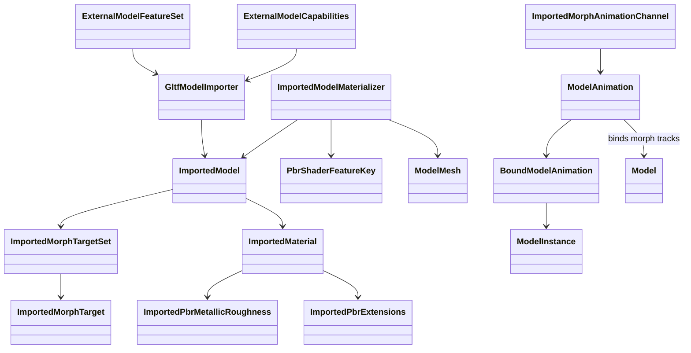
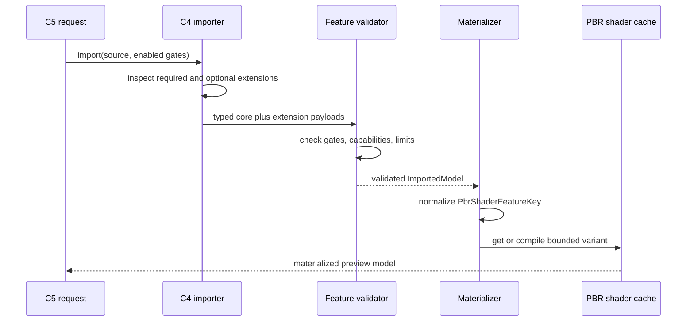
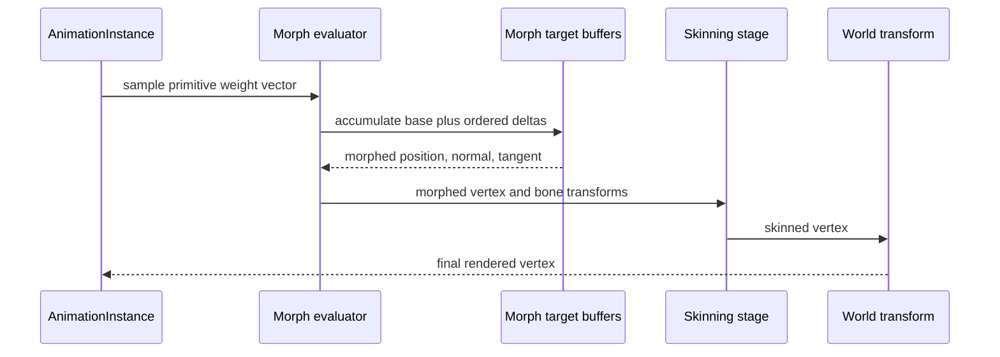

# Deep Dive: Extended Model Features (C6)

> Expands phase C6 of [Track C: External Models & Animations](../track-c-external-assets.md).
>
> Audience: human design for opt-in morph targets and advanced glTF PBR experiments. Code
> references are in the agent-context appendix.

Purpose: provide bounded extension points after C4 and C5 prove the core pipeline. C6 changes no
default shipped-game or core glTF behavior until a named experiment is enabled.

---

## 1. Activation contract

C6 is a set of experiments, not one unconditional implementation phase. Work starts only when an
external model demonstrates a missing feature and records:

- the source feature or extension;
- a repository-owned reduced fixture;
- the visual or behavioral target;
- the required importer, interchange, runtime, shader, and tooling work;
- a named feature gate;
- acceptance captures and fallback behavior.

`ExternalModelFeatureSet` carries explicit flags through C4, C5, TestHarness, and materialization.
Default is `None`. Initial gate names are:

| Gate | Family |
|---|---|
| `morph-targets` | Morph geometry and weight animation |
| `pbr-specular-surface` | IOR, specular, emissive strength |
| `pbr-layered-surface` | Clearcoat, sheen, anisotropy, iridescence |
| `pbr-light-transport` | Transmission, volume, dispersion, diffuse transmission |

Gates are scoped to one external import request. They are not global switches and are not enabled
by shipped game definitions during C6.

An enabled gate does not imply backend support. Import begins only when
`ExternalModelCapabilities` confirms the requested CPU, graphics, shader, texture, and pass
capabilities. A missing capability produces a blocking diagnostic before GPU allocation.

Required source extensions still fail when their gate is disabled. Optional extensions may be
ignored only under the policy in section 8.

## 2. Morph interchange

Morph targets remain separate from `ImportedVertex`. They do not reuse `SecondaryPosition` and do
not add a fixed array to every vertex.

```text
ImportedMorphTargetSet
  PrimitiveId
  TargetNames[]
  DefaultWeights[]
  AllowedWeightRanges[]
  Targets[]

ImportedMorphTarget

  Optional PositionDeltas[]
  Optional NormalDeltas[]
  Optional TangentDeltas[]

ImportedMorphAnimationChannel
  PrimitiveId
  TargetNames[]
  Times[]
  WeightVectors[]
  Interpolation
```

One target set belongs to one imported primitive before C4's `ushort` split. Split meshes retain
the same `PrimitiveId` and slice every target array with the same vertex remap as base geometry.
Target names use authored names when available and deterministic `Target<index>` names otherwise.

Position, normal, and tangent values are deltas in model space. At least one delta array must be
present; missing arrays mean zero. Counts must match the base primitive when present. Values must
be finite.

The initial limit is eight targets per primitive. C6 does not truncate targets. A source above the
limit fails with `NotSupportedException` until an experiment raises the capability and adds
coverage.

## 3. Morph weights and animation

Default weights come from the mesh and may be overridden by the mesh node. The target count and
weight vector length must match exactly. Each target also has an explicit finite allowed range
stored with the model. Default is `[-1, 1]`; an experiment may widen it through importer
constructor options and must then regenerate bounds. A default weight outside the selected range
fails import.

Morph animation is not represented as bone channels. `ImportedMorphAnimationChannel` addresses a
primitive and target-name vector directly. C2 continues to own only skeleton binding.

The C4 animation descriptor can contain both skeletal and morph channel groups. Materialization
produces a `ModelAnimation` with independently bound bone and morph tracks. A clip containing
morph tracks uses `ModelAnimation.Bind(Model)`, with a weak cache keyed by model identity, so
`BoundModelAnimation` can validate primitive and target identities. Bone-only clips retain C2's
`Bind(ModelBoneHierarchy)` and hierarchy-keyed cache. Missing or duplicate primitive identities,
target-name mismatches, target-count mismatches, and weights outside the model's allowed ranges
fail binding.

`LINEAR` and `STEP` interpolation follow C4. Cubic spline weights remain unsupported until a
separate experiment defines exact interpolation.

Weights are finite but are not clamped to zero through one. Negative and over-one values are valid
when the model's explicit allowed range includes them. The imported clip records observed minima
and maxima for binding diagnostics, but those clip values do not define model bounds.

## 4. Deformation and bounds

Deformation order is fixed:

1. Start with base position, normal, and tangent.
2. Add weighted morph deltas in target-index order.
3. Normalize the resulting normal and tangent and restore tangent orthogonality.
4. Apply skeletal skinning.
5. Apply object and world transforms.

The CPU reference path is implemented first. Under the `morph-targets` gate, each
`ModelMeshInstance` owns a dynamic morphed vertex buffer instead of mutating the model's shared
static buffer. It evaluates morphed data before the existing skinning path. For a two-influence C4
vertex, each delta updates both copies of its model-space position and normal. The path is the
correctness oracle for captures and later shader work. Feature-disabled instances retain the
shared static buffer.

The production experiment moves morph accumulation into the vertex shader using immutable target
buffers and one small per-instance weight buffer. The normalized shader feature key distinguishes:

- no deformation;
- skinning only;
- morphing only;
- morphing followed by skinning.

The eight-target import limit is also the active target limit. The shader processes all eight
slots in stable order and zero-fills unused slots. No frame-dependent top-weight selection is
allowed.

Bounds use interval arithmetic. For each target, the importer records per-axis delta minima and
maxima. Materialization combines those with the model-side allowed weight range to expand base
bounds conservatively, then applies the existing skinned-bounds policy. C5 rejects preview weights
outside that range; changing a range reloads and rematerializes the model.

## 5. Advanced material interchange

C6 adds an optional typed `ImportedPbrExtensions` payload beside C3's core
`ImportedPbrMetallicRoughness`. Each family is immutable and absent unless used:

```text
ImportedPbrExtensions
  Optional SpecularSurface
  Optional Clearcoat
  Optional Sheen
  Optional Anisotropy
  Optional Iridescence
  Optional Transmission
  Optional Volume
  Optional Dispersion
  Optional DiffuseTransmission
  Optional EmissiveStrength
```

Fields use engine semantics and C3 `ImportedTextureBinding` values. Parser-specific extension
objects and numeric enum constants remain inside C4.

Typed validation checks finite ranges, required texture channels, UV availability, and
cross-feature constraints before image decoding or GPU allocation. C3 core values remain valid
without the extension payload.

## 6. Shader feature normalization

Materialization converts the typed payload into a normalized `PbrShaderFeatureKey`. The key
contains only output-affecting booleans and small enums:

- core texture and alpha features;
- deformation mode;
- specular-surface features;
- layered-surface lobes;
- light-transport pass requirements.

Texture identities, factors, and sampler values remain material resource keys, not shader-variant
bits. Equivalent source extension combinations normalize to one key. Invalid combinations fail
before shader lookup.

The shader cache compiles only requested keys and enforces a configured variant ceiling. A
ceiling breach is a blocking capability diagnostic, not silent feature removal.

## 7. Material implementation families

The families have different renderer impact and are not scheduled as one shader patch.

### 7.1 Specular surface

`KHR_materials_ior`, `KHR_materials_specular`, and `KHR_materials_emissive_strength` extend the
existing opaque metallic-roughness pass. They add typed constants and bindings without changing
render ordering.

### 7.2 Layered surface

Clearcoat, sheen, anisotropy, and iridescence add distinct BRDF lobes and may add normal or lookup
textures. Each extension gets a focused shader implementation and reference capture. Combined
variants are enabled only after pairwise energy and normal-basis tests pass.

### 7.3 Light transport

Transmission, volume, dispersion, and diffuse transmission require scene-color access,
thickness or exit-distance semantics, transparent ordering, and possibly additional passes.
They do not enter the ordinary C3 alpha-blend path as extra uniforms.

The `pbr-light-transport` experiment must define before implementation:

- opaque and transparent queue placement;
- scene-color and depth inputs;
- back-face or thickness pass ownership;
- refraction and attenuation approximation;
- behavior for overlapping transmissive surfaces;
- capture platform and tolerance.

Until that experiment is accepted, a material requiring these semantics remains unsupported even
if the interchange payload type exists.

## 8. Extension and fallback policy

For each glTF extension:

| Source condition | Gate/capability | Result |
|---|---|---|
| Listed in `extensionsRequired` | disabled or unavailable | fail |
| Listed in `extensionsRequired` | enabled and implemented | preserve semantics |
| Optional and changes required geometry data | disabled | fail |
| Optional material extension with complete core fallback | disabled | ignore and warn |
| Optional material extension | enabled but unavailable | fail |
| Unknown required extension | any | fail |
| Unknown optional extension | complete core fallback | ignore and warn |

An optional extension has a complete core fallback only when removing the extension leaves valid
core glTF data with defined output. Morph targets are geometry semantics and are never silently
ignored. A warning identifies the extension, material or primitive, and disabled gate.

No experiment changes C4's behavior when `ExternalModelFeatureSet.None` is used.

## 9. C5 integration

The Model tab lists:

- extensions detected by the inspector;
- required gate names;
- available and missing capabilities;
- active feature gates;
- morph target names and current weights;
- allowed morph-weight ranges when the morph gate is active;
- advanced material families used by each material.

Feature gates are explicit controls in development builds and request JSON. Enabling a gate reloads
the source from inspection; it does not reinterpret an already materialized model.

C5 reports preserve disabled-feature, unsupported-required-extension, capability, shader-key, and
bound-expansion diagnostics. Preview captures record every active gate and the normalized feature
keys used by the model.

## 10. Acceptance

The `morph-targets` experiment is complete when:

- a repository-owned fixture imports position, normal, and tangent deltas;
- default, node-override, linear, and step weights evaluate correctly;
- CPU and shader deformation agree within the defined tolerance;
- morph-only and morph-then-skinning captures match reference output;
- split primitives preserve target identity and vertex remapping;
- morph clips bind through model identity while bone-only clips retain C2 hierarchy caching;
- conservative bounds contain every sampled clip frame;
- more than eight targets fails rather than truncates;
- the feature-disabled C4 result remains unchanged.

Each advanced material experiment is complete when:

- the extension maps to a typed payload with no parser-type leakage;
- malformed values and unsupported combinations fail before GPU allocation;
- the normalized shader key is stable and covered by cache tests;
- a neutral-value fixture matches C3 core output;
- focused and combined fixtures match reference captures;
- required, optional-fallback, disabled-gate, missing-capability, and variant-ceiling behavior is
  covered;
- C5 reports active gates and exact diagnostics;
- all C1-C5 tests pass with every C6 gate disabled.

Light-transport acceptance additionally requires deterministic captures for overlapping surfaces,
depth interaction, attenuation, and render ordering on every supported graphics backend chosen by
its experiment.

## 11. Architecture diagrams







## Appendix: current-code grounding

- Base interchange:
  `src/Panopticon.Simulation/Content/Importing/ImportedModel.cs`, `ImportedVertex.cs`,
  `ImportedMesh.cs`, `ImportedMeshPart.cs`, `ImportedAnimation.cs`, and
  `ImportedAnimationChannel.cs`.
- C1 materialization:
  `src/Panopticon.Simulation/Content/Loaders/ImportedModelMaterializer.cs` and
  `ImportedAnimationMaterializer.cs`.
- Runtime deformation:
  `src/Panopticon.Simulation/Graphics/ModelMesh.Imported.cs`,
  `ModelInstance.cs`, `Animation/ModelAnimation.cs`, and `Animation/AnimationInstance.cs`.
- Existing material and shader resources:
  `src/Panopticon.Simulation/Content/Importing/ImportedMaterial.cs`,
  `src/Panopticon.Simulation/Graphics/Shaders/ShaderSetBase.cs`, and
  `src/Panopticon.Simulation/Graphics/Shaders/ShaderResourceManager.cs`.
- C5 feature controls and reporting:
  `src/Panopticon.Tools.ReplaySketch.Core` and
  `src/Panopticon.Tools.TestHarness`.
