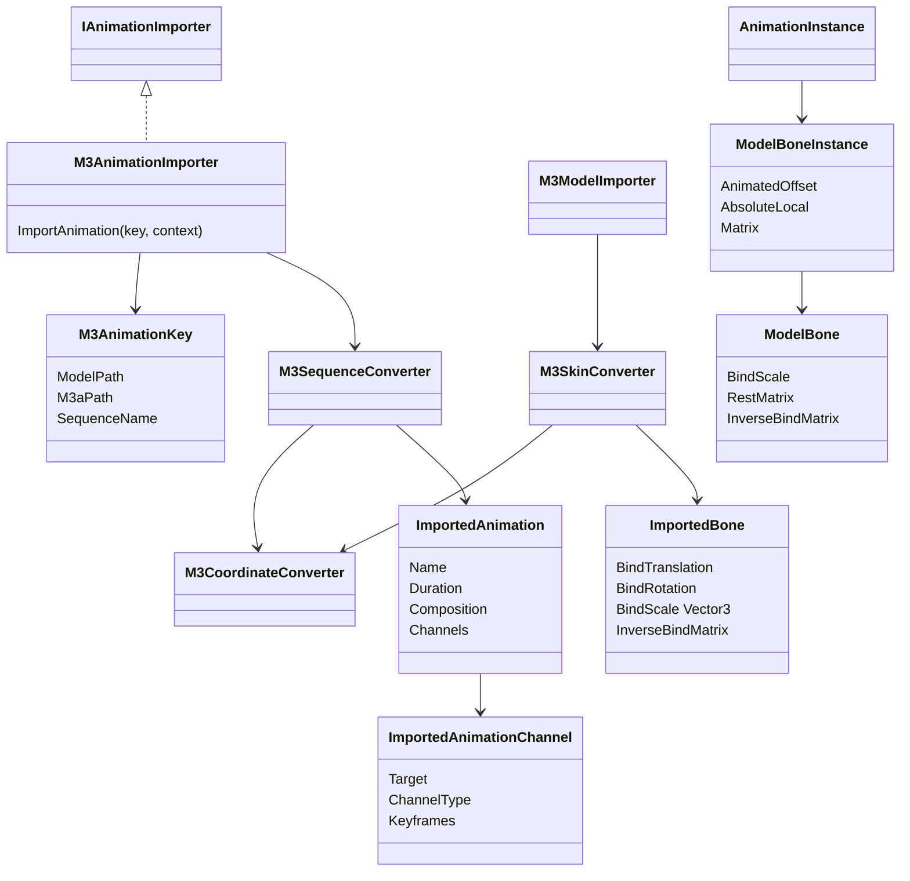
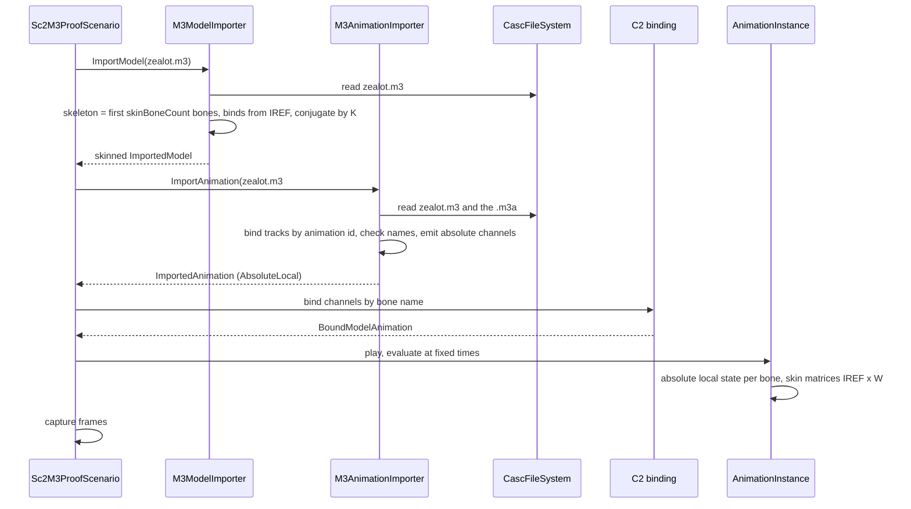

# Deep Dive: StarCraft II skinned M3 animation (C7c)

> Expands phase C7c of [Track C: External Models & Animations](../track-c-external-assets.md).
>
> Audience: human design for skinning StarCraft II M3 units and playing their embedded sequences
> and external `.m3a` clips through the C1 and C2 contracts. Code references are in the
> agent-context appendix.

Purpose: turn the static [C7b](sc2-casc-m3-storage.md) proof models into skinned, animated units.
C7c reuses the C4d four-influence runtime and the [C4f](c4f-ee2-scale-animation.md) scale
channel. It extends C4f from uniform to per-axis scale and adds absolute local-transform clips,
because M3 rigs carry non-uniform rest scale on skinned bones.

Facts below were measured on 2026-09-26 against the local StarCraft II install (build
5.0.16.97563) with the temporary parsers described in the
[C7a/C7b appendix](sc2-casc-m3-storage.md#appendix-reproduction).

---

## 1. Scope

C7c supports:

- skinning from `VERT` weights and lookups, `REGN` bone lookup ranges, `MODL` bone lookup, and
  `IREF` inverse binds, up to four influences;
- the first `MODL` skin bone count bones as the runtime skeleton;
- per-axis bind scale and per-axis scale channels, widening C4f;
- absolute local-transform clips, a new C1 and runtime composition mode;
- embedded sequences with exactly one sequence clip (`STC_`), and bone location, rotation, and
  scale tracks (`SD3V`, `SD4Q`) with linear keys;
- external `.m3a` clips whose animation ids and bone names match the target model.

C7c rejects:

- sequences with more than one `STC_` (layered clips such as `Cover` and `Stand Right Ready`);
- key interpolation other than linear, and non-monotone key times;
- `.m3a` animation ids missing from the model, or present under a different bone name;
- negative or non-finite bind scale on a retained bone, as in C4f.

C7c ignores, with a diagnostic count: event (`SDEV`), flag (`SDFG`), bounds (`SDMB`), float
(`SDR3`), and other non-bone tracks, and all tracks on bones outside the retained skeleton.

Out of scope: sequence blending across `STG_` groups and `STS_` bone masks, root motion, the
`SEQS` movement speed, team color, attachments, and data (XML) binding of sequences to
gameplay states.

## 2. Proof clips

| Unit | Clip | Source | Duration (ms) | Covers |
|---|---|---|---:|---|
| Marine | `Stand` | embedded | 2,667 | Idle skinning |
| Marine | `Walk` | embedded | 667 | Locomotion |
| Marine | `Attack` | embedded | 1,000 | Upper-body pose |
| Marine | `Spell` | embedded | 2,666 | Non-uniform animated scale (`Shield` collapses to 0.013 to 0.016) |
| Zergling | `Stand` | embedded | 3,000 | Four-influence vertices |
| Zergling | `Walk` | embedded | 2,000 | Locomotion |
| Zergling | `Attack` | embedded | 533 | Fast clip |
| Zergling | `Stand Morph Start` | embedded | 1,333 | Uniform animated scale (`Bone_Tail 01` 0.716 to 1, `Dummy01` 0.864 to 1) |
| Zealot | `Stand` | embedded | 3,333 | Idle skinning |
| Zealot | `Walk` | embedded | 733 | Locomotion |
| Zealot | `Attack` | embedded | 2,000 | Blade swing |
| Zealot | `Stand Morph Start` | `zealotoptionalanims.m3a` | 1,000 | External clip binding |

The `.m3a` is `mods/liberty.sc2mod/base.sc2assets/assets/units/protoss/zealotoptionalanims/zealotoptionalanims.m3a`
(131,648 bytes, content key `8632d6007f2e708343736026ec7ef367`).

## 3. Skin census

| Unit | Vertices by nonzero weight count (1 / 2 / 3 / 4) | Bone lookups | Skin bone count | Bones |
|---|---|---:|---:|---:|
| Marine | 1,426 / 248 / 4 / 0 | 20 | 23 | 38 |
| Zealot | 2,388 / 259 / 0 / 0 | 24 | 25 | 43 |
| Zergling | 523 / 175 / 52 / 25 | 30 | 31 | 44 |

Every proof vertex fits the C4d four-influence limit. Bones are stored parents-first. In all
three models, the bones referenced by the bone lookup, closed over their ancestors, are exactly
bones `0 .. skinBoneCount - 1`. The extra bones are ancestors without weights (`Main`, `Root`,
`BoneShoulderR`, `Dummy01`, `Bone21`).

Decision: the runtime skeleton is the first `skinBoneCount` bones. Later bones are attachments
(`Ref_*`), volumes (`Vol_*`), hit tests, and effect helpers, and are dropped with their tracks. A
lookup that references a bone at or above the skin bone count fails.

Influence mapping for a vertex in region `r`:

```
bone = MODL.boneLookup[r.firstBoneLookup + vertex.lookup[k]]
weight = vertex.weight[k] / 255
```

Lookups with zero weight are dropped. The remaining weights must sum to 1 within 0.01, following
C4d. `r.vertexLookupsUsed` bounds `k`.

## 4. Sequence wire layout

`MODL` sequences (`SEQS`), sequence groups (`STG_`), and sequence clips (`STC_`) are parallel:
`SEQS[i]` owns `STG_[i]`, whose `U32_` list indexes `STC_` entries.

SEQS v1 (96 bytes) fields used: name (`CHAR`), animation start and end in milliseconds, and
flags (bit 0 not looping). Proof sequences start at 0.

STC_ v4 (204 bytes) fields used:

| Offset | Field |
|---|---|
| 0 | Name (`CHAR`), for example `Walk_full` |
| 20 | Animation ids (`U32_`) |
| 32 | Animation references (`U32_`), parallel to the ids |
| 72 | `SD3V` track array |
| 84 | `SD4Q` track array |

An animation reference is `type << 16 | index` into the typed track array. Type 2 is `SD3V`
(vector 3, `VEC3` keys) and type 3 is `SD4Q` (quaternion, `QUAT` keys). Other types in the proof
files are 0 (`SDEV`), 1 (`SD2V`), 5 (`SDR3`), 7 (`SDS6`), 11 (`SDFG`), and 12 (`SDMB`).

Track block (32 bytes): frame times (`I32_`, milliseconds), `u32` flags, `u32` end time, keys.

BONE v1 (160 bytes) animated components:

| Offset | Component | Header | Default value |
|---|---|---|---|
| 24 | Location | `u16` interpolation, `u16` flags, `u32` animation id | `VEC3` at 32 |
| 60 | Rotation | same, id at 64 | `QUAT` (x, y, z, w) at 68 |
| 104 | Scale | same, id at 108 | `VEC3` at 112 |

Bone name is at 4 and parent (`i16`, -1 for roots) at 20. Every proof header has
interpolation 1 (linear). A component is animated by a clip when its animation id appears in the
clip's id list.

Proof binding coverage: Marine `Walk_full` has 31 ids, 29 bound to bones. The remaining ids
belong to event and bounds tracks.

## 5. Coordinate conversion

C7c applies the C7b conversion `K = S(10) * Rz(+90 degrees)` to the whole rig by conjugation, so
the world transform of every bone satisfies `W' = K^-1 * W * K`:

| Value | Converted |
|---|---|
| Translation `(x, y, z)` | `(-10y, 10x, 10z)` |
| Rotation `q` | `q' = rz^-1 * q * rz`, with `rz` the +90 degree Z quaternion |
| Scale `(sx, sy, sz)` | `(sy, sx, sz)` |
| Inverse bind `M` | `K^-1 * M * K` |

A 90 degree Z conjugation maps axis-aligned scale to axis-aligned scale with X and Y swapped.
That keeps every bone in scale, rotation, translation form. Key values use the same rules.

## 6. Bind pose and rest pose

`IREF` is the bind inverse. Decomposing `inverse(IREF)` into parent-relative locals and comparing
them with `BONE` defaults over the retained bones:

| Unit | Maximum rotation difference | Maximum translation difference | Scale difference |
|---|---:|---:|---:|
| Marine | 99.8 degrees | 0.012 | 0 |
| Zealot | 46.7 degrees | 0.109 | 0 |
| Zergling | 70.9 degrees | 0.090 | 0 |

Decision: C1 bind transforms come from `IREF`, not from `BONE` defaults, following C4d. The
static model renders the authored bind pose, and C7b vertices need no skinning evaluation.
`BONE` defaults are the values the SC2 runtime uses for components a clip does not animate.
C7c therefore writes them into every clip as constant channels (section 8).

## 7. Scale

### 7.1 Rest scale

Retained bones with non-unit rest scale:

| Unit | Uniform | Non-uniform |
|---|---|---|
| Marine | `Main` 1.184, hands, head, waist 0.845, legs 1.184 | `Shield` (0.751, 0.637, 0.641) |
| Zealot | `Main` 1.518, `Pelvis`, `Lower Chest`, feet 0.659 | none |
| Zergling | `Bone_Pelvis` 0.771, stocks 1.297 | `Bone_Head` (0.637, 1, 1) |

Dropped bones also carry non-uniform and negative scale (`Ref_Weapon Right` -0.825), which the
section 3 bone cut removes.

### 7.2 Why rest-relative offsets fail

C4c and C4f compose `local = offset * rest` with a scale, rotation, translation offset. With
non-uniform rest scale `S_r` and an animated rotation `R_s`, the required offset linear part is
`S_r R_s R_r^-1 S_r^-1`. That is not a rotation, so no scale, rotation, translation offset can
express it. Both non-uniform proof bones have animated rotation.

Decision: C7c adds absolute local composition. An absolute clip supplies each targeted bone's
complete local scale, rotation, and translation in the engine frame. The runtime uses it in
place of `offset * rest`. Rest-relative clips (W3D, glTF, NIF) are unchanged.

### 7.3 Widening C4f

C4f adds uniform `BindScale` (float) and a `Scale` channel. C7c widens it:

| Area | C4f | C7c |
|---|---|---|
| C1 bone | `BindScale` float | `BindScale` `Vector3`. The float overload maps to `(s, s, s)`. |
| C1 channels | `Scale` | Adds `ScaleX`, `ScaleY`, `ScaleZ` (float keys). `Scale` stays uniform. |
| C1 animation | rest-relative | Adds `ImportedAnimation.Composition`: `RestRelative` (default) or `AbsoluteLocal`. |
| Runtime bone | `Transform` with float scale | `ModelBone.BindScale` `Vector3` and `RestMatrix = S * R * T`. `ModelBoneInstance` uses `RestMatrix`. |
| Runtime instance | `AnimatedOffset` | Adds an absolute local state (translation, rotation, `Vector3` scale, active flag). |
| Evaluation | offset channels | Absolute clips write the absolute state. Reset clears it. |

`Transform.Scale` stays a float. Game objects and C4f uniform paths are untouched.

Positive and non-finite rules follow C4f. Animated scale samples may be zero. Rest scale must be
positive per axis.

### 7.4 Normals

Constant non-uniform scale on a bone cancels in `IREF * W(t)`, so the proof skin matrices are rigid
except while `Shield` scale animates. Skinned normals follow the C4f rule: transform, then
normalize.

Decision: C7c does not add inverse-transpose normals. Shading is exact for uniform scale and for
constant non-uniform scale. The only proof case with animated non-uniform scale is the Marine
shield collapsing below 2 percent of its size, where the shading error is not visible.

## 8. Animation conversion

For one sequence:

1. Select the sequence by exact, case-insensitive name. Duplicates or a missing name fail.
2. Require exactly one `STC_` in its `STG_` group.
3. For each retained bone and each of location, rotation, scale:
   - if the clip lists the component's animation id, read the `SD3V` or `SD4Q` track: times in
     milliseconds become `TimeSpan`, and values are converted per section 5;
   - otherwise emit one constant key at time 0 holding the target model's `BONE` default.
4. Emit `TranslationX/Y/Z`, `Quaternion`, and `ScaleX/Y/Z` channels with linear interpolation.
   Target by bone name, bound through C2's exact-name rule.
5. Set duration to the sequence end time, and composition to `AbsoluteLocal`.

Key rules:

- Times must be non-decreasing and within `[0, end]`. A time beyond the end fails.
- Keys pass through without resampling, because M3 keys are linear and C1 interpolates linearly.
- Quaternions are normalized after conversion and kept in the same hemisphere as the previous key.

Asset keys (`#` never occurs in CASC paths):

```
<model-path>#seq=<sequence name>
<model-path>#m3a=<m3a-path>#seq=<sequence name>
```

`M3AnimationImporter : IAnimationImporter` parses the key and loads the model (skeleton and
`BONE` defaults), plus the `.m3a` when present.

## 9. External `.m3a` clips

The proof `.m3a` has `MODL` v25, `MAT_` v16, `LAYR` v24, no vertices or regions, 43 bones with the
same names and parent order as `zealot.m3`, 25 skin bones, and 3 sequences (`Stand Morph Start`,
`Stand Morph`, `Stand Morph End`). Its 129 bone animation ids equal the model's 129 exactly.

Decision: `.m3a` tracks bind by animation id to the target model's bones. The `.m3a` bone that owns
the same id must have the same name, otherwise the clip fails naming both bones. Constant channels
for unanimated components use the target model's `BONE` defaults. The proof `.m3a` animates every
component, so this rule is not exercised by the proof.

C7c reads `.m3a` files with a relaxed tag table: `MODL` v25 and the section 4 animation tags
only. Geometry and material tags are not parsed, so their newer versions are not an error.

## 10. C1 and runtime changes

On top of C4f:

- `ImportedBone`: `Vector3 BindScale`, validated positive and finite per axis.
- `ImportedAnimationChannelType` and `AnimationClipType`: `ScaleX`, `ScaleY`, `ScaleZ`.
- `ImportedAnimation` and `ModelAnimation`: `Composition`.
- `ImportedAnimationMaterializer`: maps the new channel types and composition.
- `ModelBone`: `BindScale`, `RestMatrix`. `ModelBoneHierarchy` passes scale from C1.
- `ModelBoneInstance`: absolute local state. `Matrix` returns
  `S(absScale) * R(absRot) * T(absTrans)` when active, else `AnimatedOffset.Matrix * RestMatrix`.
- `AnimationInstance`: absolute clips write the absolute state per component. Reset clears the
  active flag and restores C4f defaults.

Every existing C1 producer passes unit bind scale and `RestRelative`, so W3D, glTF, and NIF
outputs and golden captures stay byte-identical.

## 11. Failure contract

| Condition | Result |
|---|---|
| Vertex with more than four nonzero weights | C4d `NotSupportedException`. No truncation. |
| Weights not summing to 1 within 0.01 | `InvalidDataException` with region and vertex. |
| Lookup bone at or above the skin bone count | `InvalidDataException`. |
| Sequence name missing or duplicate | `KeyNotFoundException` or `InvalidDataException`. |
| Sequence with more than one `STC_` | `NotSupportedException` listing the clip names. |
| Track interpolation other than linear | `NotSupportedException` with bone and component. |
| Decreasing key times, or times beyond the end | `InvalidDataException`. |
| Frame and key counts differ | `InvalidDataException`. |
| Retained bone rest scale negative, zero, or non-finite | `NotSupportedException` naming the bone. |
| `.m3a` id missing in the model | `InvalidDataException` naming the id and `.m3a` bone. |
| `.m3a` id on differently named bones | `InvalidDataException` naming both bones. |
| Non-bone or dropped-bone tracks | Ignored, counted in diagnostics. |

## 12. Proof and completion boundary

C7c is complete when:

- the three proof models import skinned, with the section 3 influence histograms and skeleton
  sizes;
- bind-pose captures match the C7b static captures within the harness image tolerance;
- the twelve section 2 clips import and bind with no missing targets, and deterministic captures
  at fixed times show the expected poses: walking legs, the Zealot blade swing, the Marine
  shield collapsing in `Spell`, and the Zergling tail scaling in `Stand Morph Start`;
- the Zealot `.m3a` clip binds by animation id and plays;
- synthetic tests cover per-axis bind scale, absolute composition, conjugation, constant-channel
  emission, and each section 11 failure;
- existing W3D, glTF, and NIF tests and golden baselines remain unchanged;
- no SC2 asset is copied or committed.

## 13. Architecture diagrams





## Appendix: current-code grounding

- Bone and channel types to widen: `src/Panopticon.Simulation/Content/Importing/ImportedBone.cs`,
  `ImportedAnimationChannel.cs:8-15`, `ImportedAnimation.cs:21-24`.
- Runtime: `src/Panopticon.Simulation/Graphics/ModelBone.cs:19-32`,
  `src/Panopticon.Simulation/Graphics/ModelBoneInstance.cs:34-36`,
  `src/Panopticon.Simulation/Graphics/Animation/AnimationInstance.cs:113-129,288-365`,
  `src/Panopticon.Simulation/Graphics/Animation/AnimationClip.cs`,
  `src/Panopticon.Simulation/Content/Loaders/ImportedAnimationMaterializer.cs:26-34`.
- Uniform `Transform.Scale` kept: `src/Panopticon.Simulation/Transform.cs:47,85-88`.
- Skinning matrix: `src/Panopticon.Simulation/Graphics/ModelInstance.cs:259-262`. Skinned normals:
  `src/Panopticon.Simulation/Assets/Shaders/Mesh.h` `GetSkinnedVertexData`,
  `PbrMetallicRoughness.vert:25-53`.
- Bone-local capture helper that reads `bone.Transform`: `src/Panopticon.Tools.TestHarness/StandaloneModelCapture.cs:238-239`.
- NIF animation key precedent: `src/Panopticon.Simulation/Content/Importing/Nif/NifAnimationKey.cs`,
  `NifAnimationImporter.cs`.

## Appendix: reproduction

The C7b census script was extended to decode `SEQS`, `STG_`, and `STC_`, map animation ids to
`BONE` headers, compare `inverse(IREF)` locals against `BONE` defaults, and list scale tracks
that deviate from rest. Bones were composed as `T * R * S` in column-vector form.
