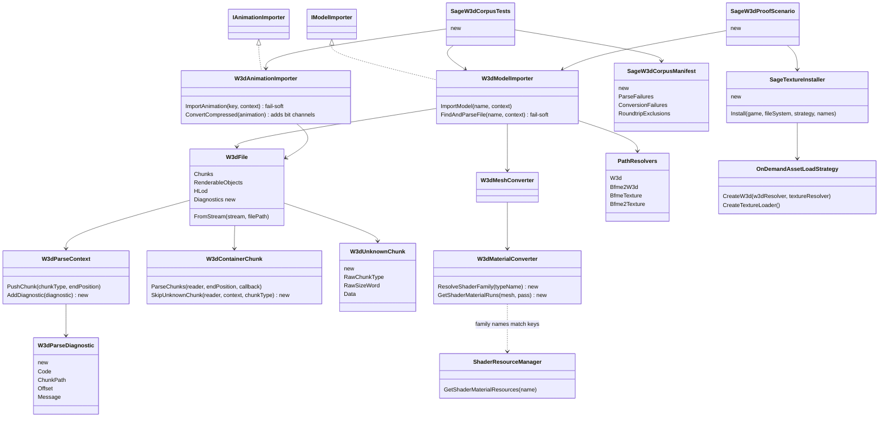
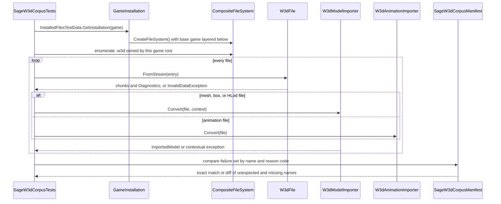
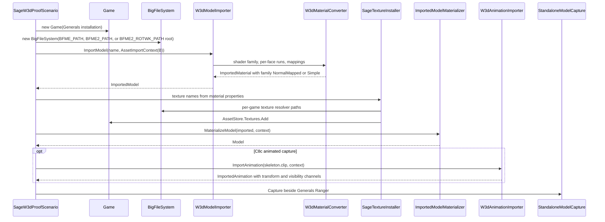

# Deep Dive: SAGE-family W3D models (C8a, C8b, C8c)

> Expands phases C8a, C8b, and C8c of [Track C: External Models & Animations](../track-c-external-assets.md).
>
> Audience: human design for loading Battle for Middle-earth, Battle for Middle-earth II, and Rise
> of the Witch-king W3D models alongside Generals and Zero Hour through the existing W3D path.

Purpose: make the BFME-family model corpus usable as art for Panopticon units. These games share
the Generals W3D container, so the work extends the native W3D reader and its C1 adapters instead
of adding a fourth external importer. Gameplay INI import (hordes, `ChildObject`, `.inc` includes)
is out of scope; it belongs to [Track D](../track-d-gameplay-expansion.md) D3 and
[ModCollector](../plans/mod-collector.md).

Facts below were measured on 2026-10-14 against operator-supplied BFME, BFME2, RotWK, and Zero
Hour installs, using the repository's own `Panopticon.FileFormats.Big` and
`Panopticon.FileFormats.W3d` readers from a throwaway console app outside the repository.

---

## 1. Scope

C8a supports:

- a headless parse of every `.w3d` in BFME, BFME2, RotWK, and Zero Hour through the per-game path
  resolvers, with RotWK layered over BFME2;
- unknown chunks and malformed chunk sizes reported as per-file diagnostics instead of aborting the
  load;
- a checked-in golden list of the known-bad corpus files (names only, no asset bytes).

C8b supports:

- static bind-pose meshes at mesh version `0x40002` (BFME) and `0x50000` (BFME2, RotWK);
- every `0x50000` shader-material family on the native shader-material path (section 6), with
  case-insensitive family names and a diagnostic fallback for families without a shader set;
- per-face shader-material ids and the `WsClassicEnv` texture mapping;
- textures resolved through the per-game texture resolvers;
- a recorded team-color source for the BFME family;
- the `SHDMESH` family (`0x0B00`-`0x0B4B`) decoded, or kept as a named diagnostic by decision.

C8c supports:

- compressed visibility bit channels, which `W3dAnimationImporter` drops today;
- a decision on channel type 15 (`UnknownBfme`), which `W3dAnimationImporter` skips today;
- corpus-wide verification of adaptive-delta and motion-channel decoding;
- animated proofs over the existing two-bone `VERTICES_2` skinning path.

C8 rejects or defers:

- BFME INI gameplay semantics; Panopticon object definitions reference the models as art only;
- `.fx` shader parity; shader materials render through the engine's shader sets, not the original
  effect files;
- EA asset streams (`.manifest`, `.relo`, `.imp`, `.w3x`); none exist in these three games.

## 2. Install and packaging

| Game | BIG magic | `.w3d` | `.dds` | `.tga` |
|---|---|---|---|---|
| BFME | `BIG4` root, `BIGF` under `apt/` | 5914 | 1713 | 1391 |
| BFME2 | `BIG4` root, `BIGF` under `apt/` | 12747 | 3760 | 2485 |
| RotWK | `BIG4` root, `BIGF` under `apt/` | 1867 (delta over BFME2) | 638 | 417 |
| Zero Hour | `BIGF` | 4429 + 7 + 2 | 3496 | 50 |

`BigArchive` already reads both magics. Game definitions `Bfme`, `Bfme2`, and `Bfme2Rotwk` exist in
`Panopticon.Mods.BuiltIn/GameDefinition.cs`, with asset strategies over the BFME path resolvers.
Only `Mods.BuiltIn` references the BFME projects; ReplaySketch, WorldBuilder, and the benchmarks
reference `Mods.Generals` only. No document records a BFME boot.

Zero Hour already boots (`GeneralsZeroHourDefinition`, H2a records zero import diagnostics). The
Generals and Zero Hour `Probe` methods check lowercase `generals.exe`, while both installs ship
`Generals.exe`, so the Launcher's directory probe fails on Linux. The environment locator skips
`Probe` and is unaffected. The default `IGameDefinition.Probe` used by the BFME family is also
case-sensitive; the BFME installs happen to match. C8a makes all probes case-insensitive.

Environment variables for the environment locator: `BFME_PATH`, `BFME2_PATH`, `BFME2_ROTWK_PATH`
(requires `BFME2_PATH` for its base game), and `CNC_GENERALS_ZH_PATH` (requires
`CNC_GENERALS_PATH`).

An operator-made extraction of Generals and Zero Hour (per-model folders with copied textures,
plus a ray-grid occlusion report over 7728 models and an older open-geometry report) is an
inspection aid only. Importers read the `.big` archives directly.

## 3. Corpus content

| Game | Mesh / HLod | Animation | Skeleton only | Compressed anim | Mesh version |
|---|---|---|---|---|---|
| BFME | 3065 | 2662 | 177 | 2541 | `0x40002` |
| BFME2 | 5987 | 6156 | 591 | 5413 | 13,711 at `0x50000`, 10,031 at `0x40002` |
| RotWK | 784 | 925 | 156 | 314 | `0x50000` |
| Zero Hour | 2522 | 1883 | 22 | 4 | `0x40002` |

Features Generals does not use:

- shader materials: 6101 meshes in BFME2, 2479 in RotWK;
- tangent and bitangent chunks: 5980 and 2436;
- dual-bone `VERTICES_2`: 401 (BFME), 1113 (BFME2), 707 (RotWK);
- motion channels: 238,102 in BFME2;
- adaptive-delta compressed animation (flavor 1): 5 files in BFME2.

## 4. Parse results

| Archive | OK | Fail |
|---|---|---|
| Generals `W3D.big` | 4556 | 0 |
| Zero Hour `W3DZH.big` | 4424 | 5 |
| BFME `W3D.big` | 5910 | 4 |
| BFME2 `W3D.big` | 12734 | 13 |
| RotWK `W3D.big` | 1866 | 1 |

Failure causes:

- `SHDMESH` family `0x0B00`-`0x0B4B` in `gbmtwalld`, `gbmtwalldramp`, and `gbmtwalle` (BFME and
  BFME2): the only real format gap. Identification as the late-W3D shader mesh is inferred from
  the chunk layout, not documented.
- Corrupt or misaligned animation chunk sizes: `cusheep_grza` (BFME); `guhbtshfb_cinb`,
  `guhbtshfb_cinc`, `lwbanhfllbst`, `lwbanhnazgul`, `lwbanhwtchkng`, `cuwyrm_cld_skl`,
  `cuwyrm_cld_skn`, `mbtrollpit_v1` (BFME2); five `UISabotr_*` animations (Zero Hour).
- `gugandalfcrstl`: unknown `W3dVertexMappingType` 67. `mbtrollpit_sknm`: decode error.
- RotWK `lwbanhwitchk.w3d` under `readonly-0-rev-*`: an `IFX` file, not W3D.

`W3dChunk` and `W3dFile` throw on any unknown chunk id at any depth today. `SHDMESH` is a top-level
chunk beside ordinary meshes and the `HLod` (`0x0700`), so skipping it leaves the `HLod` pointing at
a missing render object.

`W3dFileTests.CanRoundtripW3dFiles` already skips 26 names inline: the section 4 failures plus
roundtrip-only exclusions (`bbbags`, `kbpostgaten_al`, `kbpostgaten_am`, `psupplies04`,
`wbcave_d2a`, `wbcave_d2c`, `npc14b`, `npc15b`). C8a moves this list into the golden manifest.

### 4.1 Conversion hazards

Measured on 2026-10-18 over files that parse, against the current W3D adapters:

| Hazard | Where it fails today | Count |
|---|---|---|
| Shader-material families `Default.fx` (2 meshes), `DefaultW3D.fx` (1), `WaterShader.FX` (66 BFME2 water meshes, 1 RotWK) | `ShaderResourceManager.GetShaderMaterialResources` throws `KeyNotFoundException`; `.FX` also escapes the case-sensitive `.fx` strip | 70 meshes |
| More than one shader-material id per pass | `W3dMaterialConverter` throws `NotSupportedException` | 4 BFME2, 2 RotWK meshes (`kbpostgaten_al`, `kbpostgaten_am`) |
| `WsClassicEnv` texture mapping | `MapTextureMappingType` throws `ArgumentOutOfRangeException` | `sfe_menuspells` in each game |
| Compressed visibility bit channels | silently dropped by `ConvertCompressed` | 673 BFME, 1349 BFME2, 2 RotWK animations |
| Channel type 15 | skipped in all three channel paths | 1878 BFME, 44,161 BFME2, 1424 RotWK channels |

Shader-material families: `NormalMapped.fx` 6003 BFME2 and 2476 RotWK meshes, `Simple.fx` 31 and 4.
Both already have shader sets. No `HOUSECOLOR`-prefixed mesh exists in any BFME-family corpus, so
the Generals team-color convention does not apply.

### 4.2 Already supported

| Feature | Existing support |
|---|---|
| `0x50000` mesh chunks, shader materials, tangents, `VERTICES_2`, `NORMALS_2` | Parsed by `W3dMesh`; converted by `W3dMeshConverter` and `W3dMaterialConverter` |
| Two-bone skins (397 BFME, 1095 BFME2, 633 RotWK weighted meshes, including Mumakil `MUMAKIL_MESH` and wolf rider `BROWNWOLF01`) | `ImportedVertex.SecondaryPosition` feeds `in_Position1`; `Mesh.h` skins position 1 by bone 1 |
| Adaptive-delta flavor 1 and motion channels (Delta4, Delta8, TimeCoded) | Decoded by `W3dAdaptiveDeltaCodec` and `IW3dMotionChannelData`, converted in `ConvertCompressed` |
| Multi-LOD `HLod` (38 BFME2 files) | `W3dModelImporter` imports `Lods[0]` |
| BFME2 sub-directory model paths | `PathResolvers.Bfme2W3d` (`art/w3d/<first two letters>/`) |

## 5. Proof assets

All paths are inside each game's `W3D.big`.

| Game | Role | INI object | Model | Animation examples |
|---|---|---|---|---|
| BFME | infantry | `GondorFighter` | `art\w3d\gumaarms_skn.w3d` (skeleton `gumaarms_skl`) | `gumaarms_flla`, `gumaarms_flya` (55 total) |
| BFME | monster | `MordorMumakil` | `art\w3d\mumumakil_skn.w3d` | `mumumakil_idla`, `mumumakil_runa` (38) |
| BFME | siege | `GondorTrebuchet` | `art\w3d\gusiegtreb_skn.w3d` | `gusiegtreb_idla`, `gusiegtreb_blda` (9) |
| BFME2 | infantry | `GondorFighter` | `art\w3d\gu\gumaarms_skn.w3d` | `art\w3d\gu\gumaarms_flla` (54) |
| BFME2 | ship | `EvilMenCorsairShip` | `art\w3d\au\aucorship.w3d`, `aucrshp_s1_skn.w3d` | `aucrshp_s1_idla` (11) |
| RotWK | cavalry | `AngmarWolfRider` | `art\w3d\ku\kuorcrider_skn.w3d` (skeleton `kuorcrider_skl`) | `kuorcrider_gbda` (31) |
| RotWK | siege | `AngmarTrollSling` | `art\w3d\ku\kutsling_skn.w3d` | `kutsling_idla` (14) |

The BFME2 corsair ship is also the reference hull for [Track E](../track-e-naval-warfare.md).

## 6. Decisions

- Native W3D variant, not a C1 importer. The existing reader parses 99.9% of the corpus and the
  W3D path is already one C1 implementation, so a second W3D importer would duplicate `W3dFile`.
  Animation-semantics changes live in `W3dAnimationImporter`.
- Fail soft per file at parse time. Unknown chunks are skipped with a `W3dParseDiagnostic`; top-level
  unknown chunks are kept as raw `W3dUnknownChunk` values so roundtrip stays byte-exact. A file that
  still fails to parse produces one logged diagnostic and a null asset, matching the C1
  missing-asset rule. Conversion failures keep the C1 contextual-exception contract and are
  classified by the corpus test. Generals output stays byte-identical because Generals has no
  failures.
- Shader materials stay on the native shader-material path (decision revised 2026-10-18 from C3
  PBR). `NormalMapped` and `Simple` already render 99% of BFME2 and RotWK shader-material meshes
  with diffuse, normal map, and tangents, so a C3 mapping would duplicate them. Families without a
  shader set fall back to `Simple` with a diagnostic. C8b no longer depends on C3.
- Two-bone skins need no runtime work. The two-influence path with secondary positions predates
  C4d, so C8c no longer depends on C4d.

## 7. Phase split

| Phase | Deliverable | Proof |
|---|---|---|
| C8a | Case-insensitive launcher probes, skipped unknown chunks with diagnostics, fail-soft importers, golden corpus manifest and installed corpus test | Every archive yields exactly the manifest's parse and conversion failures; Generals and Zero Hour output unchanged |
| C8b | Shader-material family resolution, per-face shader-material ids, `WsClassicEnv`, per-game texture loading, team-color decision, `SHDMESH` decision | Static captures of the section 5 models beside a Generals Ranger; section 4.1 mesh hazards removed from the manifest |
| C8c | Compressed visibility bit channels, channel 15 decision, adaptive-delta and motion-channel verification | Gondor soldier, Mumakil, and wolf rider cycles bind with no missing targets and capture deterministically |

Cards: [`WI-C8a-01`](../agent/cards/WI-C8a-01-match-launcher-executables-case-insensitively.md) to
[`WI-C8c-04`](../agent/cards/WI-C8c-04-capture-animated-bfme-proof.md); the sequence is in
[`implementation/README.md`](../implementation/README.md#track-c--c8a-c8c--bfme-family-w3d).

## 8. Risks

- RotWK-over-BFME2 layering and the BFME texture resolvers are untested on a real install.
- Motion channels may encode root motion; C8c records whether pivot 0 channels (446 in BFME2) move
  the root.
- `W3dTimeCodedBitDatum` reads the value from bit 31 of the time code with a `TODO: Verify` note;
  C8c confirms it against the uncompressed visibility channels of the same clips.
- `W3dChunkHeader.Parse` computes `HasSubChunks` after masking the size, so it is always false.
  Raw unknown chunks keep the original size word instead of relying on it.

## 9. Architecture diagrams

Types marked new are added by C8 cards; the rest exist today.

C8a corpus test, one game per run:

C8b and C8c proof, models from a BFME-family install rendered by a Generals `Game`:

## Appendix: current-code grounding

| Fact | Location |
|---|---|
| Top-level unknown chunk throws | `src/Panopticon.FileFormats.W3d/W3dFile.cs:117` |
| Unknown chunk exception factory, 23 call sites | `src/Panopticon.FileFormats.W3d/W3dChunk.cs:104` |
| `HasSubChunks` computed after masking | `src/Panopticon.FileFormats.W3d/W3dChunkHeader.cs:15` |
| Parse with no catch | `src/Panopticon.Simulation/Content/Importing/W3d/W3dModelImporter.cs:248`, `W3dAnimationImporter.cs:58` |
| Single shader-material id only | `src/Panopticon.Simulation/Content/Importing/W3d/W3dMaterialConverter.cs:41` |
| Case-sensitive `.fx` strip | `W3dMaterialConverter.cs:61` |
| `WsClassicEnv` unmapped | `W3dMaterialConverter.cs:536` |
| Shader-material sets `NormalMapped`, `Simple` only | `src/Panopticon.Simulation/Graphics/Shaders/ShaderResourceManager.cs:79-89` |
| Compressed bit channels ignored | `W3dAnimationImporter.cs:196-274` (no `TimeCodedBitChannels` read) |
| Secondary position skinning | `W3dMeshConverter.cs:94`, `src/Panopticon.Simulation/Assets/Shaders/Mesh.h:100` |
| Case-sensitive launcher probes | `src/Panopticon.Simulation/IGameDefinition.cs:42`, `src/Panopticon.Mods.Generals/GeneralsDefinition.cs:51`, `GeneralsZeroHourDefinition.cs:55` |
| Inline corpus skip list | `test/Panopticon.Simulation.Tests/Data/W3d/W3dFileTests.cs:19-50` |
| Proof scenario and texture install pattern | `src/Panopticon.Tools.TestHarness/Ee2NifProofScenario.cs:427`, `Ee2TexcacheTextureInstaller.cs` |
