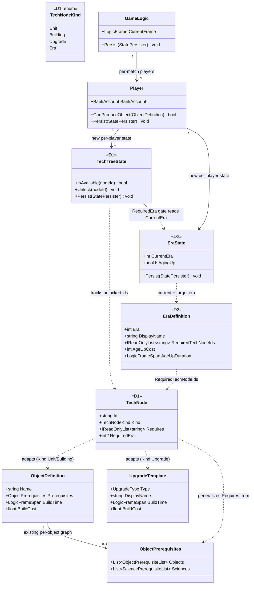
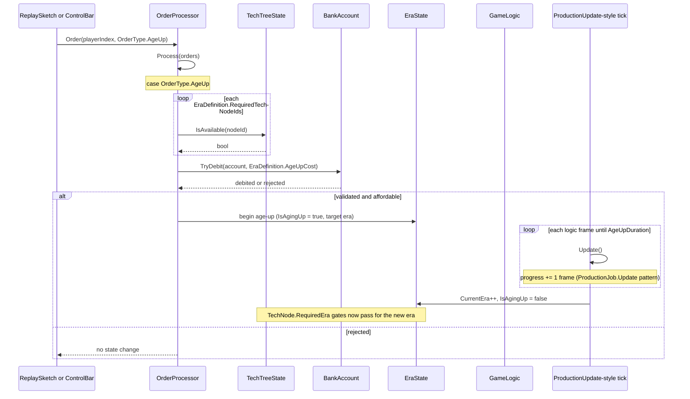
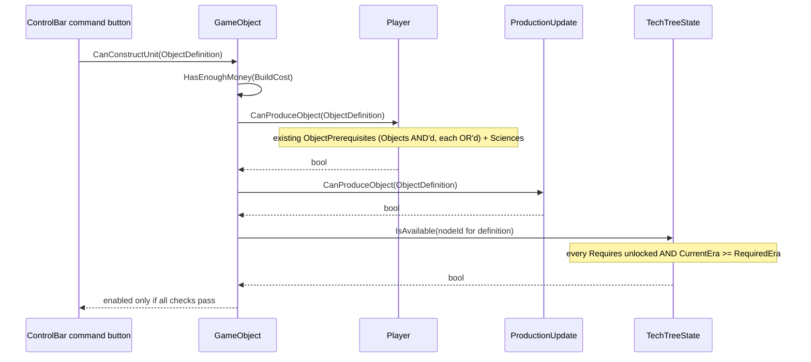

# Deep Dive: Tech Trees & Era Progression (D1/D2)

> Expands phases D1 and D2 of [Track D: Gameplay Content Expansion](../track-d-gameplay-expansion.md).
> Part of the [Large-Scale Simulation Roadmap](../README.md).
>
> Audience: human overview of the tech-tree and era-progression design. Code references are in the
> agent-context appendix at the bottom.
>
> The agent-context section at the bottom ([Current code appendix](#appendix-current-code-agent-context))
> contains file:line code references. Skip it if reading for design intent.

Purpose: generalize the existing upgrade/prerequisite mechanism into an explicit, data-authored
prerequisite graph and add discrete era progression as content on top of the existing
`GameObject`/module system. Both pieces support Track D's reference non-SAGE scenario.

---

## 1. Scope and non-goals

- In scope: a prerequisite-graph data model general enough to express branching tech trees, not
  just the SAGE games' flat per-object upgrade lists; an era state machine per player with age-up
  as a gated action; wiring both into `ObjectDefinition`/module availability so build/produce/
  ability options are gated by tech and era state.
- Out of scope, deferred to D3/D4 or later: the actual AoE/Empire Earth content itself (units,
  buildings, art). That content is external and comes through [ModCollector](../plans/mod-collector.md)
  and Track C importers, not this deep dive. Balance/design of any specific tech tree is also out of
  scope. A dedicated tech-tree editor UI is out of scope; D4/D5 reuse ReplaySketch per the project's
  no-fragmentation tooling convention. See the [C5 tooling Decision](../open-questions.md).
- This is content within the existing RTS domain. Per the
  [domain-scope Decision](../open-questions.md), new gameplay mechanics extend the
  `GameObject`/module system rather than introducing a new Simulation Domain Model.

---

## 2. Design

### 2.1 Prerequisite graph (generalizing `UpgradeTemplate`)

Today, prerequisites are expressed ad hoc per `ObjectDefinition` through build prerequisites and
upgrade requirements. D1 introduces an explicit shared graph:

```
TechNode {
    string Id;                     // stable identifier, referenced by ObjectDefinition/UpgradeTemplate
    TechNodeKind Kind;              // Unit | Building | Upgrade | Era
    IReadOnlyList<string> Requires; // Ids of TechNodes that must be "unlocked" first
    int? RequiredEra;               // null if era-independent
}

enum TechNodeKind { Unit, Building, Upgrade, Era }
```

`UpgradeTemplate` becomes one producer of `TechNode` entries through a thin adapter, so existing
Generals/BFME/BFME2 content keeps working unchanged. This follows the same pattern Track C uses for
W3D: refactor the existing path into the reference implementation. The graph is authored in INI
alongside existing object/upgrade definitions and parsed through the existing `IniParseTable<T>`
mechanism.

A per-player `TechTreeState` tracks unlocked `TechNode` ids and exposes `IsAvailable(nodeId)`.
It returns true only when every `Requires` entry is unlocked and, when `RequiredEra` is set, the
player's current era is at least that value. Build/produce/ability menus query this instead of
current per-object ad hoc checks.

### 2.2 Era progression (new mechanic)

`EraState` is per-player state with `CurrentEra` (int, 0-based) plus an in-progress age-up
flag/timer. Age-up is gated and explicit, not automatic:

```
EraDefinition {
    int Era;
    string DisplayName;
    IReadOnlyList<string> RequiredTechNodeIds; // must all be unlocked to start aging up
    int AgeUpCost;                              // resource cost, spent on start
    int AgeUpDurationFrames;                     // time gate
}
```

Age-up is issued as an order through the normal player-command pipeline. See the
[P0 harness](p0-playable-baseline-harness.md) for how orders are authored and asserted. The order is
validated against `EraDefinition.RequiredTechNodeIds` and cost, then resolves after
`AgeUpDurationFrames` via the existing scheduled/update-module pattern used by production queues.
On completion, `EraState.CurrentEra` increments and any `TechNode`/`ObjectDefinition` gated by
`RequiredEra` becomes available. Era changes also provide a cheap later hook for fidelity/visual
changes such as reskins or stat multipliers.

### 2.3 Save/load

`TechTreeState` and `EraState` are per-player data persisted through the existing
`StatePersister` pattern: `PersistVersion()` first, then explicit field persistence. This follows the
[save/load reach Decision](../open-questions.md): single-node `StatePersister`, not required to work
across sharded runs.

---

## 3. Sequencing notes

- D1 can start once Track P is stable, because it refactors `UpgradeTemplate` and needs a working
  match loop for verification. It does not need Track C.
- D2 depends on D1 because `RequiredEra` gating depends on the graph. It does not need Track C or
  ModCollector and can be validated with existing placeholder Generals/BFME content such as a toy
  2-era test tree.
- D3 is the first phase that needs [ModCollector](../plans/mod-collector.md) and Track C, at least
  C1's import abstraction. It turns the D1/D2 mechanism into actual AoE/Empire Earth-flavored
  content.
- D4 is the integration proof: one small tech tree plus one era transition, authored and asserted
  through ReplaySketch. See [`deep-dives/p0-playable-baseline-harness.md`](p0-playable-baseline-harness.md).

---

## Architecture Diagrams

Types stereotyped `<<D1>>` or `<<D2>>` are deliverables of this phase and do not yet exist in `src/`.
All other types are existing engine types (see the [appendix](#appendix-current-code-agent-context)
for their files). Design rationale lives in [section 2](#2-design); the diagrams show structure and
flow only.

### Types



### Age-up flow (D2)

Actuation routes through the existing order pipeline (`OrderProcessor.Process`), reusing
`OrderProcessor.TryDebit` for cost and the `ProductionJob` timing pattern for the time gate. `OrderType.AgeUp`
is a new D2 enum member; the timed resolution mirrors `ProductionUpdate.Update` calling
`ProductionJob.Update` then `ProductionJob.Produce` each logic frame.



### Prerequisite evaluation on a build/produce availability check (D1)

The existing buildability predicate `GameObject.CanConstructUnit` already ANDs `Player.CanProduceObject`
(object/science prerequisites) with `ProductionUpdate.CanProduceObject`. D1 adds a `TechTreeState.IsAvailable`
gate in the same predicate, so `TechNode.Requires` and `RequiredEra` gate the command button alongside the
existing checks.



---

## Appendix: Current code (agent context)

- `src/Panopticon.Simulation/Logic/Object/UpgradeTemplate.cs`: existing per-object upgrade template;
  D1's adapter wraps this rather than replacing it.
- `src/Panopticon.Simulation/Logic/Object/ObjectDefinition.cs`: build/produce prerequisite fields D1's
  `TechNode.Requires` generalizes. The `Prerequisites` field (line 524) is an
  `ObjectPrerequisites` (`src/Panopticon.Simulation/Logic/Object/ObjectPrerequisites.cs`): AND'd lists of
  OR'd `ObjectPrerequisiteList`/`SciencePrerequisiteList`, evaluated by `Player.CanProduceObject`
  (`src/Panopticon.Simulation/Logic/Player.cs:403`) and gated in `GameObject.CanConstructUnit`
  (`src/Panopticon.Simulation/Logic/Object/GameObject.cs:1238`).
- `src/Panopticon.Simulation/Logic/GameLogic.cs`: top-level per-match state; `TechTreeState`/`EraState`
  are added as per-player state here, alongside existing `BankAccount`/player state.
- `src/Panopticon.Simulation/Logic/Object/Update/ProductionUpdate.cs`: the existing timed-completion
  pattern that age-up resolution should mirror rather than inventing a second timing mechanism.
  `Update()` (line 59) advances the front `ProductionJob` each frame via `ProductionJob.Update`
  then `ProductionJob.Produce` (`src/Panopticon.Simulation/Logic/Object/Production/ProductionJob.cs`).
- Orders: `src/Panopticon.Simulation/Logic/Orders/Order.cs`, `OrderType.cs`, and `OrderProcessor.cs`
  (`Process` at line 28, `TryDebit` at line 651) are the pipeline the age-up order flows through.
- Save/load: search `PersistVersion()` call sites in `Logic/` for the established
  `StatePersister` pattern D1/D2 state must follow.
