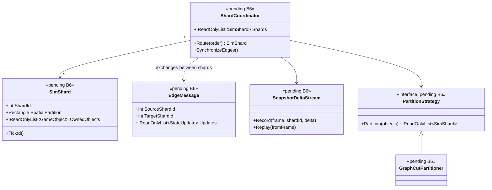

# Deep Dive: Distributed Simulation

> Expands phase B6 of [Track B — Scale](../track-b-scale.md). Part of the
> [Large-Scale RTS Roadmap](../README.md). First-pass design — refine as phases land.
>
> Audience: human — design intent and architecture diagrams. Code references are in the agent-context appendix at the bottom.
>
> The agent-context section at the bottom ([Current-state hooks appendix](#appendix-current-state-hooks--agent-context)) contains code-level details about what the implementation builds on. Skip it if you are reading for design intent.

Goal: run one simulation larger than a single machine can handle by partitioning the world
across processes or machines.

Decision: spatial sharding. One world is partitioned by region across nodes, and each node
simulates the entities in its region or regions. This was chosen over lockstep peers because
lockstep makes every node simulate the whole world, capping total scale at one machine's
capacity. Spatial sharding trades that ceiling for cross-shard handoff and boundary
synchronization complexity. See [open-questions.md](../open-questions.md) for the trade-off
record.

The design is domain-parameterized, not RTS-only. Partitioning, halo derivation, handoff, and
interaction resolution are driven by the [Simulation Domain Model seam (A4)](../track-a-foundations.md), so the infrastructure also serves non-RTS simulations. The
domain's topology model selects the partitioning scheme:
- 2-D spatial grid for RTS / open-field battles (the reference domain; built on
  [B4a-5 chunks](larger-maps.md)).
- Graph/network partitioning for transportation/logistics sims (roads, rail, utility
  networks) — partition the graph (e.g. edge-cut / METIS-style), boundaries are cut edges, halos
  are N-hop neighbourhoods rather than radius discs.
- Zone/region adjacency for city builders — partition by districts; cross-border coupling is
  resource/utility/traffic flow rather than spatial proximity.
RTS spatial sharding is the first implementation; the rest of this doc notes where each problem
is domain-parameterized.

---

## 1. Why this depends on the rest of Track A/B

Spatial sharding is the last major scale phase because it composes the earlier work:

- [A1 Headless host](headless-host.md) — a shard is a headless `SimulationHost` instance;
  no shard renders. The host's logic-only step and run-output hooks are prerequisites.
- [A2 Reproducibility & statistical stability](../track-a-foundations.md) — per the
  [relaxed-determinism Decision](../open-questions.md), shards do not agree bit-for-bit.
  Correctness is defined by invariants and statistical closeness to a single-shard reference.
  The hierarchical signature tree (A1-5) plus [A5-4 divergence localization](visualization.md)
  screen for drift and localize it instead of acting as an equality gate.
- [B3 Parallel/data-oriented logic](../track-b-scale.md) — the data-oriented storage and
  safe-parallel update model are what make a region's slice cheap to step and to serialize.
- [B4a-5 Chunked terrain storage](larger-maps.md) — the chunk/region concept used for
  large-map streaming is the natural unit of spatial partitioning for shards.
- [A4 Simulation Domain Model seam](../track-a-foundations.md) — supplies the topology model
  (grid / graph / zones), interaction locality (halo derivation), resolution authority, and
  metrics, so the sharding machinery here is domain-parameterized rather than RTS-specific.

---

## 3. Core problems to solve

1. Partitioning policy. How is the world divided and who owns each partition? The scheme is
   chosen by the [domain topology model (A4)](../track-a-foundations.md): a static grid of regions
   (RTS), a graph cut (transport networks), or a set of districts (city builder). Start static;
   consider adaptive load-balanced rebalancing later.
2. Ghost/halo objects. Each shard needs read-only replicas of entities just across its
   borders (for targeting, collision, vision, flow coupling). The halo extent is derived from
   the domain's interaction locality: the largest weapon/vision/collision radius for spatial
   domains, the hop-distance of cross-edge effects for graph domains, or adjacent-zone coupling
   for city builders.
3. Ownership handoff. When an entity crosses a partition boundary (a region edge, a graph
   node/edge, or a district border), ownership transfers to the neighbouring shard with no
   duplication or loss, on an agreed frame (conservation is an invariant, even though state
   need not be bit-identical).
4. Boundary synchronization. Per-frame exchange of halo state and handoff events, frame-
   aligned so neighbouring shards stay in step at the region seams (frame-sync at seams is
   required structurally, independent of the relaxed bit-exactness stance).
5. Cross-shard interactions. Effects that span a boundary — combat/abilities (RTS), a vehicle
   traversing a cut edge or a passenger trip (transport), a utility/resource flow across districts
   (city) — need a domain-defined resolution-authority rule (RTS: initiator's shard;
   transport: edge owner; flows: conservation at the cut) to avoid double resolution.
6. Cross-shard routing/flow. Long-range coupling spanning partitions: a coarse global graph
   for routing + local per-shard refinement (RTS pathing and transport routing), or relayed
   requests; for flow domains this is cross-boundary flow/conservation rather than path
   requests.
7. Partition-independence (within tolerance). Results should be statistically equivalent
   regardless of how the world is partitioned — not bit-identical (per the
   [relaxed-determinism Decision](../open-questions.md)). Validated by checking conservation
   invariants and comparing aggregate metrics against a single-shard reference within tolerance,
   using the hierarchical signature tree ([A5-4 divergence localization](visualization.md)) to
   pinpoint any region/entity that drifts.
8. Fault/latency model. What happens if a shard stalls or drops — does the whole sim block
   (true single-sim) or degrade? First pass: block (correctness over availability).

---

## 4. Sub-phases

| Phase | Goal | Status |
|---|---|---|
| B6-1. Partition model & boundary spec | Define the partitioning against the [domain topology model (A4)](../track-a-foundations.md) — a `IPartitionScheme`-style abstraction with a spatial-grid implementation first (built on B4a-5 chunks), then a graph-cut implementation as the first non-RTS validation domain (per the [domain-scope Decision](../open-questions.md)), with zone-adjacency for later domains — plus halo-extent derivation and the boundary message format. Pure design + simulation-on-paper. | Not started |
| B6-2. Single-process multi-shard | Run N shards in one process over a partitioned world, with halo exchange + handoff through an in-memory transport. Validates correctness without networking. | Not started |
| B6-3. Handoff & halo correctness | Make ownership handoff and halo sync frame-aligned and conservation-correct (no duplication/loss); verify aggregate metrics and the hierarchical signature tree (A1-5 recording / A5-4 localization) stay within tolerance of a single-shard reference, drilling down to localize any drifting region/entity. | Not started |
| B6-4. Cross-shard interactions | Implement the domain-defined resolution-authority rule for boundary-spanning effects (RTS combat/abilities, transport edge traversal, city flows), so each is resolved exactly once. | Not started |
| B6-5. Cross-shard routing/flow | Coarse global routing + per-shard local refinement (RTS pathing, transport routing) or relayed requests; cross-boundary flow/conservation for flow domains. | Not started |
| B6-6. Multi-process transport | Replace the in-memory transport with a real inter-process/network transport (reusing the frame-ordered `NetworkMessageBuffer` pattern). | Not started |
| B6-7. Load balancing (optional) | Adaptive region resizing/migration to balance per-shard load; deferred until static sharding is proven. | Not started |

---

## 5. Sequencing notes

- B6-1 is design-only and can begin early (it informs B4a-5's chunk boundaries), but
  implementation waits on A1/A2/B3.
- B6-2/3 run in one process first so handoff and conflict resolution can be debugged against a
  single-shard reference before networking is introduced.
- The [result replayer/visualizer (A5-3)](visualization.md) is the validation surface. Its
  run-comparison shows where a sharded run drifts beyond tolerance from the single-shard
  reference.
- B6-7 (load balancing) is optional and last. Static sharding must be correct and scalable first.
- Save/load is single-node only. Per the [StatePersister-reach Decision](../open-questions.md),
  `StatePersister` does not need to serialize sharded state; analyze and replay sharded runs via
  the recorded snapshot/delta stream instead. The domain-scope Decision's "one save/persist path"
  means one path per node.

## 5. Scenario Matrix

The P0-5b-style matrix runner validates B6 by sweeping over shard count and partition
configurations, confirming that sharded runs stay within tolerance of a single-shard reference and
produce no unit duplication or loss. This matrix uses a benchmarking runner, via the A1 headless
host and B1 harness, rather than the P0 game-scenario harness, but it follows the same
`ScenarioMatrix` data model and axis-expansion pattern.

| Axis | Values | Notes |
|---|---|---|
| `shardCount` | 1, 2, 4 | Number of simulation shards; 1-shard is the reference run |
| `scenario` | `largeBattle` (two armies meeting), `multiRegion` (units distributed across regions) | Tests different spatial distributions |
| `partitionStrategy` | `spatial-grid`, `spatial-graph-cut` | The two partitioning approaches in B6-3 |

Constraints:
- `shardCount = 1` is only valid with `partitionStrategy = spatial-grid` (the reference run).
- `spatial-graph-cut` requires `shardCount ≥ 2`.

Each cell runs the scenario with the given shard configuration and asserts:
- Unit count at end of run equals the reference (no units duplicated or lost across shards).
- All unit positions are consistent with the single-shard reference within spatial tolerance.
- Aggregate metrics (unit count, money totals) are within the A2 tolerance band.

## 7. Architecture Diagrams

Diagrams for this phase will be elaborated once B6 moves to active implementation. The
placeholder below captures the key types the distributed simulation introduces.

## 8. Related

- Track B overview: [`../track-b-scale.md`](../track-b-scale.md)
- Headless host (a shard is a host): [`headless-host.md`](headless-host.md)
- Larger maps / chunked storage (shard unit): [`larger-maps.md`](larger-maps.md)
- Open questions: [`../open-questions.md`](../open-questions.md)

---

## Appendix: Current-state hooks — agent context

> Agent context: this section contains file:line code references for agents
> implementing this phase. Human readers: the design intent above does not
> require reading this section.

| Concern | Current code | Note |
|---|---|---|
| Object storage | `GameLogic` `List<GameObject>` by `ObjectId` (`src/OpenSage.Game/Logic/GameLogic.cs`) | Single flat list; needs a region-owned view + non-resident "ghost" objects for neighbours. |
| Spatial partitioning | `PartitionCellManager`, `Quadtree` (`src/OpenSage.Game/DataStructures/`) | Already cell-based; the partition grid is the candidate boundary primitive for the spatial-grid domain. Graph/zone domains plug in a different partition primitive (graph cut / district set) behind the same B6 boundary interface. |
| Pathfinding | `Navigation` A* graph (`src/OpenSage.Game/Navigation/`) | Cross-shard paths need either a shared coarse graph or per-shard graphs with boundary stitching. Generalizes to domain routing/flow (transport routing, utility flow) via the domain model. |
| Order/frame model | `NetworkMessageBuffer`, `ReplayConnection` (`src/OpenSage.Game/Network/`) | Frame-ordered lockstep-style processing; the transport pattern for exchanging boundary/handoff messages. |
| Conflict resolution | `IGame.CreateRandom()` seam + the B3 intent/merge model | Per-shard randomness must be seeded per deterministic-context so a handed-off object behaves consistently (not bit-identically) on its new shard; cross-shard write conflicts use the same [B3](../track-b-scale.md) conflict-resolution/authority rules. |

---