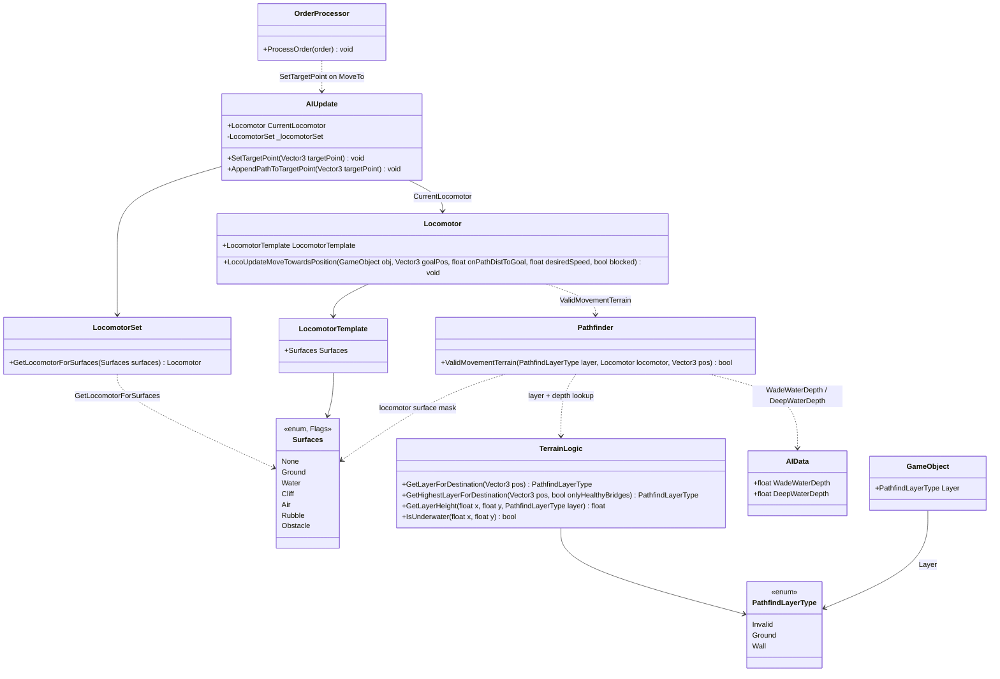
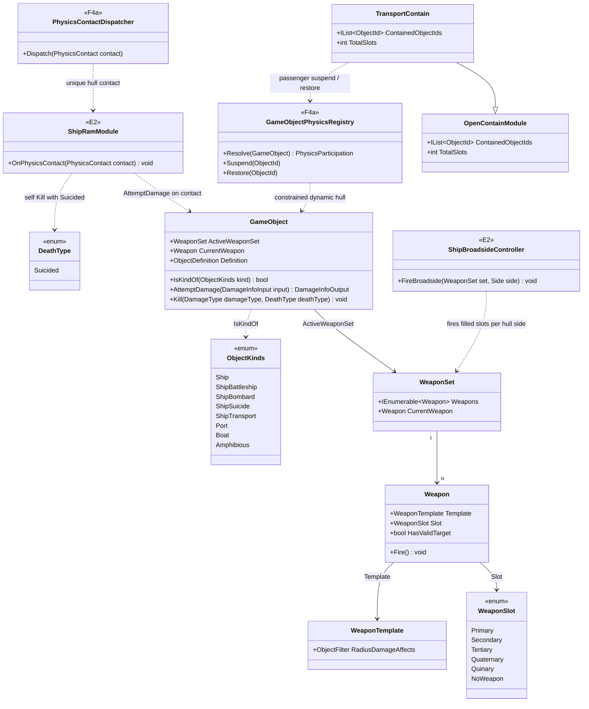
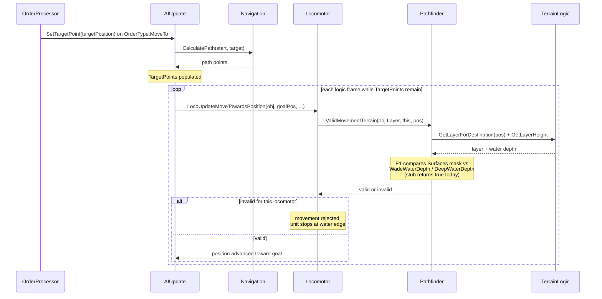
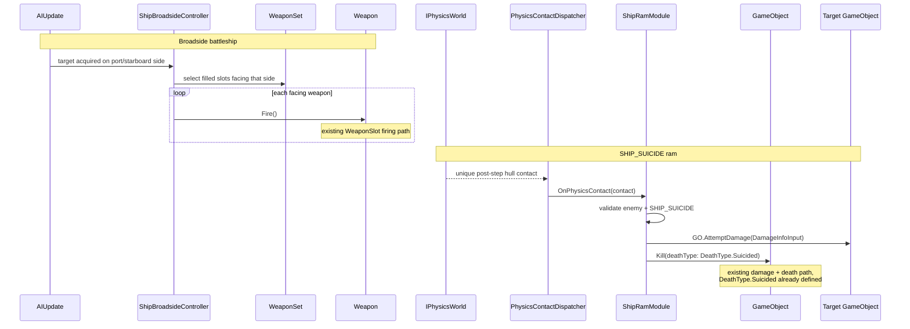

# Deep Dive: Naval Warfare (E1/E2)

> Expands phases E1 and E2 of [Track E: Naval Warfare](../track-e-naval-warfare.md). Part of
> the [Large-Scale Simulation Roadmap](../README.md).
>
> Audience: human overview of the naval-warfare design. Code references are in the
> agent-context appendix at the bottom.
>
> The agent-context section at the bottom ([Current code appendix](#appendix-current-code-agent-context))
> contains file:line code references. Skip it if reading for design intent.

Purpose: complete water/ground movement and ship combat using existing BFME2 naval content. The
design focuses on terrain passability, ship weapons, and port production rather than new content.

---

## 1. Scope and non-goals

- In scope: real water/ground terrain-passability distinction in the pathfinder, ship weapon and
  turret combat (broadside and bow-mounted), F4a Bepu hull contacts and simple water-plane support,
  shipyard/port production gated to water-adjacent tiles, and a reference scenario proving it
  end-to-end.
- Out of scope, deferred: full hydrodynamics, waves/weather-driven sea states,
  amphibious-assault choreography beyond the existing `AMPHIBIOUS` kind, and any new external ship
  models. E1-E4 validate with the existing BFME2 `SHIP_*` reference content, or W3D placeholders,
  before any Track C/ModCollector content is needed.
- This is content and a missing structural seam within the existing RTS domain, not a new
  Simulation Domain Model. See the [domain-scope Decision](../open-questions.md).

---

## 2. Design

### 2.1 Water/ground pathfinding (finishing the stub)

Today, `TerrainLogic.GetLayerForDestination` and `GetHighestLayerForDestination` always return
`PathfindLayerType.Ground`, and `Pathfinder.ValidMovementTerrain` always returns `true`. There is no
code path that distinguishes water from ground. Meanwhile, `Locomotor.Surfaces` already has a
`Water` bit, `AIData` already parses `WadeWaterDepth` and `DeepWaterDepth`, and `Locomotor` already
tracks an `OverWater` flag for visual effects. E1 wires those pieces together:

- `TerrainLogic` gains real per-cell water depth, derived from the heightmap versus the existing
  water-plane data already used for rendering, and returns the correct `PathfindLayerType` for a
  position instead of hardcoded `Ground`.
- `Pathfinder.ValidMovementTerrain` checks the locomotor's `Surfaces` mask against the cell's real
  water depth. A `Water`-only locomotor is invalid on dry land. A `Ground`-only locomotor is invalid
  past `DeepWaterDepth`, already parsed but unused for this purpose. Shallow water between
  `WadeWaterDepth` and `DeepWaterDepth` remains enterable by ground units without the `Water`
  surface bit.
- This is a correctness fix to an existing seam. The `PathfindLayerType`/`Locomotor.Surfaces`
  contract already implies this behavior, so no new engine concept is introduced.

### 2.2 Ship combat

Ship `ObjectDefinition`s already carry weapon slots through the existing weapon-set system. F4a
classifies ships as constrained dynamic bodies, maps their hull geometry through the shared
physics registry, and uses E1 water height for vertical support/damping while locomotors command
horizontal movement. E2 adds the two ship-specific combat pieces:

- Multi-mount broadside weapons: a ship fires several weapons simultaneously from different
  hull-relative bones on port and starboard sides, reusing the existing multi-weapon-slot mechanism
  with new bone-facing rules rather than a new weapon type.
- Ram/collision damage for `SHIP_SUICIDE` objects: a contact-triggered self-destruct damage
  application. No kamikaze or suicide update module exists in the engine today, so this is a new
  module built on the existing `GameObject.AttemptDamage` and `Kill(DeathType.Suicided)` path.
  `DeathType.Suicided` and `ObjectFilterRule.Suicide` already exist. The module is a generalized
  shared mechanism, not naval-only behavior. It consumes the unique post-step contact record from
  F4a rather than partition overlap.

`SHIP_TRANSPORT` reuses the existing container/garrison transport module. The `ObjectKind` flag
already exists. E2 confirms containment does not assume land-only movement and calls F4a's standard
body suspension/restoration transition for passengers.

### 2.3 Naval production (`PORT`)

The `PORT` `ObjectKind` building follows the existing production-queue/build-prerequisite pattern,
like any factory, with one addition: build placement and rally points must resolve to a water-adjacent
or water tile by using E1's terrain-passability data instead of today's land-only placement check.

---

## 3. Sequencing notes

- E1 depends on Track P so the pathfinding fix is validated against a working match loop rather than
  a partial one. It does not depend on Track C or ModCollector and can be built and tested with
  BFME2's existing `SHIP_*` reference content.
- E2 depends on E1 and F4a. E1 supplies water occupancy/height; F4a supplies the constrained-dynamic
  hull, filtering, contain/release transition, and unique contact record.
- E3 depends on E1 because it needs water-adjacency placement checks, but not on E2.
- E4 depends on E2 and E3. It is the integration proof, authored and asserted through ReplaySketch
  using the [P0 harness](p0-playable-baseline-harness.md) pattern.

---

## Architecture Diagrams

Types carry a stereotype when they are E1 or E2 deliverables rather than existing code. `<<E1>>`
and `<<E2>>` mark members or types that phase E1/E2 adds or changes; everything else exists today in
`src/OpenSage.Game`. The design rationale lives in [section 2](#2-design); these diagrams show
structure and flow only.

### Movement and terrain types

E1 finishes an existing seam: `Pathfinder.ValidMovementTerrain` returns `true` and
`TerrainLogic.GetLayerForDestination` returns `PathfindLayerType.Ground` unconditionally today.
The signatures below are the current ones; the `<<E1>>` notes mark the bodies E1 replaces.

Notes:

- `Pathfinder.ValidMovementTerrain`: E1 replaces the `return true` stub with a check of the
  locomotor's `Surfaces` mask against the cell water depth, using `AIData.WadeWaterDepth` and
  `AIData.DeepWaterDepth` (parsed today, unused for movement).
- `TerrainLogic.GetLayerForDestination` / `GetHighestLayerForDestination`: E1 replaces the hardcoded
  `PathfindLayerType.Ground` return with real per-cell resolution derived from the heightmap versus
  water-plane data already used by `IsUnderwater`.
- `PathfindLayerType` has no water-specific value; E1 constrains water movement through the
  `Surfaces` mask plus depth, not a new layer enum value.

### Ship combat and transport types

E2 reuses the existing weapon-set and container modules. Broadside coordination and the
`SHIP_SUICIDE` ram are the two `<<E2>>` deliverables; no existing kamikaze update module exists to
subclass, so the ram is a new module that reuses `GameObject.AttemptDamage` and `DeathType.Suicided`.

Notes:

- Broadside: `WeaponSet` already holds up to `WeaponSlot.Primary` through `Quinary` filled slots
  (`WeaponSet._weapons`). E2 adds the coordination that fires several slots from port/starboard hull
  bones; it does not add a weapon type.
- `SHIP_TRANSPORT`: `TransportContain` already derives from `OpenContainModule`. E2 uses F4a's
  common suspend/restore lifecycle when passengers enter and leave.
- Ram: `DeathType.Suicided` and `ObjectFilterRule.Suicide` exist, but there is no kamikaze update
  module in `src/`. `ShipRamModule` is an E2 deliverable that applies damage through the existing
  `GameObject.AttemptDamage` path and self-destructs via `Kill(deathType: DeathType.Suicided)`.
  F4a supplies the contact once; E2 owns the gameplay effect.

### Move order onto water

The flow from a move order to constrained movement, showing where E1 replaces stubs. Participants
are existing types; the `<<E1>>` notes mark replaced behavior.

### Ship broadside and ram

The two E2 combat behaviors. Both entry points (`ShipBroadsideController`, `ShipRamModule`) are E2
deliverables; the collaborators they call are existing types.

---

## Appendix: Current code (agent context)

- `src/OpenSage.Game/Terrain/TerrainLogic.cs:88,97`: `GetLayerForDestination`/
  `GetHighestLayerForDestination` unconditionally return `PathfindLayerType.Ground`; this is the
  stub E1 replaces with real water/ground resolution.
- `src/OpenSage.Game/Logic/AI/Pathfinder.cs:22-26`: `ValidMovementTerrain` unconditionally
  returns `true` (`// TODO(Port): Implement this.`); this is the stub E1 implements against
  locomotor surface + water depth.
- `src/OpenSage.Game/Logic/Object/LocomotorTemplate.cs:655-670`: `Surfaces` enum already has
  `Ground`/`Water`/`Cliff`/`Air` bits; E1 makes `Water` actually constrain movement.
- `src/OpenSage.Game/Logic/Object/Locomotor.cs:1336-1354`: existing `OverWater` flag/model
  condition tracking, visual-only today; E1's terrain data should drive this rather than each side
  computing water state independently.
- `src/OpenSage.Game/Logic/AI/AIData.cs:84,105,222,256`: `WadeWaterDepth`/`DeepWaterDepth`
  already parsed from INI but unused for movement validation; E1 is their first real consumer.
- `src/OpenSage.Game/Logic/Object/ObjectKinds.cs`: existing `SHIP`, `SHIP_BATTLESHIP`,
  `SHIP_BOMBARD`, `SHIP_SUICIDE`, `SHIP_TRANSPORT`, `PORT`, `BOAT`, `AMPHIBIOUS` kinds
  (`AddedIn(SageGame.Bfme2)`/`Bfme2Rotwk`), the reference content E1-E4 validate against. No new
  `ObjectKind` values are needed for the initial reference scenario.
- `src/OpenSage.Physics/` and `docs/roadmap/plans/physics-seam.md`: the Bepu seam exists in
  proof-of-concept form; F4a adds ship classification, water support, filtering, lifecycle, and
  contact dispatch before E2 consumes it.
- `src/OpenSage.Game/Logic/Object/Update/DockUpdate.cs`: existing dock/approach-position pattern
  used today for supply trucks; E3's `PORT` production building placement check follows the same
  module structure, distinct from this supply-specific behavior.
