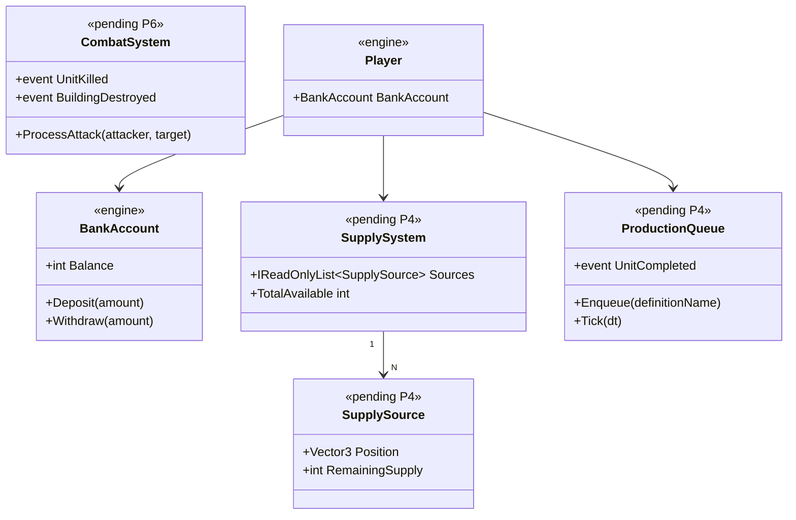

# Deep Dive: Economy & Combat Verification (P4 & P6)

> Expands phases P4 (economy loop) and P6 (combat & command) of
> [Track P — Playable Baseline](../track-p-playable-baseline.md). Part of the
> [Large-Scale Simulation Roadmap](../README.md).
>
> P5 (construction/production mechanism) is covered in [`skirmish-ai.md`](skirmish-ai.md) §1.4/§2.4,
> since the AI drives it. This document covers the economy loop (P4) and combat/command (P6).
>
> Audience: human overview of the P4/P6 verification design.

---

## P4 — Economy loop end-to-end

Purpose: verify and complete the full money loop: harvest/supply collection → deposit to
`BankAccount` → fund construction and production → spend. The design closes gaps in
supply-truck/worker/dozer cycles and power.

### Current code (grounded) — mostly present
- Money state: `BankAccount.Withdraw(...)` (`Logic/BankAccount.cs:22-38`) and `Deposit(...)`
  (`:41-60`); `Deposit` records income via `Player.AcademyStats.RecordIncome()`.
- Wiring: `Player` holds `public readonly SupplyManager SupplyManager;` and
  `public readonly BankAccount BankAccount;`, initialized in the ctor (`Logic/Player.cs:22,73,185-186`).
- Gather → deposit: `SupplyCenterDockUpdate.cs`, `SupplyWarehouseDockUpdate.cs`,
  `SupplyTruckAIUpdate.cs` (full harvester loop in `SupplyAIUpdate.cs:8-258`); money credits through
  `BankAccount.Deposit(...)` with no separate economy service.
- Power model: `Player.GetEnergy(allGameObjects)` sums owned `EnergyProduction` (`Player.cs:92-104`);
  a `_hasInsufficientPower` field exists (`Player.cs:41`), but the full power loop is unconfirmed.
- Funding gap: the audit could not confirm that construction and production debit `BankAccount`.
  Verify this in `ProductionUpdate` and the build/queue path, and add it if missing.

### Design (verify & close)
1. Prove the full cycle end-to-end with a [P0 harness](playable-baseline-harness.md) scenario:
   harvester gathers → `BankAccount` balance rises → a queued unit/structure debits the balance →
   spend is blocked when funds are insufficient. Assert money is never negative, a P7 invariant.
2. Confirm or implement the debit: ensure `ProductionUpdate.QueueProduction/QueueUpgrade`
   (`ProductionUpdate.cs:472-525`) and the build path (`OrderProcessor.BuildObject`,
   `OrderProcessor.cs:96-121`) withdraw via `BankAccount.Withdraw(...)`, with refund on cancel
   (`CancelProduction`/`CancelUpgrade`, `ProductionUpdate.cs:497-549`).
3. Power loop: confirm `_hasInsufficientPower` is driven by `GetEnergy` vs. consumption and that
   low power has the intended effect, production slowdown or disabled structures. Implement if absent.

### P4 sub-phases
| Phase | Goal | Status |
|---|---|---|
| P4-1. Gather→deposit verification | Prove harvest/supply credits `BankAccount` for the baseline factions (harness scenario + assertions). | Not started |
| P4-2. Spend/debit verification | Confirm construction/production/upgrade debit `BankAccount`, with cancel refunds; implement if missing. | Not started |
| P4-3. Power loop | Confirm/implement energy production vs. consumption and its effect (`_hasInsufficientPower`). | Not started |

---

## P6 — Combat & command verification

Goal: confirm that the player can select units and issue move/attack/build/ability orders through the
control bar end-to-end, and that weapon/damage-type/death paths cover the units a baseline match
uses. Fill the gaps surfaced by P7's match run.

### Current code (grounded) — mostly present, with gaps
- Selection & command path: `SelectionSystem.cs`, `OrderGeneratorInputHandler.cs`,
  `Mods.Generals/Gui/GeneralsControlBar.cs` — the UI/control-bar → order-generation → dispatch path.
- Order generation: `OrderGenerator` base (`Logic/OrderGenerators/OrderGenerator.cs:12-33`);
  command generators read selection + world position before creating `Order`s; dispatch via
  `NetworkMessageBuffer.Tick` → `OrderProcessor.Process` (`OrderProcessor.cs:42-566`).
- Combat model: `Logic/Object/Weapon/Weapon.cs`, `WeaponTemplate.cs`,
  `Logic/Object/Damage/DamageModule.cs`, `Logic/Object/Body/ActiveBody.cs`,
  `Logic/Object/Update/FireWeaponUpdate.cs`, `Logic/Object/Update/DamageFieldUpdate.cs`.
- Death: `GameObject.Kill()/OnDie()/Destroy()`; death behaviors invoked from `OnDie(...)`.
- Gaps the audit flagged: no central combat-result event bus; the full command-button → `OrderType`
  → processor path is not verified for every control-bar action; damage/health edge cases such as
  selection invalidation on death and ownership cleanup are unverified.

### Design (verify & close)
1. Command coverage matrix: enumerate the control-bar actions a baseline match uses — move, attack,
   force-attack, build, produce, sell, repair, ability/special-power, rally point — and verify each
   maps button → `OrderType` → a real `OrderProcessor` handler. The handled set is already known in
   `OrderProcessor.cs:42-566`. Author each as a [P0 harness](playable-baseline-harness.md) command and
   assert the effect.
2. Combat coverage: verify weapon fire → `DamageModule` → `ActiveBody` health → `Kill/OnDie` for
   the unit/damage-type set the baseline factions field. Assert kills, death cleanup, and selection
   invalidation on death.
3. Death cleanup: ensure dying objects are removed from selection and owner tracking. This ties
   directly into the shared death notification used by [victory-defeat](victory-defeat.md) P3-4.

### P6 sub-phases
| Phase | Goal | Status |
|---|---|---|
| P6-1. Command coverage matrix | Map every baseline control-bar action to a verified `OrderType` handler; assert each via the harness. | Not started |
| P6-2. Combat coverage | Verify weapon→damage→health→death for baseline units/damage types; assert kills + cleanup. | Not started |
| P6-3. Death cleanup | Selection invalidation + owner-tracking removal on death; share P3-4's death event. | Not started |

---

## Integration surface
- P4: `BankAccount.Deposit/Withdraw`, `Player.SupplyManager`, `Supply*DockUpdate`/`SupplyAIUpdate`,
  `ProductionUpdate.QueueProduction/QueueUpgrade/Cancel*`, `OrderProcessor.BuildObject`,
  `Player.GetEnergy`/`_hasInsufficientPower`.
- P6: `SelectionSystem`, `OrderGeneratorInputHandler`, `GeneralsControlBar`, `OrderGenerator*`,
  `OrderProcessor.Process`, `Weapon`/`WeaponTemplate`/`DamageModule`/`ActiveBody`/`FireWeaponUpdate`,
  `GameObject.Kill/OnDie/Destroy` and the shared death event with P3-4.

## Sequencing & dependencies
- P4 and P6 both depend on P1 because players must already be spawned and related. P4 gates P2/P5,
  since the AI needs a working economy to spend. P6 is largely verification and can proceed once
  units exist.
- Both feed P7: P4 supplies the "money never negative" invariant, P6 the "no lost/duplicated units"
  invariant. Both are asserted through the [P0 harness](playable-baseline-harness.md).
- P6-3 shares the death notification introduced for [P3-4](victory-defeat.md). Coordinate them.

## Scenario Matrix

The P0-5b matrix runner validates P4 and P6 across faction × supply × order-type configurations.

### P4 — Economy loop

| Axis | Values | Notes |
|---|---|---|
| `faction` | `USA`, `GLA`, `China` | Each faction has different supply-unit types |
| `supplyDensity` | `sparse` (1 supply source), `normal` (2), `rich` (4) | Tests harvester loop under different supply loads |
| `startingMoney` | `low` (500), `normal` (10000) | Exercises production gating under money pressure |

Constraints: none (all 3×2×2 = 12 cells are valid).

Each cell runs a supply-harvester scenario through the P0 harness for a fixed frame count and asserts:
- `player.BankAccount >= 0` at every tick, the universal invariant.
- `player.money` increased from its starting value at least once, proving harvesting is running.
- At least one unit was produced, proving money was spent on production.

### P6 — Combat & command verification

| Axis | Values | Notes |
|---|---|---|
| `orderType` | `MoveTo`, `AttackObject`, `BuildObject`, `CreateUnit`, `SpecialPower` | The five gameplay-relevant order families |
| `faction` | `USA`, `GLA`, `China` | Order behavior and unit definitions vary per faction |

Constraints: none (all 5×3 = 15 cells are valid).

Each cell issues the given `OrderType` for a reference unit of the given faction and asserts
the expected observable effect: unit moves, target health decreases, building constructed,
unit spawns, or ability effect observed.

## Architecture Diagrams

Diagrams for these phases will be elaborated once P4/P6 move to active implementation. The
placeholder below captures the key economic and production types.

## Related
- Track overview: [`../track-p-playable-baseline.md`](../track-p-playable-baseline.md)
- Production mechanism + AI that spends: [`skirmish-ai.md`](skirmish-ai.md) (P2/P5)
- Death→defeat event shared with: [`victory-defeat.md`](victory-defeat.md) (P3)
- Harness for the assertions: [`playable-baseline-harness.md`](playable-baseline-harness.md) (P0)
- Architecture snapshot: [`../agent/current-state.md`](../agent/current-state.md)
